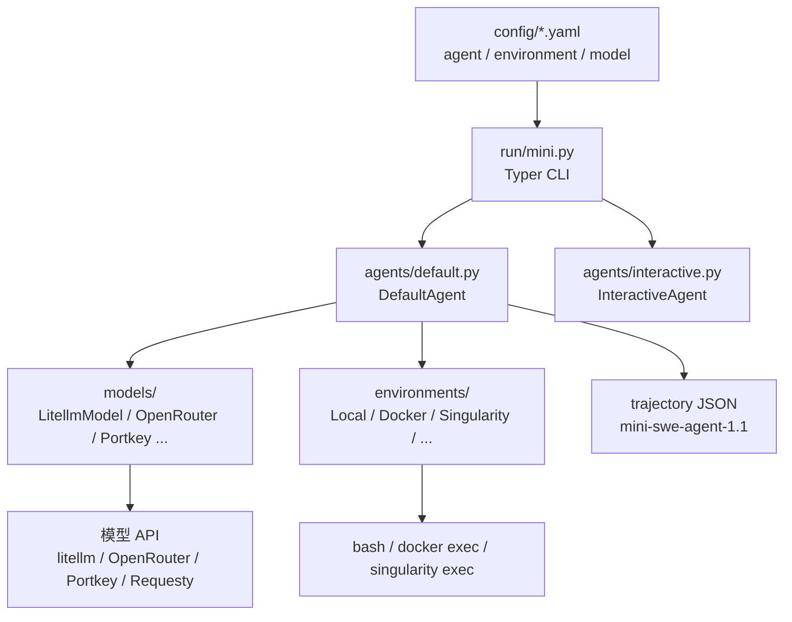

# 架构解剖：三个 Protocol 与 190 行主循环

> 本知识包锁定 v2.4.6（commit `04d809ce`）。`agents/default.py` 实测 190 行（非空 172，F-075），下面按真实代码结构拆。

## 1. 组件地图



三个核心 Protocol 定义在 `minisweagent/__init__.py`（F-044 的代码基础）：

| Protocol | 必须实现 | 职责 |
|---|---|---|
| `Model` | `query(messages)`、`format_message()`、`format_observation_messages()`、`get_template_vars()`、`serialize()` | 调模型、解析动作、把执行结果格式化成观察消息 |
| `Environment` | `execute(action, cwd)`、`get_template_vars()`、`serialize()` | 执行一条命令，返回 output/returncode/exception_info |
| `Agent` | `run(task)`、`save(path)` | 组织消息循环、限制、轨迹 |

这种拆分让“换模型”与“换沙箱”成为正交操作：Agent 不需要知道模型是 Claude 还是 GPT，也不需要知道命令跑在本地还是 Docker 里。

## 2. 主循环：run → step → query → execute_actions

```python
def run(self, task="", **kwargs):
    self.messages = []
    self.add_messages(system_message, user_message)
    while True:
        try:
            self.step()
            self.n_consecutive_format_errors = 0
        except FormatError as e:
            self.cost += ...          # 已计费仍累计
            self.n_consecutive_format_errors += 1
            ...
        except InterruptAgentFlow as e:
            self.add_messages(*e.messages)
        except Exception as e:
            self.handle_uncaught_exception(e)
            raise
        finally:
            self.save(self.config.output_path)
        if self.messages[-1].get("role") == "exit":
            break
    return self.messages[-1].get("extra", {})
```

（结构节选，非逐字复制；完整实现见 `default.py:88-124`，F-049。）

调用链只有四层：

1. `run(task)`：初始化 system + user 消息，循环调用 `step()`。
2. `step()`：`return self.execute_actions(self.query())`（F-050）。
3. `query()`：检查 step/cost/wall-time 限制 → `model.query(messages)` → 累计 cost → 追加 assistant 消息（F-051）。
4. `execute_actions(message)`：对每个 action 调 `env.execute` → `model.format_observation_messages` → 追加 observation（F-052）。

没有 planner、没有 executor、没有 memory manager、没有 tool registry。所谓“Agent 架构”在这里就是**一个带限制的 while 循环**。

## 3. 异常驱动的控制流

mini 用异常而不是返回值来表达“提前结束”（`exceptions.py`）：

| 异常 | 触发点 | 结果 |
|---|---|---|
| `Submitted` | 环境看到完成信号（F-055） | 追加 `role=exit`，正常结束 |
| `LimitsExceeded` | step 或 cost 超限（F-051） | 追加 `role=exit`，以 `LimitsExceeded` 结束 |
| `TimeExceeded` | wall-clock 超限（F-051） | 同上，`exit_status=TimeExceeded` |
| `FormatError` | 模型输出无法解析出恰好一个动作 | 追加错误提示；连续 3 次则 `RepeatedFormatError`（F-053） |
| `UserInterruption` | 用户在 confirm/human 模式中断（F-066） | 追加用户消息，继续或退出 |

异常都继承 `InterruptAgentFlow`，并携带要追加的消息。这样“错误”也进入同一条线性历史，模型下一轮能看到自己错在哪——这是 mini 不需要额外纠错状态机的关键。

## 4. 限制与成本

`AgentConfig` 的默认值（F-048）：

| 字段 | 默认 | 作用 |
|---|---|---|
| `step_limit` | 0（不限） | 最大步数 |
| `cost_limit` | 3.0 美元 | 超过即停（注意是 `<=` 触发，达到 3.0 就停） |
| `wall_time_limit_seconds` | 0（不限） | 墙钟时间上限 |
| `max_consecutive_format_errors` | 3 | 连续格式错误上限 |
| `output_path` | None | 轨迹保存路径 |

`query()` 在每次调模型前检查限制，`FormatError` 分支还会把已计费的成本补记（F-053）。这说明作者把“成本”当作一等公民：不是事后统计，而是循环的退出条件。

## 5. 序列化：轨迹就是消息

`serialize()` 产出（F-074）：

```json
{
  "info": {
    "model_stats": {"instance_cost": 0.42, "api_calls": 17},
    "config": {"agent": {...}, "agent_type": "..."},
    "mini_version": "2.4.6",
    "exit_status": "Submitted",
    "submission": "..."
  },
  "messages": [...],
  "trajectory_format": "mini-swe-agent-1.1"
}
```

`save()` 在每个 `finally` 都会写一次（F-049）。这意味着即使 Agent 崩溃，磁盘上也有一份到最后一步的轨迹——调试时不需要“复现崩溃”，直接看 JSON 即可。

## 6. 代码规模与文件职责

| 文件 | 行数 | 职责 |
|---|---|---|
| `agents/default.py` | 172 | 配置、主循环、限制、序列化 |
| `agents/interactive.py` | — | confirm/yolo/human 三模式与白名单 |
| `environments/local.py` | 80 | 本地 subprocess 执行、完成信号 |
| `environments/docker.py` | — | 容器生命周期与 `docker exec` |
| `models/litellm_model.py` | 147 | litellm 调用、成本、重试、缓存控制 |
| `models/utils/actions_toolcall.py` | — | bash tool schema 与 tool_call 解析 |
| `models/utils/actions_text.py` | — | 三反引号解析（v1 兼容） |
| `run/mini.py` | 86 | CLI 入口、配置加载、交互循环 |

全仓 `src/` 共 59 个 `.py`、5,349 行（非空 4,531）；测试 56 个文件、447 个 `def test_`（F-075、F-076）。所谓“100 行”指的是 Agent 核心，不是整个项目。

## 7. 读源码的顺序

1. `agents/default.py`：先看 `run()` 与 `step()`，建立主循环。
2. `environments/local.py`：看一条命令如何执行、如何判定完成。
3. `models/litellm_model.py` + `models/utils/actions_toolcall.py`：看模型输出如何变成 action。
4. `run/mini.py`：看 CLI 如何把 YAML、模型、环境装配起来。
5. `config/mini.yaml`：看默认提示词与截断策略。

这条顺序与官方 `control_flow.md` 一致，但补上了“配置如何进入循环”的一环。
