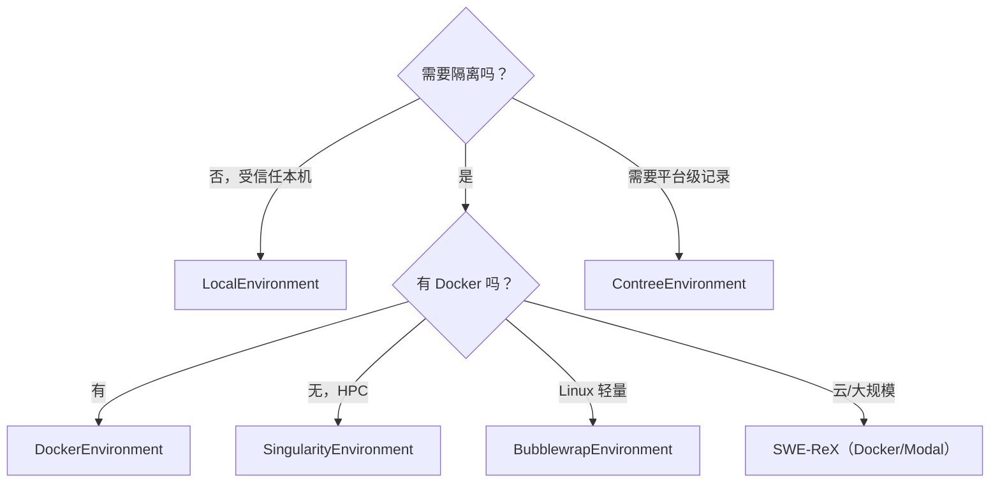

# 执行环境：从本地 subprocess 到容器与远程沙箱

> mini 的 Agent 不执行命令，**Environment 才执行**。同一套 Agent 循环，换一个 Environment 就从“在本机跑”变成“在 Docker/远程集群跑”，这是它最容易迁移的部分（F-043、F-057）。

## 1. 统一接口

所有环境都实现同一个方法：

```python
def execute(self, action: dict, cwd: str = "") -> dict:
    return {
        "output": "...",
        "returncode": 0,
        "exception_info": "",
    }
```

`action` 至少包含 `command`；工具调用模式下还带 `tool_call_id`（F-060）。Agent 只消费 `output` / `returncode` / `exception_info` 三个字段，因此环境可以任意替换。

## 2. 六类后端对照

| 环境类 | 执行方式 | 隔离级别 | 适用场景 | 证据 |
|---|---|---|---|---|
| `LocalEnvironment` | `subprocess.Popen(shell=True)` | 无隔离，直接跑在宿主 | 快速试用、受信任仓库 | F-054 |
| `DockerEnvironment` | 启动容器 + `docker exec` | 容器级隔离 | SWE-bench、批量评测、日常隔离 | F-056 |
| `SingularityEnvironment` | Singularity/Apptainer `exec` | 容器级隔离 | HPC 等无 Docker 环境 | F-057 |
| `BubblewrapEnvironment` | bubblewrap 沙箱 | 轻量非特权隔离（Linux） | 实验性、本机轻隔离 | F-057 |
| `ContreeEnvironment` | ConTree SDK | 平台级安全执行 | 需要 Git 式执行记录 | F-057 |
| `SwerexDockerEnvironment` / `SwerexModalEnvironment` | SWE-ReX 远程执行 | 远程容器/云 | 大规模训练、Modal 云 | F-057 |

> 博客只列了 Local/Docker/Singularity/Contree 四类（F-022），实际源码还有 bubblewrap 与 SWE-ReX 两族，读旧文时不要以为只有四种。

## 3. LocalEnvironment：最小实现

```python
process = subprocess.Popen(
    command, shell=True, text=True, cwd=cwd, env=os.environ | self.config.env,
    stdout=subprocess.PIPE, stderr=subprocess.STDOUT, start_new_session=(os.name == "posix"),
)
stdout, _ = process.communicate(timeout=timeout)
```

关键点（F-054）：

1. `shell=True`：模型写的是 shell 命令，不是 argv 数组。
2. `stderr=STDOUT`：错误输出与正常输出合并，模型能看到完整反馈。
3. `start_new_session=True`（POSIX）：超时时可以 `killpg` 杀整个进程组，避免子进程残留。
4. 默认 `timeout=30` 秒；超时抛 `TimeoutExpired`，输出仍会带回。
5. `env=os.environ | config.env`：宿主环境变量 + 配置覆盖，方便注入 API Key 或 `PAGER=cat` 之类。

### 完成信号

```python
lines = output["output"].lstrip().splitlines(keepends=True)
if lines and lines[0].strip() == "COMPLETE_TASK_AND_SUBMIT_FINAL_OUTPUT" and output["returncode"] == 0:
    submission = "".join(lines[1:])
    raise Submitted({...})
```

完成不是“模型说完了”，而是**环境看到一条特定命令且返回码为 0**（F-055）。这避免模型只在自然语言里声称“我修好了”，却不真正提交。

## 4. DockerEnvironment：容器生命周期

启动命令（F-056）：

```bash
docker run -d --name minisweagent-<8hex> -w <cwd> --rm <image> sleep 2h
```

执行时用 `docker exec`，默认 `bash -lc` 解释命令，30 秒超时。关键设计：

1. **容器名随机**：`minisweagent-` + 8 位 uuid，避免并发冲突。
2. **`sleep 2h` 保活**：容器不是跑完一条命令就退出，而是持续 2 小时供多步使用。
3. **`--rm` 自动清理**：进程退出后容器删除，减少磁盘泄漏。
4. **`cwd` 固定**：容器内工作目录由配置决定，不依赖上一条命令的 `cd`。

> 注意：Docker 容器提供的是**进程/文件系统隔离**，不是安全沙箱。模型仍可在容器内执行任意命令、访问挂载目录与网络。生产环境需要额外的网络策略、只读挂载、资源限制与审批层。

## 5. 如何选择



| 场景 | 推荐 | 理由 |
|---|---|---|
| 第一次试用 | Local | 零依赖，直接看循环 |
| 修真实仓库 | Docker | 隔离依赖与系统状态 |
| SWE-bench 批量 | Docker + `--workers` | 官方批处理默认走容器 |
| HPC 集群 | Singularity/Apptainer | 通常无 Docker 守护进程 |
| RL/大规模训练 | SWE-ReX + Modal | 远程执行、弹性扩缩 |
| 安全敏感 | 容器 + 网络/挂载限制 | mini 本身不做权限审批 |

## 6. 安全边界（必须写清）

mini 的设计把安全责任交给环境，而不是 Agent：

1. **无命令白名单**：Agent 不会拦截 `rm -rf`、`curl | sh` 等命令。
2. **无审批层**：默认 `mini` 是 `confirm` 模式，但 `-y/--yolo` 会跳过确认（F-065）；批量评测通常直接 yolo。
3. **无网络策略**：容器默认继承 Docker 网络；需要隔离时要自己加 `--network none` 或代理。
4. **无资源配额**：CPU/内存/磁盘限制要由容器运行时配置。

因此，**不要把 LocalEnvironment 用在不可信仓库或不可信模型输出上**。如果要做生产级安全，应该在 Environment 外层再加审批、网络代理、只读挂载与审计日志，而不是期待 mini 内置。

## 7. 一句话总结

Environment 是 mini 的“可替换执行层”：接口只有一个 `execute()`，但背后可以是本机 shell、Docker、HPC 容器或云端沙箱。选型的核心不是“哪个最强”，而是**隔离需求与运维成本**的平衡。
