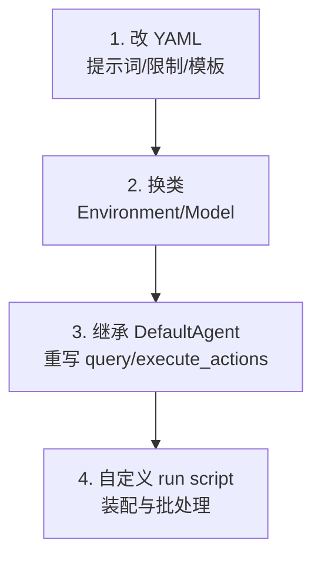

# 配置与扩展：三段式 YAML、Jinja 模板与子类化

> mini 的“可配置”集中在三块：`agent`（循环与提示词）、`environment`（执行）、`model`（调用）。没有插件系统、没有依赖注入容器，扩展靠 **YAML 覆盖 + Python 子类** 两招。

## 1. 三段式配置

v2 的配置结构（F-062）：

```yaml
agent:
  system_template: "..."
  instance_template: "..."
  step_limit: 0
  cost_limit: 3.
environment:
  cwd: "."
  timeout: 30
  env:
    PAGER: cat
model:
  model_name: "anthropic/claude-sonnet-4-5-20250929"
  observation_template: "..."
  format_error_template: "..."
  model_kwargs:
    drop_params: true
```

| 段 | 关键字段 | 作用 |
|---|---|---|
| `agent` | `system_template`、`instance_template`、`step_limit`、`cost_limit` | 提示词与循环限制 |
| `environment` | `cwd`、`timeout`、`env` | 执行目录、超时、环境变量 |
| `model` | `model_name`、`observation_template`、`format_error_template`、`model_kwargs` | 模型与观察格式 |

CLI 支持多个 `-c` 叠加与键值覆盖（F-062）：

```bash
mini -c mini.yaml -c model.model_kwargs.temperature=0.5
mini -c swebench.yaml -c agent.step_limit=100
```

> 注意：一旦使用 `-c`，就不会自动加载完整默认配置；要显式带上基础配置文件，再叠加覆盖。

## 2. 模板变量从哪来

`get_template_vars()` 按固定顺序做递归合并（F-051 的代码基础）：

```text
config.model_dump()
  ← env.get_template_vars()      # cwd/timeout/platform.uname()/环境变量
  ← model.get_template_vars()    # model_name 等
  ← {n_model_calls, model_cost, elapsed_seconds}
  ← extra_template_vars          # task 等运行期变量
  ← kwargs
```

因此模板里可以直接用：

| 变量 | 来源 | 示例 |
|---|---|---|
| `task` | `run(task)` 注入 | `请解决：{{task}}` |
| `system` / `release` / `machine` | `platform.uname()` | 在 macOS 上提示 `sed -i ''` |
| `n_model_calls` | Agent 计数 | 让模型知道第几步 |
| `model_cost` | 累计成本 | 提示预算 |
| `elapsed_seconds` | 墙钟 | 提示时间 |
| `cwd` / `timeout` | Environment 配置 | 提示工作目录 |

模板用 Jinja2 的 `StrictUndefined` 渲染：变量名写错会直接报错，而不是静默为空。这对调试友好，但改模板时要确保变量存在。

## 3. 观察截断：10,000 字符规则

默认观察模板（F-064）：

```jinja

<output>{{ output.output }}</output>

<output_head>{{ output.output[:5000] }}</output_head>
<elided_chars>{{ output.output | length - 10000 }} characters elided</elided_chars>
<output_tail>{{ output.output[-5000:] }}</output_tail>

```

设计意图：**保留头部（命令回显/错误开头）与尾部（测试结果/堆栈结尾），中间省略**。这样既不让超长输出撑爆上下文，也不丢失最关键的失败信息。

如果模型经常需要看中间段，应该在提示词里教它用 `sed -n`、`grep -n`、`head/tail` 自己缩小输出，而不是把截断阈值调大。

## 4. 轨迹格式

每次 `save()` 写出 `mini-swe-agent-1.1` 格式（F-074）：

| 字段 | 内容 |
|---|---|
| `info.model_stats.instance_cost` | 本次总成本 |
| `info.model_stats.api_calls` | 模型调用次数 |
| `info.config.agent` | Agent 配置快照 |
| `info.config.agent_type` | 类路径 |
| `info.mini_version` | 包版本 |
| `info.exit_status` | `Submitted` / `LimitsExceeded` / `TimeExceeded` / `RepeatedFormatError` 等 |
| `info.submission` | 完成信号后的提交内容 |
| `messages` | 完整线性历史 |
| `trajectory_format` | 固定字符串 |

这份 JSON 可以直接用于：复现（把 messages 交给另一个模型）、微调（取 assistant 动作）、审计（看每一步命令与返回码）、评测（统计步数/成本）。

## 5. InteractiveAgent：三种人机模式

`InteractiveAgent` 在 `DefaultAgent` 上加了三个模式（F-065、F-066）：

| 模式 | 行为 | 切换 |
|---|---|---|
| `confirm` | 模型提出动作，用户确认/拒绝/改写 | `/c` |
| `yolo` | 直接执行，不确认 | `/y` |
| `human` | 用户接管输入命令 | `/u` |

配置项：

```yaml
agent:
  mode: confirm
  whitelist_actions: ["^ls", "^cat", "^git status"]
  confirm_exit: true
```

`whitelist_actions` 是正则列表：匹配的动作不询问，直接执行。`confirm_exit` 控制“模型想结束时是否再确认一次”。这回答了一个常见误解：**mini 不是没有 HITL**，只是默认的 `DefaultAgent` 没有，CLI 用的是 `InteractiveAgent`。

## 6. 扩展的四个层次



### 6.1 只改配置

最常见：换模型、调 `cost_limit`、改系统提示、加环境变量。不需要写 Python。

### 6.2 换 Environment / Model

```python
from minisweagent.environments.docker import DockerEnvironment
from minisweagent.models.litellm_model import LitellmModel

agent = DefaultAgent(
    LitellmModel(model_name="gpt-4o"),
    DockerEnvironment(image="python:3.11"),
)
```

这是官方 cookbook 的“mix & match”方式（F-067、F-077）。

### 6.3 继承 Agent

官方 cookbook 给出的典型扩展是重写 `execute_actions`，把某些动作交给 Python 函数而不是 shell：

```python
class AgentWithPythonFunctions(DefaultAgent):
    def execute_actions(self, message):
        # 解析出 python 动作 → 本地函数；其余交给 env.execute
        ...
```

也可以重写 `query()` 加钩子（例如记录每步 token、注入额外上下文）。

### 6.4 自定义 run script

`run/` 下的 `hello_world.py`、`mini.py`、`benchmarks/swebench.py` 都是“装配示例”：读配置 → 建 model/env → 建 agent → 跑任务 → 保存轨迹。照抄一个改成自己的批处理即可。

## 7. 常见配置坑

| 现象 | 原因 | 处理 |
|---|---|---|
| 改了提示词不生效 | 用了 `-c` 但没带基础配置 | 显式 `-c mini.yaml -c 你的覆盖.yaml` |
| 模型一直格式错误 | 模型不支持 tool calling | 换 `litellm_textbased` 或换模型 |
| 输出被截断 | 超过 10,000 字符 | 让模型用 `sed/grep/head` 缩小输出 |
| 成本很快触顶 | 默认 `cost_limit=3.0` | 按单价调高，或限制 step |
| macOS 上 `sed -i` 失败 | BSD sed 需要空参数 | 默认模板已按 `system == Darwin` 提示 |
| 轨迹里没有 submission | 模型没发完成信号 | 检查 `COMPLETE_TASK_AND_SUBMIT_FINAL_OUTPUT` 是否单独一行 |

## 8. 一句话总结

mini 的扩展哲学是**“配置优先、子类兜底”**：能用 YAML 解决的绝不写代码；YAML 解决不了的，继承一个 172 行的类，重写一个方法即可。这比插件系统简单，但也意味着复杂扩展需要你理解主循环。
