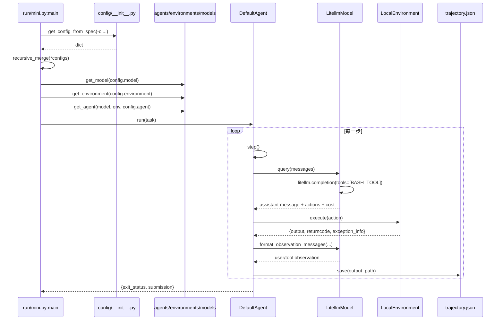

# 源码地图：模块、符号、调用链与扩展点

> 本文是 [02-architecture-and-code](02-architecture-and-code.md) 的下钻版：02 讲“架构是什么”，本文讲“代码在哪、叫什么、按什么顺序跑、改哪里”。所有行号基于 v2.4.6（commit `04d809ce`），新增事实编号 F-091 ~ F-100。

## 1. 源码树与规模

```text
src/minisweagent/
├── __init__.py            # 版本、全局配置目录、Model/Environment/Agent 三个 Protocol
├── __main__.py            # python -m minisweagent 入口
├── exceptions.py          # InterruptAgentFlow 及 5 个子类
├── agents/
│   ├── __init__.py        # Agent 注册表与 get_agent()
│   ├── default.py         # DefaultAgent + AgentConfig（190 行）
│   ├── interactive.py     # InteractiveAgent（209 行）
│   └── utils/prompt_user.py
├── config/
│   ├── __init__.py        # 配置路径解析、key=value 解析、YAML 加载
│   ├── default.yaml       # 文本模式默认配置
│   ├── mini.yaml          # CLI 默认配置（tool calling）
│   └── benchmarks/        # swebench / programbench 配置
├── environments/
│   ├── __init__.py        # Environment 注册表与 get_environment()
│   ├── local.py           # LocalEnvironment（92 行）
│   ├── docker.py          # DockerEnvironment（161 行）
│   ├── singularity.py     # SingularityEnvironment（139 行）
│   └── extra/             # bubblewrap / contree / swerex_*
├── models/
│   ├── __init__.py        # Model 注册表、get_model()、全局成本统计
│   ├── litellm_model.py   # tool calling 默认实现（164 行）
│   ├── litellm_textbased_model.py
│   ├── litellm_response_model.py
│   ├── openrouter_*.py / portkey_*.py / requesty_model.py
│   ├── test_models.py     # Deterministic 模型
│   └── utils/             # actions_*、retry、cache_control、multimodal
├── run/
│   ├── hello_world.py
│   ├── mini.py            # CLI 入口（109 行）
│   ├── benchmarks/        # swebench / swebench_single / programbench
│   └── utilities/         # config / inspector / mini_extra
└── utils/
    ├── log.py
    └── serialize.py       # UNSET + recursive_merge
```

规模口径（F-100）：`src/` 下 **59 个 `.py`，5,349 行（含空行），非空 4,531 行**。`default.py` 190 行（非空 172）、`local.py` 92（非空 80）、`litellm_model.py` 164（非空 147）、`run/mini.py` 109（非空 86）。

> 之前的“172 行”是**非空行**口径。写文档时要么写“190 行（非空 172）”，要么明确“非空”，否则会和 `wc -l` 对不上。

## 2. 模块职责与符号索引

| 文件（行数） | 关键符号与行号 | 职责 |
|---|---|---|
| `__init__.py`（92） | `Model` L43、`Environment` L61、`Agent` L73 | 定义三个 Protocol；加载全局 `.env`；暴露 `__version__` |
| `exceptions.py`（26） | `InterruptAgentFlow` L1、`Submitted` L9、`LimitsExceeded` L13、`TimeExceeded` L17、`UserInterruption` L21、`FormatError` L25 | 用异常携带“要追加的消息”，统一控制流 |
| `agents/__init__.py`（28） | `_AGENT_MAPPING`、`get_agent_class` L14、`get_agent` L25 | `default`/`interactive` 短名解析；深拷贝配置后实例化 |
| `agents/default.py`（190） | `AgentConfig` L19、`DefaultAgent` L38、`run` L88、`step` L126、`query` L130、`execute_actions` L154、`serialize` L159、`save` L182 | 主循环、限制、模板渲染、轨迹序列化 |
| `agents/interactive.py`（209） | `InteractiveAgentConfig` L24、`InteractiveAgent` L33、`query` L58、`step` L109、`execute_actions` L124、`_ask_confirmation_or_interrupt` L165 | confirm/yolo/human 三模式、白名单、退出确认、新任务注入 |
| `config/__init__.py`（64） | `get_config_path` L12、`_key_value_spec_to_nested_dict` L31、`get_config_from_spec` L56 | 配置查找顺序与 `key=value` 解析（F-093） |
| `environments/__init__.py`（33） | `_ENVIRONMENT_MAPPING`、`get_environment_class` L19、`get_environment` L30 | 7 类环境短名解析（F-092） |
| `environments/local.py`（92） | `LocalEnvironmentConfig` L13、`execute` L24、`_check_finished` L45、`_run` L72 | 本机 subprocess、超时杀进程组、完成信号 |
| `environments/docker.py`（161） | `DockerEnvironmentConfig` L15、`_start_container` L74、`execute` L101、`_check_finished` L140、`cleanup` L153 | 容器生命周期、`docker exec`、完成信号 |
| `models/__init__.py`（113） | `GlobalModelStats` L13、`get_model` L45、`get_model_name` L65、`get_model_class` L92 | 模型注册表、全局成本/调用上限（F-091 之外的模型装配） |
| `models/litellm_model.py`（164） | `LitellmModelConfig` L27、`_query` L64、`query` L81、`_calculate_cost` L108、`_parse_actions` L128 | tool calling、重试、成本、FormatError 持久化（F-095） |
| `models/utils/actions_toolcall.py`（113） | `BASH_TOOL` L9、`parse_toolcall_actions` L30、`format_toolcall_observation_messages` L79 | bash tool schema 与 tool_call 校验（F-096） |
| `models/utils/actions_text.py`（70） | `parse_regex_actions` L15、`format_observation_messages` L43 | v1 三反引号解析 |
| `run/mini.py`（109） | `main` L55 | CLI 参数 → 配置合并 → 装配 → `agent.run`（F-094） |
| `run/benchmarks/swebench.py`（275） | `get_swebench_docker_image_name` L68、`get_sb_environment` L79、`process_instance` L122、`main` L202 | 批量评测、每实例环境、preds 写入（F-098） |
| `utils/serialize.py`（29） | `UNSET`、`recursive_merge` L6 | 配置与轨迹的递归合并（F-097） |

## 3. 一次运行的真实调用链



对应的精确顺序（`agents/default.py`）：

1. `run` L88：`messages = []`，追加 system + user，进入 `while True`。
2. `step` L126：`execute_actions(query())`。
3. `query` L130：先检查 `step_limit`/`cost_limit`/`wall_time_limit_seconds`，再 `model.query`，累计 `cost`，`add_messages(message)`。
4. `execute_actions` L154：对 `message.extra.actions` 逐个 `env.execute`，再 `model.format_observation_messages`，`add_messages(*observations)`。
5. `finally`（L120）：每步 `save(self.config.output_path)`。
6. 退出条件：`messages[-1]["role"] == "exit"`（L122）。

## 4. 五类数据契约

### 4.1 message

```python
{"role": "system" | "user" | "assistant" | "exit",
 "content": str | list,
 "extra": {...}}   # 仅内部使用，发给模型前会被剥离
```

`_prepare_messages_for_api` 会过滤 `extra`（F-095），所以 `extra` 可以安全存放成本、响应原文、动作等调试信息。

### 4.2 action

```python
{"command": "ls -la", "tool_call_id": "call_..."}   # tool calling
{"command": "ls -la"}                              # textbased
```

`tool_call_id` 只在 tool calling 模式下存在，用于把 observation 关联回对应的 tool call（F-096）。

### 4.3 output

```python
{"output": "...", "returncode": 0, "exception_info": ""}
```

环境层统一返回这三个字段；异常时 `returncode=-1`，并附 `extra.exception_type` / `extra.exception`（F-054）。

### 4.4 config

```python
{"agent": {...}, "environment": {...}, "model": {...}, "run": {...}}
```

`run` 段只用于 CLI/批处理（如 `task`、`env_startup_command`），不会传给 `AgentConfig`。`recursive_merge` 会跳过 `UNSET` 哨兵，后写覆盖先写（F-097）。

### 4.5 trajectory

```python
{"info": {"model_stats": {...}, "config": {...}, "mini_version": "2.4.6",
          "exit_status": "...", "submission": "..."},
 "messages": [...],
 "trajectory_format": "mini-swe-agent-1.1"}
```

`serialize` L159 负责组装，`save` L182 负责写盘。批处理还会在 `finally` 里补 `instance_id`、`traceback` 等字段（F-098）。

## 5. 三个注册表与装配顺序

| 注册表 | 位置 | 短名 | 默认 |
|---|---|---|---|
| Agent | `agents/__init__.py` | `default`、`interactive` | CLI 用 `interactive`，库调用用 `default` |
| Environment | `environments/__init__.py` | `docker`、`singularity`、`local`、`swerex_docker`、`swerex_modal`、`bubblewrap`、`contree` | `local`（F-092） |
| Model | `models/__init__.py` | 10 项（见 04 篇） | `LitellmModel` |

装配顺序（`run/mini.py` L55 起，F-094）：

1. `configure_if_first_time()`：首次运行引导配置。
2. `configs = [get_config_from_spec(spec) for spec in config_spec]`。
3. 追加 CLI 覆盖：`task`、`agent_class`、`mode=yolo`、`cost_limit`、`confirm_exit`、`output_path`、`model_class`、`model_name`、`environment_class`。
4. `config = recursive_merge(*configs)`。
5. 若 `run.task` 是 `UNSET`，用 `_multiline_prompt()` 交互输入。
6. `model = get_model(config=config["model"])`。
7. `env = get_environment(config["environment"], default_type="local")`。
8. `agent = get_agent(model, env, config["agent"], default_type="interactive")`。
9. `agent.run(run_task)`，最后打印轨迹路径。

> 关键细节：`-c` 一旦出现，Typer 的默认值 `[mini.yaml]` 会被替换，不会自动叠加默认配置。这是 `run/mini.py` 里 `config_spec` 参数的默认值语义，不是 bug（F-094）。

## 6. 异常与退出状态矩阵

| 异常（行号） | 触发 | `exit_status` | 是否继续循环 |
|---|---|---|---|
| `Submitted` L9 | 环境看到完成信号 | `Submitted` | 否（追加 exit） |
| `LimitsExceeded` L13 | step/cost 超限 | `LimitsExceeded` | 否 |
| `TimeExceeded` L17 | wall-clock 超限 | `TimeExceeded` | 否 |
| `FormatError` L25 | 输出无法解析为动作 | 连续 3 次后 `RepeatedFormatError` | 是（前两次） |
| `UserInterruption` L21 | 用户 Ctrl-C / 拒绝 | 不直接退出 | 是（追加用户消息） |
| 其它 `Exception` | 未捕获错误 | 异常类名 | 否（`handle_uncaught_exception` 后重新抛出） |

`run` L99-L118 的处理顺序很关键：`FormatError` 先累计已计费成本，再决定是否升级为 `RepeatedFormatError`；`InterruptAgentFlow` 只追加消息；其它异常先写一条 exit 消息再抛出，保证轨迹不丢。

## 7. 扩展点地图

| 想做的事 | 改哪里 | 具体做法 |
|---|---|---|
| 换模型 | `model.model_name` / `model.model_class` | YAML 即可；特殊 provider 继承 `LitellmModel` |
| 换执行环境 | `environment.environment_class` | 短名或完整类路径；自定义类实现 `execute` |
| 改提示词 | `agent.system_template` / `instance_template` | Jinja2，可用 `task`/`system`/`cost` 等变量 |
| 加动作类型 | 继承 `DefaultAgent.execute_actions` | 先分流非 bash 动作，其余交给 `env.execute` |
| 加确认/审批 | 继承 `InteractiveAgent` | 重写 `_should_ask_confirmation` 或 `whitelist_actions` |
| 改观察格式 | `model.observation_template` | 默认截断 10,000 字符（F-064） |
| 加成本策略 | 继承 `LitellmModel._calculate_cost` | 或设 `cost_tracking: ignore_errors` |
| 加批处理 | 抄 `run/benchmarks/swebench.py` | `process_instance` + `update_preds_file` + 进度管理器 |
| 加轨迹分析 | 读 `trajectory_format` | `messages` 即完整轨迹；`info` 有成本/退出状态 |

## 8. 测试地图

`tests/` 共 56 个文件（53 个 `.py` + 3 个 `.json`），**447 个 `def test_`**（F-099）。重点文件：

| 测试文件 | 行数 | 用例 | 覆盖 |
|---|---|---|---|
| `tests/agents/test_interactive.py` | 1,256 | 36 | 三模式、确认、白名单、退出、Ctrl-C |
| `tests/agents/test_default.py` | 544 | 18 | 主循环、限制、格式错误、序列化 |
| `tests/run/test_swebench.py` | 562 | 27 | 批处理、preds、过滤、切片、并发 |
| `tests/run/test_cli_integration.py` | 649 | 20 | CLI 参数、配置合并、端到端 |
| `tests/models/test_format_error_response_persistence.py` | 529 | 16 | FormatError 时成本/响应持久化 |
| `tests/environments/test_local.py` | 264 | 18 | subprocess、超时、完成信号 |
| `tests/environments/test_docker.py` | 230 | 11 | 容器生命周期、exec、清理 |
| `tests/config/test_init.py` | 139 | 29 | 配置路径、key=value、合并 |

想验证自己的改动，优先跑对应目录：`pytest tests/agents/test_default.py -q`。

## 9. 调试路线：从一条轨迹反推

1. 打开 `*.traj.json`，先看 `info.exit_status`：`Submitted` / `LimitsExceeded` / `TimeExceeded` / `RepeatedFormatError`。
2. 看 `info.model_stats`：`api_calls` 与 `instance_cost` 是否触顶。
3. 沿 `messages` 找最后一条 `assistant`：它的 `extra.actions` 是最后一次尝试。
4. 看紧随其后的 observation：`returncode` 与 `output` 是失败原因。
5. 如果是 `FormatError`，看 `extra.response` 保存的原始响应（F-095）。
6. 如果是 `Submitted` 但结果不对，看 `submission` 与最后几条命令，判断是否“假完成”。
7. 需要复现：把 `messages` 交给同一个模型/同一个环境，重放最后一步。

## 10. 源码阅读顺序（按行号）

| 顺序 | 文件 | 读什么 |
|---|---|---|
| 1 | `agents/default.py` L88-L157 | `run` → `step` → `query` → `execute_actions` |
| 2 | `exceptions.py` L1-L26 | 六个异常如何携带消息 |
| 3 | `environments/local.py` L24-L80 | 一条命令如何执行、如何判定完成 |
| 4 | `models/litellm_model.py` L64-L136 | 模型调用、重试、成本、动作解析 |
| 5 | `models/utils/actions_toolcall.py` L9-L78 | bash tool schema 与校验 |
| 6 | `run/mini.py` L55-L109 | CLI 如何装配三个组件 |
| 7 | `config/__init__.py` L12-L63 | 配置查找与 `key=value` 解析 |
| 8 | `run/benchmarks/swebench.py` L68-L179 | 批处理如何为每个实例建环境、存轨迹 |
| 9 | `tests/agents/test_default.py` | 用测试反推边界条件 |

## 11. 一句话总结

源码层只有四个动作：**查限制 → 问模型 → 执行动作 → 追加观察**；其余 5,000 行都是围绕这四个动作的注册、配置、环境适配、序列化与测试。把 `default.py` 的 70 行主循环读透，再看任何扩展都只是“在四个动作之间插钩子”。
