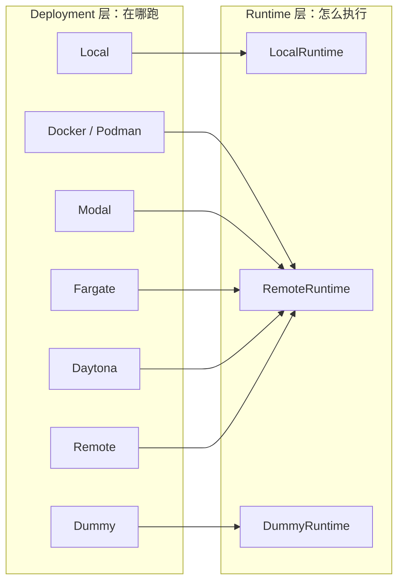

# SWE-ReX 项目总览：给 Agent 一个可替换的 shell 后端

SWE-ReX 是 SWE-agent 团队从 coding agent 评测实践中抽出的**执行后端**：它不决定 agent 怎么想，只负责把“在某台机器/某个容器里跑一条 shell 命令、拿回输出和退出码、保持会话状态”这件事做成稳定接口。换部署（本地、Docker、Modal、Fargate、Daytona、远程服务器）时，agent 侧代码不变。

## 一句话定位

> 你的 agent 写 `runtime.run_in_session(...)`；SWE-ReX 负责这句话最终落在本机、容器还是云沙箱里。

官方描述是 “a runtime interface for interacting with sandboxed shell environments”（`README.md` 第12行，F-094）。三个关键词：runtime interface、sandboxed、shell。

## 它解决的具体问题

| 问题 | 没有 SWE-ReX 时 | SWE-ReX 的做法 | 事实 |
|---|---|---|---|
| 命令何时结束 | 自己解析输出、猜提示符 | pexpect + 固定 PS1 哨兵 | F-052、F-053 |
| 退出码 | 从文本里猜 | 旁路 `echo EXITCODESTART$?EXITCODEEND` | F-053 |
| 交互式工具 | 只能跑一次性命令 | `is_interactive_command` + `expect` | F-042、F-055 |
| 多会话状态 | 自己维护多个 shell | `dict[str, Session]`，按名字隔离 | F-049、F-051 |
| 换执行环境 | 重写执行层 | Deployment 只换生命周期，Runtime 契约不变 | F-017、F-039、F-098 |
| 远程异常 | 压平成字符串 | 511 + `class_path` 反射重建 | F-047、F-065、F-076 |
| 文件进出沙箱 | 自己搭传输 | `read_file`/`write_file`/`upload`，目录自动 zip | F-046、F-068 |

## 谱系

SWE-ReX 来自 SWE-agent 与 SWE-agent enigma 的工程经验（`README.md` 第25行，F-095）。同团队生态包括 SWE-agent、mini-SWE-agent、SWE-smith、SWE-bench、CodeClash、sb-cli（README 第62-72行的生态链接）。它与 mini-SWE-agent 的关系容易误解：mini-SWE-agent 用极简的本地 subprocess 执行，SWE-ReX 则是把执行层做成可替换基础设施；两者都服务于“coding agent 跑命令”，但抽象层级不同。

## 版本与规模（快照）

| 项 | 值 | 来源 |
|---|---|---|
| 包版本 | `1.4.0` | `src/swerex/__init__.py:1`（F-006） |
| 快照描述 | `v1.4.0-18-g5c995c3` | `git describe`（F-007） |
| 固定 commit | `5c995c3`（2026-03-02） | F-007 |
| Python 文件 / 行数 | 29 / 3,715（非空 3,052） | F-009 |
| 测试文件 / 用例 | 13 / 89 | F-011 |
| HTTP 路由 | 10 | F-077 |
| 部署配置 / 运行时实现 | 7 / 3 | F-035、F-071 |

> `CHANGELOG.md` 最新只到 1.2.1（F-008），不要用它判断当前版本；以 `__version__` 与 tag 为准。

## 七个部署、三个运行时



- 部署负责启动/停止环境、分配端口、生成 token、等待 alive；运行时负责 session 与命令。
- Docker/Modal/Fargate/Daytona 最终都通过 `RemoteRuntime` 连接容器内的 `LocalRuntime`。
- `LocalDeployment` 是同进程直连；`RemoteDeployment` 是“环境已在别处启动，只连过去”的薄包装。

详见 [部署矩阵](/concepts/04-deployments.md) 与 [运行时与执行语义](/concepts/05-runtimes-and-execution.md)。

## 它不是什么

1. **不是 agent 框架**。没有 LLM 调用、提示词、工具选择、规划循环。它只提供执行接口；agent 循环要自己写（见 [作为 Agent 执行后端](/concepts/09-agent-integration.md)）。
2. **不是 benchmark harness**。没有 SWE-bench 数据集加载、评测指标、补丁提取；这些在 SWE-agent / SWE-bench 侧。
3. **不是容器编排平台**。Fargate/Modal/Daytona 部署做的是“创建单个沙箱并连上”，不是集群调度器。
4. **不是安全边界本身**。`LocalDeployment` 明确在本机无沙箱执行（`docs/usage.md` 第8-10行警告）；隔离强度取决于你选的部署与镜像。

## 10 分钟判断是否该用它

适合：

1. 你的 agent 需要在真实 shell 里连续操作（`cd`、环境变量、交互式调试器）。
2. 你需要同一套 agent 代码在本地与云沙箱之间切换。
3. 你要并行跑几十上百个环境，且不想自己写容器/云资源生命周期。
4. 你需要把“执行”从 agent 逻辑里拆出来单独测试。

不适合：

1. 只需要一次性 `subprocess.run`，不需要会话状态。
2. 只需要调用某个 API，不需要 shell。
3. 你已经有成熟的执行层（如 E2B、Daytona 官方 SDK）且不打算统一接口。

## 最小可运行片段

```python
import asyncio
from swerex.deployment.local import LocalDeployment
from swerex.runtime.abstract import BashAction, CreateBashSessionRequest

async def main():
    deployment = LocalDeployment()
    await deployment.start()
    runtime = deployment.runtime
    await runtime.create_session(CreateBashSessionRequest())
    print(await runtime.run_in_session(BashAction(command="export X=1")))
    print(await runtime.run_in_session(BashAction(command="echo $X")))
    await deployment.stop()

asyncio.run(main())
```

这段代码来自 `docs/usage.md` 第16-39行的结构（F-099/F-100），把 `LocalDeployment` 换成 `DockerDeployment(image="python:3.12")` 即可在容器里跑（F-101）。

## 相关概念

- [架构分层](/concepts/01-architecture.md)
- [会话模型](/concepts/02-session-model.md)
- [部署矩阵](/concepts/04-deployments.md)
- [快速开始示例](/examples/01-local-hello-world.md)
