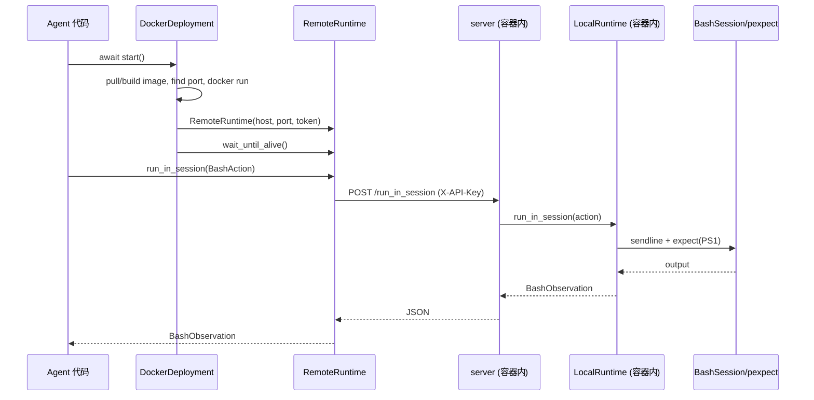

# 架构分层：Deployment、Runtime 与 Server 的职责边界

SWE-ReX 的架构可以压缩成一句话：**Deployment 管“把环境弄出来”，Runtime 管“在环境里干活”，Server 把后者的方法映射成 HTTP。** 三者职责不重叠，替换任何一层都不影响调用方。

## 三层职责

| 层 | 抽象 | 职责 | 不负责 | 事实 |
|---|---|---|---|---|
| 部署层 | `AbstractDeployment` | `start`/`stop`/`is_alive`/`runtime`/`add_hook` | 命令语义、session 状态 | F-017 |
| 运行时层 | `AbstractRuntime` | session、命令、文件、上传、close | 容器/云资源生命周期 | F-039 |
| 传输层 | `server.py` | 把 Runtime 方法映射为 10 个 HTTP 路由 | 执行逻辑（委托给 `LocalRuntime`） | F-072、F-077 |

### 部署层

`AbstractDeployment` 只有四个抽象成员（`deployment/abstract.py` 第11-38行，F-017）：

```python
async def start(self, *args, **kwargs): ...
async def stop(self, *args, **kwargs): ...
async def is_alive(self, *, timeout: float | None = None) -> IsAliveResponse: ...
@property
def runtime(self) -> AbstractRuntime: ...
```

外加 `add_hook(hook)`。所有具体部署的差异都在 `start()` 里：Docker 拉镜像、跑容器、映射端口；Modal 创建 Sandbox、拿 tunnel URL；Fargate 创建 ECS 资源、等 task running；Daytona 创建沙箱、拿 preview link；Local 直接 `LocalRuntime()`；Remote 直接连已有地址。它们的共同终点是：**在 `runtime` 属性上给出一个可用的 Runtime**。

`__del__` 会在对象销毁时尝试 `stop()`（F-018）。这是兜底清理，不是可靠的生命周期管理——显式 `await deployment.stop()` 仍是主路径。

### 运行时层

`AbstractRuntime` 定义 9 个方法（F-039）：

```text
is_alive()
create_session(request)
run_in_session(action)
close_session(request)
execute(command)
read_file(request)
write_file(request)
upload(request)
close()
```

这 9 个方法就是全部执行语义。`LocalRuntime` 用 pexpect + subprocess 实现；`RemoteRuntime` 用 aiohttp 把同样的方法发到 server；`DummyRuntime` 返回预置结果。三者对调用方完全同构。

### 传输层

容器内跑 `swerex-remote`（即 `server.main()`），它创建一个全局 `LocalRuntime`，把 10 个路由直接委托过去（F-072、F-077）：

```text
POST /create_session  → runtime.create_session(request)
POST /run_in_session  → runtime.run_in_session(action)
POST /execute         → runtime.execute(command)
POST /read_file       → runtime.read_file(request)
POST /write_file      → runtime.write_file(request)
POST /upload          → 临时文件 + unzip + move
POST /close_session   → runtime.close_session(request)
GET  /is_alive        → runtime.is_alive()
POST /close           → runtime.close()
GET  /                → {"message": "hello world"}
```

没有业务逻辑，没有状态机，没有队列。server 只做三件额外的事：API key 认证、请求 ID 幂等、异常序列化（F-073 ~ F-076）。

## 三进程调用链

以 Docker 为例：



对应事实：Docker 启动流程 F-020；启动命令 F-021；`RemoteRuntime` 构造与超时 F-062/F-063；server 路由 F-077；`BashSession` F-052/F-053。

## 为什么这样分层

### 1. 让“换环境”不触碰 agent

`docs/architecture.md` 第18-20行明确：`LocalRuntime` 与 `RemoteRuntime` 接口完全相同、可互换（F-098）。agent 只依赖 `AbstractRuntime`，所以从本地切到 Docker 只是换一个 Deployment 构造（F-101）。

### 2. 让“远程”不产生第二套语义

远程不是重新实现命令执行，而是把同一套 Pydantic 模型序列化过 HTTP。请求/响应模型集中在 `runtime/abstract.py`（F-040 ~ F-047），server 与 client 共用。这样超时、退出码、交互式命令的语义不会在传输层分叉。

### 3. 让云平台差异收敛在生命周期

Modal/Fargate/Daytona 的代码大部分是资源创建、网络暴露、等待与清理；执行相关只有“启动 `swerex-remote`”一行。新平台接入的成本因此主要在“怎么把 server 跑起来并让客户端可达”，而不是“怎么执行命令”。

### 4. 让异常跨进程保真

server 捕获所有非 HTTP 异常，序列化为 `_ExceptionTransfer`（message / class_path / traceback / extra_info），以 511 返回（F-076）。客户端按 `class_path` 动态导入并重建原异常（F-065）。这让远程调用仍能 `except CommandTimeoutError`，而不是拿到一个字符串。

## 关键边界与约束

| 边界 | 事实 | 含义 |
|---|---|---|
| server 是单例 `LocalRuntime` | F-072 | 一个 server 进程共享一个 runtime 与 session 表 |
| session 表在 runtime 进程内 | F-049 | server 重启会丢失所有 session |
| 幂等只记最后一次 | F-075 | 并发客户端不保证去重 |
| `RemoteRuntime.timeout` 默认 0.15s | F-063/F-071 | 首次连接/慢操作需显式放大 |
| `is_alive` 不抛连接异常 | F-067 | 适合轮询，但需检查 `bool()` |
| `__del__` 清理是兜底 | F-018 | 不能替代显式 `stop()` |

## 一个容易踩的坑：`port=None` 的两种含义

`RemoteRuntime._api_url` 在 `port is None` 时只返回 host（F-063）。这对 Daytona 是必需的——preview link 已经是完整 URL；但对 `RemoteDeployment`，如果 host 只写 `http://127.0.0.1` 而 port 留空，就会连到 80 端口。配置时要么给 host 完整 URL，要么显式给 port。

## 相关概念

- [会话模型](/concepts/02-session-model.md)
- [HTTP 协议](/concepts/03-http-protocol.md)
- [部署矩阵](/concepts/04-deployments.md)
- [运行时与执行语义](/concepts/05-runtimes-and-execution.md)
- [源码地图](/concepts/08-source-map.md)
