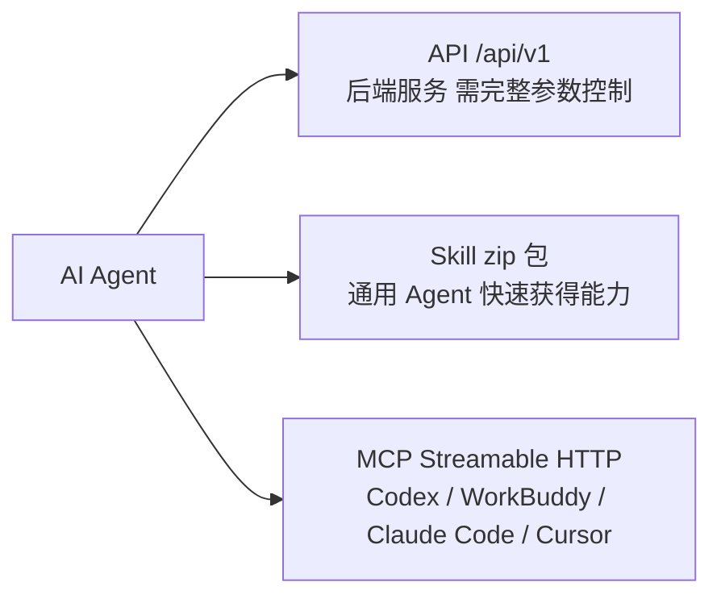

# 平台全景：能力地图与文档导航

## 一、平台是什么

知乎数据开放平台（`https://developer.zhihu.com`）把知乎的公共内容、个人创作数据、知识库与文档工具能力开放给 AI Agent 调用。官方文档站的 meta description 将其描述为提供「全链路数据产品矩阵……兼容各类调用方式 Skills/API/MCP」。

一句话定位：**知乎的公开内容与个人数据被拆成一组有明确额度与计费规则的开放接口，可被 Agent 以 API、Skill 包或 MCP 三种方式消费。** 三条关键区分：调用方是你的 Agent 而非知乎；能力按「产品域」划分而额度按「额度组」划分；查自己数据用 Access Secret，查他人数据才需要 OAuth。

## 二、官方文档的 10 个栏目

官方文档站的一级导航共 10 个栏目、31 篇正文，每篇可由 `https://developer.zhihu.com/docs?key=<key>` 定位。

| 栏目 | 文档 key | 篇数 | 覆盖能力（文档篇目） |
|---|---|---:|---|
| 开始使用 | `guide` | 5 | 鉴权说明 / Zhihu CLI / 知乎 MCP / 额度查询 API / 服务价格 |
| 知乎搜索 | `zhihu-search` | 2 | 知乎搜索 API / 知乎搜索 Skill |
| 全网搜索 | `global-search` | 2 | 全网搜索 API / 全网搜索 Skill |
| 直答 | `zhida` | 2 | 直答 API / 直答 Skill |
| 热榜 | `hot-list` | 2 | 知乎热榜 API / 知乎热榜 Skill |
| 问题发现 | `question-discovery` | 2 | 问题推荐 API / 问题回答 API |
| 创作能力 | `creator` | 4 | 我的创作全文 API / 我的创作评论 API / 账号创作数据 API / 单篇创作数据 API |
| 知识库 | `knowledge-base` | 4 | 知识库列表 API / 知识库内容列表 API / 知识库文件上传 API / 知识库检索 API |
| 小工具 | `tools` | 2 | PDF 解析 API / PPT 生成 API |
| 知乎用户数据 | `zhihu-user-data` | 6 | 接入知乎 OAuth / 用户的内容 API / 用户的关注 API / 用户的收藏 API / 用户收藏夹列表 API / 收藏夹内容 API |
| **合计** | — | **31** | — |

知乎搜索、全网搜索、直答、热榜四栏目遵循同一节奏：**一篇 API + 一篇 Skill**。

## 三、三种接入方式的分工

### API

直接调用开放平台 HTTP 接口，统一用 `Authorization: Bearer <your_access_secret>` + `X-Request-Timestamp`（秒级 Unix 时间戳）鉴权。路径按域划分：`/api/v1/content/...`（搜索、热榜）、`/api/v1/user/...`（创作、用户数据、问题发现）、`/api/v1/knowledge/...`（知识库）、`/api/v1/pdf-parse/tasks` 与 `/api/v1/ppt-generation/tasks`（小工具）。

**两处例外**：直答 API 地址是 `https://developer.zhihu.com/v1/chat/completions`，PDF 解析的文件上传接口是 `https://developer.zhihu.com/resources/v1/files`，二者都不在 `/api/v1` 下。

### Skill

官方打包好的 zip 包，解压后交给 Agent 即可。下载 URL 遵循 `<能力>_skills.zip` 命名规律：

| Skill | 下载地址 |
|---|---|
| 知乎搜索 | `https://developer.zhihu.com/download/zhihu_search_skills.zip` |
| 全网搜索 | `https://developer.zhihu.com/download/global_search_skills.zip` |
| 直答 | `https://developer.zhihu.com/download/zhida_skills.zip` |
| 热榜 | `https://developer.zhihu.com/download/hot_list_skills.zip` |
| Zhihu CLI 配套 skill | `https://developer-cdn.zhihu.com/zhihu-cli/releases/stable/skill/zhihu-cli-skill.zip` |

Zhihu CLI 是官方命令行工具，配合上面那个 CLI skill 包使用：把包发给 Agent，Agent 通过标准输入接收 Access Secret（凭证落在 macOS Keychain / Windows Credential Manager / Linux Secret Service），之后用自然语言提任务即可。官方明确 **Zhihu CLI 不接受 OAuth Token、用户 ID 或其他代查参数**，只查询 Access Secret 所属账号。

### MCP

统一服务地址 `https://developer.zhihu.com/api/mcp/v1`，传输方式为 **Streamable HTTP**——官方 FAQ 原文：「如果客户端要求选择连接方式，选择 Streamable HTTP」。暴露 4 个工具：`zhihu_search`（知乎搜索）、`global_search`（全网搜索）、`hot_list`（知乎热榜）、`zhida`（知乎直答）。MCP 只覆盖这 4 项公共检索/生成能力，**不含**创作能力、知识库、小工具与用户数据。

### 何时用哪个

读「我的」创作/关注/收藏、管知识库 → API 或 Zhihu CLI（MCP 不提供）；代表他人访问数据 → API + OAuth（MCP 与 Zhihu CLI 均不提供）。

## 四、两套凭证体系

| 维度 | Access Secret | OAuth access_token |
|---|---|---|
| 获取方式 | 登录 `https://developer.zhihu.com/profile` 个人中心生成 | 邮件申请 `app_id` / `app_key`，邮箱 `openplatform@zhihu.com` |
| 传递方式 | `Authorization: Bearer <your_access_secret>` | `X-OAuth-Token` 请求头 |
| 适用场景 | 「我用自己的账号调我自己的数据」 | 「第三方应用代表其他授权用户访问数据」 |
| 是否必须 | 查自己数据时必需 | 查他人数据时必需 |

官方 OAuth 集成文档明确写明：如果只是要使用开放平台上的通用 API 以及查看自己的相关数据，**则无需接入 OAuth**，直接用个人中心创建的 Access Secret 调用。

OAuth 采用标准 OAuth 2.0 Authorization Code Flow：跳转授权页 `https://openapi.zhihu.com/authorize?redirect_uri={redirect_uri}&app_id={app_id}&response_type=code` → 平台回调 `{redirect_uri}?authorization_code={authorization_code}` → 后端 `POST https://openapi.zhihu.com/access_token`（参数 `app_id`、`app_key`、`grant_type` 固定 `authorization_code`、`redirect_uri`、`code`）换取 `access_token`（响应含 `token_type`、`expires_in` 秒）→ 用它调「获取用户信息」接口。`authorization_code` 与 `access_token` 的使用应在应用后端完成，避免泄露 `app_key` 和用户令牌。**不应把 Access Secret 分发给应用用户**。

## 五、额度与计费

### 9 个额度组

额度查询接口 `GET /api/v1/quota`，请求参数 `APIIDs`（逗号分隔，**该参数只能出现一次**；不传则返回当前已配置的可展示额度）。响应字段 `APIID` / `APIName` / `TotalQuota` / `TotalUsed` / `RemainingQuota`，均为 Int64，`RemainingQuota` 最低为 0。**查询额度本身不消耗业务额度。** 时间戳校验：`X-Request-Timestamp` 与服务端时间**相差不能超过 10 分钟**。

| API ID | 名称 | 覆盖范围 |
|---|---|---|
| `global_search` | 全网搜索 | 全网搜索 |
| `zhihu_search` | 知乎搜索 | 知乎内容搜索 |
| `hot_list` | 热榜 | 知乎热榜 |
| `question_discovery` | 问题发现 | 问题推荐及问题回答摘要 |
| `zhida_openai` | 直答 | 直答服务 |
| `tools` | 小工具 | PDF 解析及 PPT 生成 |
| `knowledge` | 知识库 | 文件上传、列表、内容列表及检索 |
| `user_data` | 知乎用户数据 | 创作列表、关注、收藏及收藏夹数据 |
| `creator` | 创作能力 | 本人全文、评论、账号统计、单篇统计 |

### 计费规则

- 按**成功调用次数**计费，价格以「元／千次」展示，不足千次也按实际付费调用次数计算。鉴权失败、参数错误、触发限流等未成功的请求**不计费**；流式服务开始输出有效内容后，按一次成功调用计量。
- 免费额度按**北京时间 00:00 重置，未用完不结转**。同一知乎账号下的多个 Access Secret 共用该账号额度。**部分服务共用同一额度组**，调用组内任一服务都会消耗该组的剩余免费次数。
- 余额扣减顺序：体验余额 → 充值余额。**单次调用不拆分使用两种余额，余额不足时请求不执行。** 使用 OAuth 授权查询其他用户数据时，费用归属于发起调用的开发者账号，不由授权用户支付。
- 每日免费额度属限时优惠；实际额度以额度查询结果或个人中心「用量统计 - 各接口限免额度」为准。

### 服务价格表（免费额度用完后的付费单价）

| 服务 | 单价 |
|---|---:|
| 全网搜索 | 12 元／千次 |
| 知乎搜索 | 20 元／千次 |
| 知乎热榜 | 10 元／千次 |
| 直答 Agent | 20 元／千次 |
| 用户创作内容摘要 | 10 元／千次 |
| 获取关注用户列表 | 10 元／千次 |
| 获取收藏夹以及收藏内容 | 10 元／千次 |
| 我的创作全文 | 10 元／千次 |
| 我的创作评论 | 10 元／千次 |
| 账号创作数据 | 10 元／千次 |
| 单篇创作数据 | 10 元／千次 |
| 问题回答 | 20 元／千次 |
| 知识库列表 | 1 元／千次 |
| 知识库内容列表 | 1 元／千次 |
| 知识库文件上传 | 10 元／千次 |
| 知识库检索 | 10 元／千次 |

价格表的服务名与额度组 `APIID` **不逐字对应**：「直答 Agent」对应 `zhida_openai`、「用户创作内容摘要」对应 `user_data`、「问题回答」对应 `question_discovery`；知识库 4 个接口各自标价但共用额度组 `knowledge`。

免费额度默认值仅部分给出：问题发现每租户每自然日 100 次（未实名等低额度用户 10 次）；创作能力每租户每自然日共计 200 次（低额度用户 10 次）；小工具普通用户每天 10 次、低额度用户每天 2 次，PDF 解析与 PPT 生成**共用**该额度。

## 六、阅读路径

| 你想做什么 | 先读 |
|---|---|
| 拿到凭证、查剩余额度、了解计费 | `01-auth-and-quota.md` |
| 搜知乎、看热榜、找全网资料 | `02-search-and-hotlist.md` |
| 用知乎直答模型做问答（含流式） | `03-zhida.md` |
| 找值得回答的问题、读某问题下的回答摘要 | `04-question-discovery.md` |
| 读自己的创作全文与评论、看账号与单篇数据 | `05-creator-capability.md` |
| 管知识库：列表、上传文件、检索内容 | `06-knowledge-base.md` |
| 把 PDF 解析成结构化结果、把回答生成 PPT | `07-document-tools.md` |
| 代表其他用户读内容/关注/收藏，或接入第三方登录 | `08-user-data-oauth.md` |
| 落地 Skill 包、配置 MCP、装 Zhihu CLI | `09-integration-surfaces.md` |

可运行代码在 `../examples/`，原始字段与错误码摘录在 `../references/`。

## 七、已知边界与时效提示

以下信息在官方文档中**未给出**，使用时不应推测：

- **各接口的具体超时时间**——无统一请求/任务超时数值；仅说明知识库文件上传是同步接口、较大文件可能耗时较长。
- **接口级 QPS 数值**——无任何接口的具体 QPS；只有错误码 `30001` 表示频率限制、并发限制或当日额度超限。
- **`user_collections` / `user_favlists` / `favlist_contents` 的 `Limit` 上限**——三者均只写「返回数量，默认 `20`」，未给出最大值（对比 `user_contents` 与 `user_followees` 写「最大 `50`」）。
- **`global_search` 的翻页方式**——响应只有 `HasMore`，请求侧**无任何翻页入参**（仅 `Query`、`Count`、`Filter`、`SearchDB`）。
- **Skill 包的具体错误码**——各 Skill 文档只说明「调用失败时会返回错误信息并以非零状态结束」，未列错误码表。
- **`created` 字段的单位**——直答 API / 直答 Skill 响应含 `created`（示例值 `1740470400`），未标注单位与时区。
- **`zhida-agent` 是否支持 role/content 上下文传参**——官方明确：只有 `zhida-fast-1p5` 与 `zhida-thinking-1p5` 支持 `role`、`content` 上下文传参。
- **小工具（PDF 解析 / PPT 生成）的付费单价**——服务价格表未列出这两项。
- **各额度组的免费额度总数与多租户汇总规则**——除问题发现、创作能力、小工具三组外其余组未给出具体数字；账号关联多租户时查询结果会汇总相关租户额度，但汇总规则未给出。