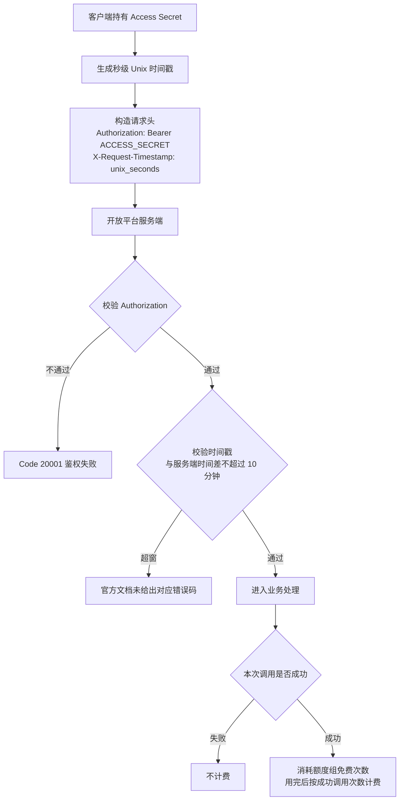
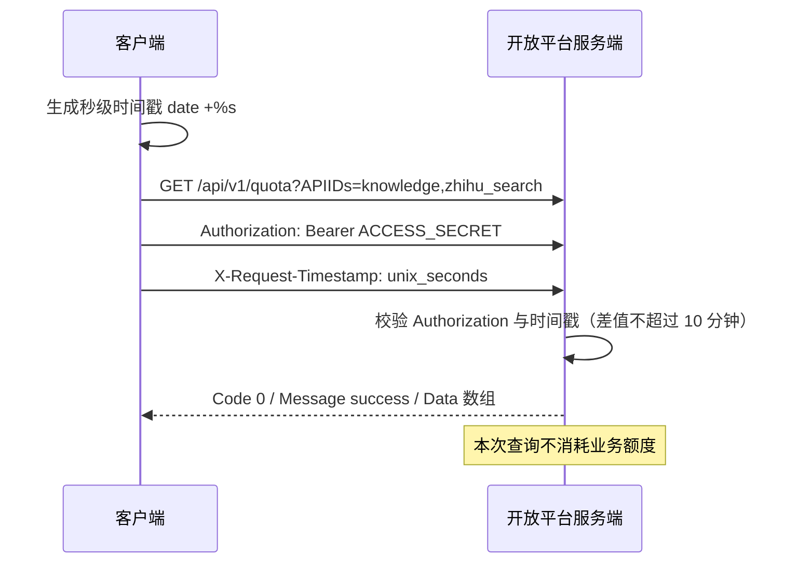

# 鉴权、额度与计费：开放平台的三条硬契约

知乎数据开放平台对开发者只暴露三组硬性约束：**请求必须同时通过两个头的校验**、**能用的额度由一个可查询的接口决定**、**钱只在你真正拿到结果时才扣**。三者互相咬合——鉴权没过就进不了额度逻辑，额度不足的请求不会执行，也就不产生费用。本篇写成可直接照做的契约说明，并标出官方文档未覆盖的缺口。

## 一、鉴权契约：Bearer 与秒级时间戳的双头校验

### 1.1 请求头三件套

开放平台推荐通过 `Authorization: Bearer <your_access_secret>` 调用数据接口。`zhihu_search`、`global_search`、`hot_list` 等接口统一使用 Bearer 鉴权。

| 名称 | 示例值 | 说明 |
| - | - | - |
| Authorization | `Bearer <your_access_secret>` | Bearer 鉴权头 |
| X-Request-Timestamp | `1742822400` | 秒级 Unix 时间戳 |
| Content-Type | `application/json` | JSON 接口固定值 |

Access Secret 在知乎开放平台[个人中心](https://developer.zhihu.com/profile)查看并获取，需作为 Bearer Token 放入请求头。

### 1.2 双头校验与 10 分钟窗口

官方原文明确：**服务端会校验 `Authorization` 与 `X-Request-Timestamp`**，两者缺一不可。`X-Request-Timestamp` 需要传**秒级** Unix 时间戳。

额度查询 API 页面对该头的约束写得更具体：**Unix 秒级时间戳，与服务端时间相差不能超过 10 分钟**。客户端时钟必须与服务端同步，长时间挂起的进程、休眠后的机器或跨时区部署都可能踩中这个窗口。

### 1.3 通用 curl 骨架

官方给出的搜索调用示例是所有开放平台接口的通用形态：

```shell
curl -G 'https://developer.zhihu.com/api/v1/content/zhihu_search' \
  --data-urlencode 'Query=怎么理解rave文化' \
  -H 'Authorization: Bearer <your_access_secret>' \
  -H "X-Request-Timestamp: $(date +%s)" \
  -H 'Content-Type: application/json'
```

要点：`X-Request-Timestamp` 用 `$(date +%s)` 在请求发出瞬间生成；`Bearer` 与密钥间有一个空格。

### 1.4 鉴权请求链路



### 1.5 官方文档的两个缺口

⚠️ **缺口一：时间戳超窗没有对应错误码。** 官方文档给出了 `X-Request-Timestamp` 的 10 分钟窗口约束，但**没有给出超窗时的具体错误码**，也未说明它会被归入哪个错误码分类，不能假定它等同于 `20001` 或 `10001`。

⚠️ **缺口二：`Content-Type` 是否强制没有统一声明。** `Content-Type: application/json` 出现在鉴权说明页的请求头表中，但**在额度查询 API 页的请求头表里未列出**——该页只列出 `Authorization` 与 `X-Request-Timestamp`，官方调用示例也未带该头。各接口是否强制要求该头，官方未统一声明。

### 1.6 凭证安全纪律

以下规则来自 Zhihu CLI 官方说明：

- 只在**与 Agent 的私密对话**中发送 Access Secret，**不要放进公开群聊、文档或代码仓库**。
- 验证成功后，凭证保存在 **macOS Keychain、Windows Credential Manager 或 Linux 桌面的 Secret Service**，**不会写入 Skill 文件夹和普通配置文件**。
- Linux 的 **SSH、CI 或容器场景**通常由**宿主 Secret Store 通过进程级环境变量注入**。
- MCP 接入侧同样要求：**请勿分享包含密钥的配置或截图**。
- Zhihu CLI 只查询 Access Secret 所属账号，不接受 OAuth Token 或其他代查参数；访问其他授权用户数据需单独接入知乎 OAuth。

## 二、额度查询 API：把额度变成可编程的事实

### 2.1 接口与请求

`GET https://developer.zhihu.com/api/v1/quota`

该页请求头只列出必填的 `Authorization` 与 `X-Request-Timestamp`（秒级 Unix 时间戳，与服务端时间相差不超过 10 分钟）。

| 参数 | 类型 | 必填 | 说明 |
| --- | --- | --- | --- |
| `APIIDs` | String | 否 | 多个 API ID 用逗号分隔，`APIIDs` 参数只能出现一次；未提供时返回当前已配置的可展示额度 |

指定额度项的请求形态：

```http
GET /api/v1/quota?APIIDs=knowledge,zhihu_search
```

### 2.2 九个额度组

| API ID | 名称 | 覆盖范围 |
| --- | --- | --- |
| `global_search` | 全网搜索 | 全网搜索 |
| `zhihu_search` | 知乎搜索 | 知乎内容搜索 |
| `hot_list` | 热榜 | 知乎热榜 |
| `question_discovery` | 问题发现 | 问题推荐及问题回答摘要 |
| `zhida_openai` | 直答 | 直答服务 |
| `tools` | 小工具 | PDF 解析及 PPT 生成 |
| `knowledge` | 知识库 | 知识库文件上传、知识库列表、知识库内容列表及知识库检索 |
| `user_data` | 知乎用户数据 | 用户创作列表、关注、收藏及收藏夹数据 |
| `creator` | 创作能力 | 本人全文、评论、账号统计、单篇统计 |

### 2.3 响应结构

顶层响应字段为 `Code` / `Message` / `Data`（Array），数组项字段如下：

| 字段 | 类型 | 说明 |
| --- | --- | --- |
| `APIID` | String | 额度项 ID |
| `APIName` | String | 额度项名称 |
| `TotalQuota` | Int64 | 当前自然日总额度 |
| `TotalUsed` | Int64 | 当前自然日已使用额度 |
| `RemainingQuota` | Int64 | 当前自然日剩余额度，最低为 0 |

```json
{
  "Code": 0,
  "Message": "success",
  "Data": [
    {
      "APIID": "knowledge",
      "APIName": "知识库",
      "TotalQuota": 500,
      "TotalUsed": 12,
      "RemainingQuota": 488
    }
  ]
}
```

### 2.4 六条语义要点

1. **该查询不会消耗业务额度**——可放心用于轮询。
2. 不传 `APIIDs` 时**按上表固定顺序**返回当前已配置额度项；**尚未接入额度配置的 API 会被省略**，不会导致整个列表失败。
3. 显式请求多个 API 时同样**只返回其中已配置的子集**；若全部尚未配置，**成功返回空数组**（`Code` 为 0）。
4. **账号关联多个租户时，查询结果会汇总相关租户额度**。
5. **实际额度以查询结果为准**，各接口页公布的默认次数不是运行时真值。
6. 额度数据按**自然日**统计，与计费页的「北京时间 00:00 重置」口径对应。

### 2.5 错误码

| Code | 说明 |
| --- | --- |
| `10001` | `APIIDs`参数格式错误或包含未知API ID；旧客户端参数不兼容时提示更新到最新版Zhihu CLI |
| `20001` | Access Secret 鉴权失败 |
| `30001` | 请求频率超过限制，请稍后重试 |
| `90001` | 额度数据读取失败 |

### 2.6 额度查询时序



## 三、计费规则：成功才计费

### 3.1 计费口径

- 下列服务按**成功调用次数**计费。
- 价格为**人民币含税价**，以「元／千次」展示；**不足千次也按实际付费调用次数计算**。
- **鉴权失败、参数错误、触发限流等未成功的请求不计费。**
- **流式服务开始输出有效内容后，按一次成功调用计量。**

### 3.2 余额扣减顺序

**免费额度用完后，调用费用依次从体验余额、充值余额中支付；单次调用不拆分使用两种余额，余额不足时请求不执行。**

「不拆分」意味着：一次调用要么整体走体验余额，要么整体走充值余额，不会先扣完体验余额再从充值余额补差。

### 3.3 OAuth 场景的计费归属

**使用 OAuth 授权查询其他用户数据时，费用归属于发起调用的开发者账号，不由授权用户支付。**

### 3.4 免费额度的四条规则

- **部分服务共用同一额度组**：调用组内任一服务，都会消耗该组的剩余免费次数。
- **同一知乎账号下的多个 Access Secret 共用该账号的额度**。
- **每日额度按北京时间 00:00 重置，未用完的次数不结转。**
- **每日免费额度属于限时优惠，后续可能根据活动情况调整。**

查看入口：「**个人中心 - 用量统计 - 各接口限免额度**」；额度查询 API 页另提到「个人中心 - 用量统计」。

### 3.5 完整价格表

下表为**每日免费额度用完后**，可继续付费调用的服务单价。

| 分类 | 服务 | 单价 |
| --- | --- | ---: |
| 搜索与 AI 服务 | 全网搜索 | 12 元／千次 |
| 搜索与 AI 服务 | 知乎搜索 | 20 元／千次 |
| 搜索与 AI 服务 | 知乎热榜 | 10 元／千次 |
| 搜索与 AI 服务 | 直答 Agent | 20 元／千次 |
| 用户数据服务 | 用户创作内容摘要 | 10 元／千次 |
| 用户数据服务 | 获取关注用户列表 | 10 元／千次 |
| 用户数据服务 | 获取收藏夹以及收藏内容 | 10 元／千次 |
| 创作者服务 | 我的创作全文 | 10 元／千次 |
| 创作者服务 | 我的创作评论 | 10 元／千次 |
| 创作者服务 | 账号创作数据 | 10 元／千次 |
| 创作者服务 | 单篇创作数据 | 10 元／千次 |
| 问题发现服务 | 问题回答 | 20 元／千次 |
| 知识库服务 | 知识库列表 | 1 元／千次 |
| 知识库服务 | 知识库内容列表 | 1 元／千次 |
| 知识库服务 | 知识库文件上传 | 10 元／千次 |
| 知识库服务 | 知识库检索 | 10 元／千次 |

⚠️ **价格表与额度组的 `APIID` 不是逐字一一对应。** 例如「直答 Agent」对应 `zhida_openai`、「问题回答」对应 `question_discovery`、「我的创作全文 / 评论」对应 `creator`。**官方文档未给出价格表与 `APIID` 的映射表**，成本核算不能按名称字面匹配。

## 四、额度的实际影响：各接口页公布的日额度

额度查询接口给出运行时真值，各业务接口页还公布了一组**默认日额度**，可用于容量规划。官方在每个接口页都声明「**实际额度以额度查询结果为准**」。

| 额度组 | 覆盖接口 | 默认日额度 | 未实名等低额度用户 |
| --- | --- | --- | --- |
| 创作能力（`creator`） | 本人全文、评论、账号统计、单篇统计 | 每租户每自然日**共计 200 次** | 10 次 |
| 问题发现（`question_discovery`） | 问题推荐、问题回答摘要 | 每租户每自然日 **100 次** | 10 次 |
| 小工具（`tools`） | PDF 解析、PPT 生成 | 普通用户每天 **10 次** | 每天 2 次 |

补充要点：

- **创作能力四个接口共用同一额度组**，调用任一个都会消耗该组剩余次数。
- **问题推荐与问题回答共用「问题发现」额度**，每租户每自然日 100 次。
- **小工具的额度在任务成功时计入 1 次**，**失败或查询任务状态不消耗额度**。
- **PDF 文件上传不消耗小工具免费额度**，但上传接口**另有按租户计算的日请求限流**：普通用户默认 10 次，低额度用户默认 2 次，**达到上限时返回限流错误**。
- 创作能力接口只支持当前 Access Secret 所属账号，**不接受 OAuth 身份切换**。

⚠️ **各接口的具体 QPS 数值官方文档未给出。** 文档只使用「调用频率、并发限制」等定性描述，真实吞吐须以返回的 `30001` 与额度查询结果反推。

## 五、排错决策表

| 症状 | 可能原因 | 处置 |
| --- | --- | --- |
| `Code: 20001` 鉴权失败 | Access Secret 缺失、错误、被撤销；`Bearer` 前缀或空格写错 | 重新获取 Secret，确认头部为 `Bearer <secret>` 且含空格 |
| `Code: 10001` 参数错误 | `APIIDs` 格式错误或含未知 API ID；旧客户端参数不兼容 | `APIIDs` 只出现一次、逗号分隔、只能用上表 9 个合法 ID；提示更新到最新版 Zhihu CLI |
| `Code: 30001` 请求频率超过限制 | 短时调用频率或并发超限 | 退避重试；先查 `GET /api/v1/quota` 判断是否同时撞上当日额度上限 |
| `Code: 30002` 额度不足 | 额外配置的成功次数额度耗尽 | 各接口页措辞不一（用户内容页作「配额限制」、PDF 解析页作「额度不足」）；以 `RemainingQuota` 为准 |
| `Code: 30003` 请求被风控拒绝 | 风控拦截（创作能力、问题发现类接口） | 停止持续重试，降低调用频率 |
| `Code: 90001` | 额度数据读取失败（quota）／服务内部错误（业务接口） | 稍后重试；业务接口场景记录 `Code` 与 `Message` |
| 请求被拒但无明确错误码 | `X-Request-Timestamp` 与服务端时间相差**超过 10 分钟** | **官方文档未给出超窗的错误码**；先校准时钟，确认时间戳为**秒级** |
| 问题发现场景返回 `30001` | 可能是**当日额度耗尽**而非频率限制 | 官方建议：**查询「问题发现」剩余额度区分每日额度与短时限制** |
| 额度查询返回空数组 | 所请求的 API 全部尚未接入额度配置 | 这是**成功响应**而非错误；改用不传 `APIIDs` 获取当前已配置额度项 |
| 额度查询缺少某个 API ID | 该 API 尚未接入额度配置，被**省略** | 不会导致整个列表失败；按实际返回的项做预算 |
| 免费额度看着比预期少 | 多个 Access Secret **共用额度**；多个服务**共用同一额度组** | 以 `TotalQuota` / `TotalUsed` / `RemainingQuota` 三字段联动核对 |

## 六、下一步

- [08 · OAuth 与用户数据](../concepts/08-user-data-oauth.md)——`X-OAuth-Token` 的传入方式与 OAuth 计费归属。
- [09 · 集成形态](../concepts/09-integration-surfaces.md)——MCP 与 Skill 如何携带同一套鉴权头。
- [示例 05 · 额度治理](../examples/05-quota-governance.md)——把额度查询与预算控制落到工程实践。