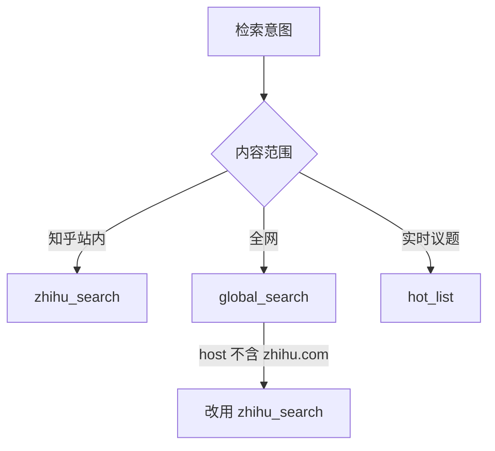

# 搜索与热榜——知乎站内外两套检索与实时议题榜

知乎数据开放平台的「读」能力由三个接口承担：`zhihu_search`（站内）、`global_search`（全网）、`hot_list`（实时热榜）。三者的条数上限、筛选语法与返回字段互不相同，且均无翻页游标。

## 一、三者对照与选型



条数上限与越界行为见第二、三、四章；请求头三件套一致：

| 头部名称 | 取值 |
| :- | :- |
| `Authorization` | `Bearer <your_access_secret>` |
| `X-Request-Timestamp` | 秒级 Unix 时间戳 |
| `Content-Type` | 固定值 `application/json` |

服务端会校验 `Authorization` 与 `X-Request-Timestamp`。

## 二、知乎站内搜索 `zhihu_search`

| 说明 | 值 |
| :- | :- |
| HTTP URL | https://developer.zhihu.com/api/v1/content/zhihu_search |
| HTTP Method | GET |

返回与查询相关的问题、回答或文章。

### 2.1 请求参数

| 名称 | 类型 | 必填 | 说明 |
| :- | :- | :- | :- |
| Query | String | 是 | 查询关键词（不能为空） |
| Count | Int32 | 否 | 请求数量，默认 10，最大 10 |
| SortBy | String | 否 | 格式 `字段:方向:(最小值,最大值)` |

### 2.2 SortBy 三段式语法

格式 `字段:方向:(最小值,最大值)`，三段均可退化：

| 段 | 取值 | 说明 |
| :- | :- | :- |
| 字段 | `CommentCount`、`VoteUpCount`、`EditTime` | 非法字段会返回参数错误 |
| 方向 | `asc` / `desc` | **不区分大小写**；裸字段或空方向默认降序 |
| 区间 | `(最小值,最大值)` | 可整体省略；圆括号区间**包含两端边界**，空端表示不限 |

边界为**非负 int64 整数**，**最小值不得大于最大值**；非法字段、方向、区间或数字返回参数错误。`EditTime` 取响应中的时间字段（当前映射为发布时间，秒级 Unix 时间戳）。**同值保留原排序**。

| 官方示例 | 实际含义 |
| :- | :- |
| `VoteUpCount:desc:(,10)` | 点赞数 ≤10 后降序 |
| `VoteUpCount:asc:(10,)` | 点赞数 ≥10 后升序 |
| `VoteUpCount:desc:(10,100)` | 点赞数 10～100 后降序 |
| `(,)` | 不限范围 |

`VoteUpCount::(10,)` 等价于 `VoteUpCount:desc:(10,)`；不传 `SortBy` 保持默认行为。

### 2.3 条数边界与响应结构

`Count <= 0` 服务端**默认回退为 10**；`Count > 10` 服务端**自动截断为 10**。均为服务端行为，响应不回显生效值。

`Data` 结构：

| 参数名 | 类型 | 是否必返 | 描述 |
| :- | :- | :- | :- |
| HasMore | Bool | 是 | 当前实现固定返回 `false` |
| SearchHashId | String | 是 | 搜索请求标识 |
| Items | Array[Item] | 是 | 搜索结果列表 |
| EmptyReason | String | 否 | 无结果时的原因说明 |

`Item` 字段：

| 参数名 | 类型 | 是否必返 | 描述 |
| :- | :- | :- | :- |
| Title | String | 是 | 内容标题 |
| ContentType | String | 是 | 内容类型 |
| ContentID | String | 是 | 内容标识 |
| ContentText | String | 是 | 内容摘要 |
| Url | String | 是 | 内容链接（带溯源 UTM 参数） |
| CommentCount | Int32 | 是 | 评论数 |
| VoteUpCount | Int32 | 是 | 赞同数 |
| AuthorName | String | 是 | 作者昵称 |
| AuthorAvatar | String | 是 | 作者头像 |
| AuthorBadge | String | 是 | 作者认证图标 |
| AuthorBadgeText | String | 是 | 作者认证文案 |
| EditTime | Int32 | 是 | 发布时间或更新时间戳 |
| CommentInfoList | Array[CommentInfo] | 否 | 精选评论 |
| AuthorityLevel | String | 是 | 权威等级 |
| RankingScore | Float32 | 是 | 排序分数 |

`CommentInfo` 只有 `Content` 一个字段（String，必返，评论内容）。

响应示例：

```json
{
    "Code": 0,
    "Message": "success",
    "Data": {
        "HasMore": false,
        "SearchHashId": "1234567890",
        "Items": [
            {
                "Title": "RAG 评测方法综述",
                "ContentType": "Article",
                "ContentID": "123456789",
                "ContentText": "本文介绍了主流 RAG 评测框架，包括 RAGAS、TruLens ...",
                "Url": "https://zhuanlan.zhihu.com/p/123456789?utm_medium=openapi_platform&utm_source=c2f012356e63",
                "CommentCount": 15,
                "VoteUpCount": 128,
                "AuthorName": "张三",
                "AuthorAvatar": "https://picx.zhimg.com/example.jpg",
                "AuthorBadge": "",
                "AuthorBadgeText": "",
                "EditTime": 1710000000,
                "CommentInfoList": [],
                "AuthorityLevel": "2",
                "RankingScore": 0.98
            }
        ]
    }
}
```

响应 `Url` 固定携带溯源参数 `?utm_medium=openapi_platform&utm_source=c2f012356e63`，去重或域名匹配前需剥离。

错误码：

| 错误码 | 说明 |
| :- | :- |
| 0 | 成功 |
| 10001 | 参数错误 |
| 20001 | 鉴权失败 |
| 30001 | 频率限制 |
| 90001 | 内部错误 |

⚠️ **翻页与配额缺口**：`HasMore` 当前实现**恒为 false**，响应中**没有** `Paging.IsEnd`、`NextOffset`、`Offset` 或任何游标字段，想拿更多结果只能换关键词多次调用；接口超时时间、具体 QPS 与 `30001` 触发阈值，官方文档均未给出。

## 三、全网搜索 `global_search`

接口：`GET https://developer.zhihu.com/api/v1/content/global_search`，覆盖站外站点。

### 3.1 请求参数

| 名称 | 类型 | 必填 | 说明 |
| :- | :- | :- | :- |
| Query | String | 是 | 查询关键词 |
| Count | Int32 | 否 | 请求数量，默认 10，最大 20 |
| Filter | String | 否 | 高级语法筛选表达式。作为 URL Query 参数传入时需进行 URL 编码，推荐使用 `--data-urlencode` 或 SDK 参数编码能力 |
| SearchDB | String | 否 | 索引库选择，默认 `all` |

`SearchDB` 枚举：

| 值 | 说明 |
| :- | :- |
| `all` | 全部索引库，默认值 |
| `realtime` | 仅搜索实时库 |
| `static` | 仅搜索静态库 |

### 3.2 Filter 表达式语法

`Filter` 按站点、发布时间等条件过滤，可用字段仅两个：

| 字段 | 含义 | 类型 | 示例 |
| :- | :- | :- | :- |
| host | 站点域名 | String | `host=="example.com"` |
| publish_time | 发布时间，秒级时间戳 | Int64 | `publish_time>=1778494631` |

操作符随字段而异，引号规则也不同：

| 字段 | 支持操作符 | 取值写法 |
| :- | :- | :- |
| host | `==`、`!=` | 字符串值**必须使用双引号** |
| publish_time | `==`、`!=`、`>`、`>=`、`<`、`<=` | 数字值**不使用引号** |

`AND`、`OR` **必须大写**；`AND` 优先级高于 `OR`；可用括号 `()` 控制优先级。官方示例：

```
host=="example.com"
host=="example.com" AND publish_time>=1778494631
(host=="example.com" OR host=="news.example.com") AND publish_time>1778494631
```

⚠️ **站内内容不可过滤**：`host=="zhihu.com"` 及其子域名**不支持**；官方要求搜知乎站内内容时直接使用 `zhihu_search` 接口。

调用示例：

```shell
curl -G 'https://developer.zhihu.com/api/v1/content/global_search' \
  --data-urlencode 'Query=怎么理解rave文化' \
  --data-urlencode 'Filter=host=="example.com" AND publish_time>=1778494631' \
  --data-urlencode 'SearchDB=all' \
  -d 'Count=5' \
  -H 'Authorization: Bearer <your_access_secret>' \
  -H "X-Request-Timestamp: $(date +%s)"
```

`Filter` 含 `==`、`>`、`"` 等字符，须用 `--data-urlencode` 或等价编码，直接拼进 URL 会被解析错误。

### 3.3 响应结构

`Data` 只有 `HasMore`(Bool) 与 `Items`(Array[Item])。`Item` 字段与站内搜索几乎同构：`Title`、`ContentType`、`ContentID`、`ContentText`、`Url`、`CommentCount`、`VoteUpCount`、`AuthorName`、`AuthorAvatar`、`AuthorBadge`、`AuthorBadgeText`、`EditTime`、`CommentInfoList`、`AuthorityLevel`（`CommentInfoList` 可选，`CommentInfo` 同样只有 `Content` 一个字段）。差异逐字列出如下：

| 字段 | `global_search` | `zhihu_search` |
| :- | :- | :- |
| EditTime | Int64，最后编辑时间戳，如 1745486539 | Int32 |
| AuthorityLevel | 权威等级（1 低权威，2 中权威，3 高权威，4 超高权威） | 仅写「权威等级」 |
| AuthorName | 作者昵称，匿名时，展示为：知乎用户 | 未说明匿名口径 |
| ContentText | 内容摘要，高亮部分用 `<em>` 标签表示 | 未说明高亮口径 |

⚠️ **Item 字段缺口**：全局搜索 Item **没有** `SearchHashId`、**没有** `RankingScore`，`Data` 也**没有** `EmptyReason`。

⚠️ **翻页缺口**：`HasMore` 是唯一翻页线索，但官方**未给出**翻页入参——请求与响应两侧都不存在 `Page`、`Offset` 或 `Cursor`。

⚠️ **规格缺口**：本页**没有错误码表**（另两个接口均给出了）；接口超时时间与调用额度说明本页也未给出。

## 四、知乎热榜 `hot_list`

接口：`GET https://developer.zhihu.com/api/v1/content/hot_list`，返回结构化的标题、链接、缩略图与摘要。

### 4.1 请求参数与边界

| 名称 | 类型 | 必填 | 说明 |
| :- | :- | :- | :- |
| Limit | Int32 | 否 | 返回数量，默认 30，最大 30 |

当 `Limit <= 0` 或 `Limit > 30` 时服务端**自动回退为 30**——**静默**行为，不报错也不回显生效值。

### 4.2 响应结构

| 参数名 | 类型 | 是否必返 | 描述 |
| :- | :- | :- | :- |
| Total | Int64 | 是 | 实际返回的热榜条数 |
| Items | Array[Item] | 是 | 热榜内容列表 |

`Item` 只有 4 个字段：

| 参数名 | 类型 | 是否必返 | 描述 |
| :- | :- | :- | :- |
| Title | String | 是 | 热榜标题 |
| Url | String | 是 | 热榜对应的知乎链接 |
| ThumbnailUrl | String | 是 | 缩略图 URL，无封面图时为空字符串 |
| Summary | String | 是 | 内容摘要，无摘要时为空字符串 |

当前仅返回**问题和文章**两类热榜内容；`ThumbnailUrl` 与 `Summary` **始终返回**，无数据时值为 `""`（不是 `null`）。

错误码：

| 错误码 | 说明 |
| :- | :- |
| 0 | 成功 |
| 20001 | 鉴权失败 |
| 30001 | 频率限制 |
| 90001 | 内部错误 |

⚠️ **本页无 `10001`**：热榜错误码表中**没有** `10001`（参数错误）这一行，与 `zhihu_search` 不一致，统一错误处理时不可假设所有接口都会返回它。

⚠️ **信息缺口**：热榜响应**无分页字段**，也**无热度值字段**——只有 `Title`、`Url`、`ThumbnailUrl`、`Summary` 四项，无法得知排名分值，也无法解释条目之间的顺序依据。

## 五、API 与 Skill 封装的参数名映射

同一能力有两种封装：REST API 与面向 AI 助手/Agent 的 Skill 包。

| 能力 | API 参数 | Skill 参数 | Skill 侧默认 | Skill 侧范围 | Skill 下载包 |
| :- | :- | :- | :- | :- | :- |
| 知乎搜索 | `Query` / `Count` | `query` / `count` | 10 / 10 | count 1-10 | https://developer.zhihu.com/download/zhihu_search_skills.zip |
| 全网搜索 | `Query`/`Count`/`Filter`/`SearchDB` | `query`/`count`/`filter`/`search_db` | 10 | count 1-20 | https://developer.zhihu.com/download/global_search_skills.zip |
| 热榜 | `Limit` | `limit` | 30 | limit 1-30 | https://developer.zhihu.com/download/hot_list_skills.zip |

参数名规律：**REST 侧首字母大写，Skill 侧小写下划线**，一对一映射；Skill 包名规律为 `<能力>_skills.zip`。

Skill 侧响应字段与 API 侧**完全一致**，仍为 `Code` / `Message` / `Data` 三层，嵌套用点号扁平路径表达，如 `Data.Items[].CommentInfoList[].Content`。

失败语义统一为「调用失败时会返回错误信息并以非零状态结束」；搜索与全网搜索 Skill 另补「根据错误提示检查请求参数、认证配置或调用频率」，热榜 Skill 未提参数项。

⚠️ **高亮标签需处理**：Skill 侧明确写明 `Data.Items[].ContentText` **可能包含 `<em>` 高亮标签**，直接渲染存在 HTML 注入风险，展示前需转义或剥离。

⚠️ **Skill 页规格不完整**：三个 Skill 页**均未列错误码表**；`global_search` Skill 对 `filter` 的说明只是「高级筛选表达式」，**未重复**语法细节，需引用 API 页的 Filter 语法章节。

⚠️ **枚举口径不统一**：`ContentType` 在 API 页示例中为 `Answer` / `Article`，在 Skill 页示例中为 `article`，官方**未给出**完整枚举清单，解析时不要按大小写硬编码。
