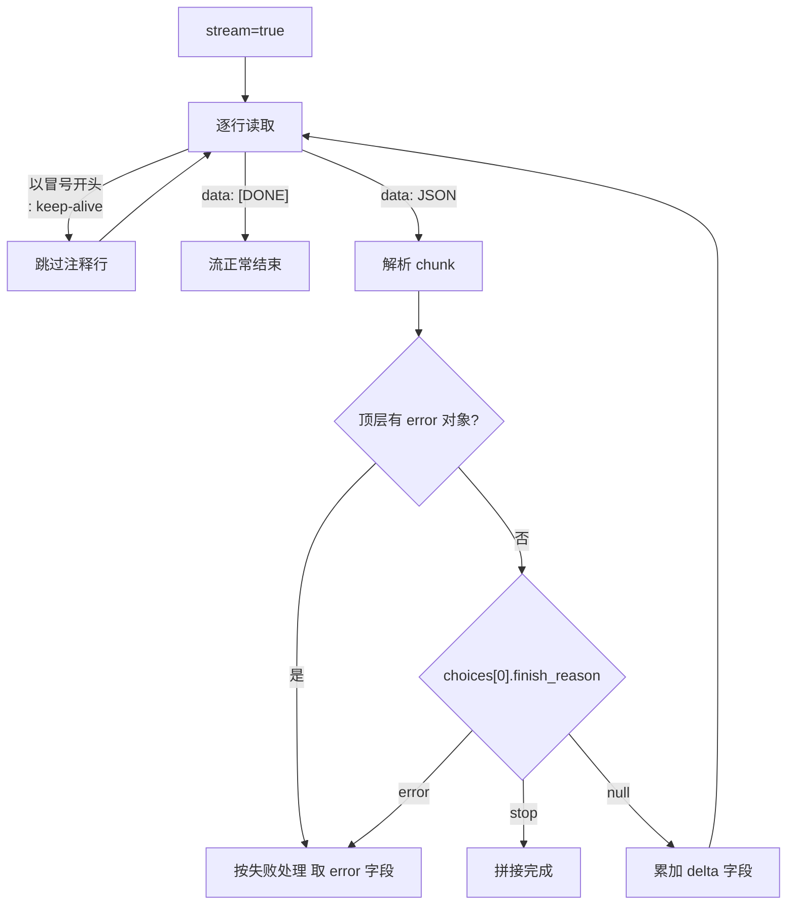

# 直答——三档模型的 Chat Completions 接口与流式协议

## 一、接口定位与形态

直答（Zhida）是知乎开放平台提供的生成式问答能力。在平台全部开放接口中，它是**唯一一个采用 OpenAI 风格响应包装**的接口——响应顶层直接是 `id` / `object` / `created` / `model` / `choices`，而非其余接口通用的 `Code` / `Message` / `Data` 三段式结构（额度接口即返回 `{"Code": 0, "Message": "success", "Data": [...]}`）。

| 说明 | 值 |
| :- | :- |
| HTTP URL | `https://developer.zhihu.com/v1/chat/completions` |
| HTTP Method | `POST` |
| 请求类型 | `application/json` |
| 响应类型 | `application/json`（`stream=false`） / `text/event-stream`（`stream=true`） |

鉴权 Header：

- `Authorization: Bearer <your_access_secret>`
- `X-Request-Timestamp: <unix_seconds>`

官方说明：统一使用 Access Secret 的 Bearer 鉴权语义；`X-Request-Timestamp` 为**秒级** Unix 时间戳。

## 二、请求参数与能力白名单

### Body 与 Message

Body 当前支持 3 个请求字段：

| 名称 | 类型 | 必填 | 说明 |
| :- | :- | :- | :- |
| `model` | String | 是 | 模型档位，支持 `zhida-fast-1p5`、`zhida-thinking-1p5`、`zhida-agent` |
| `messages` | Array[Message] | 是 | 对话消息列表 |
| `stream` | Bool | 否 | 是否流式返回，默认 `false` |

Message 只有 `role`（String，消息角色，必填）与 `content`（String，问题内容，必填）两个字段。

### 官方能力白名单（逐条转写）

官方「注意事项」共 6 条，原文转写如下：

1. 当前仅保证 `model/messages/stream` 三个字段的能力语义。
2. 其他请求字段当前不作为正式支持能力，不保证生效。
3. `id` 在同一次流式响应中保持一致。
4. `model` 为必填，缺失时返回 `missing_required_parameter`。
5. 支持 role、content 上下文传参的模型：`zhida-fast-1p5`、`zhida-thinking-1p5`。
6. 实际可用模型还会受租户授权配置影响。

由此得到两条硬结论：

- **第 5 条把 `zhida-agent` 排除在「支持 role、content 上下文传参的模型」之外。** 传 `messages` 数组时，只有 `zhida-fast-1p5` 与 `zhida-thinking-1p5` 的上下文传参能力被官方保证。
- **除 `model` / `messages` / `stream` 之外的字段写了也不保证生效。** `temperature`、`max_tokens`、`top_p`、`stop`、`tools` 等字段即使写入请求体，官方也只声明「不作为正式支持能力，不保证生效」。

⚠️ **缺口 1**：官方文档未给出 `messages` 的最大条数、`role` 的取值枚举（是否允许 `system` / `assistant`）、`content` 的长度上限，也未给出 `messages` 与 `zhida-agent` 的配合方式。

## 三、响应结构

### 非流式（`stream=false`）

| 字段 | 类型 | 说明 |
| :- | :- | :- |
| `id` | String | 本次响应 ID，形如 `chatcmpl-xxxx` |
| `object` | String | 响应对象类型，形如 `chat.completion` |
| `created` | Int64 | 响应创建时间，形如 `1740470400` |
| `model` | String | 实际使用的模型（回显） |
| `choices` | Array | 回答列表 |
| `choices[].index` | Int | 回答序号 |
| `choices[].message` | Object | 回答内容，含 `role`、`reasoning_content`（推理内容，是否返回取决于模型）、`content`（回答正文） |
| `choices[].finish_reason` | String | 生成结束原因，形如 `stop` |

```json
{
  "id": "chatcmpl-xxxx",
  "object": "chat.completion",
  "created": 1740470400,
  "model": "zhida-thinking-1p5",
  "choices": [
    {
      "index": 0,
      "message": {
        "role": "assistant",
        "reasoning_content": "先给出分析过程...",
        "content": "..."
      },
      "finish_reason": "stop"
    }
  ]
}
```

### 流式增量字段

流式响应中 `choices[]` 使用 `delta` 而非 `message`：`choices[].delta.role`（消息角色）、`choices[].delta.reasoning_content`（增量推理内容）、`choices[].delta.content`（增量回答正文）、`choices[].delta`（结束时为 `{}` 空对象）、`choices[].finish_reason`（生成结束原因）。

⚠️ **缺口 2**：`reasoning_content` 是否出现在增量帧中取决于所选模型，官方未给出「哪一档返回、哪一档不返回」的对照表，解析必须写成「有/无」两种分支。

## 四、流式协议（SSE）

### 帧格式

`stream=true` 时响应类型为 `text/event-stream`，官方示例共 4 帧（3 帧 `data:` + 1 帧结束标记）：

```text
data: {"id":"chatcmpl-xxxx","object":"chat.completion.chunk","created":1740470400,"model":"zhida-thinking-1p5","choices":[{"index":0,"delta":{"role":"assistant","reasoning_content":"先分析背景"},"finish_reason":null}]}

data: {"id":"chatcmpl-xxxx","object":"chat.completion.chunk","created":1740470400,"model":"zhida-thinking-1p5","choices":[{"index":0,"delta":{"content":"最终回答片段"},"finish_reason":null}]}

data: {"id":"chatcmpl-xxxx","object":"chat.completion.chunk","created":1740470400,"model":"zhida-thinking-1p5","choices":[{"index":0,"delta":{},"finish_reason":"stop"}]}

data: [DONE]
```

要点：

- 流式帧的 `object` 为 `chat.completion.chunk`（非流式为 `chat.completion`）；同一流内 `id` 保持一致（白名单第 3 条）。
- `finish_reason` 中间帧为 `null`，结束时为 `stop`（异常时为 `error`）；结束标记为 `data: [DONE]`，不是 JSON。
- 服务端会发送心跳注释 `: keep-alive`。**解析器必须能容忍以冒号开头的注释行**，这类行不是数据帧，直接跳过。

### 帧解析流程



## 五、错误处理

### 错误响应对象

```json
{
  "error": {
    "message": "xxx",
    "type": "invalid_request_error",
    "param": "model",
    "code": "model_not_found"
  }
}
```

官方文档中出现的错误码：

| `code` | `type` | `param` / `message` | 触发场景 |
| :- | :- | :- | :- |
| `model_not_found` | `invalid_request_error` | `param` = `model` | `model` 取值不在支持枚举内 |
| `missing_required_parameter` | 官方文档未给出 | 官方文档未给出 | `model` 必填字段缺失 |
| `internal_error` | `server_error` | `message` = `Internal server error` | 服务端内部错误 |

### 流式中途错误

HTTP 200 已发出后发生的错误，通过 SSE 帧返回——顶层带 `error` 对象，且 `choices[].finish_reason` 为 `error`：

```text
data: {"id":"chatcmpl-xxxx","object":"chat.completion.chunk","created":1740470400,"model":"zhida-thinking-1p5","choices":[{"index":0,"delta":{},"finish_reason":"error"}],"error":{"message":"Internal server error","type":"server_error","code":"internal_error"}}

data: [DONE]
```

**结论：不能只靠 HTTP 状态码判断失败。** 客户端必须逐帧解析，对每一帧同时检查顶层 `error` 对象与 `choices[].finish_reason`；`finish_reason == "error"` 或存在 `error` 对象时按失败处理，并从 `error` 中取 `message` / `type` / `code`。在 `data: [DONE]` 之前出现的 `error` 帧即意味着本次生成失败，即使此前已推送了若干正常增量。

⚠️ **缺口 3**：官方**未给出** HTTP 状态码与错误码的对应关系、`max_tokens` 上限与请求超时时间；错误响应示例只展示了 `param` 字段，未说明它在其它错误码下是否存在。

## 六、直答 Skill 封装

### 下载与参数

下载：`https://developer.zhihu.com/download/zhida_skills.zip`。Skill 面向 AI 助手与 Agent 封装直答能力，请求参数如下：

| 名称 | 类型 | 必填 | 说明 |
| :- | :- | :- | :- |
| `query` | String | 是 | 用户问题，不能为空 |
| `model` | String | 否 | 模型名称，默认 `zhida-fast-1p5`；还可选择 `zhida-thinking-1p5` 或 `zhida-agent` |
| `stream` | Bool | 否 | 是否使用流式响应，默认 `false` |
| `output` | String | 否 | 输出格式。非流式请求使用 `json`；流式请求可使用 `sse` 或 `text` |

```json
{
  "query": "什么是 RAG？",
  "model": "zhida-thinking-1p5",
  "stream": false,
  "output": "json"
}
```

### 与 API 的差异

| 维度 | 直答 API | 直答 Skill |
| :- | :- | :- |
| 问题载体 | `messages` 数组（`role` + `content`） | 单个 `query` 字符串，**不暴露** `messages` |
| `model` | 必填，缺失返回 `missing_required_parameter` | 选填，默认 `zhida-fast-1p5` |
| `stream` | 选填，默认 `false` | 选填，默认 `false` |
| 输出格式 | 由 `stream` 决定 `application/json` / `text/event-stream` | 额外 `output` 字段，与 `stream` 配对 |
| 流式内容 | SSE 帧 | `output=sse` 为 SSE 事件；`output=text` 直接输出正文（非 JSON） |
| 失败语义 | 返回 `error` 对象；流式时以 `finish_reason=error` 的帧返回 | 返回错误信息并以非零状态结束 |

`output` 与 `stream` 必须配对：非流式 → `output` 用 `json`；流式 → `output` 用 `sse` 或 `text`；`output=text` 时输出的是**回答正文本身**而非 JSON 结构，不能按 JSON 解析。Skill 无 `messages` 入口，多轮上下文需自行拼进 `query`。

⚠️ **缺口 4**：`output` 的**默认值官方未明确**，只说明了各取值的使用场景。

⚠️ **缺口 5**：Skill 页**未给出** SSE 帧的具体 JSON 示例（只有 `data` 为 JSON 对象、结束事件为 `data: [DONE]` 的描述），也**未给出**错误码表。

## 七、模型选型

| 模型档位 | 官方描述 | 支持 role / content 上下文传参 |
| :- | :- | :- |
| `zhida-fast-1p5` | 快速回答 | 是 |
| `zhida-thinking-1p5` | 深度思考 | 是 |
| `zhida-agent` | 智能检索与回答 | **否**（不在官方支持清单内） |

选型判断：需要多轮 `role` / `content` 上下文时只能用 `zhida-fast-1p5` 或 `zhida-thinking-1p5`；需要推理内容时选 `zhida-thinking-1p5`；`zhida-agent` 按官方描述用于智能检索与回答，其上下文传参能力官方未声明。能否调用还取决于租户授权。

⚠️ **缺口 6**：官方「直答 API」页概述为「快速回答、深度思考、智能思考」，而 MCP 文档页对同一档位记为「智能检索与回答」——两处表述并存。

## 八、与其他篇目衔接

- [额度与鉴权](../concepts/01-auth-and-quota.md)：直答额度项 API ID 为 `zhida_openai`。
- [集成方式与 MCP 工具](../concepts/09-integration-surfaces.md)：MCP 侧 `zhida` 工具同样支持三档模型。
- [搜索与直答协作示例](../examples/02-search-and-zhida-workflow.md)：搜索取证后再以直答生成回答的链路。