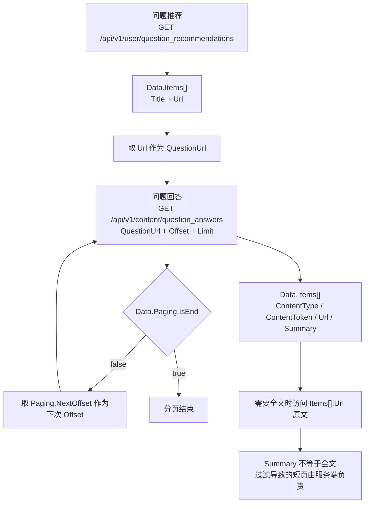

# 问题发现——问题推荐与问题回答摘要的双接口契约

知乎开放平台的「问题发现」能力由两个接口组成：问题推荐给出**可回答的问题入口**，问题回答给出**该问题下的回答摘要列表**。两者共用同一额度组、走同一条鉴权链，但在路径前缀、分页能力和返回字段上几乎没有交集，且各自埋着一个高概率踩中的语义坑。

## 一、两个接口概览

| 维度 | 问题推荐 | 问题回答 |
| :- | :- | :- |
| HTTP URL | `https://developer.zhihu.com/api/v1/user/question_recommendations` | `https://developer.zhihu.com/api/v1/content/question_answers` |
| HTTP Method | `GET` | `GET` |
| 路径前缀 | `/api/v1/user/...` | `/api/v1/content/...` |
| 额度组 | 问题发现 `question_discovery` | 问题发现 `question_discovery` |
| 核心产出 | `Data.Items[]`：`Title` + `Url` | `Data.Items[]`：`ContentType` / `ContentToken` / `Url` / `Summary` |
| 必填参数 | 无（`Query` 与 `Count` 均可省略） | `QuestionUrl`（String，必填） |
| 分页 | **不支持分页** | 支持，`Offset` / `Limit` + `Data.Paging` |
| 返回条数 | 可能不足 `Count`，也可能为空 | 单页 `Items` 可能少于 `Limit`，甚至为空 |

⚠️ **前缀异常点**：在「用户侧」接口家族中，问题回答是**唯一**使用 `/api/v1/content/...` 前缀的接口。`/api/v1/content/` 主要是搜索类接口的地盘（`global_search`、`zhihu_search`、`hot_list`），而 `user_data` 额度组覆盖的用户创作列表、关注、收藏及收藏夹数据全部走 `/api/v1/user/...`。按前缀写死路由的客户端必须把这两个接口分开处理。

## 二、共同的鉴权契约

两个接口使用开放平台**统一 Bearer 鉴权**，并携带**秒级** `X-Request-Timestamp`：

| 请求头 | 值 | 说明 |
| :- | :- | :- |
| `Authorization` | `Bearer <your_access_secret>` | Access Secret 作为 Bearer Token |
| `X-Request-Timestamp` | `<unix_seconds>` | 秒级 Unix 时间戳 |

身份语义上，官方原文为「**两种模式均使用当前账号身份**」：问题推荐依据「当前 Access Secret 所属用户的画像」或用户指定的主题工作，问题回答同样在当前账号身份下执行。两个接口页都**没有提供任何指定他人身份的参数**。

⚠️ **缺口 1**：两页只写「请求头使用开放平台统一 Bearer 鉴权，并携带秒级 `X-Request-Timestamp`」，**未在本页重复声明与服务端时间的偏差窗口**。该约束只在额度查询页写明（与服务器时间相差不能超过 10 分钟），适用范围以额度页为准，详见 [01 · 鉴权与额度](../concepts/01-auth-and-quota.md)。

## 三、问题推荐 API

### 3.1 请求参数

| Query 参数 | 类型 | 必填 | 默认值 | 说明 |
| :- | :- | :- | :- | :- |
| `Query` | String | 否 | — | 主题关键词。未提供时按当前用户画像推荐；提供时按主题推荐，去除首尾空白后不能为空 |
| `Count` | Int32 | 否 | `5` | 返回数量，范围 `1-20` |

### 3.2 ⚠️ 核心坑：不传 `Query` 与传空字符串含义不同

| 请求形态 | 走的推荐模式 | 官方给出的结果 |
| :- | :- | :- |
| `?Count=5`（不传 `Query`） | **画像推荐**（按当前用户画像） | 正常返回 |
| `?Query=人工智能&Count=5` | **主题推荐**（按主题关键词） | 正常返回 |
| `?Query=`（空字符串） | — | 返回 `10001` |
| `?Query=` 后接纯空白 | — | 返回 `10001` |

根因在 `Query` 的定义里有一句硬约束：**去除首尾空白后不能为空**。因此「省略参数」与「传一个空值」在语义上是两件事——省略表示"没有指定主题"，空值表示"指定了一个非法主题"。客户端若用「参数存在就拼接到 URL」的实现方式，在主题为空时会稳定发出 `?Query=` 并触发 `10001`。

### 3.3 响应结构

`Data.Items` 中每个元素**只有两个字段**：

| 字段 | 类型 | 说明 |
| :- | :- | :- |
| `Title` | String | 问题标题 |
| `Url` | String | 问题链接 |

```json
{
  "Code": 0,
  "Message": "success",
  "Data": {
    "Items": [
      {
        "Title": "如何理解 AI Agent？",
        "Url": "https://www.zhihu.com/question/123"
      }
    ]
  }
}
```

注意这里**没有** `ContentToken`、没有摘要、没有分页游标——问题推荐只给标题与链接，选题与取内容的动作都留给调用方。

### 3.4 边界

- **不支持分页**：`Count` 是唯一可调的返回数量控制，没有 `Offset`，没有 `NextOffset`，也没有 `Totals`。
- 返回条目**可能不足 `Count`，也可能为空**。
- `Count` 取值范围 `1-20`，默认 `5`。

⚠️ **缺口 2**：官方**未给出**「返回条目少于 `Count`」与「返回空数组」的区分方式，也未说明条目不足的原因（候选池不足、主题覆盖度有限等均属推测）。客户端无法据此判断是"确实没有更多问题"还是"本次候选池恰好为空"，只能原样呈现。

## 四、问题回答 API

### 4.1 请求参数

| Query 参数 | 类型 | 必填 | 默认值 | 说明 |
| :- | :- | :- | :- | :- |
| `QuestionUrl` | String | 是 | — | 完整的知乎问题 URL |
| `Offset` | Int64 | 否 | `0` | 分页偏移，不能为负数 |
| `Limit` | Int64 | 否 | `20` | 返回数量，范围 `1-50` |

`QuestionUrl` 要求的是**完整的知乎问题 URL**（问题页地址形态，如 `https://www.zhihu.com/question/123`），而问题推荐返回的 `Url` 正是这个形态，两个接口因此可以直接串联。

### 4.2 响应结构

| 字段 | 类型 | 说明 |
| :- | :- | :- |
| `Items` | Array | 回答摘要列表 |
| `Items[].ContentType` | String | 固定为 `answer` |
| `Items[].ContentToken` | String | 回答 Token |
| `Items[].Url` | String | 回答链接 |
| `Items[].Summary` | String | 服务返回的回答摘要或截取文本 |
| `Paging.IsEnd` | Bool | 是否已到最后一页 |
| `Paging.NextOffset` | Int64 | 下一页偏移；IsEnd=true 时可省略 |
| `Paging.Totals` | Int64 | 回答总数；未提供时可能不返回 |

```json
{
  "Code": 0,
  "Message": "success",
  "Data": {
    "Items": [
      {
        "ContentType": "answer",
        "ContentToken": "456",
        "Url": "https://www.zhihu.com/question/123/answer/456",
        "Summary": "这是一段回答摘要……"
      }
    ],
    "Paging": {
      "IsEnd": true,
      "Totals": 1
    }
  }
}
```

### 4.3 ⚠️ `Summary` 的准确定义

官方对 `Summary` 的说明只有一句：**「服务返回的回答摘要或截取文本，不额外生成 AI 摘要，也不代表回答全文。」** 三个否定句缺一不可：

| 断言 | 含义 |
| :- | :- |
| 是服务返回的摘要或截取文本 | 内容由上游服务给出，不是本平台二次加工的产物 |
| **不额外生成 AI 摘要** | 不要指望它是被模型改写过的"精华版"，措辞与原文保持上游形态 |
| **不代表回答全文** | 不能把 `Summary` 当作回答完整内容直接展示或当作唯一内容来源 |

需要全文时，只能通过 `Items[].Url` 访问原文。

### 4.4 翻页铁律（五条逐条转写）

官方「分页说明」给出的前置事实是：**无效或无摘要的回答会被过滤，因此单页 `Items` 数量可能少于 `Limit`，甚至为空。请使用服务返回的分页字段，不按过滤后的条数重新计算。**

由此得到五条不可改写的翻页规则：

1. `Paging.IsEnd=false` 时，**按需**将 `Paging.NextOffset` 作为下一次请求的 `Offset`。
2. `Paging.IsEnd=true` 时停止翻页；**请勿根据 `Items` 数量判断结束或自行计算偏移**。
3. 若 `IsEnd=false` 但缺少 `NextOffset`，**停止自动翻页并报告分页信息不完整**，避免重复请求。
4. `Paging.Totals` **可能包含被过滤的项**，不保证等于最终可读取的摘要数。
5. `Paging.Totals` **未提供时可能不返回**——它不是"最后一页"的判据，`IsEnd` 才是。

⚠️ **缺口 3**：官方**未给出**"无效或无摘要的回答会被过滤"的具体判定规则（何为无效、何为无摘要），也未说明被过滤项在 `Totals` 中是否必然计入（只说"可能包含"）。客户端因此无法自建过滤逻辑来对齐 `Totals`。

## 五、两个接口的调用链



链路上的三段式结论：**问题推荐给「入口」，问题回答给「入口下的摘要」，原文始终需要通过 `Url` 单独访问。** 全链路共用同一个 Access Secret 身份，不存在跨身份调用。

## 六、额度与错误码

### 6.1 额度

| 额度项 | API ID | 覆盖接口 | 默认日额度 | 未实名等低额度用户 |
| :- | :- | :- | :- | :- |
| 问题发现 | `question_discovery` | 问题推荐、问题回答摘要 | 每租户每个自然日 **100 次** | 10 次 |

两种推荐模式与问题回答共用同一额度组，**调用任一个都会消耗该组剩余次数**。官方同时声明：**实际额度以额度查询结果为准**。

⚠️ **`30001` 有两种可能含义**：问题发现场景下返回 `30001`，**可能是当日额度耗尽而非频率限制**。官方给出的处置方式是**查询「问题发现」剩余额度以区分每日额度与短时限制，避免持续重试**。把它一律当作"限流"并立即重试，会在额度已耗尽时形成无效重试风暴。

### 6.2 错误码

问题推荐：

| Code | 说明 |
| :- | :- |
| `10001` | 参数错误 |
| `20001` | 鉴权或授权失败 |
| `30001` | 调用频率、并发限制或当日额度超过限制 |
| `30002` | 额外配置的累计成功次数额度耗尽 |
| `30003` | 请求被风控拒绝 |
| `90001` | 服务内部错误 |

问题回答：

| Code | 说明 |
| :- | :- |
| `10001` | 问题 URL 或分页参数错误，或者问题不存在 |
| `20001` | 鉴权或授权失败 |
| `30001` | 调用频率、并发限制或当日额度超过限制 |
| `30002` | 额外配置的累计成功次数额度耗尽 |
| `30003` | 请求被风控拒绝 |
| `90001` | 服务内部错误 |

两页的成功响应均为 `Code: 0` / `Message: "success"`（见上方响应示例）。⚠️ **缺口 4**：两页错误码表**都没有列出 `0` 行**，成功态只能从响应示例反推；`30001` 也**未提供区分频率限制与日额度耗尽的判定字段**，只能靠额度查询旁证。

## 七、与创作能力的边界

「问题发现」与「创作能力」是**两个彼此独立的额度组**，不要混算：

| 维度 | 问题发现 | 创作能力 |
| :- | :- | :- |
| 额度组 | `question_discovery` | `creator` |
| 覆盖接口 | 问题推荐、问题回答摘要 | 我的创作全文、我的创作评论、账号创作数据、单篇创作数据 |
| 默认日额度 | 每租户每自然日 **100 次** | 每租户每自然日**共计 200 次** |
| 未实名等低额度用户 | 10 次 | 10 次 |
| 身份语义 | 当前 Access Secret 所属用户 | 仅当前 Access Secret 所属账号，**不接受 OAuth 身份切换** |

调用问题发现不会消耗创作能力额度，反之亦然。官方在创作能力接口页同样写明：「问题推荐和回答摘要共用独立的『问题发现』额度。」

⚠️ **缺口 5**：官方**未给出**问题发现额度组内的**组内配额拆分方式**（100 次是共享池，而非两接口各 50 次），也未说明额度扣减是否存在优先级或先后顺序差异。

## 八、与其他篇目衔接

- [01 · 鉴权与额度](../concepts/01-auth-and-quota.md)——Bearer 双头校验、`/api/v1/quota` 的 9 个额度组与计费口径。
- [08 · OAuth 与用户数据](../concepts/08-user-data-oauth.md)——问题发现只服务当前账号本人；访问他人授权数据的边界。
- [示例 01 · 首次调用流程](../examples/01-first-call-workflow.md)——从鉴权到首个成功响应的完整步骤。
