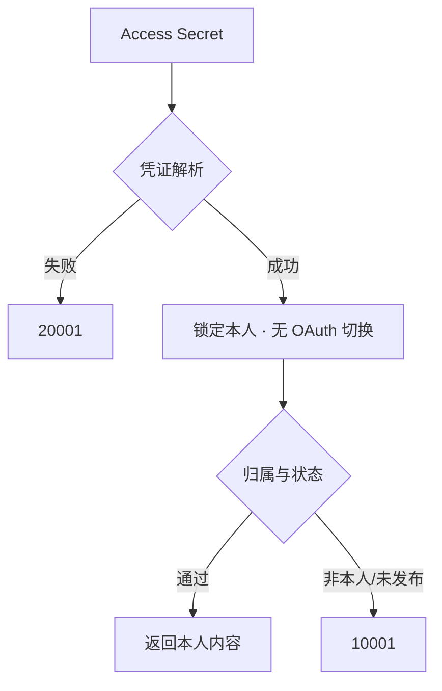

# 创作能力——本人内容全文、评论与账号/单篇数据的四接口契约

四接口都只服务**当前 Access Secret 所属账号**：不接受 OAuth 身份切换，只读本人已发布内容，共用一个额度组。

## 一、四个接口概览

|接口|路径（GET）|必填参数|可选参数|
|---|---|---|---|
|我的创作全文|`/api/v1/user/content_detail`|`ContentUrl`|无|
|我的创作评论|`/api/v1/user/content_comments`|`ContentUrl`|`Offset`/`Limit`/`Order`|
|账号创作数据|`/api/v1/user/creator_account_stats`|无|`ContentType`/`StartDate`/`EndDate`|
|单篇创作数据|`/api/v1/user/creator_content_stats`|`ContentUrl`|`StartDate`/`EndDate`|

四者路径前缀统一为 `/api/v1/user/...`（域名 `https://developer.zhihu.com`）。

## 二、共同的鉴权与身份约束

四页逐字一致：

|约束项|官方表述要点|
|---|---|
|账号范围|**仅支持当前 Access Secret 所属账号**|
|请求头|`Authorization: Bearer <your_access_secret>`、`X-Request-Timestamp: <unix_seconds>`（秒级）|
|身份来源|服务端从凭证解析本人身份，**不能通过参数指定他人**|
|身份切换|**不接受 OAuth 身份切换**|
|内容状态|仅支持本人**已发布**的内容；草稿、未发布或其他不可用状态不在支持范围内|
|归属核验|链接无效、内容不存在或作者不属于当前用户时返回参数错误，**响应不会泄露作者归属信息**|



⚠️ **缺口 1**：官方**未给出** `10001` 区分「链接无效」「内容不存在」「作者非本人」「内容未发布」的原因码。

## 三、我的创作全文

`ContentUrl`(String，必填)：当前用户创作的回答、文章、想法或视频链接。

支持的知乎 HTTPS 链接形态（逐字）：`/answer/{id}`、`/question/{id}/answer/{id}`、`/p/{id}`（文章）、`/pin/{id}`、`/zvideo/{id}`。响应字段在 `Data`：

|字段|类型|说明|
|---|---|---|
|`ContentType`|String|内容类型：answer、article、pin 或 zvideo|
|`ContentToken`|String|内容标识，保留字符串精度|
|`Url`|String|内容链接|
|`Title`|String|内容标题，可能为空字符串|
|`Body`|String|正文，可能含 HTML；展示时转义或安全清洗|

边界：视频类型**仅返回关联正文，不提供视频文件下载**；无可用正文时返回内容不可用，**不把空 `Body` 称为全文**。

## 四、我的创作评论

|名称|类型|必填|说明|
|---|---|---|---|
|`ContentUrl`|String|是|当前用户创作的内容链接|
|`Offset`|Int64|否|分页偏移，默认 `0`，不能为负数|
|`Limit`|Int64|否|根评论返回数量，默认 `20`，范围 `1–50`|
|`Order`|String|否|`score`（热度）/`reverse`（时间倒序）/`ascending`（时间正序），默认 `score`|

`Data.Items[]` 每项含 `Comment` 根评论与 `Children[]`，**两层使用相同字段**：

|字段|类型|含义|
|---|---|---|
|`ID`|Int64|评论 ID（保留大整数精度）|
|`Type`|String|评论类型|
|`ReplyID`|Int64，可选|直接回复的评论 ID，0 时省略|
|`RootID`|Int64，可选|所属根评论 ID，0 时省略|
|`CreatedAt`|Int64|创建时间，Unix 秒级|
|`Content`|String|评论文本，按不可信内容处理|
|`LikeCount`|Int64|点赞数|
|`DislikeCount`|Int64|点踩数|
|`AuthorToken`|String|评论作者标识|

```json
{"Code":0,"Message":"success","Data":{"Items":[{"Comment":{"ID":456,"Type":"article","CreatedAt":1742822400,"Content":"<p>示例评论</p>","LikeCount":2,"DislikeCount":0,"AuthorToken":"example-user"},"Children":[]}],"Paging":{"IsEnd":true}}}
```

边界与翻页：`Children` 为上游附带的子评论，**不保证完整**；评论作者可能为他人，目标内容须为本人所有；`Limit` 为**根评论**数。`Data.Paging.IsEnd` 为 Bool，`Totals`/`NextOffset` 可选 Int64；`IsEnd=false` 时用 `NextOffset` 作下次 `Offset`，**不要按 `Items` 条数累加，也不要因短页或空页停止**；`NextOffset` 缺失或不递增应报告分页异常并停止翻页；`Totals` **不保证等于可遍历评论数**；**改目标或改排序从 `Offset=0` 开始**。

⚠️ **缺口 2**：官方**未给出** `Children` 层级深度上限与子评论分页入口，也**未给出** `Type` 取值枚举（示例 `"article"`）。

## 五、账号创作数据

|名称|类型|必填|说明|
|---|---|---|---|
|`ContentType`|String|否|`all`、`answer`、`article`、`pin` 或 `zvideo`，默认 `all`|
|`StartDate`|String|否|开始日期，格式 `YYYY-MM-DD`，需与 EndDate 同时提供|
|`EndDate`|String|否|结束日期，格式 `YYYY-MM-DD`，不得早于 StartDate|

`Data` 顶层：`ContentType`(String) 与 `Metrics`/`Audience`/`CreationCounts`/`Followers`/`FollowerDetails`/`FollowerProfile`（Object，可选）。

### Metrics 字段表

|字段|类型|说明|
|---|---|---|
|`Updated`|String|统计更新时间|
|`ViewCount`|Int64|阅读量|
|`PlayCount`|Int64|播放量|
|`UpvoteCount`|Int64|赞同数|
|`CommentCount`|Int64|评论数|
|`LikeCount`|Int64|喜欢数|
|`CollectCount`|Int64|收藏数|
|`ShareCount`|Int64|分享数|
|`RepinCount`|Int64|转发数|
|`PublishCount`|Int64|发布内容数|
|`ClickRate`|Float64|点击率|
|`ReadFinishedRate`|Float64|阅读完成率|
|`PlayFinishedRate`|Float64|播放完成率|
|`IncreasedUpvoteCount`|Int64|新增赞同|
|`DecreasedUpvoteCount`|Int64|减少的赞同|
|`IncreasedLikeCount`|Int64|新增喜欢|
|`DecreasedLikeCount`|Int64|减少的喜欢|
|`Yesterday`|Metrics|昨日指标，同 Metrics 结构|
|`Today`|Metrics|今日指标，同 Metrics 结构|

账号级 Metrics 全表 19 项（18 项与单篇级同名）；单篇级 25 项 = 上表 18 项共有 + 下表 7 项独有：

|字段|类型|说明|
|---|---|---|
|`Date`|String|统计日期|
|`PageShowUV`|Int64|曝光用户数（UV）|
|`NewFollowerCount`|Int64|新增关注用户数|
|`FollowerConversionRate`|Float64|转粉率|
|`PositiveInteractionRate`|String|正向互动率|
|`FollowerGain`|Int64|内容带来的转粉数|
|`UpvoteCount7Days`|Int64|7 日赞同数|

其余子结构：

- `CreationCounts`：`Answer`/`Article`/`Video`/`Follower`（Int64）。
- `Followers`：`Total`/`Yesterday`/`NewYesterday`/`CancelledYesterday`/`ActiveCount`(Int64)、`ActiveRatio`(String)。
- `FollowerDetails`：`Daily`(Array[FollowerDaily])/`Today`(FollowerDaily)/`Period`(FollowerPeriod)；`FollowerDaily`：`Date`(String) + `NetIncrease`/`NewCount`/`UnfollowCount`/`HomepageVisitorCount`/`HomepageFollowCount`(Int64)/`HomepageConversionRate`(Float64)；`FollowerPeriod`：`Date`(String) + 7/14/30 日各项 = 上列指标加天数后缀（`NetIncrease7Days`、`NewCount7Days`、`UnfollowCount7Days`、`HomepageVisitorCount7Days`、`HomepageFollowCount7Days`、`HomepageConversionRate7Days`，14/30 同构）。
- `Audience`：`Status`/`Reason`(String)，`Source`/`Activeness`/`ActiveTime`/`Gender`/`Age`/`Interest`/`Location`/`OS` 为 Array[AudienceProfileItem]，`Content` 为 Array[AudienceContentItem]；`AudienceProfileItem`：`Name`(String)/`Ratio`(Float64)/`Count`(Int64，可选)；`AudienceContentItem`：`ContentType`/`ContentToken`/`Title`(String)/`FollowCount`(Int64)。
- `FollowerProfile`：`Status`(Int32，0 时省略，**缺失不代表异常**)/`Reason`(String)/`Audience`/`Interactions`(FollowerInteractions)。

```json
{"Code":0,"Message":"success","Data":{"ContentType":"all","Metrics":{"Updated":"2026-09-08 12:00:00","ViewCount":100,"UpvoteCount":10,"Yesterday":{"ViewCount":20}},"Followers":{"Total":50,"Yesterday":2,"NewYesterday":3,"CancelledYesterday":1}}}
```

## 六、单篇创作数据

Query：`ContentUrl`(String，必填)；`StartDate`/`EndDate`(String，`YYYY-MM-DD`，需成对提供，`EndDate` 不得早于 `StartDate`)。

`Data.Items[]` 每项：`ContentType`/`ContentToken`/`Url`/`Title`(String，`Title` 可选、空标题省略)、`Metrics`/`Audience`(Object，可选)，`Audience` 同 §五。

⚠️ **账号级与单篇级 `Metrics` 不是同构结构。** 账号级用 `Updated`（**统计更新时间**），单篇级用 `Date`（**统计日期**），不能复用同一类型定义；边界：`Data.Items` **无统计数据时可为空数组，不等同于各指标均为零**。

## 七、字段阅读铁律

两页**逐字相同**的约定，共九条：

1. JSON 字段名**区分大小写**。
2. 可选数值指标**未返回时不应补零**；已提供的数值指标为 `0` 时**会保留**。
3. 状态、字符串和集合字段也可能因零值、空字符串或空集合而省略，**不能仅凭缺失判断上游未提供**。
4. `Int64` 计数字段需**保留整数精度**。
5. 比例沿用上游原值，**单位未明确时不要自行乘 100 或拼接百分号**。
6. 指标可用范围取决于内容类型和上游覆盖，**不承诺所有字段同时存在**。
7. **画像及互动明细缺失时不补全。**
8. 统计可能延迟，**日期范围不保证对每项指标同时生效**。
9. **日期必须成对提供或同时省略**；省略时使用服务默认统计范围，**不承诺固定天数**。

实现建议：**统计图表必须区分「0」与「无数据」**——缺失表示上游未提供或不可用，`0` 表示确实为零。

⚠️ **缺口 3**：官方**未给出** `Updated` 的时间格式（示例 `2026-09-08 12:00:00` 未声明时区），也**未给出** `PositiveInteractionRate`、`ActiveRatio`（String）的单位与取值范围。

## 八、额度

|额度项|API ID|覆盖接口|日额度|未实名|
|---|---|---|---|---|
|创作能力|`creator`|本人全文、评论、账号统计、单篇统计|每租户每自然日**共计 200 次**|10 次|

四接口**共用同一额度组**，调用任一个都消耗其剩余次数，**实际额度以额度查询为准**；问题推荐与回答摘要共用**独立的**「问题发现」额度。

⚠️ **缺口 4**：官方**未给出**创作能力额度组的**组内配额拆分方式**（200 次为共享池，非各 50 次）与接口优先级。

## 九、错误码

四页一致；成功响应含 `Code`/`Message`/`Data`：

|Code|说明|
|---|---|
|`0`|请求成功|
|`10001`|参数错误或内容不可用|
|`20001`|鉴权或授权失败|
|`30001`|调用频率、并发或当日额度超限|
|`30002`|额外配置的成功次数额度耗尽|
|`30003`|请求被风控拒绝|
|`90001`|服务内部错误|

## 十、账号级 vs 单篇级选型

|对比维度|账号创作数据|单篇创作数据|
|---|---|---|
|路径前缀|`/api/v1/user/creator_account_stats`|`/api/v1/user/creator_content_stats`|
|必填参数|无（`ContentType`/`StartDate`/`EndDate` 可选）|`ContentUrl`（String，必填）|
|时间字段|`Metrics.Updated`（统计更新时间）|`Metrics.Date`（统计日期）|
|独有指标|`Metrics.Updated`、`CreationCounts`、`Followers`、`FollowerDetails`、`FollowerProfile`|`Metrics.Date` 与 6 项独有|
|返回结构|`Data` 单对象|`Data.Items[]`，无统计数据时可为空数组|

账号盘子用账号级，单篇表现用单篇级

## 十一、与其他篇目衔接

[01 鉴权与额度](../concepts/01-auth-and-quota.md)｜[08 OAuth 与用户数据](../concepts/08-user-data-oauth.md)｜[示例 03 创作分析流程](../examples/03-creator-analytics-workflow.md)
