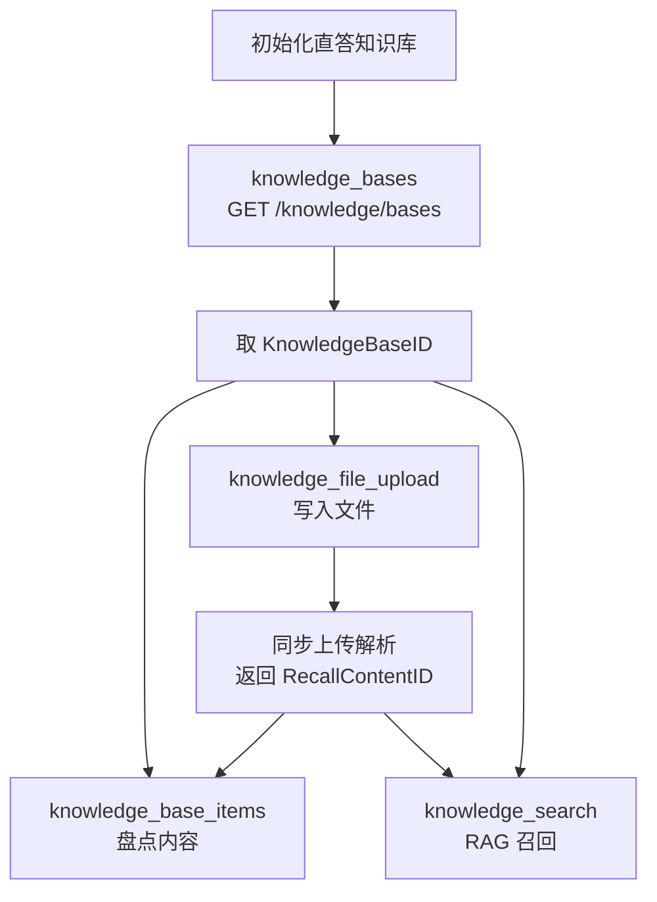

# 直答知识库：上传、盘点与 RAG 检索的四个接口

直答知识库是开放平台唯一完整的「写入—盘点—召回」闭环。四个接口靠 `KnowledgeBaseID` 与 `RecallContentID` 串成管道：先枚举知识库，再写入或盘点内容，最后召回片段。

## 一、前置条件：必须先完成直答知识库初始化

`knowledge_bases`、`knowledge_base_items`、`knowledge_file_upload`、`knowledge_search` 四页顶部承载**同一句原文**：

> 首次使用请先登录直答知识库完成初始化 https://zhida.zhihu.com/repositories/square

⚠️ **缺口：未初始化会返回什么，官方文档未给出。** 四页错误码表都没有这一码，`20001` 无法区分密钥无效与未初始化。

## 二、四个接口总览

| 接口 | 方法与路径 | API ID | Content-Type |
| --- | --- | --- | --- |
| 知识库列表 | `GET /api/v1/knowledge/bases` | `knowledge_bases` | - |
| 知识库内容列表 | `GET /api/v1/knowledge/bases/{KnowledgeBaseID}/items` | `knowledge_base_items` | - |
| 知识库文件上传 | `POST /api/v1/knowledge/files` | `knowledge_file_upload` | `multipart/form-data` |
| 知识库检索 | `POST /api/v1/knowledge/search` | `knowledge_search` | `application/json` |

请求头一致：`Authorization` 为 `Bearer <your_access_secret>`，`X-Request-Timestamp` 为**秒级 Unix 时间戳**。



四个 API ID 同属额度组 `knowledge`，见 [01 · 鉴权与额度](../concepts/01-auth-and-quota.md)。

## 三、知识库列表（`knowledge_bases`）

获取**当前用户创建或订阅的知识库**。

### 3.1 请求参数

| 名称 | 类型 | 必填 | 默认值 | 说明 |
| --- | --- | --- | --- | --- |
| `Scope` | String | 否 | `all` | `all`、`created` 或 `subscribed` |

### 3.2 响应 `Data.Items[]`（`KnowledgeBase`）

| 参数名 | 类型 | 是否必返 | 描述 |
| --- | --- | --- | --- |
| `KnowledgeBaseID` | String | 是 | 知识库 ID |
| `Name` | String | 是 | 知识库名称 |
| `Description` | String | 否 | 知识库描述 |
| `Relation` | String | 是 | 当前用户与知识库的关系：`created`、`subscribed` 或 `both` |
| `IsDefault` | Boolean | 是 | 是否为当前用户的默认知识库 |
| `Visibility` | String | 是 | 可见性：`private` 或 `public` |
| `ContentCount` | Int64 | 是 | 内容数量 |
| `UpdatedAt` | Int64 | 是 | 秒级更新时间戳 |

```json
{
  "Code": 0,
  "Message": "success",
  "Data": {
    "Items": [
      {
        "KnowledgeBaseID": "7526139256098382426",
        "Name": "产品资料",
        "Description": "产品相关文档",
        "Relation": "created",
        "IsDefault": false,
        "Visibility": "private",
        "ContentCount": 12,
        "UpdatedAt": 1785902400
      }
    ]
  }
}
```

### 3.3 边界与错误码

⚠️ **本接口不分页，一次返回全部知识库。** `Data` 下只有 `Items`，无 `Total`、`HasMore`、`Cursor` 等分页元信息；**条数上限与具体 QPS 官方文档未给出**，仅声明 `30001` 频率限制。

| 错误码 | 说明 |
| --- | --- |
| `0` | 成功 |
| `10001` | 请求参数错误 |
| `20001` | 鉴权失败或无访问权限 |
| `30001` | 频率限制 |
| `90001` | 请求失败 |

## 四、知识库内容列表（`knowledge_base_items`）

分页获取**指定知识库**中的内容。

### 4.1 请求参数

| 位置 | 名称 | 类型 | 必填 | 说明 |
| --- | --- | --- | --- | --- |
| Path | `KnowledgeBaseID` | String | 是 | 知识库 ID |
| Query | `Cursor` | String | 否 | 默认空；上一页返回的不透明游标；调用方不要解析或修改 |
| Query | `Limit` | Int32 | 否 | 默认 `20`；每页数量，范围 `1..20` |

### 4.2 响应 `Data` 与 `KnowledgeItem`

| 参数名 | 类型 | 是否必返 | 描述 |
| --- | --- | --- | --- |
| `Items` | Array[KnowledgeItem] | 是 | 本页内容项 |
| `Total` | Int64 | 是 | 当前条件下的内容总数 |
| `HasMore` | Boolean | 是 | 是否还有下一页 |
| `NextCursor` | String | 否 | `HasMore=true` 时用于请求下一页 |

`KnowledgeItem`：

| 参数名 | 类型 | 是否必返 | 描述 |
| --- | --- | --- | --- |
| `RecallContentID` | String | 是 | 内容 ID，可能为空 |
| `ContentType` | String | 是 | `unknown`、`file`、`answer` 或 `article` |
| `Title` | String | 是 | 文件名 |
| `Abstract` | String | 否 | 摘要 |
| `CreatedAt` | Int64 | 否 | 秒级创建时间戳 |
| `UpdatedAt` | Int64 | 否 | 秒级更新时间戳 |
| `OriginUrl` | String | 否 | 原始来源地址；回答和文章为原文地址，文件等其他类型为源文件下载地址 |

### 4.3 分页约定与错误码

⚠️ **分页约定（官方原文）：请以 `HasMore` 判断是否继续分页，不要根据本页条数推断是否结束。** 末页少于 `Limit` 条不等于没有下一页。**`NextCursor` 仅在 `HasMore=true` 时可用**，为 `false` 时取值官方文档未给出。

| 错误码 | 说明 |
| --- | --- |
| `0` | 成功 |
| `10001` | 请求参数错误 |
| `20001` | 鉴权失败或无访问权限 |
| `30001` | 频率限制 |
| `40004` | 知识库不存在 |
| `90001` | 请求失败 |

## 五、知识库文件上传（`knowledge_file_upload`）

上传文件并**同步完成解析和知识库挂载**。不指定知识库时进入**当前用户的默认知识库**。

### 5.1 Form 参数与扩展名

| 名称 | 类型 | 必填 | 说明 |
| --- | --- | --- | --- |
| `File` | File | 是 | 文件内容不能为空，单文件最大 `100 MB` |
| `KnowledgeBaseID` | String | 否 | 目标知识库 ID；不传时使用当前用户的默认知识库 |

⚠️ **不要手工设置带 boundary 的 `Content-Type`；使用 curl `-F` 时会自动生成正确的 multipart Header。** 手工拼 `multipart/form-data` 漏掉 boundary，服务端无法解析表单。

支持的扩展名（官方给出 16 个）：

```text
pdf, md, txt, ppt, pptx, xlsx, xls, docx, doc,
webp, png, jpg, mobi, epub, csv, azw3
```

文件名规则：扩展名判断**忽略大小写**；文件名必须是**合法 UTF-8**，不能包含 NUL、换行或其他控制字符；清理路径和首尾空白后的文件名不能超过 **255 个 UTF-8 字节**。⚠️ 该单位是 **UTF-8 字节而非字符数**，255 个中文字符远超 255 字节。

### 5.2 响应 `Data`

| 参数名 | 类型 | 是否必返 | 描述 |
| --- | --- | --- | --- |
| `KnowledgeBaseID` | String | 是 | 文件实际进入的知识库 ID |
| `RecallContentID` | String | 是 | 内容 ID |
| `FileName` | String | 是 | 清理后的原始文件名 |
| `FileSize` | Int64 | 是 | 文件大小，单位为字节 |
| `Title` | String | 否 | 内容标题 |
| `Abstract` | String | 否 | 内容摘要 |
| `OriginUrl` | String | 否 | 源文件下载地址 |

```json
{
  "Code": 0,
  "Message": "success",
  "Data": {
    "KnowledgeBaseID": "7526139256098382426",
    "RecallContentID": "recall-content-id",
    "FileName": "产品资料.pdf",
    "FileSize": 1048576,
    "Title": "产品资料",
    "Abstract": "文档主要介绍产品能力",
    "OriginUrl": "https://assets2.zhihu.com/example/product.pdf"
  }
}
```

### 5.3 同步语义与错误码

同步语义（官方原文要点）：该接口是**同步接口**，较大文件可能需要较长时间；调用方取消请求**不代表上传和解析一定同步取消**；**请不要对超时或未知结果自动重试**；相同文件仅在前一次仍处于同步处理阶段时被拦截，前一次进入终态后可再次上传。

⚠️ **同步 + 不可自动重试是本接口最需要设计的部分。** 超时只说明客户端没拿到结果，服务端可能仍在解析并已写入；正确处置是**先调内容列表确认文件是否落库**再决定重传。

| 错误码 | 说明 |
| --- | --- |
| `0` | 成功 |
| `10001` | 文件、文件名、格式、大小或其他请求参数不合法 |
| `20001` | 鉴权失败或无权向目标知识库上传 |
| `30001` | 频率限制 |
| `40004` | 知识库不存在 |
| `40005` | 相同文件正在处理中 |
| `40006` | 文件解析失败 |
| `90001` | 请求失败 |

## 六、知识库检索（`knowledge_search`）

用 RAG 从指定知识库或召回范围检索相关文档片段。

### 6.1 请求参数

| 名称 | 类型 | 必填 | 默认值 | 说明 |
| --- | --- | --- | --- | --- |
| `Query` | String | 是 | - | 检索问题，去除首尾空白后不能为空 |
| `KnowledgeBaseIDs` | Array[String] | 条件必填 | `[]` | 指定知识库 ID 列表 |
| `RecallScopes` | Array[String] | 条件必填 | `[]` | `personal`、`subscription`、`public` |
| `Limit` | Int32 | 否 | `10` | 返回文档数量，范围 `1..10` |

⚠️ **`KnowledgeBaseIDs` 和 `RecallScopes` 至少有一个非空，也可以同时传入；同时传入时搜索范围取二者并集。** 二者都是「条件必填」，全空数组落入 `10001`。

### 6.2 请求示例

```json
{
  "Query": "产品的退款规则是什么？",
  "KnowledgeBaseIDs": ["7526139256098382426"],
  "RecallScopes": ["personal", "subscription"],
  "Limit": 10
}
```

### 6.3 响应 `Data.Items[]`（`SearchItem`）

| 参数名 | 类型 | 是否必返 | 描述 |
| --- | --- | --- | --- |
| `Content` | Array[String] | 是 | 同一文档命中的有序正文片段列表 |
| `KnowledgeBaseID` | String | 是 | 所属知识库 ID |
| `DocName` | String | 是 | 文档名称 |
| `RecallContentID` | String | 否 | 内容 ID |
| `OriginUrl` | String | 否 | 原始来源地址；回答和文章为原文地址，文件等其他类型为源文件下载地址 |

⚠️ **`Limit` 按文档结果数计算，不按 `Content` 中的片段数计算。** 返回的字符串总数可远大于 `Limit`。

```json
{
  "Code": 0,
  "Message": "success",
  "Data": {
    "Items": [
      {
        "Content": [
          "退款申请需要在购买后七天内提交。",
          "退款到账通常需要三个工作日。"
        ],
        "KnowledgeBaseID": "7526139256098382426",
        "DocName": "退款规则",
        "RecallContentID": "MTAwMjMwMDAwNzUxODUxMDI0Nnw6fFpISV9EQV9VU0VSX1VQTE9BRA==",
        "OriginUrl": "https://assets2.zhihu.com/example/refund.md"
      }
    ]
  }
}
```

| 错误码 | 说明 |
| --- | --- |
| `0` | 成功 |
| `10001` | 请求参数错误 |
| `20001` | 鉴权失败或无访问权限 |
| `30001` | 频率限制 |
| `50002` | 检索失败，请稍后重试 |
| `90001` | 请求失败 |

## 七、跨接口衔接：两个 ID 串起全链路

| 字段 | 知识库文件上传 | 知识库内容列表 | 知识库检索 |
| --- | --- | --- | --- |
| `KnowledgeBaseID` | 是（实际进入的知识库 ID） | 由路径参数指定 | 是（所属知识库 ID） |
| `RecallContentID` | 是（内容 ID） | 是（**可能为空**） | 否（可选） |
| 文件名 / 文档名 | `FileName`、`Title` | `Title`（文件名） | `DocName`（文档名称） |
| `OriginUrl` | 源文件下载地址 | 原始来源地址 | 原始来源地址 |
| 内容类型 | 不返回 | `ContentType`：`unknown`/`file`/`answer`/`article` | 不返回 |

`RecallContentID` 是**上传 ↔ 内容列表 ↔ 检索**三者的关联键；`FileName`/`Title` 与 `OriginUrl` 三处语义一致。⚠️ 但内容列表中它写明**可能为空**，不能当强制外键；稳定主键是 `KnowledgeBaseID` 加文件名字段。

## 八、两套命名体例并存

依据源文件逐字核对，两侧命名体例互不相同。

| 维度 | 知识库侧 | 小工具侧 |
| --- | --- | --- |
| 字段命名 | **PascalCase**：`KnowledgeBaseID`、`RecallContentID`、`NextCursor`、`HasMore` | **snake_case**：`file_id`、`task_id`、`task_status` |
| 路径参数 | `{KnowledgeBaseID}` | `{task_id}` |
| 请求参数 | `Scope`、`Cursor`、`Limit`、`Query`、`KnowledgeBaseIDs`、`RecallScopes` | `file`、`file_id`、`resource_url`、`num_pages` |
| 时间戳单位 | 秒级（`UpdatedAt`、`CreatedAt`） | 毫秒级（`expires_at_ms`） |
| 结果包裹 | `Data` 含 `Items` 数组 | `Data` 含 `task_status`、`progress`、`result`、`error` |

同一套开放平台并存两套大小写风格，**不能用同一套字段映射规则**写通用客户端。

## 九、易错点汇总

| # | 易错点 | 后果 | 正确做法 |
| --- | --- | --- | --- |
| 1 | 上传字段写成小写 `file` | 知识库上传字段是 `File`，小写 `file` 属 PDF 解析接口 | 知识库用 `File`，PDF 用 `file` |
| 2 | 把 `Scope` 与 `RecallScopes` 当同一套枚举 | 前者取 `all`/`created`/`subscribed`，后者取 `personal`/`subscription`/`public` | 各自按本页取值，勿混用 |
| 3 | 以为 `Limit` 按片段数计 | `Limit` 按文档结果数计算 | 用 `Items` 长度判文档数，`Content` 长度判片段数 |
| 4 | 上传超时后自动重试 | 取消请求不代表解析同步取消，可能重复写入 | 不自动重试；先查内容列表确认前次是否进终态 |
| 5 | 解析或拼装 `Cursor` | 游标是不透明串，改动会破坏分页链 | 原样回传服务端返回的 `Cursor` |
| 6 | 用本页条数判断分页结束 | 末页少于 `Limit` 条仍可能有下一页 | 以 `HasMore` 为唯一终止判据 |

## 十、下一步

- [01 · 鉴权、额度与计费](../concepts/01-auth-and-quota.md)——`knowledge` 额度组口径。
- [07 · 小工具：PDF 解析与 PPT 生成](../concepts/07-document-tools.md)——另一套 snake_case 命名的异步接口。
- [示例 02 · 知识库 RAG 工作流](../examples/02-knowledge-rag-workflow.md)——四个接口串成的写入与召回流程。
