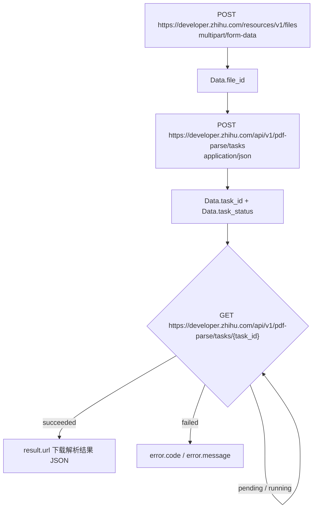
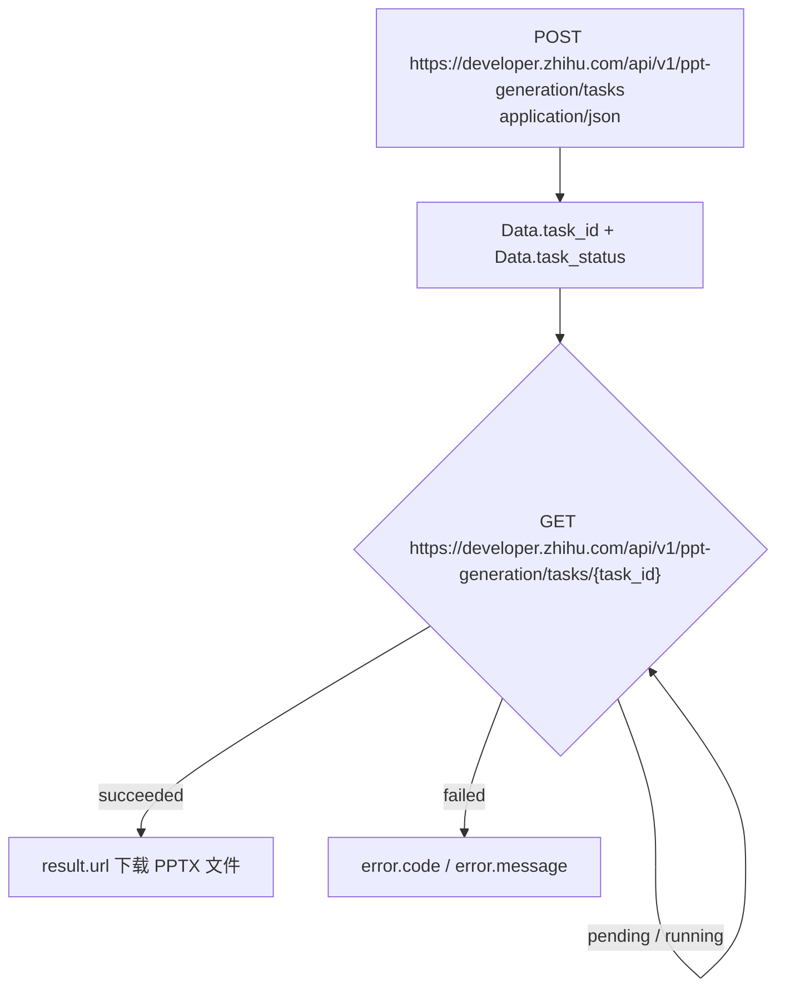

# 小工具：PDF 解析与 PPT 生成的异步任务模型

小工具（额度组 `tools`）有两项能力：**PDF 解析**把 PDF 转成结构化 JSON，**PPT 生成**把知乎回答或文章链接转成 PPTX。两者都是**异步任务**——建任务拿 `task_id`，轮询状态，成功后从 `result.url` 下载结果。

## 一、两个能力对照

| 维度 | PDF 解析 | PPT 生成 |
| --- | --- | --- |
| 输入 | 本地 PDF 文件（经上传接口） | 知乎回答或文章链接 |
| 前置步骤 | 先上传换 `file_id` | 无，链接直接进任务 |
| 创建任务 | `POST /api/v1/pdf-parse/tasks` | `POST /api/v1/ppt-generation/tasks` |
| 查询任务 | `GET /api/v1/pdf-parse/tasks/{task_id}` | `GET /api/v1/ppt-generation/tasks/{task_id}` |
| 产出 | 结构化 JSON（页、块、图片 Base64） | PPTX 文件 |
| 关键约束 | 文件最大 100MB；`file_id` 24 小时内使用 | `num_pages` 范围 6 到 21 |
| 独有错误码 | `40002` 文件不存在、已过期或不可访问 | 无 `40002`（PPT 无文件概念） |

⚠️ **两个接口的字段命名是 snake_case，与知识库侧的 PascalCase 不同**，大小写不能互相套用。

## 二、PDF 解析：三步链路



官方调用流程逐条对应：上传取 `file_id` → 建任务取 `task_id` → 轮询状态 → `task_status=succeeded` 时从 `result.url` 下载结果。

### 2.1 上传文件

`POST https://developer.zhihu.com/resources/v1/files`

| 说明 | 值 |
| --- | --- |
| HTTP URL | `https://developer.zhihu.com/resources/v1/files` |
| HTTP Method | `POST` |
| 请求类型 | `multipart/form-data` |
| 响应类型 | `application/json` |

Form 参数：

| 名称 | 类型 | 必填 | 说明 |
| --- | --- | --- | --- |
| `file` | File | 是 | PDF 文件，最大 100MB |

响应 `Data.file_id`(String) 为文件资源 ID，用于创建解析任务。当前仅支持上传 PDF 文件。

⚠️ **注意字段名是小写 `file`**，与知识库上传的 `File`（首字母大写）不是同一字段。

```json
{
  "Code": 0,
  "Message": "success",
  "Data": {
    "file_id": "file_00000000fb987230beba394fd8279daf"
  }
}
```

官方 Curl 示例：

```bash
curl -X POST 'https://developer.zhihu.com/resources/v1/files' \
  -H 'Authorization: Bearer <your_access_secret>' \
  -H "X-Request-Timestamp: $(date +%s)" \
  -F 'file=@/path/to/example.pdf;type=application/pdf'
```

⚠️ **上传后的文件需在 24 小时内用于创建任务**，否则命中 `40002` 文件不存在、已过期或不可访问。

⚠️ **上传不消耗小工具免费额度**，但上传接口**另有按租户计算的日请求限流**：普通用户默认 10 次，低额度用户默认 2 次，达到上限时返回限流错误。

### 2.2 创建解析任务

`POST https://developer.zhihu.com/api/v1/pdf-parse/tasks`，请求类型 `application/json`。

| 名称 | 类型 | 必填 | 说明 |
| --- | --- | --- | --- |
| `file_id` | String | 是 | 上传文件接口返回的文件资源 ID |

响应 `Data`：

| 名称 | 类型 | 是否必返 | 说明 |
| --- | --- | --- | --- |
| `task_id` | String | 是 | PDF 解析任务 ID |
| `task_status` | String | 是 | 任务状态，初始通常为 `pending` |

### 2.3 查询解析任务

`GET https://developer.zhihu.com/api/v1/pdf-parse/tasks/{task_id}`，响应类型 `application/json`。

Path 参数：

| 名称 | 类型 | 必填 | 说明 |
| --- | --- | --- | --- |
| `task_id` | String | 是 | 创建任务接口返回的任务 ID |

## 三、PPT 生成：两步链路



### 3.1 创建任务

`POST https://developer.zhihu.com/api/v1/ppt-generation/tasks`，请求类型 `application/json`。

| 名称 | 类型 | 必填 | 说明 |
| --- | --- | --- | --- |
| `resource_url` | String | 是 | 知乎回答或文章链接 |
| `num_pages` | Int32 | 是 | 期望生成页数，范围 6 到 21 |

`resource_url` 当前支持三种格式：

| 格式 | 模板 |
| --- | --- |
| 问题下的回答 | `https://www.zhihu.com/question/{question_id}/answer/{answer_id}` |
| 独立回答 | `https://www.zhihu.com/answer/{answer_id}` |
| 专栏文章 | `https://zhuanlan.zhihu.com/p/{article_id}` |

请求示例：

```json
{
  "resource_url": "https://www.zhihu.com/question/1892249263213356127/answer/2021688002292752412",
  "num_pages": 12
}
```

响应 `Data`：

| 名称 | 类型 | 是否必返 | 说明 |
| --- | --- | --- | --- |
| `task_id` | String | 是 | PPT 生成任务 ID |
| `task_status` | String | 是 | 任务状态，初始通常为 `pending` |

⚠️ **PPT 没有上传步骤，也不存在 `file_id`。** `40002` 文件不存在、已过期或不可访问这一错误码只属于 PDF 解析接口。

### 3.2 查询生成任务

`GET https://developer.zhihu.com/api/v1/ppt-generation/tasks/{task_id}`，响应类型 `application/json`。

Path 参数：

| 名称 | 类型 | 必填 | 说明 |
| --- | --- | --- | --- |
| `task_id` | String | 是 | 创建任务接口返回的任务 ID |

## 四、统一的任务模型

两接口查询响应结构完全一致。

| 名称 | 类型 | 是否必返 | 说明 |
| --- | --- | --- | --- |
| `task_id` | String | 是 | 任务 ID |
| `task_status` | String | 是 | 任务状态 |
| `progress` | Number | 是 | 任务进度，范围 0 到 1 |
| `result` | Object or Null | 是 | 任务成功后返回结果信息，未完成或失败时为 `null` |
| `error` | Object or Null | 是 | 任务失败时返回错误信息，未失败时为 `null` |

`task_status` 取值：

| 值 | 说明 |
| --- | --- |
| `pending` | 任务已创建，等待处理 |
| `running` | 任务处理中 |
| `succeeded` | 任务已成功 |
| `failed` | 任务失败 |

`Result` 字段（两接口有别）：

| 字段 | 类型 | 是否必返 | PDF 解析 | PPT 生成 |
| --- | --- | --- | --- | --- |
| `url` | String | 是 | 解析结果下载链接 | PPTX 文件下载链接 |
| `summary` | String | 否 | PDF 摘要，可能为空 | 不返回 |
| `expires_at_ms` | Int64 | 是 | 下载链接过期时间，毫秒级时间戳 | 下载链接过期时间，毫秒级时间戳 |

`Error` 字段：

| 名称 | 类型 | 是否必返 | 说明 |
| --- | --- | --- | --- |
| `code` | String | 是 | 错误码 |
| `message` | String | 是 | 错误信息 |

处理中响应示例：

```json
{
  "Code": 0,
  "Message": "success",
  "Data": {
    "task_id": "pdf_39b0e572b738a5ce8c5be600f9cf7b91",
    "task_status": "running",
    "progress": 0.35,
    "result": null,
    "error": null
  }
}
```

成功响应示例：

```json
{
  "Code": 0,
  "Message": "success",
  "Data": {
    "task_id": "pdf_39b0e572b738a5ce8c5be600f9cf7b91",
    "task_status": "succeeded",
    "progress": 1,
    "result": {
      "url": "https://zhihu-openapi.bj.bcebos.com/...?authorization=...",
      "summary": "这是一份关于开放平台能力介绍的 PDF。",
      "expires_at_ms": 1782800000000
    },
    "error": null
  }
}
```

失败响应示例：

```json
{
  "Code": 0,
  "Message": "success",
  "Data": {
    "task_id": "pdf_39b0e572b738a5ce8c5be600f9cf7b91",
    "task_status": "failed",
    "progress": 0,
    "result": null,
    "error": {
      "code": "parse_failed",
      "message": "PDF parse failed"
    }
  }
}
```

⚠️ **任务失败时外层 `Code` 仍是 `0`，失败信息在 `Data.error` 里。** 只看顶层 `Code` 会把失败任务误判为成功，必须同时检查 `task_status`。

## 五、幂等：Idempotency-Key

创建任务接口支持可选 Header `Idempotency-Key`。

| 规则 | 说明 |
| --- | --- |
| 生效前提 | 同一个 `Idempotency-Key` **配合同一个请求参数** |
| 效果 | 重复调用会返回同一个 `task_id` |
| 重放标记 | 命中幂等重放时响应 Header 包含 `Idempotent-Replayed: true` |
| 禁止用法 | **不要把同一个 `Idempotency-Key` 用于不同请求参数**，否则 `40001` 幂等键与请求参数冲突 |

⚠️ **幂等键与参数必须一对一绑定。** 换参数复用同一键会直接报 `40001`，而不是新建任务。

## 六、额度口径

PPT 生成与 PDF 解析**共用小工具日额度，不分别计算**：普通用户每天 10 次，低额度用户每天 2 次。

| 场景 | 是否计入额度 |
| --- | --- |
| 任务成功 | 计入 1 次 |
| 任务失败 | 不消耗额度 |
| 查询任务状态 | 不消耗额度 |

官方原文：**任务成功时计入 1 次，失败或查询任务状态不消耗额度。**

上传 PDF 文件不消耗小工具免费额度，但受上传接口自身的按租户日请求限流约束（见 2.1）。

## 七、错误码

PDF 解析：

| Code | 说明 |
| --- | --- |
| `10001` | 请求参数错误 |
| `20001` | 鉴权失败或无权限访问 |
| `30001` | 请求过于频繁 |
| `30002` | 额度不足 |
| `40001` | 幂等键与请求参数冲突 |
| `40002` | 文件不存在、已过期或不可访问 |
| `40003` | 活跃任务数超限，请等待已有任务完成后再提交 |
| `90001` | 服务内部错误 |

PPT 生成：

| Code | 说明 |
| --- | --- |
| `10001` | 请求参数错误 |
| `20001` | 鉴权失败或无权限访问 |
| `30001` | 请求过于频繁 |
| `30002` | 额度不足 |
| `40001` | 幂等键与请求参数冲突 |
| `40003` | 活跃任务数超限，请等待已有任务完成后再提交 |
| `90001` | 服务内部错误 |

⚠️ **PPT 错误码表中没有 `40002`**，因为 PPT 生成没有文件上传环节。

## 八、PDF 解析结果文件结构

访问 `result.url` 下载得到 JSON 格式的 PDF 解析结果：

```json
{
  "schema_version": "v1",
  "pages": [
    {
      "page": 0,
      "blocks": [
        {
          "type": "text",
          "box": [0.17, 0.30, 0.82, 0.44],
          "content": "这是一段从 PDF 中解析出的正文。"
        },
        {
          "type": "figure",
          "box": [0.10, 0.55, 0.90, 0.78],
          "content": "",
          "image": {
            "media_type": "image/jpeg",
            "data": "/9j/4AAQSkZJRgABAQ..."
          }
        }
      ]
    }
  ]
}
```

| 名称 | 类型 | 说明 |
| --- | --- | --- |
| `schema_version` | String | 结果结构版本，当前为 `v1` |
| `pages` | Array | 按页组织的解析结果 |
| `pages[].page` | Integer | 页码，从 `0` 开始 |
| `pages[].blocks` | Array | 当前页解析出的内容块 |
| `blocks[].type` | String | 内容块类型，如 `title`、`text`、`formula`、`figure` |
| `blocks[].box` | Number Array | 内容块坐标，格式为 `[x1, y1, x2, y2]` |
| `blocks[].content` | String | 文本内容；图片块没有文本时为空字符串 |
| `blocks[].image` | Object | 图片信息，仅图片块可能返回 |
| `blocks[].image.media_type` | String | 图片 MIME 类型，如 `image/jpeg`、`image/png` |
| `blocks[].image.data` | String | 纯 Base64 图片数据，不包含 `data:image/...;base64,` 前缀 |

⚠️ **调用方应兼容未知的 `type` 和后续新增字段**；普通文本块**不返回** `image`。

⚠️ **`pages[].page` 从 `0` 开始**，与 `num_pages` 期望页数和 PDF 阅读器的 1 起始页码都不同。

## 九、注意事项（官方原文逐条）

PDF 解析：

1. 当前仅支持 PDF 文件解析。
2. 文件大小最大 100MB。
3. 查询接口返回的下载链接有效期较短；如果链接过期，重新查询任务可获得新的下载链接。
4. 不要把同一个 `Idempotency-Key` 用于不同请求参数。

PPT 生成：

1. 当前仅支持知乎回答和知乎专栏文章链接。
2. `num_pages` 必须在 6 到 21 之间。
3. 查询接口返回的下载链接有效期较短；如果链接过期，重新查询任务可获得新的下载链接。
4. 不要把同一个 `Idempotency-Key` 用于不同请求参数。

## 十、两个时间戳与链接过期陷阱

⚠️ **`expires_at_ms` 是毫秒级时间戳，与其他接口的秒级时间戳不同。** 知识库侧的 `UpdatedAt`、`CreatedAt` 是秒级 `Int64`，两者相差三个数量级。

⚠️ **`result.url` 过期后重新查询同一 `task_id` 即可拿到新链接，不要重跑任务。** 重跑会新建任务、重复占用活跃任务配额（`40003`），并再次计入 1 次额度。

## 十一、下一步

- [01 · 鉴权、额度与计费](../concepts/01-auth-and-quota.md)——`tools` 额度组与 `30002` 额度不足的计费口径。
- [06 · 直答知识库](../concepts/06-knowledge-base.md)——另一套 PascalCase 命名体例的知识库接口。
- [示例 04 · 文档工具工作流](../examples/04-document-tool-workflow.md)——两条链路的工程化编排。
