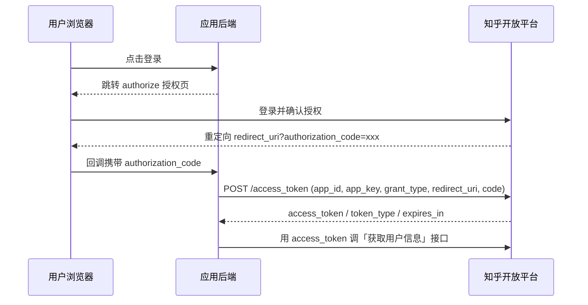
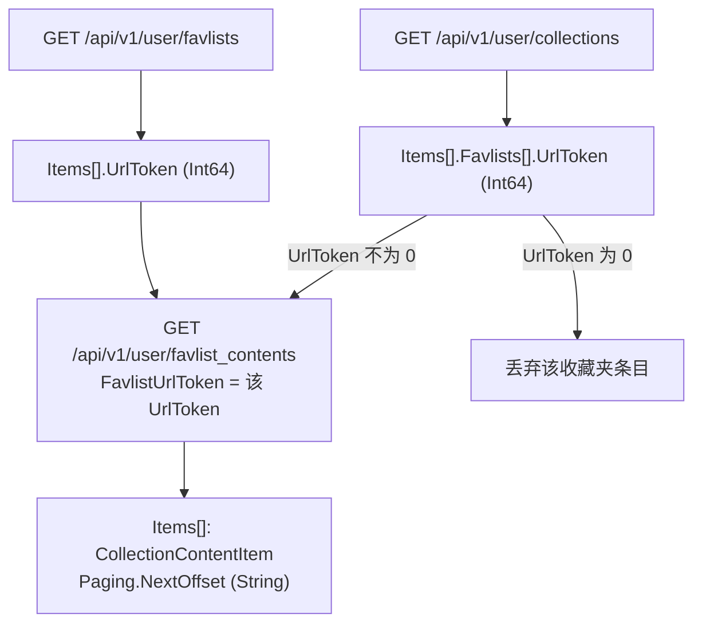

# 用户数据与 OAuth——一个请求头切换数据主体

知乎开放平台把「查用户数据」做成了**一族共机制接口**：五个接口路径与字段各异，但**取谁的数据**由同一个请求头决定。

## 一、适用边界：查自己的数据不需要 OAuth

官方 OAuth 页开篇的边界注，置顶于此：

> 注：知乎 OAuth 能力是为了集成知乎作为三方登录功能与获取授权用户下的个人信息而使用，如果您只是为了使用知乎数据开放平台上的通用 API 以及查看自己的相关数据，则无需接入，可以直接使用开放平台个人中心创建的 Access Secret 进行调用。

**查自己的数据不需要 OAuth。** 五个 user 接口不带 `X-OAuth-Token` 时返回当前 Access Secret 所属用户本人的数据；OAuth 只在三方登录、或查**别人**数据（前提是对方已授权你的应用）时必需。

## 二、OAuth 接入准备

需申请应用凭证 `app_id` 与 `app_key`。申请邮箱 `openplatform@zhihu.com`，邮件主题 `<公司/组织/产品名称>申请接入知乎 OAuth 服务`。必填材料：

| 材料项（原文） |
|---|
| 应用名称 |
| 应用简介 |
| 应用图标，分辨率 >= 256x256，附件形式发送。 |
| 授权回调地址 URL，OAuth 授权完成后的回调地址`redirect_uri` |
| 申请人姓名 |
| 申请人手机号 |
| 申请人知乎个人中心地址，如：https://www.zhihu.com/people/xxx |
| 申请获取用户权限（多选）：A.邮箱 B.手机 C.公开内容（包含个人创作内容、关注用户列表、公开收藏夹） |

⚠️ 原文提示：您申请获取的用户权限，将会在用户授权时展示给用户进行**二次确认**，请谨慎选择。

## 三、授权流程：四步换令牌

知乎 OAuth 采用标准 OAuth 2.0 Authorization Code Flow：



1. **引导授权**：`https://openapi.zhihu.com/authorize?redirect_uri={redirect_uri}&app_id={app_id}&response_type=code`
2. **确认授权**：重定向回 `{redirect_uri}?authorization_code={authorization_code}`
3. **换 Access Token**：后端用该 `authorization_code` 调「获取 access_token」接口
4. **取用户信息**：用 `access_token` 调「获取用户信息」接口

⚠️ 原文：`authorization_code` 的交换和 `access_token` 的使用**应在应用后端完成**，避免泄露 `app_key` 与用户令牌。

⚠️ 陷阱：回调参数名是 `authorization_code`，换 token 时提交的字段名是 `code`（**两者不同**）。

## 四、获取 Access Token

`POST https://openapi.zhihu.com/access_token`，Content-Type `application/x-www-form-urlencoded`。

| 参数 | 类型 | 必填 | 说明 |
|---|---|---|---|
| `app_id` | string | 是 | 第三方 APP_ID，需向知乎申请 |
| `app_key` | string | 是 | 第三方 APP_KEY，需向知乎申请 |
| `grant_type` | string | 是 | 固定值：`authorization_code` |
| `redirect_uri` | string | 是 | 申请 APP_ID 时填写的重定向地址 |
| `code` | string | 是 | 用户授权后生成的 `authorization_code` |

响应字段：`access_token`(string，访问令牌)、`token_type`(string，令牌类型，如 `Bearer`)、`expires_in`(long，**过期时间，单位为秒**)。

```json
{
  "access_token": "xxx",
  "token_type": "Bearer",
  "expires_in": 3600
}
```

```bash
curl -s -X POST "https://openapi.zhihu.com/access_token" \
  -H "Content-Type: application/x-www-form-urlencoded" \
  -d "app_id=${APP_ID}" \
  -d "app_key=${APP_KEY}" \
  -d "grant_type=authorization_code" \
  -d "redirect_uri=${REDIRECT_URI}" \
  -d "code=${CODE}"
```

⚠️ 原文**未给出**「获取用户信息」接口的 URL、参数与响应字段。

## 五、五个 user 接口：一个头切换数据主体

五个接口共用同一套 Header：

| 名称 | 必填 | 说明 |
|---|---|---|
| `Authorization` | 是 | `Bearer <your_access_secret>`，开放平台接口鉴权凭证 |
| `X-Request-Timestamp` | 是 | 秒级 Unix 时间戳 |
| `X-OAuth-Token` | 否 | 不传时查询**本人**；传入时查询该 OAuth 凭证对应的**已授权用户** |
| `Content-Type` | 是 | 固定值 `application/json` |

⚠️ `Content-Type` 在 `user_favlists` 与 `favlist_contents` 两页**未列出**，上表为跨五页合并表述。

| 接口 | 方法与路径 | 额度组 |
|---|---|---|
| 用户的内容 | `GET /api/v1/user/contents` | `user_data` |
| 用户的关注 | `GET /api/v1/user/followees` | `user_data` |
| 用户的收藏 | `GET /api/v1/user/collections` | `user_data` |
| 用户收藏夹列表 | `GET /api/v1/user/favlists` | `user_data` |
| 收藏夹内容 | `GET /api/v1/user/favlist_contents` | `user_data` |

数据接口主机 `developer.zhihu.com`，OAuth 端点主机 `openapi.zhihu.com`，**两套地址不可混用**。

**核心机制一句话**：同一路径、同一参数，只靠 `X-OAuth-Token` 头切换数据主体——`Authorization` 恒为开放平台 Access Secret，决定「**能不能调**」；`X-OAuth-Token` 决定「**查谁**」。

⚠️ `X-OAuth-Token` 必须是**被授权用户本人**的令牌。

⚠️ 本族与「创作能力」族不同：后者**不接受 OAuth 身份切换**（服务端从凭证解析本人身份），额度组为 `creator`，两族边界不可混淆。

## 六、各接口字段规格

### 6.1 用户的内容 `user_contents`

| 名称 | 类型 | 必填 | 说明 |
|---|---|---|---|
| `Offset` | Int64 | 否 | 分页偏移量，默认 `0` |
| `Limit` | Int64 | 否 | 返回数量，默认 `20`，最大 `50` |
| `ContentType` | String | **是** | 内容类型，可选值：`all`、`answer`、`article`、`zvideo`、`pin`、`question`；`all` 表示全部内容类型 |
| `SortField` | String | 否 | 排序字段，可选值：`like_count`、`ts`，默认 `ts` |
| `SortOrder` | String | 否 | 排序方向，可选值：`asc`、`desc`，默认 `desc` |

`Data.Items[]`（`ContentItem`，均必返）：`ContentType`(String，固定为小写 `answer`/`article`/`zvideo`/`pin`/`question`)、`Url`(String，内容链接)、`CreatedAt`(Int64，内容创建时间，秒级时间戳)、`LikeCount`(Int64，点赞数)、`CommentCount`(Int64，评论数)、`FavoriteCount`(Int64，收藏数)、`Title`(String，内容标题)、`Summary`(String，内容摘要)。

`Data.Paging`：`IsEnd`(Bool，是，是否已到最后一页)、`NextOffset`(**String**，否，下一页分页偏移量)、`Totals`(Int64，是，总数)。原文：如果返回结果中 `Paging.IsEnd=false`，可将 `Paging.NextOffset` 作为下一次请求的 `Offset`。

```json
{
  "Code": 0,
  "Message": "success",
  "Data": {
    "Items": [
      {
        "ContentType": "answer",
        "Url": "https://www.zhihu.com/answer/123456789",
        "CreatedAt": 1745486539,
        "LikeCount": 128,
        "CommentCount": 12,
        "FavoriteCount": 20,
        "Title": "如何理解某个问题？",
        "Summary": "这是一段内容摘要..."
      }
    ],
    "Paging": {
      "IsEnd": false,
      "NextOffset": "20",
      "Totals": 100
    }
  }
}
```

⚠️ `ContentType` 是本接口**唯一必填**的 Query 参数，漏传即 `10001`；请求侧可传 `all`，响应侧只回五个小写枚举之一，**永不会是 `all`**。

### 6.2 用户的关注 `user_followees`

Query：`Offset`(Int64, 否, 默认 `0`)、`Limit`(Int64, 否, 默认 `20`，最大 `50`)。

`Data.Items[]`（`FolloweeItem`，均必返）：`Fullname`(String，用户名)、`UrlToken`(**String**，用户主页标识)、`Url`(String，用户主页 URL)、`AvatarUrl`(String，用户头像 URL)、`Headline`(String，用户一句话介绍)、`Gender`(Int16，性别：`0` 未知或保密，`1` 女性，`2` 男性)、`FollowerCount`(Int64，粉丝数)。`Data.Paging` 同 6.1。

⚠️ 官方**只提供关注列表（followees），不含关注者（followers）接口**。

### 6.3 用户的收藏 `user_collections`

Query：`Limit`(Int64, 否, 默认 `20`)。

`Data.Items[]`（`CollectionContentItem`）：`ContentType`(String，固定为小写 `answer`/`article`/`zvideo`/`pin`/`question`)、`Url`(String，内容链接)、`CreatedAt`(Int64，内容创建时间，秒级时间戳)、`FavTime`(Int64，收藏时间，秒级时间戳)、`LikeCount`(Int64，点赞数)、`CommentCount`(Int64，评论数)、`FavoriteCount`(Int64，收藏数)、`Title`(String，内容标题)、`Summary`(String，内容摘要)、`Favlists`(Array[FavlistItem]，内容所在收藏夹列表)、`Author`(Author，否，内容作者；下游未返回作者时不输出)。

内嵌 `FavlistItem`：`UrlToken`(**Int64**，收藏夹 URL 标识；**下游未返回时为 `0`**)、`Title`(String，收藏夹名称)、`Url`(String，收藏夹链接)。

内嵌 `Author`：`Name`(String，作者名称)、`UrlToken`(**String**，作者 URL 标识)、`Url`(String，作者主页链接)、`Gender`(Int16，作者性别：`0` 未知，`1` 女性，`2` 男性)、`Headline`(String，作者签名)。

⚠️ 本接口 `Data` **只有 `Items`，没有 `Paging`**；语义是「**近期**收藏内容」，`Limit` 上限与分页游标官方**未给出**。全量收藏必须走 6.5 两段式链路。

### 6.4 用户收藏夹列表 `user_favlists`

Query：`Limit`(Int64, 否, 默认 `20`)。

`Data.Items[]`（`FavlistItem`，均必返）：`UrlToken`(**Int64**，收藏夹 URL 标识，可用于查询收藏夹内容)、`Url`(String，收藏夹链接)、`Title`(String，收藏夹名称)、`Description`(String，收藏夹描述)、`IsPublic`(Bool，是否公开)。

⚠️ **同名不同结构**：本页 `FavlistItem` 与 6.3 内嵌的 `FavlistItem` 字段集**不同**（多出 `Description`、`IsPublic`），建模时不要复用同一个类。

⚠️ `IsPublic=false` 的收藏夹即使在列表中返回，其内容也不可取——接口只提供「公开内容」。

### 6.5 收藏夹内容 `favlist_contents`

| 名称 | 类型 | 必填 | 说明 |
|---|---|---|---|
| `FavlistUrlToken` | **Int64** | **是** | 收藏夹 URL 标识，可从用户收藏夹列表 API 返回的 `UrlToken` 获取 |
| `Offset` | Int64 | 否 | 分页偏移量，默认 `0` |
| `Limit` | Int64 | 否 | 返回数量，默认 `20` |

`Data.Items[]` 为 `CollectionContentItem`，与 6.3 **完全一致**，可复用同一响应模型；`Data.Paging` 同 6.1。

⚠️ 本页**未给出 `Limit` 上限**（与 `user_contents` / `user_followees` 的「最大 `50`」不同）。

## 七、收藏夹两段式调用链



两条 `UrlToken` 来源：主链路 `user_favlists` → `Items[].UrlToken`（Int64）；另一条 `user_collections` → `Items[].Favlists[].UrlToken`（Int64，未返回时为 `0`，须过滤）。

## 八、硬坑汇总

| 坑 | 表现 | 正确做法 |
|---|---|---|
| 同名 `UrlToken` 三种类型 | `FolloweeItem.UrlToken`(String) / `Author.UrlToken`(String) / `FavlistItem.UrlToken`(Int64) | 按所在结构体分别建模，别用同一个字段类 |
| `FavlistItem.UrlToken` 为 0 | 下游未返回时值为 `0`（不是空） | `0` 视为无效值过滤掉 |
| `Paging.NextOffset` 是字符串 | 示例 `"20"` | 回传前转数值 |
| `ContentType` 必填 | `user_contents` 漏传即 `10001` | 请求用 `all`；响应只会是五个小写枚举之一（不含 `all`） |
| 两套 `ContentType` 枚举 | user 系列含 `zvideo`/`pin`/`question`；知识库内容只有 `unknown`/`file`/`answer`/`article` | 不要混用 |
| 收藏类无分页 | `user_collections` 与 `user_favlists` 无 `Paging` | 全量收藏必须走收藏夹两段式 |
| OAuth token 归属 | `X-OAuth-Token` 必须是**被授权用户本人**的 token | 不能拿任意用户的 token |
| `FavlistItem` 同名不同字段 | 三处 `FavlistItem` 结构不一致 | 分开建模 |

## 九、错误码与额度

五个 user 接口的错误码表完全一致：

| 错误码 | 说明 |
|---|---|
| `0` | 成功 |
| `10001` | 参数错误 |
| `20001` | 鉴权失败 |
| `30001` | 频率限制 |
| `30002` | 配额限制 |
| `90001` | 内部错误 |

五个接口同属 `user_data` 额度组。⚠️ 本族页面**未给出具体次数**（与「创作能力 200 次」「问题发现 100 次」不同），以 `GET /api/v1/quota` 返回为准。

## 十、与其他篇目衔接

- [鉴权、额度与计费](../concepts/01-auth-and-quota.md)：双头校验与 `user_data` 额度组。
- [创作能力](../concepts/05-creator-capability.md)：不接受 OAuth 身份切换的另一族接口。
- [平台总览](../concepts/00-platform-overview.md)：接口全景与命名。
- [首次调用工作流](../examples/01-first-call-workflow.md)：从零跑通第一个请求。
