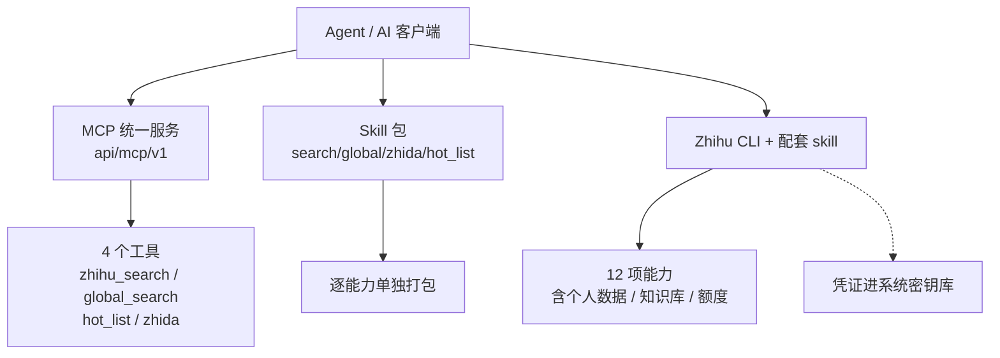
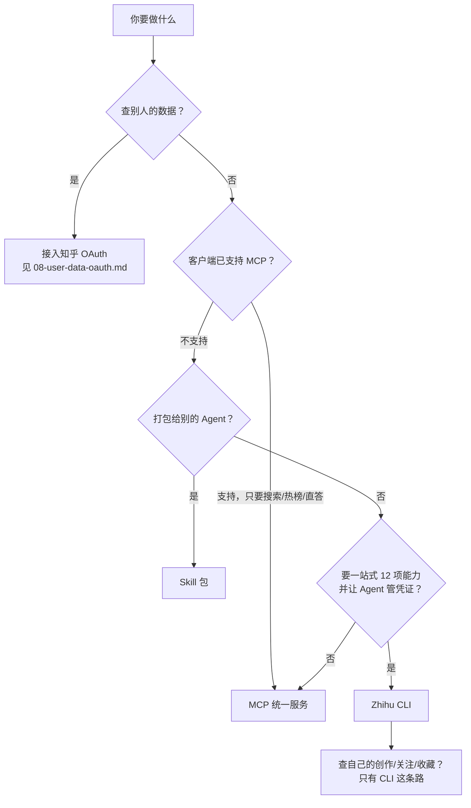

# 接入面——MCP、Skill 与 CLI 三条路径的选型与纪律

知乎数据开放平台对外暴露三种接入形态：**MCP 统一服务**、**Skill 包**、**Zhihu CLI**。三者都能调用知乎能力，但入口形态、配置位置、参数名体例与凭证落点各不相同。

## 一、三条接入路径总览

| 对比维度 | MCP 统一服务 | Skill 包 | Zhihu CLI |
|---|---|---|---|
| 入口形态 | 单个 HTTP 端点 `https://developer.zhihu.com/api/mcp/v1`，Streamable HTTP 传输 | 4 个能力各一个 zip 包（另加 CLI 的 skill 包），下载后交给 Agent | 官方命令行工具 + 配套 skill，由 Agent 调用 |
| 配置位置 | 客户端自身配置：Codex `~/.codex/config.toml`、Cursor `~/.cursor/mcp.json`、WorkBuddy 连接器、Claude Code 命令行 | Agent 的 skills 目录 | 凭证交给 Agent 后由 CLI 写入系统密钥库 |
| 需要写的代码量 | 0，复制配置片段 | 0，下载 zip 交给 Agent 安装 | 0，发一段安装 prompt 给 Agent |
| 暴露的工具 | 4 个：`zhihu_search`、`global_search`、`hot_list`、`zhida` | 4 个能力对应 4 个包 | 12 项能力，含创作、关注、收藏、知识库、额度 |
| 适用场景 | 客户端已内置 MCP，要即时搜索、热榜、直答 | 把某项能力打包分发给别的 Agent | 一站式使用个人数据，并让 Agent 代管凭证 |

⚠️ 三者暴露的能力**不等价**：MCP 与 4 个 Skill 包只覆盖公开检索类能力；个人数据（创作、关注、收藏）只在 Zhihu CLI 这条路径上暴露。



## 二、MCP 统一服务

### 2.1 服务地址、传输方式与鉴权

- **服务地址**：`https://developer.zhihu.com/api/mcp/v1`
- **传输方式**：Streamable HTTP。客户端要求选择连接方式时，选择 Streamable HTTP；WorkBuddy 配置中写作 `"type": "streamableHttp"`。
- **鉴权**：`Authorization` 头，值为 `Bearer` + 你的 Access Secret。官方明确：替换 `your_access_secret` 时**保留前面的 `Bearer `（含空格）**。
- Access Secret 只填在自己的客户端配置中，请勿分享包含密钥的配置或截图。

### 2.2 四个工具

| 能力 | 工具 | 示例 |
| --- | --- | --- |
| 知乎搜索 | `zhihu_search` | 搜索知乎上关于远程办公的经验，列出不同观点和原文链接。 |
| 全网搜索 | `global_search` | 搜索最近关于固态电池的新闻，注明来源。 |
| 知乎热榜 | `hot_list` | 看看今天知乎热榜前 10 个话题。 |
| 知乎直答 | `zhida` | 使用知乎直答的 zhida-fast-1p5 模型，解释什么是 RAG。 |

直答三档模型枚举：`zhida-fast-1p5`（快速回答）/ `zhida-thinking-1p5`（深度思考）/ `zhida-agent`（智能检索与回答）。客户端会根据需求选择工具；需要指定来源时，可在提问中加上「请使用 zhihu MCP」。

### 2.3 四家客户端配置

**Codex**（`~/.codex/config.toml`，Windows 对应路径为 `%USERPROFILE%\.codex\config.toml`）：

```toml
[mcp_servers.zhihu]
url = "https://developer.zhihu.com/api/mcp/v1"
http_headers = { Authorization = "Bearer your_access_secret" }
```

**WorkBuddy**（连接器页面 → 右上角「自定义连接器」→「配置 MCP」）：

```json
{
  "mcpServers": {
    "zhihu": {
      "type": "streamableHttp",
      "url": "https://developer.zhihu.com/api/mcp/v1",
      "headers": {
        "Authorization": "Bearer your_access_secret"
      }
    }
  }
}
```

**Claude Code**（终端执行，`--scope user` 表示在当前用户的所有项目中使用）：

```sh
claude mcp add --transport http --scope user --header "Authorization: Bearer your_access_secret" zhihu https://developer.zhihu.com/api/mcp/v1
```

**Cursor**（`~/.cursor/mcp.json`，文件不存在时新建；Windows 对应路径为 `%USERPROFILE%\.cursor\mcp.json`）：

```json
{
  "mcpServers": {
    "zhihu": {
      "url": "https://developer.zhihu.com/api/mcp/v1",
      "headers": {
        "Authorization": "Bearer your_access_secret"
      }
    }
  }
}
```

⚠️ 四家差异集中在**配置键名**与**存放位置**：Codex 用 `http_headers`（TOML 内联表），WorkBuddy 与 Cursor 用 `headers`（JSON 对象），Claude Code 用 `--header` 命令行参数、不落手写配置文件。

### 2.4 排错与迁移

| 症状 | 官方排查要点 |
|---|---|
| 连接失败 | 检查服务地址是否完整、Access Secret 是否已替换，以及 `Bearer` 后是否保留了一个空格。修改后重新连接；如果客户端要求选择连接方式，选择 Streamable HTTP。 |
| 看不到知乎工具 | 确认 `zhihu` 已启用，并在当前对话中可用。重新打开对话或重启客户端后再试。 |
| Codex 已有 `[mcp_servers.zhihu]` | 直接修改该段，不要重复添加。保留文件中的其他配置。 |
| 已连接但调用工具失败 | 连接成功不代表所有工具都有可用权限和额度。先检查 Access Secret 和剩余额度；仍然失败时，提供调用时间、工具名称和错误提示以便排查，不要提供密钥。 |

**从独立 MCP 地址迁移**（官方原文）：按上面的步骤添加 `zhihu`，确认可以使用后，停用客户端中原有的知乎搜索、全网搜索、热榜或直答 MCP 配置，避免工具重复出现。原有服务地址继续可用。

## 三、Skill 包

### 3.1 官方 Skill 清单

| 能力 | 文档 key | 下载 URL |
| --- | --- | --- |
| 知乎搜索 | `zhihu_search_skill` | https://developer.zhihu.com/download/zhihu_search_skills.zip |
| 全网搜索 | `global_search_skill` | https://developer.zhihu.com/download/global_search_skills.zip |
| 直答 | `zhida_skill` | https://developer.zhihu.com/download/zhida_skills.zip |
| 知乎热榜 | `hot_list_skill` | https://developer.zhihu.com/download/hot_list_skills.zip |
| Zhihu CLI | `zhihu_cli` | https://developer-cdn.zhihu.com/zhihu-cli/releases/stable/skill/zhihu-cli-skill.zip |

⚠️ 五组 URL 体例不统一：前四个在 `developer.zhihu.com/download/` 下、文件名以 `_skills.zip` 结尾；CLI 那个在 `developer-cdn.zhihu.com` 的 releases 路径下。

### 3.2 参数体例三态对照

同一能力，API 侧与 Skill 侧的参数名体例不同：

| 能力 | API 侧参数 | Skill 侧参数 |
| --- | --- | --- |
| 知乎搜索 | `Query` / `Count` | `query` / `count`（默认 10，范围 1-10） |
| 全网搜索 | `Query`/`Count`/`Filter`/`SearchDB` | `query`/`count`/`filter`/`search_db`（count 默认 10，范围 1-20；search_db 默认 `all`） |
| 直答 | `model`/`messages`/`stream` | `query`/`model`/`stream`/`output`（model 默认 `zhida-fast-1p5`） |
| 热榜 | `Limit` | `limit`（默认 30，范围 1-30） |

⚠️ 三处细节：① 全网搜索的 `count` 上限 1-20，比知乎搜索的 1-10 宽；② `search_db` 可选 `all`、`realtime`、`static`，默认 `all`；③ 直答 Skill 用 `query` 字符串提问，API 侧是 `messages` 数组，两者不能互换。

### 3.3 请求示例与响应约定

四份 Skill 页各自给出请求示例，逐字如下：

```json
{
  "query": "RAG",
  "count": 5
}
```

```json
{
  "query": "人工智能",
  "count": 5,
  "filter": "host==\"example.com\"",
  "search_db": "all"
}
```

```json
{
  "query": "什么是 RAG？",
  "model": "zhida-thinking-1p5",
  "stream": false,
  "output": "json"
}
```

```json
{
  "limit": 10
}
```

搜索与热榜类 Skill 的响应字段与 API 侧一致：`Code`（`0` 表示成功）、`Message`、`Data`，嵌套用 `Data.Items[].X` 形式的点号扁平路径表达。

⚠️ 两处官方文档未完全展开：Skill 页**未列出错误码表**，只有约定式描述「调用失败时会返回错误信息并以非零状态结束。请根据错误提示检查请求参数、认证配置或调用频率。」；`Data.Items[].ContentText` 是内容摘要，其中**可能包含 `<em>` 高亮标签**，直接当纯文本渲染会带上标签。

直答 Skill 的响应不走 `Code`/`Message`/`Data`，而是 `id`/`object`/`created`/`model`/`choices[]`；`stream=true` 且 `output=sse` 时由多条 SSE 事件组成，结束事件为 `data: [DONE]`；`output=text` 时直接输出回答正文。

四个能力包下载后交由 Agent 安装即可；CLI 配套 skill 的官方安装 prompt 逐字如下：

```text
请下载安装 zhihu-cli skill 并完成初始化配置
https://developer-cdn.zhihu.com/zhihu-cli/releases/stable/skill/zhihu-cli-skill.zip
```

## 四、Zhihu CLI

### 4.1 定位与能力一览（12 项）

Zhihu CLI 是知乎数据开放平台面向 AI Agent 提供的官方命令行工具。把配套 Skill 交给 Agent，它就能调用下表 12 项能力，并在获得 Access Secret 后读取你自己的创作、关注与收藏。

| 能力 | 适合解决什么问题 |
|---|---|
| 搜索知乎 | 查找社区里的真实经验、不同观点和具体案例 |
| 搜索全网 | 补充新闻、官网及其他外部资料 |
| 知乎热榜 | 了解当下正在发生和被关注的议题 |
| 知乎直答 | 对目标清晰的问题快速获得综合答案 |
| 问题发现 | 根据你的画像或指定主题推荐适合回答的问题 |
| 问题回答摘要 | 查看一个问题下的回答摘要和原文链接 |
| 本人创作全文、评论与数据 | 分别查看本人全文、评论、账号统计或单篇统计 |
| 我的创作 | 回顾自己的回答、文章、视频、想法和问题 |
| 我的关注 | 理解长期关注的人与知识方向 |
| 我的收藏 | 从收藏夹和近期收藏中找回积累的资料 |
| 知识库 | 查看知识库、检索资料，或上传明确指定的单个文件 |
| 额度查询 | 查看当前已配置的全网搜索、知乎搜索、热榜、问题发现、知乎用户数据、创作能力、直答、知识库和小工具当日统一额度 |

官方给出的说法里可直接复用的四条：「先看知乎用户怎么评价，再找几篇官方资料交叉核对。」「根据我的画像推荐几个适合回答的问题。」「把这份 PDF 上传到默认知识库，显示上传进度。」「查看我今天各项开放 API 还剩多少额度。」

### 4.2 凭证存放与验证语义

| 环节 | 官方口径 |
|---|---|
| 凭证投放 | 只在与 Agent 的私密对话中发送 Access Secret，不要放进公开群聊、文档或代码仓库。Agent 会通过标准输入把凭证交给 Zhihu CLI。 |
| 凭证存放 | 验证成功后，凭证保存在 macOS Keychain、Windows Credential Manager 或 Linux 桌面的 Secret Service，**不会写入 Skill 文件夹和普通配置文件**。Linux 的 SSH、CI 或容器场景通常由宿主 Secret Store 通过进程级环境变量注入。 |
| 验证方式 | Agent 会检查安装状态、版本兼容性和凭证有效性，并发起一次最小内容请求。**内容列表为空也不影响验证，只要开放平台正常返回成功状态即可。** |
| Session 行为 | 每个 Session 首次激活时检查一次。网络失败只会显示「暂时无法确认」，不会误报为最新版。 |
| 升级行为 | 存在更新时，Agent 会先完成当前任务，再询问是否更新——**更新不会静默执行**。 |

⚠️ 两条原文边界：Zhihu CLI **不接受 OAuth Token、用户 ID 或其他代查参数**，只查当前凭证所属账号；第三方 Web 应用如果需要集成知乎登录、代表其他授权用户访问数据，应单独接入知乎 OAuth，**不应把 Access Secret 分发给应用用户**。

## 五、官方数据与安全边界（五条）

1. **只查询当前凭证所属账号。** Zhihu CLI 不接受 OAuth Token、用户 ID 或其他代查参数。
2. **个人数据按需读取。** Agent 不应默认遍历全部关注和收藏。
3. **摘要不等于完整原文。** 需要准确理解时，应继续访问返回的原始链接。
4. **更新不会静默执行。** Agent 会先征得同意；更新服务也不会接收 Access Secret、查询内容或个人数据。
5. **知识库按需操作。** Agent 不应自动遍历全部知识库，也只会在你明确指定文件并授权后上传；上传进度写入诊断流，最终结果仍保持机器可读 JSON。

⚠️ 第 3 条对 MCP 与 Skill 路径同样适用：搜索与热榜返回的 `ContentText` 是**摘要**，准确理解时必须继续访问原始链接。

## 六、选型决策



⚠️ 「查别人的数据」是 OAuth 场景，不属于这三条路径：Access Secret 体系服务于「让自己的 Agent 使用自己的知乎数据」，代表其他授权用户访问必须走 OAuth。

## 七、排错速查表

| 症状 | 原因 | 处置 |
|---|---|---|
| MCP 连不上 | 地址不完整、密钥未替换、`Bearer` 后空格丢失 | 核对地址与 `Bearer `（含空格）；要求选连接方式时选 Streamable HTTP |
| 工具不出现 | `zhihu` 未启用或当前对话不可用 | 启用后重新打开对话或重启客户端 |
| 工具重复出现 | 原有独立 MCP 地址与新的 `zhihu` 并存 | 确认 `zhihu` 可用后，停用原有的搜索/热榜/直答 MCP 配置 |
| Skill 非零状态结束 | 参数、认证配置或调用频率问题 | 按错误提示检查请求参数、认证配置或调用频率；Skill 页未列错误码表 |
| 直答返回模型不存在 | `model` 值不在枚举内 | 只用 `zhida-fast-1p5`、`zhida-thinking-1p5`、`zhida-agent` |
| 凭证找不到 | 凭证未落到系统密钥库，或环境未注入 | 检查 Keychain / Credential Manager / Secret Service；CI 与容器场景确认宿主 Secret Store 的进程级环境变量已注入 |

## 八、与其他篇目衔接

- [平台总览](../concepts/00-platform-overview.md)：接口全景与命名。
- [鉴权、额度与计费](../concepts/01-auth-and-quota.md)：Access Secret 的双头校验与额度组。
- [搜索与热榜](../concepts/02-search-and-hotlist.md)：`Query`/`Count`/`Filter`/`SearchDB`/`Limit` 的 API 侧定义。
- [知乎直答](../concepts/03-zhida.md)：`messages` 形态与三档模型差异。
- [用户数据与 OAuth](../concepts/08-user-data-oauth.md)：查别人数据的 OAuth 路径。
- [首次调用工作流](../examples/01-first-call-workflow.md)：从零跑通第一个请求。
