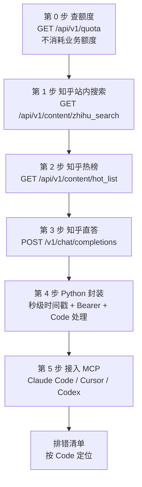

# 从零到第一次成功调用：知乎开放平台上手实操

本文只做一件事：让一个从未调用过知乎开放平台的开发者，在读完之后能独立跑通「查额度 → 读内容 → 问直答 → 接 MCP」这条链路。所有 URL、参数名、字段名、错误码均逐字取自官方文档，官方没有写的地方一律标注「官方文档未给出」，不做推测性补充。

## 一、前置清单

| 需要什么 | 从哪来 | 注意 |
| - | - | - |
| Access Secret | 知乎开放平台[个人中心](https://developer.zhihu.com/profile)手动生成并复制 | 调用方需把它作为 Bearer Token 放进请求头；不要分享含密钥的配置或截图 |
| `X-Request-Timestamp` | `date +%s` | 必须是**秒级** Unix 时间戳，与服务端时间相差不能超过 10 分钟；毫秒值会被判定为非法 |
| HTTP 客户端 | `curl` 或任意 HTTP 客户端 | 本文示例统一用 `curl`；Python 部分只用标准库 `urllib.request` |
| 额度余量 | `GET /api/v1/quota` | 该查询**不会消耗业务额度**，可在任何正式调用前先查 |

请求头三件套（官方示例值）：

| 名称 | 示例值 | 说明 |
| - | - | - |
| Authorization | `Bearer <your_access_secret>` | Bearer 鉴权头 |
| X-Request-Timestamp | `1742822400` | 秒级 Unix 时间戳 |
| Content-Type | `application/json` | JSON 接口固定值 |

## 二、整体流程



## 三、第 0 步：先查额度，不花额度

官方明确说明：可以通过 API 查询当前 Access Secret 所属账号在自然日内的各项能力的每日限免额度，**该查询不会消耗业务额度**。所以第一个请求永远应该是它。

```bash
curl -G 'https://developer.zhihu.com/api/v1/quota' \
  --data-urlencode 'APIIDs=knowledge,zhihu_search' \
  -H 'Authorization: Bearer <your_access_secret>' \
  -H "X-Request-Timestamp: $(date +%s)"
```

响应示例：

```json
{
  "Code": 0,
  "Message": "success",
  "Data": [
    {
      "APIID": "knowledge",
      "APIName": "知识库",
      "TotalQuota": 500,
      "TotalUsed": 12,
      "RemainingQuota": 488
    }
  ]
}
```

`Data` 是数组，每个元素一组额度：

| 字段 | 类型 | 说明 |
| --- | --- | --- |
| `APIID` | String | 额度项 ID，如 `knowledge`、`zhihu_search`、`hot_list`、`zhida_openai` |
| `APIName` | String | 额度项名称 |
| `TotalQuota` | Int64 | 当前自然日总额度 |
| `TotalUsed` | Int64 | 当前自然日已使用额度 |
| `RemainingQuota` | Int64 | 当前自然日剩余额度，最低为 0 |

读法：上面这一项表示「知识库」额度组今天共 500 次，已用 12 次，还剩 488 次。上例请求了 `knowledge,zhihu_search` 两个 ID，但返回数组中只出现了 `knowledge`——官方文档说明，显式请求多个 API 时返回的是其中**已配置的子集**，未配置项被省略；若全部未配置，则成功返回空数组。`zhihu_search` 的具体额度数值官方文档未给出，以实际查询结果为准。

⚠️ `APIIDs` 参数**只能出现一次**，多个 API ID 用**逗号分隔**写在同一个值里（`knowledge,zhihu_search`），写成两个 `APIIDs=` 会被判为 `10001` 参数格式错误。

## 四、第 1 步：调第一个读接口——知乎站内搜索

```bash
curl -G 'https://developer.zhihu.com/api/v1/content/zhihu_search' \
  --data-urlencode 'Query=怎么理解rave文化' \
  -d 'Count=5' \
  -H 'Authorization: Bearer <your_access_secret>' \
  -H "X-Request-Timestamp: $(date +%s)"
```

响应示例：

```json
{
    "Code": 0,
    "Message": "success",
    "Data": {
        "HasMore": false,
        "SearchHashId": "1234567890",
        "Items": [
            {
                "Title": "RAG 评测方法综述",
                "ContentType": "Article",
                "ContentID": "123456789",
                "ContentText": "本文介绍了主流 RAG 评测框架，包括 RAGAS、TruLens ...",
                "Url": "https://zhuanlan.zhihu.com/p/123456789?utm_medium=openapi_platform&utm_source=c2f012356e63",
                "CommentCount": 15,
                "VoteUpCount": 128,
                "AuthorName": "张三",
                "AuthorAvatar": "https://picx.zhimg.com/example.jpg",
                "AuthorBadge": "",
                "AuthorBadgeText": "",
                "EditTime": 1710000000,
                "CommentInfoList": [],
                "AuthorityLevel": "2",
                "RankingScore": 0.98
            }
        ]
    }
}
```

逐字段要点：

| 字段 | 官方含义 | 实操解读 |
| --- | --- | --- |
| `ContentText` | 内容摘要 | **是摘要不是全文**，需要全文必须自己访问 `Url` 抓取 |
| `Url` | 内容链接（带溯源 UTM 参数） | 形如 `...?utm_medium=openapi_platform&utm_source=...`，可直接展示给用户 |
| `AuthorityLevel` | 权威等级 | 返回字符串（如 `"2"`），官方文档未给出取值含义表 |
| `RankingScore` | 排序分数 | 浮点数（如 `0.98`），官方文档未给出取值范围 |
| `HasMore` | 当前实现固定返回 `false` | **恒为 false**，接口没有翻页语义 |

⚠️ `Count` 默认 10、最大 10。当 `Count > 10` 时服务端会自动截断为 `10`，不报错；`Count <= 0` 时默认回退为 `10`。也就是说传 `Count=100` 不报错，只会静默给你 10 条。

⚠️ `HasMore` 恒为 `false`，没有翻页能力。需要更多结果只能换关键词、换 `SortBy`，不要写 `while has_more` 的死循环。

## 五、第 2 步：调热榜

```bash
curl 'https://developer.zhihu.com/api/v1/content/hot_list?Limit=10' \
  -H 'Authorization: Bearer <your_access_secret>' \
  -H "X-Request-Timestamp: $(date +%s)"
```

响应示例：

```json
{
    "Code": 0,
    "Message": "success",
    "Data": {
        "Total": 2,
        "Items": [
            {
                "Title": "如何评价某个热点问题？",
                "Url": "https://www.zhihu.com/question/123456789",
                "ThumbnailUrl": "https://pic1.zhimg.com/v2-d4b0f8158e064dbcc71eb6ce970230a9.jpg",
                "Summary": "这是该问题的内容摘要"
            },
            {
                "Title": "一篇正在热榜上的文章标题",
                "Url": "https://zhuanlan.zhihu.com/p/987654321",
                "ThumbnailUrl": "",
                "Summary": ""
            }
        ]
    }
}
```

`Data` 只有 `Total`（实际返回的热榜条数）和 `Items`；每个 `Item` 只有 `Title`、`Url`、`ThumbnailUrl`、`Summary` 四个字段。当前仅返回**问题和文章**两类热榜内容。

⚠️ `Limit` 默认 30、最大 30。当 `Limit <= 0` 或 `Limit > 30` 时，服务端会自动回退为 `30`（注意是回退而不是截断到 30 再报错，与搜索接口的 `Count` 行为一致）。

⚠️ `ThumbnailUrl` 和 `Summary` **始终返回**，无数据时值是空字符串 `""`，**不是 `null`**。代码里可以直接 `item["Summary"] or ""`，但不要依赖 `is None` 判断。

## 六、第 3 步：调直答

直答接口不是 `Code/Message/Data` 结构，而是 OpenAI 风格的 `chat.completion` 对象，URL 也与其他接口不同（没有 `/api` 前缀）。

```bash
curl 'https://developer.zhihu.com/v1/chat/completions' \
  -H 'Content-Type: application/json' \
  -H 'Authorization: Bearer <your_access_secret>' \
  -H "X-Request-Timestamp: $(date +%s)" \
  --data '{
    "model": "zhida-thinking-1p5",
    "messages": [
      {"role": "user", "content": "什么是 RAG？"}
    ],
    "stream": false
  }'
```

响应示例：

```json
{
  "id": "chatcmpl-xxxx",
  "object": "chat.completion",
  "created": 1740470400,
  "model": "zhida-thinking-1p5",
  "choices": [
    {
      "index": 0,
      "message": {
        "role": "assistant",
        "reasoning_content": "先给出分析过程...",
        "content": "..."
      },
      "finish_reason": "stop"
    }
  ]
}
```

三个模型档位（`model` 取值）：

| `model` | 官方说明 | 支持 role/content 上下文传参 |
| --- | --- | --- |
| `zhida-fast-1p5` | 快速回答 | 是 |
| `zhida-thinking-1p5` | 深度思考 | 是 |
| `zhida-agent` | 智能检索与回答 | **否** |

⚠️ 当前仅保证 `model` / `messages` / `stream` 三个字段的能力语义，其他请求字段不作为正式支持能力，不保证生效。`model` 为必填，缺失时返回错误码 `missing_required_parameter`；模型名写错返回 `model_not_found`，错误体形如 `{"error":{"message":"...","type":"invalid_request_error","param":"model","code":"model_not_found"}}`。

⚠️ `zhida-agent` **不支持** role、content 上下文传参；支持上下文传参的只有 `zhida-fast-1p5` 与 `zhida-thinking-1p5`。另外实际可用模型还会受租户授权配置影响。

⚠️ `stream=true` 时响应类型是 `text/event-stream`，服务端会发送心跳注释 `: keep-alive`，且流式中途出错时 HTTP 已回 200，错误体现在数据帧的 `finish_reason: "error"` 里——必须解析 SSE 帧体，不能只看状态码。

## 七、第 4 步：Python 最小可运行脚本

只依赖标准库 `urllib.request`，无需 `pip install`。保存为 `first_call.py`，先 `export ZHIHU_ACCESS_SECRET='你的 Access Secret'`，再 `python first_call.py`。

```python
#!/usr/bin/env python3
# -*- coding: utf-8 -*-
"""知乎开放平台最小可运行脚本：查额度 → 搜索 → 热榜 → 直答。"""

import json
import os
import time
import urllib.error
import urllib.parse
import urllib.request

BASE = "https://developer.zhihu.com"

CODE_HINTS = {
    10001: "参数非法：核对参数名大小写与取值范围",
    20001: "鉴权失败：Access Secret 是否正确、是否保留了 'Bearer ' 后的空格",
    30001: "频率超限或额度耗尽：先查 /api/v1/quota 区分",
    90001: "平台内部错误，稍后再试",
}


class ZhihuError(Exception):
    """Code != 0 的业务错误。"""

    def __init__(self, code, message, payload=None):
        super().__init__("Code=%s Message=%s" % (code, message))
        self.code = code
        self.message = message
        self.payload = payload


def build_headers():
    """Bearer 头 + 秒级 Unix 时间戳。"""
    secret = os.environ.get("ZHIHU_ACCESS_SECRET", "").strip()
    if not secret:
        raise SystemExit("缺少环境变量 ZHIHU_ACCESS_SECRET")
    return {
        "Authorization": "Bearer " + secret,
        # 必须是秒级，毫秒会被判定为非法时间戳
        "X-Request-Timestamp": str(int(time.time())),
        "Content-Type": "application/json",
    }


def raw_request(path, method="GET", query=None, body=None):
    """发请求并返回解析后的 JSON。"""
    url = BASE + path
    if query:
        url = url + "?" + urllib.parse.urlencode(query)
    data = None
    if body is not None:
        data = json.dumps(body, ensure_ascii=False).encode("utf-8")
    req = urllib.request.Request(
        url, data=data, headers=build_headers(), method=method
    )
    try:
        with urllib.request.urlopen(req, timeout=60) as resp:
            text = resp.read().decode("utf-8")
    except urllib.error.HTTPError as exc:
        text = exc.read().decode("utf-8", "replace")
        print("[HTTP %s] %s" % (exc.code, text))
        raise
    return json.loads(text) if text else {}


def api_data(path, method="GET", query=None, body=None):
    """统一处理 Code / Message / Data。"""
    payload = raw_request(path, method=method, query=query, body=body)
    code = payload.get("Code")
    if code != 0:
        raise ZhihuError(code, payload.get("Message"), payload)
    return payload.get("Data")


def step0_quota():
    print("== 第 0 步：查额度（不消耗业务额度） ==")
    data = api_data("/api/v1/quota", query={"APIIDs": "knowledge,zhihu_search"})
    for item in data or []:
        print("  %-16s %-10s 总额 %-6s 已用 %-6s 剩余 %s" % (
            item.get("APIID"), item.get("APIName"),
            item.get("TotalQuota"), item.get("TotalUsed"),
            item.get("RemainingQuota")))


def step1_search(query="怎么理解rave文化", count=5):
    print("== 第 1 步：知乎站内搜索 ==")
    data = api_data(
        "/api/v1/content/zhihu_search",
        query={"Query": query, "Count": count},
    )
    print("  HasMore=%s SearchHashId=%s" % (
        data.get("HasMore"), data.get("SearchHashId")))
    for it in (data.get("Items") or [])[:3]:
        print("  - [%s] %s" % (it.get("ContentType"), it.get("Title")))
        print("    摘要: %s" % it.get("ContentText"))
        print("    链接: %s" % it.get("Url"))
        print("    权威等级=%s 排序分数=%s" % (
            it.get("AuthorityLevel"), it.get("RankingScore")))
    return data


def step2_hot_list(limit=10):
    print("== 第 2 步：知乎热榜 ==")
    data = api_data("/api/v1/content/hot_list", query={"Limit": limit})
    print("  Total=%s" % data.get("Total"))
    for it in (data.get("Items") or [])[:3]:
        print("  - %s | %s" % (it.get("Title"), it.get("Url")))
        print("    ThumbnailUrl=%r Summary=%r" % (
            it.get("ThumbnailUrl"), it.get("Summary")))
    return data


def step3_zhida(question="什么是 RAG？", model="zhida-thinking-1p5"):
    print("== 第 3 步：知乎直答（只保证 model/messages/stream） ==")
    payload = raw_request(
        "/v1/chat/completions",
        method="POST",
        body={
            "model": model,
            "messages": [{"role": "user", "content": question}],
            "stream": False,
        },
    )
    if payload.get("error"):
        err = payload["error"]
        raise ZhihuError(err.get("code"), err.get("message"), payload)
    choice = (payload.get("choices") or [{}])[0]
    msg = choice.get("message") or {}
    print("  model=%s finish_reason=%s" % (
        payload.get("model"), choice.get("finish_reason")))
    print("  content: %s" % msg.get("content"))
    return payload


def main():
    try:
        step0_quota()
        step1_search()
        step2_hot_list()
        step3_zhida()
    except ZhihuError as exc:
        print("[业务错误] %s" % exc)
        print("  提示: %s" % CODE_HINTS.get(exc.code, "官方文档未给出更多说明"))
        return 1
    except Exception as exc:
        print("[请求异常] %r" % exc)
        return 2
    return 0


if __name__ == "__main__":
    raise SystemExit(main())
```

脚本里三处关键处理：

- `X-Request-Timestamp` 用 `str(int(time.time()))`，即**秒级**，不会误传毫秒。
- `api_data()` 统一校验 `Code`，非 0 时抛出带 `Code` 与 `Message` 的 `ZhihuError`，`main()` 捕获后打印 `Message` 与对应提示。
- 直答单独走 `raw_request()`，因为它的错误体在 `error` 对象里而不是顶层 `Code`。

## 八、第 5 步：接入 MCP

服务地址：`https://developer.zhihu.com/api/mcp/v1`。配置前先登录[个人中心](https://developer.zhihu.com/profile)生成 Access Secret，把配置中的 `your_access_secret` 替换成自己的密钥，**保留前面的 `Bearer `（含空格）**。

Claude Code：

```sh
claude mcp add --transport http --scope user --header "Authorization: Bearer your_access_secret" zhihu https://developer.zhihu.com/api/mcp/v1
```

Cursor（`~/.cursor/mcp.json`，Windows 对应 `%USERPROFILE%\.cursor\mcp.json`）：

```json
{
  "mcpServers": {
    "zhihu": {
      "url": "https://developer.zhihu.com/api/mcp/v1",
      "headers": {
        "Authorization": "Bearer your_access_secret"
      }
    }
  }
}
```

Codex（`~/.codex/config.toml`，Windows 对应 `%USERPROFILE%\.codex\config.toml`）：

```toml
[mcp_servers.zhihu]
url = "https://developer.zhihu.com/api/mcp/v1"
http_headers = { Authorization = "Bearer your_access_secret" }
```

MCP 暴露的工具与能力对应关系：

| 能力 | 工具 | 示例提问 |
| --- | --- | --- |
| 知乎搜索 | `zhihu_search` | 搜索知乎上关于远程办公的经验，列出不同观点和原文链接。 |
| 全网搜索 | `global_search` | 搜索最近关于固态电池的新闻，注明来源。 |
| 知乎热榜 | `hot_list` | 看看今天知乎热榜前 10 个话题。 |
| 知乎直答 | `zhida` | 使用知乎直答的 zhida-fast-1p5 模型，解释什么是 RAG。 |

⚠️ `Bearer` 后面那个**空格**必须保留，官方文档在连接失败的排查指引里单独点了这一条。

⚠️ 已有 `[mcp_servers.zhihu]`（Codex）或已有 `mcpServers`（Cursor/WorkBuddy）时，直接**修改那一段**，不要重复添加同名条目。客户端还会要求选择连接方式时，选 Streamable HTTP。

⚠️ 连接成功不代表所有工具都有可用权限和额度；看不到知乎工具时要确认 `zhihu` 已启用并在当前对话中可用，必要时重新打开对话或重启客户端。

## 九、排错清单

| 症状 | 原因 | 处置 |
| --- | --- | --- |
| `Code=20001` 鉴权失败 | Access Secret 不对或仍是占位符 `<your_access_secret>` | 去[个人中心](https://developer.zhihu.com/profile)重新复制，注意 `Bearer` 后有空格 |
| `Code=10001` 参数错误 | 参数非法，如 `Query` 为空、`SortBy` 字段/方向/区间写错、`APIIDs` 写了两遍 | 核对参数名大小写（`Query`/`Count`/`SortBy`、`APIIDs`/`Scope`/`Limit`），`SortBy` 格式必须是 `字段:方向:(最小值,最大值)` |
| `Code=30001` 频率限制 | 请求频率超限，或当日额度已耗尽 | 查 `/api/v1/quota` 区分是频率问题还是额度问题；额度按自然日计算，最低为 0 |
| 请求被判失败但参数完全正确 | 时间戳用了毫秒，或与服务器时间相差超过 10 分钟 | 改用 `date +%s` / `int(time.time())`，检查本机时钟 |
| MCP 连不上 | `Bearer` 后少了空格，或服务地址写得不完整 | 逐字比对 `https://developer.zhihu.com/api/mcp/v1` 与 `Bearer <secret>` |
| MCP 工具不出现 | 客户端未启用 `zhihu`，或当前会话未加载 | 启用 `zhihu` 后重新打开对话或重启客户端；CLI 里用 `/mcp` 查连接状态 |
| 直答返回 `model_not_found` | 模型名拼错，或该模型未获租户授权 | 只用 `zhida-fast-1p5` / `zhida-thinking-1p5` / `zhida-agent` 三个官方档位 |
| 直答返回 `missing_required_parameter` | body 里缺 `model` | 补上 `model` 字段 |

## 十、延伸阅读

- 平台全貌与接入面：[`../concepts/00-platform-overview.md`](../concepts/00-platform-overview.md)
- 鉴权、额度与计费契约：[`../concepts/01-auth-and-quota.md`](../concepts/01-auth-and-quota.md)
- 搜索与热榜细节：[`../concepts/02-search-and-hotlist.md`](../concepts/02-search-and-hotlist.md)
- 直答能力与模型档位：[`../concepts/03-zhida.md`](../concepts/03-zhida.md)
- 集成面（MCP、CLI 等）：[`../concepts/09-integration-surfaces.md`](../concepts/09-integration-surfaces.md)
