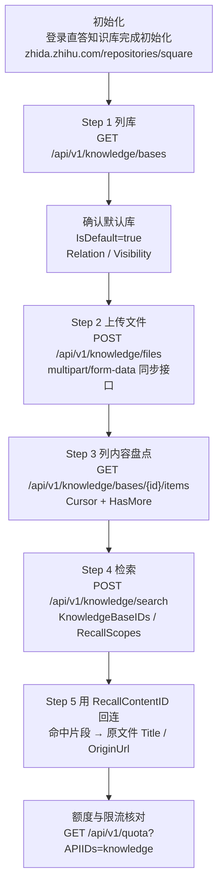

# 知识库 RAG 全链路实操：从列库到命中片段回连

知识库是知乎开放平台里链路最长的一组能力：四个接口、两种请求形态（`GET` 与 `multipart/form-data` 混用）、一个同步阻塞的上传、一套游标分页，最后还要把检索命中的片段对回原始文件。本文按官方文档顺序把这套流程走一遍，所有 URL、字段名、错误码逐字取自官方文档。

## 一、前置条件

官方文档在三个知识库接口页面开头都写了同一句话：**首次使用请先登录直答知识库完成初始化 `https://zhida.zhihu.com/repositories/square`**。跳过这一步，接口大概率返回 `40004`（知识库不存在）或列表为空。

除此之外的常规前置：已获取 Access Secret、请求头携带 `Authorization: Bearer <your_access_secret>` 与秒级 `X-Request-Timestamp`、本地已有待上传文件。

## 二、全链路流程



## 三、Step 1：列库

```bash
curl -G 'https://developer.zhihu.com/api/v1/knowledge/bases' \
  --data-urlencode 'Scope=all' \
  -H 'Authorization: Bearer <your_access_secret>' \
  -H "X-Request-Timestamp: $(date +%s)"
```

响应示例：

```json
{
  "Code": 0,
  "Message": "success",
  "Data": {
    "Items": [
      {
        "KnowledgeBaseID": "7526139256098382426",
        "Name": "产品资料",
        "Description": "产品相关文档",
        "Relation": "created",
        "IsDefault": false,
        "Visibility": "private",
        "ContentCount": 12,
        "UpdatedAt": 1785902400
      }
    ]
  }
}
```

`Scope` 可选 `all`、`created`、`subscribed`，默认 `all`。字段解读：

| 字段 | 类型 | 说明 |
| --- | --- | --- |
| `KnowledgeBaseID` | String | 知识库 ID，后续上传与内容列表都要用 |
| `Name` | String | 知识库名称 |
| `Description` | String | 知识库描述，**非必返** |
| `Relation` | String | 当前用户与知识库的关系：`created`、`subscribed` 或 `both` |
| `IsDefault` | Boolean | 是否为当前用户的默认知识库 |
| `Visibility` | String | 可见性：`private` 或 `public` |
| `ContentCount` | Int64 | 内容数量 |
| `UpdatedAt` | Int64 | 秒级更新时间戳 |

Step 1 之后的判定逻辑很简单：优先选 `IsDefault=true` 的库；没有默认库时，从 `Relation` 为 `created` 的库里选一个。官方文档未说明 `subscribed` 库的写入权限，但上传接口的错误码表把 `20001` 定义为「鉴权失败或无权向目标知识库上传」，因此往非自建库传文件若收到 `20001`，换回自建库即可。

⚠️ `Visibility` 有 `public` 的库。往公开库上传前请自行确认内容是否适合公开，官方文档未对可见性变更给出额外说明。

## 四、Step 2：上传文件

上传到指定知识库：

```bash
curl 'https://developer.zhihu.com/api/v1/knowledge/files' \
  -F 'File=@./document.pdf' \
  -F 'KnowledgeBaseID=7526139256098382426' \
  -H 'Authorization: Bearer <your_access_secret>' \
  -H "X-Request-Timestamp: $(date +%s)"
```

上传到默认知识库时省略 `KnowledgeBaseID`：

```bash
curl 'https://developer.zhihu.com/api/v1/knowledge/files' \
  -F 'File=@./document.pdf' \
  -H 'Authorization: Bearer <your_access_secret>' \
  -H "X-Request-Timestamp: $(date +%s)"
```

响应示例：

```json
{
  "Code": 0,
  "Message": "success",
  "Data": {
    "KnowledgeBaseID": "7526139256098382426",
    "RecallContentID": "recall-content-id",
    "FileName": "产品资料.pdf",
    "FileSize": 1048576,
    "Title": "产品资料",
    "Abstract": "文档主要介绍产品能力",
    "OriginUrl": "https://assets2.zhihu.com/example/product.pdf"
  }
}
```

上传接口的响应字段与后续两步直接相关：`KnowledgeBaseID` 是文件实际落入的库 ID（省略参数时这里是默认库的 ID），`RecallContentID` 是内容 ID，**这是 Step 5 回连的关键**。

⚠️ 表单字段名是**首字母大写的 `File`**。这与 PDF 解析接口 `POST https://developer.zhihu.com/resources/v1/files` 的小写 `file` 不同，两个接口的字段名不能互串。

⚠️ 这是**同步接口**，文件上传、解析、知识库挂载一次完成，较大文件可能需要较长时间。调用方取消请求**不代表**上传和解析一定同步取消，因此**不要对超时或未知结果自动重试**——重试会撞上 `40005`（相同文件正在处理中）。官方说明：相同文件仅在前一次仍处于同步处理阶段时被拦截，前一次进入终态后可再次上传。

⚠️ 扩展名白名单共 16 种，忽略大小写：

```text
pdf, md, txt, ppt, pptx, xlsx, xls, docx, doc,
webp, png, jpg, mobi, epub, csv, azw3
```

单文件最大 `100 MB`；文件名必须是合法 UTF-8，不能包含 NUL、换行或其他控制字符；清理路径和首尾空白后的文件名不能超过 255 个 UTF-8 字节。

⚠️ **不要手工设置带 boundary 的 `Content-Type`**。用 curl 的 `-F` 会自动生成正确的 multipart Header；Python 侧若用 `requests`，同样只传 `files=` 而不要自己拼 `Content-Type`。

## 五、Step 3：列内容盘点

```bash
curl -G 'https://developer.zhihu.com/api/v1/knowledge/bases/7526139256098382426/items' \
  --data-urlencode 'Limit=20' \
  -H 'Authorization: Bearer <your_access_secret>' \
  -H "X-Request-Timestamp: $(date +%s)"
```

响应示例：

```json
{
  "Code": 0,
  "Message": "success",
  "Data": {
    "Items": [
      {
        "RecallContentID": "MTAwMjMwMDAwNzUxODUxMDI0Nnw6fFpISV9EQV9VU0VSX1VQTE9BRA==",
        "ContentType": "file",
        "Title": "产品资料.pdf",
        "Abstract": "文档摘要",
        "CreatedAt": 1785900000,
        "UpdatedAt": 1785902400,
        "OriginUrl": "https://assets2.zhihu.com/example/product.pdf"
      }
    ],
    "Total": 12,
    "HasMore": true,
    "NextCursor": "next-cursor"
  }
}
```

`Cursor` 是不透明游标，官方要求**调用方不要解析或修改**它；`Limit` 默认 `20`，范围 `1..20`。

⚠️ 终止判据是 `HasMore`，**不是**本页条数。官方原文：「请以 `HasMore` 判断是否继续分页，不要根据本页条数推断是否结束。」正确写法是把上一页返回的 `NextCursor` 原样回传，直到 `HasMore=false`。

## 六、Step 4：检索

```bash
curl 'https://developer.zhihu.com/api/v1/knowledge/search' \
  -H 'Content-Type: application/json' \
  -H 'Authorization: Bearer <your_access_secret>' \
  -H "X-Request-Timestamp: $(date +%s)" \
  --data '{
    "Query": "产品的退款规则是什么？",
    "KnowledgeBaseIDs": ["7526139256098382426"],
    "RecallScopes": ["personal"],
    "Limit": 10
  }'
```

请求体：

```json
{
  "Query": "产品的退款规则是什么？",
  "KnowledgeBaseIDs": ["7526139256098382426"],
  "RecallScopes": ["personal", "subscription"],
  "Limit": 10
}
```

响应示例：

```json
{
  "Code": 0,
  "Message": "success",
  "Data": {
    "Items": [
      {
        "Content": [
          "退款申请需要在购买后七天内提交。",
          "退款到账通常需要三个工作日。"
        ],
        "KnowledgeBaseID": "7526139256098382426",
        "DocName": "退款规则",
        "RecallContentID": "MTAwMjMwMDAwNzUxODUxMDI0Nnw6fFpISV9EQV9VU0VSX1VQTE9BRA==",
        "OriginUrl": "https://assets2.zhihu.com/example/refund.md"
      }
    ]
  }
}
```

| 字段 | 类型 | 说明 |
| --- | --- | --- |
| `Content` | Array[String] | 同一文档命中的**有序正文片段**列表 |
| `KnowledgeBaseID` | String | 所属知识库 ID |
| `DocName` | String | 文档名称 |
| `RecallContentID` | String | 内容 ID，**非必返** |
| `OriginUrl` | String | 原始来源地址，**非必返**；回答和文章为原文地址，文件等其他类型为源文件下载地址 |

⚠️ `KnowledgeBaseIDs` 与 `RecallScopes` **至少有一个非空**，两者同时传入时搜索范围取**并集**。`RecallScopes` 的枚举值只有三个：`personal`、`subscription`、`public`。

⚠️ `Limit` 按**文档结果数**计算，不按 `Content` 里的片段数计算；默认 `10`，范围 `1..10`。想要更多片段只能提高 `Limit` 的文档数上限，或靠 `Content` 数组本身的长度。

## 七、Step 5：用 `RecallContentID` 回连命中项

三个环节都会出现同一个 ID，这是把「检索片段」接回「原文件」的锚点：

| 环节 | 字段 | 作用 |
| --- | --- | --- |
| 上传响应 | `Data.RecallContentID` | 刚上传文件的内容 ID |
| 内容列表 | `Items[].RecallContentID` | 库内每个内容项的 ID（**可能为空**） |
| 检索响应 | `Items[].RecallContentID` | 命中文档的 ID（**非必返**） |

回连逻辑：先用内容列表接口把整个库的 `RecallContentID → {Title, ContentType, OriginUrl}` 建一张索引表，再用检索结果的 `RecallContentID` 去查表，命中后就能给出「命中文档名 + 原始链接」，供前端做「命中 → 原文件」跳转。

⚠️ 两处 ID 都可能缺失：内容列表的 `RecallContentID` 官方标注「可能为空」，检索响应的 `RecallContentID` 是非必返字段。因此回连必须准备降级路径——退而用 `DocName` / `OriginUrl` 匹配，或用 `KnowledgeBaseID` + `Title` 组合定位。官方文档未给出 ID 缺失时的官方回退策略，这一步需要自行兜底。

## 八、完整 Python 脚本

只依赖标准库（含手写的 multipart 编码），无需 `pip install`。保存为 `knowledge_rag.py`：

```bash
export ZHIHU_ACCESS_SECRET='你的 Access Secret'
python knowledge_rag.py ./document.pdf "产品的退款规则是什么？"
```

```python
#!/usr/bin/env python3
# -*- coding: utf-8 -*-
"""知乎直答知识库 RAG 全链路：列库 → 上传 → 列内容 → 检索 → 回连。"""

import json
import os
import sys
import time
import urllib.error
import urllib.parse
import urllib.request
import uuid

BASE = "https://developer.zhihu.com"

CODE_HINTS = {
    10001: "参数非法：核对字段名大小写与取值范围",
    20001: "鉴权失败或无访问权限：检查 Access Secret 与 'Bearer ' 空格",
    30001: "频率限制：稍后重试",
    40004: "知识库不存在：确认 KnowledgeBaseID 或是否已完成初始化",
    40005: "相同文件正在处理中：等待上一次处理完成，不要自动重试",
    40006: "文件解析失败：确认文件未损坏",
    50002: "检索失败，可稍后重试",
    90001: "平台内部错误",
}


class ZhihuError(Exception):
    """Code != 0 的业务错误。"""

    def __init__(self, code, message, payload=None):
        super().__init__("Code=%s Message=%s" % (code, message))
        self.code = code
        self.message = message
        self.payload = payload


def build_headers(extra=None):
    """Bearer 头 + 秒级 Unix 时间戳。"""
    secret = os.environ.get("ZHIHU_ACCESS_SECRET", "").strip()
    if not secret:
        raise SystemExit("缺少环境变量 ZHIHU_ACCESS_SECRET")
    headers = {
        "Authorization": "Bearer " + secret,
        # 必须是秒级，毫秒会被判定为非法时间戳
        "X-Request-Timestamp": str(int(time.time())),
    }
    if extra:
        headers.update(extra)
    return headers


def _decode(resp):
    text = resp.read().decode("utf-8")
    return json.loads(text) if text else {}


def request_json(path, method="GET", query=None, body=None):
    """发请求并返回完整 payload（含 Code / Message / Data）。"""
    url = BASE + path
    if query:
        url = url + "?" + urllib.parse.urlencode(query)
    data = None
    headers = build_headers()
    if body is not None:
        data = json.dumps(body, ensure_ascii=False).encode("utf-8")
        headers["Content-Type"] = "application/json"
    req = urllib.request.Request(url, data=data, headers=headers, method=method)
    try:
        with urllib.request.urlopen(req, timeout=120) as resp:
            return _decode(resp)
    except urllib.error.HTTPError as exc:
        text = exc.read().decode("utf-8", "replace")
        print("[HTTP %s] %s" % (exc.code, text))
        raise


def get_json(path, query=None):
    """GET 并校验 Code，返回 Data。"""
    payload = request_json(path, method="GET", query=query)
    code = payload.get("Code")
    if code != 0:
        raise ZhihuError(code, payload.get("Message"), payload)
    return payload.get("Data") or {}


def post_json(path, body):
    """POST JSON 并校验 Code，返回 Data。"""
    payload = request_json(path, method="POST", body=body)
    code = payload.get("Code")
    if code != 0:
        raise ZhihuError(code, payload.get("Message"), payload)
    return payload.get("Data") or {}


def encode_multipart(file_path, knowledge_base_id=None):
    """手写 multipart/form-data 编码。字段名是首字母大写的 File。"""
    boundary = "----zhihuopen" + uuid.uuid4().hex
    filename = os.path.basename(file_path)
    with open(file_path, "rb") as fh:
        payload = fh.read()
    chunks = []
    chunks.append(("--%s\r\n" % boundary).encode("ascii"))
    chunks.append(
        ('Content-Disposition: form-data; name="File"; filename="%s"\r\n'
         % filename).encode("utf-8")
    )
    chunks.append(b"Content-Type: application/octet-stream\r\n\r\n")
    chunks.append(payload)
    chunks.append(b"\r\n")
    if knowledge_base_id:
        chunks.append(("--%s\r\n" % boundary).encode("ascii"))
        chunks.append(b'Content-Disposition: form-data; name="KnowledgeBaseID"\r\n\r\n')
        chunks.append(knowledge_base_id.encode("utf-8"))
        chunks.append(b"\r\n")
    chunks.append(("--%s--\r\n" % boundary).encode("ascii"))
    return b"".join(chunks), "multipart/form-data; boundary=%s" % boundary


def upload_file(file_path, knowledge_base_id=None):
    """同步上传接口；超时不要自动重试，否则会撞 40005。"""
    body, content_type = encode_multipart(file_path, knowledge_base_id)
    headers = build_headers({"Content-Type": content_type})
    req = urllib.request.Request(
        BASE + "/api/v1/knowledge/files",
        data=body,
        headers=headers,
        method="POST",
    )
    try:
        with urllib.request.urlopen(req, timeout=1800) as resp:
            payload = _decode(resp)
    except urllib.error.HTTPError as exc:
        text = exc.read().decode("utf-8", "replace")
        print("[HTTP %s] %s" % (exc.code, text))
        raise
    code = payload.get("Code")
    if code != 0:
        raise ZhihuError(code, payload.get("Message"), payload)
    return payload.get("Data") or {}


def list_bases(scope="all"):
    data = get_json("/api/v1/knowledge/bases", {"Scope": scope})
    return data.get("Items") or []


def list_all_items(kb_id, page_size=20):
    """按 Cursor 翻页；以 HasMore 为终止判据。"""
    items = []
    cursor = ""
    while True:
        query = {"Limit": page_size}
        if cursor:
            query["Cursor"] = cursor
        data = get_json("/api/v1/knowledge/bases/%s/items" % kb_id, query)
        items.extend(data.get("Items") or [])
        if not data.get("HasMore"):
            break
        cursor = data.get("NextCursor") or ""
        if not cursor:
            break
    return items


def search(query, kb_ids=None, scopes=("personal",), limit=10):
    body = {
        "Query": query,
        "KnowledgeBaseIDs": list(kb_ids or []),
        "RecallScopes": list(scopes),
        "Limit": limit,
    }
    data = post_json("/api/v1/knowledge/search", body)
    return data.get("Items") or []


def pick_target_bases(bases):
    """优先默认库，其次自建库。"""
    for b in bases:
        if b.get("IsDefault"):
            return b
    for b in bases:
        if b.get("Relation") in ("created", "both"):
            return b
    return bases[0] if bases else None


def main():
    file_path = sys.argv[1] if len(sys.argv) > 1 else None
    question = sys.argv[2] if len(sys.argv) > 2 else "产品的退款规则是什么？"

    try:
        # Step 1：列库并确认目标库
        bases = list_bases()
        if not bases:
            print("没有可用知识库：请先登录 https://zhida.zhihu.com/repositories/square 完成初始化")
            return 1
        for b in bases:
            print("[库] %s | %s | Relation=%s | IsDefault=%s | Visibility=%s | ContentCount=%s" % (
                b.get("KnowledgeBaseID"), b.get("Name"), b.get("Relation"),
                b.get("IsDefault"), b.get("Visibility"), b.get("ContentCount")))
        target = pick_target_bases(bases)
        kb_id = target.get("KnowledgeBaseID")
        print("目标库: %s (%s)" % (kb_id, target.get("Name")))

        # Step 2：上传（可选）
        if file_path:
            up = upload_file(file_path, kb_id)
            print("[上传] RecallContentID=%s FileName=%s FileSize=%s" % (
                up.get("RecallContentID"), up.get("FileName"), up.get("FileSize")))

        # Step 3：列内容盘点
        items = list_all_items(kb_id)
        print("[盘点] 内容共 %d 条" % len(items))
        index = {}
        for it in items:
            rid = it.get("RecallContentID")
            if rid:
                index[rid] = it

        # Step 4：检索
        hits = search(question, kb_ids=[kb_id], scopes=("personal",), limit=10)
        print("[检索] 命中 %d 个文档" % len(hits))

        # Step 5：用 RecallContentID 回连
        for h in hits:
            rid = h.get("RecallContentID")
            linked = index.get(rid) if rid else None
            doc_name = h.get("DocName")
            origin = h.get("OriginUrl")
            if linked:
                doc_name = linked.get("Title") or doc_name
                origin = linked.get("OriginUrl") or origin
            print("命中文档: %s" % doc_name)
            print("  RecallContentID: %s" % rid)
            print("  来源链接: %s" % (origin or "（未提供）"))
            for seg in h.get("Content") or []:
                print("  片段: %s" % seg)
    except ZhihuError as exc:
        print("[业务错误] %s" % exc)
        print("  提示: %s" % CODE_HINTS.get(exc.code, "官方文档未给出更多说明"))
        return 1
    except urllib.error.HTTPError as exc:
        print("[HTTP 错误] %s" % exc)
        return 2
    except Exception as exc:
        print("[请求异常] %r" % exc)
        return 2
    return 0


if __name__ == "__main__":
    raise SystemExit(main())
```

脚本与官方契约的对应关系：`build_headers()` 用 `str(int(time.time()))` 保证秒级时间戳；`get_json()` / `post_json()` / `upload_file()` 三处都统一校验 `Code != 0` 并抛出携带 `Code` 与 `Message` 的 `ZhihuError`，由 `main()` 统一捕获打印；`encode_multipart()` 手工拼 multipart body 并让 `Content-Type` 带上 boundary，避免边界错误。

## 九、额度与限流

四个知识库接口——文件上传、知识库列表、知识库内容列表、知识库检索——**共用同一个 `knowledge` 额度组**，任意一个调用都会消耗该组剩余的免费次数。

```bash
curl -G 'https://developer.zhihu.com/api/v1/quota' \
  --data-urlencode 'APIIDs=knowledge' \
  -H 'Authorization: Bearer <your_access_secret>' \
  -H "X-Request-Timestamp: $(date +%s)"
```

`quota` 查询本身不消耗业务额度，可以放心反复调用。错误码速查：

| Code | 含义 | 是否可重试 |
| --- | --- | --- |
| `10001` | 请求参数错误（列表接口）/ 文件、文件名、格式、大小或其他请求参数不合法（上传接口） | 修正后重试 |
| `20001` | 鉴权失败或无访问权限 | 修正密钥后重试 |
| `30001` | 频率限制 | 稍后重试 |
| `40004` | 知识库不存在 | 确认 `KnowledgeBaseID` |
| `40005` | 相同文件正在处理中 | 等前一次进入终态后再传，**不要立即重试** |
| `40006` | 文件解析失败 | 换文件后重试 |
| `50002` | 检索失败，请稍后重试 | **可重试** |
| `90001` | 请求失败 | 稍后重试 |

## 十、排错清单

| 症状 | 原因 | 处置 |
| --- | --- | --- |
| `40004` 知识库不存在 | `KnowledgeBaseID` 写错，或从未登录直答知识库完成初始化 | 先访问 `https://zhida.zhihu.com/repositories/square` 完成初始化，再重新调列库接口拿准确 ID |
| `40005` 相同文件正在处理中 | 前一次上传仍处于同步处理阶段，脚本又自动重试了 | 关闭自动重试；等待前一次进入终态后即可再次上传同一文件 |
| `40006` 文件解析失败 | 文件损坏、加密或内容无法解析 | 换文件重试；注意扩展名必须在 16 种白名单内 |
| 上传报 `10001` | 字段名写成小写 `file`，或文件名含控制字符/超过 255 UTF-8 字节 | 改成首字母大写的 `File`；文件名清理首尾空白后再传 |
| 上传返回 `10001` 但文件不大 | 扩展名不在白名单内，或手工设置了带 boundary 的 `Content-Type` | 对照 16 种扩展名清单；Content-Type 交给 curl `-F` 或 Python 的 multipart 编码器生成 |
| 检索返回 `10001` | `KnowledgeBaseIDs` 与 `RecallScopes` 同时为空，或 `Query` 为空 | 至少给一个非空的库 ID 或召回范围；`Query` 去首尾空白后不能为空 |
| 检索命中片段太少 | 把 `Limit` 当成了片段数 | `Limit` 按文档数计算（范围 1..10），片段数看 `Content` 数组长度 |
| 分页提前终止 | 用本页条数而不是 `HasMore` 判断结束 | 以 `HasMore` 为终止判据，把 `NextCursor` 原样回传 |
| `50002` 检索失败 | 检索服务临时异常 | 官方标注可稍后重试；加退避重试，注意同属 `knowledge` 额度组 |
| `30001` 频率限制 | 请求过密，或 `knowledge` 额度组已耗尽 | 先查 `/api/v1/quota?APIIDs=knowledge` 区分两者；额度按自然日计算 |

## 十一、延伸阅读

- 知识库能力完整说明：[`../concepts/06-knowledge-base.md`](../concepts/06-knowledge-base.md)
- 文档工具（PDF 解析、PPT 生成）：[`../concepts/07-document-tools.md`](../concepts/07-document-tools.md)
- 鉴权、额度与计费契约：[`../concepts/01-auth-and-quota.md`](../concepts/01-auth-and-quota.md)
- 文档工具工作流实操：[`../examples/04-document-tool-workflow.md`](../examples/04-document-tool-workflow.md)
