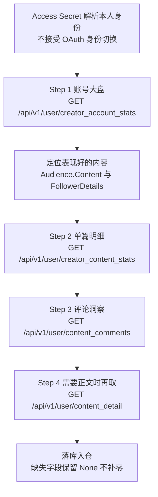

# 创作数据分析实操：从账号大盘到单篇明细

本文只做一件事：把知乎「创作能力」四接口接进自己的分析流程。所有 URL、参数名、字段名、类型、错误码均逐字取自官方文档；官方没有写的地方一律标注「官方文档未给出」，不做推测性补充。

## 一、前置与边界：先算预算，再谈取数

| 约束项 | 官方表述 |
| - | - |
| 账号范围 | **仅支持当前 Access Secret 所属账号**；服务端从凭证解析本人身份，不能通过参数指定他人 |
| 身份切换 | **不接受 OAuth 身份切换** |
| 内容状态 | 仅支持本人**已发布**的内容；草稿、未发布或其他不可用状态不在支持范围内 |
| 请求头 | `Authorization: Bearer <your_access_secret>`、`X-Request-Timestamp: <unix_seconds>`（秒级） |
| 额度 | 本人全文、评论、账号统计、单篇统计共用「创作能力」额度组，默认每个租户每个自然日**共计 200 次**，未实名等低额度用户为 **10 次** |

⚠️ 四个接口共用**同一个 200 次/自然日的共享池**，不是各 50 次；额度查询 `GET /api/v1/quota` 不消耗业务额度，动手前先查 `APIIDs=creator` 的 `RemainingQuota`，再决定翻多少页评论。

⚠️ 组内配额如何拆分、接口之间有无优先级，**官方文档未给出**；因此不要为「每篇内容都要跑一遍全量评论」做预算假设。

## 二、整体流程



## 三、Step 1：账号级统计（账号大盘）

### 3.1 取数

```bash
curl -G 'https://developer.zhihu.com/api/v1/user/creator_account_stats' \
  --data-urlencode 'ContentType=all' \
  --data-urlencode 'StartDate=2026-09-01' \
  --data-urlencode 'EndDate=2026-09-07' \
  -H 'Authorization: Bearer <your_access_secret>' \
  -H "X-Request-Timestamp: $(date +%s)"
```

| 名称 | 类型 | 必填 | 说明 |
| - | - | - | - |
| ContentType | String | 否 | `all`、`answer`、`article`、`pin` 或 `zvideo`，默认 `all` |
| StartDate | String | 否 | 开始日期，格式 `YYYY-MM-DD`，需与 EndDate 同时提供 |
| EndDate | String | 否 | 结束日期，格式 `YYYY-MM-DD`，不得早于 StartDate |

### 3.2 响应示例（官方原文）

```json
{
  "Code": 0,
  "Message": "success",
  "Data": {
    "ContentType": "all",
    "Metrics": {
      "Updated": "2026-09-08 12:00:00",
      "ViewCount": 100,
      "UpvoteCount": 10,
      "Yesterday": {
        "ViewCount": 20
      }
    },
    "Followers": {
      "Total": 50,
      "Yesterday": 2,
      "NewYesterday": 3,
      "CancelledYesterday": 1
    }
  }
}
```

### 3.3 字段解读

`Data` 顶层为 `ContentType`(String) 与 `Metrics`/`Audience`/`CreationCounts`/`Followers`/`FollowerDetails`/`FollowerProfile`（均为 Object，可选）。

| 分组 | 关键字段 | 读法 |
| - | - | - |
| `Metrics` | `Updated`(String，统计更新时间)、`ViewCount`/`PlayCount`/`UpvoteCount`/`CommentCount`/`LikeCount`/`CollectCount`/`ShareCount`/`RepinCount`/`PublishCount`(Int64)、`ClickRate`/`ReadFinishedRate`/`PlayFinishedRate`(Float64)、`IncreasedUpvoteCount`/`DecreasedUpvoteCount`/`IncreasedLikeCount`/`DecreasedLikeCount`(Int64)，另有 `Yesterday`/`Today`(Metrics，同结构) | `Updated` 是**统计更新时间**，不是区间起点 |
| `Followers` | `Total`(粉丝总数)、`Yesterday`(昨日粉丝净增数)、`NewYesterday`(昨日新增粉丝数)、`CancelledYesterday`(昨日取消关注数)、`ActiveCount`(活跃粉丝数) 均为 Int64；`ActiveRatio`(活跃粉丝占比) 是 **String** | `ActiveRatio` 是字符串，不是 Float64 |
| `CreationCounts` | `Answer`/`Article`/`Video`/`Follower`(Int64) | 创作数量快照 |
| `Audience` | `Status`(画像数据状态)/`Reason`(画像状态或数据缺失原因) 均为 String；分布数组共 **8 个**：`Source`/`Activeness`/`ActiveTime`/`Gender`/`Age`/`Interest`/`Location`/`OS`(Array\<AudienceProfileItem\>)，另有内容列表 `Content`(Array\<AudienceContentItem\>) | 先读 `Status`/`Reason` 再读分布，画像缺失时不做补全 |
| `FollowerDetails` | `Daily`(Array\<FollowerDaily\>)、`Today`(FollowerDaily)、`Period`(FollowerPeriod) | `Today` 的实际统计日期以其 `Date` 为准 |
| `FollowerProfile` | `Status`(Int32，值为 0 时省略，缺失不代表异常)、`Reason`、`Audience`、`Interactions` | 粉丝侧的画像与互动明细 |

### 3.4 两个必须写进代码的边界

⚠️ **日期成对规则**：`StartDate` 与 `EndDate` 必须成对提供或同时省略；省略时使用服务默认统计范围，**不承诺固定天数**。做「近 7 天」不能假设默认就是 7 天，必须显式传 `StartDate`/`EndDate`。

⚠️ **缺失 ≠ 0**：可选数值指标未返回时**不应补零**，已提供的数值指标为 0 时会保留；状态、字符串和集合字段也可能因零值、空字符串或空集合而省略，**不能仅凭缺失判断上游未提供**。渲染层必须区分「0」与「无数据」。

## 四、Step 2：单篇级统计（单篇明细）

### 4.1 取数

```bash
curl -G 'https://developer.zhihu.com/api/v1/user/creator_content_stats' \
  --data-urlencode 'ContentUrl=https://zhuanlan.zhihu.com/p/123' \
  --data-urlencode 'StartDate=2026-09-01' \
  --data-urlencode 'EndDate=2026-09-07' \
  -H 'Authorization: Bearer <your_access_secret>' \
  -H "X-Request-Timestamp: $(date +%s)"
```

`ContentUrl`(String，必填) 指向当前用户创作的回答、文章、想法或视频链接；`StartDate`/`EndDate` 同样成对提供或同时省略。

### 4.2 响应示例（官方原文）

```json
{
  "Code": 0,
  "Message": "success",
  "Data": {
    "Items": [
      {
        "ContentType": "article",
        "ContentToken": "123",
        "Url": "https://zhuanlan.zhihu.com/p/123",
        "Title": "示例文章",
        "Metrics": {
          "Date": "2026-09-08",
          "ViewCount": 100,
          "UpvoteCount": 10
        }
      }
    ]
  }
}
```

### 4.3 `Date` 与 `Updated` 语义不同，不能当同构结构复用类型定义

账号级 `Metrics` 用 `Updated`（**统计更新时间**），单篇级 `Metrics` 用 `Date`（**统计日期**）。两者的其余同名字段大体一致，但**整体不是同构结构**，写代码时不要共用同一个类型定义或同一个解析函数——共用会在某一级静默取到 `None`。

### 4.4 单篇独有的转粉指标

| 字段 | 类型 | 说明 |
| - | - | - |
| `PageShowUV` | Int64 | 内容曝光用户数（UV） |
| `NewFollowerCount` | Int64 | 新增关注用户数 |
| `FollowerConversionRate` | Float64 | 转粉率 |
| `PositiveInteractionRate` | String | 正向互动率 |
| `FollowerGain` | Int64 | 内容带来的转粉数量 |
| `UpvoteCount7Days` | Int64 | 7 日赞同数 |

⚠️ `Items` 为**空数组**时表示没有统计数据，**不等同于各指标均为 0**；落库时应保留空数组语义，不要给每项指标造一行 0。

⚠️ 比例字段类型不统一：`FollowerConversionRate` 是 Float64，`PositiveInteractionRate` 是 String。官方明确要求**沿用上游原值，单位未明确时不要自行乘 100 或拼接百分号**；`ActiveRatio` 同理。

## 五、Step 3：评论抓取与翻页纪律

```bash
curl -G 'https://developer.zhihu.com/api/v1/user/content_comments' \
  --data-urlencode 'ContentUrl=https://zhuanlan.zhihu.com/p/123' \
  --data-urlencode 'Offset=0' \
  --data-urlencode 'Limit=20' \
  --data-urlencode 'Order=score' \
  -H 'Authorization: Bearer <your_access_secret>' \
  -H "X-Request-Timestamp: $(date +%s)"
```

| 名称 | 类型 | 必填 | 说明 |
| - | - | - | - |
| ContentUrl | String | 是 | 当前用户创作的内容链接 |
| Offset | Int64 | 否 | 分页偏移，默认 `0`，不能为负数 |
| Limit | Int64 | 否 | 根评论返回数量，默认 `20`，范围 `1–50` |
| Order | String | 否 | `score` 按热度排序、`reverse` 按时间倒序、`ascending` 按时间正序，默认 `score` |

响应示例（官方原文）：

```json
{
  "Code": 0,
  "Message": "success",
  "Data": {
    "Items": [
      {
        "Comment": {
          "ID": 456,
          "Type": "article",
          "CreatedAt": 1742822400,
          "Content": "<p>示例评论</p>",
          "LikeCount": 2,
          "DislikeCount": 0,
          "AuthorToken": "example-user"
        },
        "Children": []
      }
    ],
    "Paging": {
      "IsEnd": true
    }
  }
}
```

翻页纪律逐条照抄官方：

| 纪律 | 说明 |
| - | - |
| 判定终止 | `Data.Paging.IsEnd` 为 **Bool**，为 true 才停 |
| 取下一偏移 | `IsEnd=false` 时使用 `NextOffset` 作为下次 `Offset`；`NextOffset` 与 `Totals` 均为**可选 Int64** |
| 不要累加 | **不要按 Items 条数累加**偏移量 |
| 不要短页即停 | **不要因短页或空页停止** |
| 异常处理 | `NextOffset` 未提供或不递增时，应报告分页异常并**停止自动翻页** |
| `Totals` | 沿用上游计数，**不保证等于可遍历的评论数量** |
| 换目标/换排序 | 改变目标或排序应**从 `Offset=0` 开始** |

⚠️ `Limit` 是**根评论**的返回数量；`Children` 仅为上游附带的子评论，**不保证完整**——需要完整子评论树时官方文档未给出独立分页入口。

⚠️ `Content` 按不可信内容处理（示例里就是 `<p>…</p>` 的 HTML），必须转义后再渲染；`ID` 是 Int64 大整数，别用 JS `Number` 承载。

## 六、Step 4（可选）：取全文

`GET /api/v1/user/content_detail`，`ContentUrl`(String，必填)。响应 `Data` 含 `ContentType`/`ContentToken`/`Url`/`Title`/`Body`。

- `Body` **可能包含 HTML，展示时转义或安全清洗**。
- `ContentToken` 保留字符串精度，不要转数字。
- 视频类型**仅返回关联正文，不提供视频文件下载**。
- 没有可用正文时返回内容不可用，**不把空 `Body` 宣称为全文**；全文与评论分别调用。

## 七、完整 Python 脚本

只依赖标准库。额度提醒：**创作能力额度组默认每租户每自然日共计 200 次，未实名等低额度用户为 10 次**，四个接口共用。

```python
#!/usr/bin/env python3
# -*- coding: utf-8 -*-
"""知乎创作数据分析实操：账号大盘 -> 单篇明细 -> 评论翻页。

额度提醒：创作能力额度组默认每个租户每个自然日共计 200 次，
未实名等低额度用户为 10 次；全文、评论、账号统计、单篇统计共用这一额度组。
实际额度以 GET /api/v1/quota 为准。
"""
import json
import os
import time
import urllib.error
import urllib.parse
import urllib.request

BASE = "https://developer.zhihu.com"
SECRET = os.environ.get("ZHIHU_ACCESS_SECRET", "")
CONTENT_URL = os.environ.get("ZHIHU_CONTENT_URL", "")


class ZhihuApiError(Exception):
    """Code != 0 的业务错误。"""

    def __init__(self, code, message):
        super().__init__("Code=%s Message=%s" % (code, message))
        self.code = code
        self.message = message


def build_headers():
    if not SECRET:
        raise SystemExit("缺少环境变量 ZHIHU_ACCESS_SECRET")
    return {
        "Authorization": "Bearer " + SECRET,
        # 秒级 Unix 时间戳，与服务端时间相差不能超过 10 分钟
        "X-Request-Timestamp": str(int(time.time())),
        "Content-Type": "application/json",
    }


def get_json(path, params=None):
    """GET 请求；Code != 0 时抛 ZhihuApiError。"""
    url = BASE + path
    if params:
        url += "?" + urllib.parse.urlencode(params)
    req = urllib.request.Request(url, headers=build_headers(), method="GET")
    try:
        with urllib.request.urlopen(req, timeout=60) as resp:
            raw = resp.read().decode("utf-8")
    except urllib.error.HTTPError as exc:
        raw = exc.read().decode("utf-8", "replace")
        print("[HTTP %s] %s" % (exc.code, raw))
        raise
    payload = json.loads(raw) if raw else {}
    code = payload.get("Code")
    if code != 0:
        raise ZhihuApiError(code, payload.get("Message"))
    return payload.get("Data")


def fmt(value):
    """区分「0」与「缺失」：None 原样保留，不补零。"""
    return "缺失" if value is None else value


def fetch_account_stats(start_date=None, end_date=None, content_type=None):
    params = {}
    if content_type:
        params["ContentType"] = content_type
    if start_date and end_date:          # 成对提供，或同时省略
        params["StartDate"] = start_date
        params["EndDate"] = end_date
    return get_json("/api/v1/user/creator_account_stats", params)


def fetch_content_stats(content_url, start_date=None, end_date=None):
    params = {"ContentUrl": content_url}
    if start_date and end_date:
        params["StartDate"] = start_date
        params["EndDate"] = end_date
    return get_json("/api/v1/user/creator_content_stats", params)


def fetch_comments(content_url, offset=0, limit=20, order="score"):
    params = {"ContentUrl": content_url, "Offset": offset, "Limit": limit, "Order": order}
    return get_json("/api/v1/user/content_comments", params)


def main():
    if not CONTENT_URL:
        raise SystemExit("缺少环境变量 ZHIHU_CONTENT_URL（本人已发布内容链接）")
    try:
        # Step 1：账号大盘
        account = fetch_account_stats("2026-09-01", "2026-09-07", "all") or {}
        metrics = account.get("Metrics") or {}
        followers = account.get("Followers") or {}
        print("== Step 1 账号级 ==")
        print("  ContentType        : %s" % fmt(account.get("ContentType")))
        print("  Metrics.Updated    : %s" % fmt(metrics.get("Updated")))
        print("  Metrics.ViewCount  : %s" % fmt(metrics.get("ViewCount")))
        print("  Metrics.UpvoteCount: %s" % fmt(metrics.get("UpvoteCount")))
        print("  Followers.Total    : %s" % fmt(followers.get("Total")))
        print("  Followers.ActiveRatio: %s" % fmt(followers.get("ActiveRatio")))

        # Step 2：单篇明细
        content = fetch_content_stats(CONTENT_URL, "2026-09-01", "2026-09-07") or {}
        items = content.get("Items") or []
        print("== Step 2 单篇级：Items=%d 条 ==" % len(items))
        for item in items:
            m = item.get("Metrics") or {}
            print("  [%s] %s" % (item.get("ContentType"), item.get("Title")))
            print("    Date=%s ViewCount=%s PageShowUV=%s NewFollowerCount=%s" % (
                fmt(m.get("Date")), fmt(m.get("ViewCount")),
                fmt(m.get("PageShowUV")), fmt(m.get("NewFollowerCount"))))
            print("    FollowerConversionRate=%s PositiveInteractionRate=%s" % (
                fmt(m.get("FollowerConversionRate")),
                fmt(m.get("PositiveInteractionRate"))))

        # Step 3：评论与 NextOffset 翻页
        print("== Step 3 评论 ==")
        offset = 0
        for page in range(1, 11):
            data = fetch_comments(CONTENT_URL, offset=offset, limit=20, order="score") or {}
            paging = data.get("Paging") or {}
            rows = data.get("Items") or []
            print("  page=%d Offset=%d 根评论=%d IsEnd=%s Totals=%s NextOffset=%s" % (
                page, offset, len(rows), fmt(paging.get("IsEnd")),
                fmt(paging.get("Totals")), fmt(paging.get("NextOffset"))))
            if paging.get("IsEnd"):
                break
            next_offset = paging.get("NextOffset")
            if next_offset is None or next_offset <= offset:
                print("  分页异常：NextOffset 缺失或不递增，停止自动翻页")
                break
            offset = next_offset
    except ZhihuApiError as exc:
        print("[业务错误] %s" % exc)
        return 1
    except Exception as exc:
        print("[请求异常] %r" % exc)
        return 2
    return 0


if __name__ == "__main__":
    raise SystemExit(main())
```

脚本里三处关键处理：`int(time.time())` 保证**秒级**时间戳；`get_json` 统一校验 `Code`，非 0 抛带 `Code`/`Message` 的 `ZhihuApiError`；取指标一律写 `metrics.get("ViewCount")` 而**不是 `metrics.get("ViewCount") or 0`**，缺失就保持 `None`。

## 八、渲染层纪律表

| 场景 | 正确做法 | 错误做法 |
| - | - | - |
| 0 与缺失 | 缺失显示「—/无数据」，`0` 显示 `0` | 用 `or 0` 把缺失抹成 0 |
| 比例字段 | 沿用上游原值并标注字段名 | 自行乘 100 或拼百分号 |
| `Updated` vs `Date` | 各自建字段，不共用类型定义 | 拿 `Updated` 当统计日期画图 |
| `Items` 空数组 | 显示「暂无统计数据」 | 展开成各指标为 0 的行 |
| `Children` | 仅作上游附带的子评论展示 | 当作完整子评论树 |
| `Totals` | 仅作上游计数参考 | 当作可遍历评论总数用于校验 |
| 评论 `Content` / 正文 `Body` | 转义或安全清洗后渲染 | 直接 innerHTML 注入 |
| Int64 `ID` / `ContentToken` | 用字符串或 BigInt 承载 | 用 JS Number 承载 |

## 九、排错清单

创作能力四接口的错误码表（官方七码）：

| Code | 说明 | 处置 |
| - | - | - |
| `0` | 请求成功 | 继续解析 `Data` |
| `10001` | 参数错误或内容不可用 | 核对参数名大小写、`StartDate`/`EndDate` 是否成对、`EndDate` 是否早于 `StartDate`、`ContentUrl` 是否为本人**已发布**内容（链接无效、内容不存在或作者非本人都归到这一码，响应不会泄露归属信息） |
| `20001` | 鉴权或授权失败 | 核对 Access Secret 与 `Bearer` 后的空格、时间戳是否为秒级 |
| `30001` | 调用频率、并发或当日额度超限 | 查 `GET /api/v1/quota?APIIDs=creator` 区分频率问题与额度问题；并发调用要串行化 |
| `30002` | 额外配置的成功次数额度耗尽 | 等待自然日重置或调整调用计划 |
| `30003` | 请求被风控拒绝 | 降低频率、串行重试，不要并发轰炸 |
| `90001` | 服务内部错误 | 退避后重试 |

⚠️ `40004`（知识库不存在）属于知识库接口的错误码，**不适用于**创作能力四接口；遇到它先怀疑调错了接口或路径。

## 十、延伸阅读

- 四接口契约与字段阅读铁律：[`../concepts/05-creator-capability.md`](../concepts/05-creator-capability.md)
- 鉴权与额度契约：[`../concepts/01-auth-and-quota.md`](../concepts/01-auth-and-quota.md)
- OAuth 与用户数据能力边界：[`../concepts/08-user-data-oauth.md`](../concepts/08-user-data-oauth.md)
- 首次调用与环境准备：[`../examples/01-first-call-workflow.md`](../examples/01-first-call-workflow.md)
