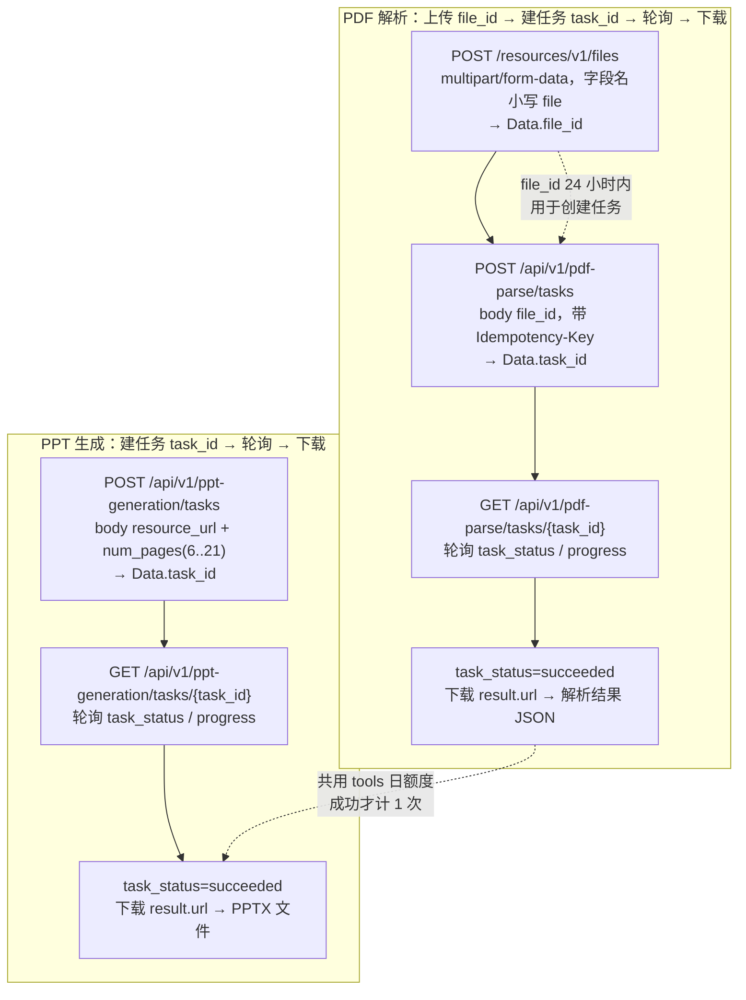

# 文档工具实战：PDF 解析与 PPT 生成的异步任务全链路

小工具（额度组 `tools`）只有两项能力，**PDF 解析**把 PDF 转成结构化 JSON，**PPT 生成**把知乎回答或文章链接转成 PPTX。两者都是**异步任务**：服务端先返回一个 `task_id`，客户端自己轮询状态，拿到终态后再下载产物。

⚠️ 这两项能力**共用同一份小工具日额度，不分别计算**：普通用户每天 10 次，低额度用户每天 2 次。混用会互相挤占，详见第八节。

## 一、两条链路对比



| 维度 | PDF 解析 | PPT 生成 |
| --- | --- | --- |
| 输入 | 本地 PDF 文件（`multipart/form-data`，字段名小写 `file`，最大 100MB） | 知乎回答或文章链接（`resource_url` + `num_pages`） |
| 建任务接口 | `POST /api/v1/pdf-parse/tasks` | `POST /api/v1/ppt-generation/tasks` |
| 查询接口 | `GET /api/v1/pdf-parse/tasks/{task_id}` | `GET /api/v1/ppt-generation/tasks/{task_id}` |
| `task_id` 示例 | `pdf_39b0e572b738a5ce8c5be600f9cf7b91` | `ppt_39b0e572b738a5ce8c5be600f9cf7b91` |
| `result` 字段 | `url`、`summary`、`expires_at_ms` | `url`、`expires_at_ms` |
| 独有错误码 | `40002` 文件不存在、已过期或不可访问 | 无（不支持文件上传） |

## 二、PDF 链路：上传 → 建任务 → 轮询 → 下载

### 2.1 Step 1：上传文件

```bash
curl -X POST 'https://developer.zhihu.com/resources/v1/files' \
  -H 'Authorization: Bearer <your_access_secret>' \
  -H "X-Request-Timestamp: $(date +%s)" \
  -F 'file=@/path/to/example.pdf;type=application/pdf'
```

响应示例：

```json
{
  "Code": 0,
  "Message": "success",
  "Data": {
    "file_id": "file_00000000fb987230beba394fd8279daf"
  }
}
```

- 字段名是**小写 `file`**（与知识库上传接口的大写 `File` 相反，写成 `File` 会报 `10001`）。
- 当前仅支持上传 PDF 文件，最大 100MB。

⚠️ **上传后的文件需在 24 小时内用于创建任务**，超时后命中 `40002`（文件不存在、已过期或不可访问）。

⚠️ **上传不消耗小工具免费额度**，但上传接口**另有按租户计算的日请求限流**：普通用户默认 10 次，低额度用户默认 2 次，达到上限时返回限流错误。这个限流与 `tools` 的 10 次额度是**两套独立计数**。

### 2.2 Step 2：创建解析任务

```bash
curl -X POST 'https://developer.zhihu.com/api/v1/pdf-parse/tasks' \
  -H 'Authorization: Bearer <your_access_secret>' \
  -H "X-Request-Timestamp: $(date +%s)" \
  -H 'Content-Type: application/json' \
  -H 'Idempotency-Key: pdf-request-001' \
  -d '{"file_id":"file_00000000fb987230beba394fd8279daf"}'
```

请求体只有一个必填字段 `file_id`（String）。响应：

```json
{
  "Code": 0,
  "Message": "success",
  "Data": {
    "task_id": "pdf_39b0e572b738a5ce8c5be600f9cf7b91",
    "task_status": "pending"
  }
}
```

`task_status` 初始通常为 `pending`。如果命中幂等重放，响应 Header 会包含：

```text
Idempotent-Replayed: true
```

### 2.3 Step 3：轮询任务状态

```bash
curl 'https://developer.zhihu.com/api/v1/pdf-parse/tasks/pdf_39b0e572b738a5ce8c5be600f9cf7b91' \
  -H 'Authorization: Bearer <your_access_secret>' \
  -H "X-Request-Timestamp: $(date +%s)"
```

`task_status` 有四个取值：`pending`（任务已创建，等待处理）、`running`（任务处理中）、`succeeded`（任务已成功）、`failed`（任务失败）。轮询时用 `progress`（Number，范围 0 到 1）反馈进度。

处理中响应：

```json
{
  "Code": 0,
  "Message": "success",
  "Data": {
    "task_id": "pdf_39b0e572b738a5ce8c5be600f9cf7b91",
    "task_status": "running",
    "progress": 0.35,
    "result": null,
    "error": null
  }
}
```

成功响应：

```json
{
  "Code": 0,
  "Message": "success",
  "Data": {
    "task_id": "pdf_39b0e572b738a5ce8c5be600f9cf7b91",
    "task_status": "succeeded",
    "progress": 1,
    "result": {
      "url": "https://zhihu-openapi.bj.bcebos.com/...?authorization=...",
      "summary": "这是一份关于开放平台能力介绍的 PDF。",
      "expires_at_ms": 1782800000000
    },
    "error": null
  }
}
```

失败响应：

```json
{
  "Code": 0,
  "Message": "success",
  "Data": {
    "task_id": "pdf_39b0e572b738a5ce8c5be600f9cf7b91",
    "task_status": "failed",
    "progress": 0,
    "result": null,
    "error": {
      "code": "parse_failed",
      "message": "PDF parse failed"
    }
  }
}
```

⚠️ **`result.url` 有效期较短**；如果链接过期，**重新查询同一 `task_id` 即可获得新的下载链接，不要重跑任务**——重跑会新建任务、重复占用活跃任务配额并再次计入 1 次额度。

⚠️ **`expires_at_ms` 是毫秒级时间戳**，与其他接口的秒级时间戳相差三个数量级。做剩余有效期判断时必须先除以 1000 再和秒级时间戳相减。

## 三、PDF 解析结果文件结构

访问 `result.url` 下载得到 JSON 格式的 PDF 解析结果：

```json
{
  "schema_version": "v1",
  "pages": [
    {
      "page": 0,
      "blocks": [
        {
          "type": "text",
          "box": [0.17, 0.30, 0.82, 0.44],
          "content": "这是一段从 PDF 中解析出的正文。"
        },
        {
          "type": "figure",
          "box": [0.10, 0.55, 0.90, 0.78],
          "content": "",
          "image": {
            "media_type": "image/jpeg",
            "data": "/9j/4AAQSkZJRgABAQ..."
          }
        }
      ]
    }
  ]
}
```

| 字段 | 类型 | 说明 |
| --- | --- | --- |
| `schema_version` | String | 结果结构版本，当前为 `v1` |
| `pages` | Array | 按页组织的解析结果 |
| `pages[].page` | Integer | 页码，**从 `0` 开始** |
| `pages[].blocks` | Array | 当前页解析出的内容块 |
| `blocks[].type` | String | 内容块类型，如 `title`、`text`、`formula`、`figure` |
| `blocks[].box` | Number Array | 内容块坐标，格式为 `[x1, y1, x2, y2]` |
| `blocks[].content` | String | 文本内容；图片块没有文本时为空字符串 |
| `blocks[].image` | Object | 图片信息，仅图片块可能返回 |
| `blocks[].image.media_type` | String | 图片 MIME 类型，如 `image/jpeg`、`image/png` |
| `blocks[].image.data` | String | 纯 Base64 图片数据，**不包含 `data:image/...;base64,` 前缀** |

⚠️ 调用方应**兼容未知的 `type` 和后续新增字段**；**普通文本块不返回 `image`**。把 `image.data` 直接当 data URL 拼接会出错，需要自己补 `data:<media_type>;base64,` 前缀。

## 四、PPT 生成链路

### 4.1 创建生成任务

```bash
curl -X POST 'https://developer.zhihu.com/api/v1/ppt-generation/tasks' \
  -H 'Authorization: Bearer <your_access_secret>' \
  -H "X-Request-Timestamp: $(date +%s)" \
  -H 'Content-Type: application/json' \
  -H 'Idempotency-Key: ppt-request-001' \
  -d '{
    "resource_url": "https://www.zhihu.com/question/1892249263213356127/answer/2021688002292752412",
    "num_pages": 12
  }'
```

`num_pages`（Int32，必填）范围 **6 到 21**。`resource_url` 当前支持三种格式：

- `https://www.zhihu.com/question/{question_id}/answer/{answer_id}`
- `https://www.zhihu.com/answer/{answer_id}`
- `https://zhuanlan.zhihu.com/p/{article_id}`

不受支持的链接返回：

```json
{
  "Code": 10001,
  "Message": "resource_url is not supported",
  "Data": null
}
```

### 4.2 查询生成任务

查询接口 `GET /api/v1/ppt-generation/tasks/{task_id}` 的响应结构与 PDF 完全一致（`task_id`/`task_status`/`progress`/`result`/`error`），只是 `result` 里没有 `summary`，失败时 `error.code` 为 `generation_failed`、`error.message` 为 `PPT generation failed`。

## 五、完整 Python 脚本

```python
import os
import sys
import time
import json
import argparse

import requests

BASE = "https://developer.zhihu.com"
SECRET = os.environ.get("ZHIHU_ACCESS_SECRET", "<your_access_secret>")

PDF_TASK_PATH = "/api/v1/pdf-parse/tasks"
PPT_TASK_PATH = "/api/v1/ppt-generation/tasks"


class ApiError(RuntimeError):
    def __init__(self, code, message):
        super().__init__("Code=%s Message=%s" % (code, message))
        self.code = code
        self.message = message


def headers(extra=None):
    h = {
        "Authorization": "Bearer %s" % SECRET,
        "X-Request-Timestamp": str(int(time.time())),
    }
    if extra:
        h.update(extra)
    return h


def check(resp):
    """统一校验 Code；非 0 抛 ApiError，30001/30002 单独区分。"""
    body = resp.json()
    code = body.get("Code")
    if code != 0:
        raise ApiError(code, body.get("Message"))
    return body


def upload_pdf(path):
    """Step 1：上传 PDF，字段名小写 file。返回 file_id。"""
    with open(path, "rb") as f:
        resp = requests.post(
            BASE + "/resources/v1/files",
            headers=headers(),
            files={"file": (os.path.basename(path), f, "application/pdf")},
            timeout=60,
        )
    return check(resp)["Data"]["file_id"]


def create_task(task_path, payload, idempotency_key):
    """Step 2：建任务。返回 (task_id, 是否幂等重放)。"""
    resp = requests.post(
        BASE + task_path,
        headers=headers({
            "Content-Type": "application/json",
            "Idempotency-Key": idempotency_key,
        }),
        data=json.dumps(payload, ensure_ascii=False).encode("utf-8"),
        timeout=60,
    )
    replayed = resp.headers.get("Idempotent-Replayed") == "true"
    data = check(resp)["Data"]
    return data["task_id"], replayed


def poll_task(task_path, task_id, max_wait=900, interval=3.0):
    """Step 3：轮询到终态。四个 task_status 值分别处理。"""
    deadline = time.time() + max_wait
    attempt = 0
    while time.time() < deadline:
        attempt += 1
        resp = requests.get(
            BASE + task_path + "/" + task_id, headers=headers(), timeout=30
        )
        data = check(resp)["Data"]
        status = data.get("task_status")
        print("[%d] task_id=%s task_status=%s progress=%s"
              % (attempt, task_id, status, data.get("progress")))
        if status == "succeeded":
            return data.get("result") or {}
        if status == "failed":
            err = data.get("error") or {}
            raise RuntimeError("task failed: %s / %s"
                               % (err.get("code"), err.get("message")))
        # pending / running：继续等待
        time.sleep(interval)
    raise TimeoutError("轮询超时：task_id=%s" % task_id)


def download(result, out_path):
    """Step 4：下载产物。expires_at_ms 是毫秒级时间戳。"""
    url = result.get("url")
    if not url:
        raise RuntimeError("result.url 为空")
    resp = requests.get(url, timeout=120)
    resp.raise_for_status()
    with open(out_path, "wb") as f:
        f.write(resp.content)
    return result.get("expires_at_ms")


def run_pdf(pdf_path, out_path, key):
    file_id = upload_pdf(pdf_path)
    print("file_id=%s" % file_id)
    task_id, replayed = create_task(
        PDF_TASK_PATH, {"file_id": file_id}, key
    )
    print("task_id=%s idempotent_replayed=%s" % (task_id, replayed))
    result = poll_task(PDF_TASK_PATH, task_id)
    expires = download(result, out_path)
    print("summary=%s" % result.get("summary"))
    print("expires_at_ms=%s（毫秒级）" % expires)
    return out_path


def run_ppt(resource_url, num_pages, out_path, key):
    task_id, replayed = create_task(
        PPT_TASK_PATH,
        {"resource_url": resource_url, "num_pages": num_pages},
        key,
    )
    print("task_id=%s idempotent_replayed=%s" % (task_id, replayed))
    result = poll_task(PPT_TASK_PATH, task_id)
    expires = download(result, out_path)
    print("expires_at_ms=%s（毫秒级）" % expires)
    return out_path


if __name__ == "__main__":
    p = argparse.ArgumentParser()
    p.add_argument("--mode", choices=["pdf", "ppt"], required=True)
    p.add_argument("--pdf", default="/path/to/example.pdf")
    p.add_argument("--resource-url")
    p.add_argument("--num-pages", type=int, default=12)
    p.add_argument("--out", default="out.bin")
    p.add_argument("--key", default="pdf-request-001")
    a = p.parse_args()

    try:
        if a.mode == "pdf":
            run_pdf(a.pdf, a.out, a.key)
        else:
            if not a.resource_url:
                sys.exit("ppt 模式需要 --resource-url")
            run_ppt(a.resource_url, a.num_pages, a.out, a.key)
    except ApiError as e:
        if e.code == 30001:
            sys.exit("触发限流，退避后重试：%s" % e.message)
        if e.code == 30002:
            sys.exit("额度不足，改走降级路径：%s" % e.message)
        if e.code == 40003:
            sys.exit("活跃任务数超限，等已有任务完成后再提交：%s" % e.message)
        sys.exit("接口错误：%s" % e)
```

关于 `Idempotent-Replayed` 的判别：命中重放时，**响应 Header 出现 `Idempotent-Replayed: true`**，且 `Data.task_id` 与首次调用**完全相同**。因此客户端在重试建任务时，应当**复用返回的 `task_id` 继续轮询**，而不是认为「请求没生效」再发一次——后者虽然命中同一幂等键不会重复计费，但会白白占用一次活跃任务配额。

## 六、幂等与额度纪律

| 场景 | 平台行为 | 官方口径 | 客户端应对 |
| --- | --- | --- | --- |
| 同一个 `Idempotency-Key` + 同一参数重复调用 | 返回同一个 `task_id`，响应 Header 含 `Idempotent-Replayed: true` | 官方文档原文 | 复用已拿到的 `task_id` 继续轮询，不要新建任务 |
| 同一个 `Idempotency-Key` 换请求参数 | 返回 `40001` 幂等键与请求参数冲突 | 官方文档原文 | 幂等键按业务实体派生（如 `pdf-<file_id>`），不要复用一个常量键 |
| 任务成功 | 计入 1 次额度 | 任务成功时计入 1 次 | 提交前先确认额度，避免成功后才发现超限 |
| 任务失败 | **不消耗**额度 | 失败或查询任务状态不消耗额度 | 可安全重试（仍受 `40003` 活跃任务数约束） |
| 查询任务状态 | **不消耗**额度 | 同上 | 轮询频率可以放宽松，但仍受 `30001` 限流约束 |
| PDF 解析 + PPT 生成混用 | **共用**同一份小工具日额度，不分别计算 | 普通用户每天 10 次，低额度用户每天 2 次 | 预算按「小工具合计 10 次」分配，不要按接口各算 10 次 |
| 上传 PDF 文件 | 不消耗小工具免费额度，另有按租户日请求限流 | 普通用户默认 10 次，低额度用户默认 2 次 | 上传限流与 `tools` 额度是两套计数，分别规划 |
| 活跃任务堆积 | `40003` 活跃任务数超限，请等待已有任务完成后再提交 | 官方文档原文 | 先把旧任务轮询到终态再提交新任务 |
| 额度耗尽 | `30002` 额度不足 | 官方文档原文 | 复用已下载的产物、复用 `file_id` 已建的任务、或等次日 00:00 重置；官方 MCP 服务不提供 PDF 解析与 PPT 生成工具 |

## 七、错误码速查

| Code | PDF 解析 API | PPT 生成 API |
| --- | --- | --- |
| `10001` | 请求参数错误 | 请求参数错误 |
| `20001` | 鉴权失败或无权限访问 | 鉴权失败或无权限访问 |
| `30001` | 请求过于频繁 | 请求过于频繁 |
| `30002` | 额度不足 | 额度不足 |
| `40001` | 幂等键与请求参数冲突 | 幂等键与请求参数冲突 |
| `40002` | 文件不存在、已过期或不可访问 | —（PPT 无文件上传环节） |
| `40003` | 活跃任务数超限，请等待已有任务完成后再提交 | 活跃任务数超限，请等待已有任务完成后再提交 |
| `90001` | 服务内部错误 | 服务内部错误 |

失败响应的顶层结构（业务错误码在顶层，不在 `Data` 里）：

```json
{
  "Code": 10001,
  "Message": "file_id is invalid",
  "Data": null
}
```

## 八、延伸阅读

- 小工具能力完整说明：[`../concepts/07-document-tools.md`](../concepts/07-document-tools.md)
- 鉴权、额度与计费契约：[`../concepts/01-auth-and-quota.md`](../concepts/01-auth-and-quota.md)
- 知识库 RAG 实操：[`../concepts/06-knowledge-base.md`](../concepts/06-knowledge-base.md)
