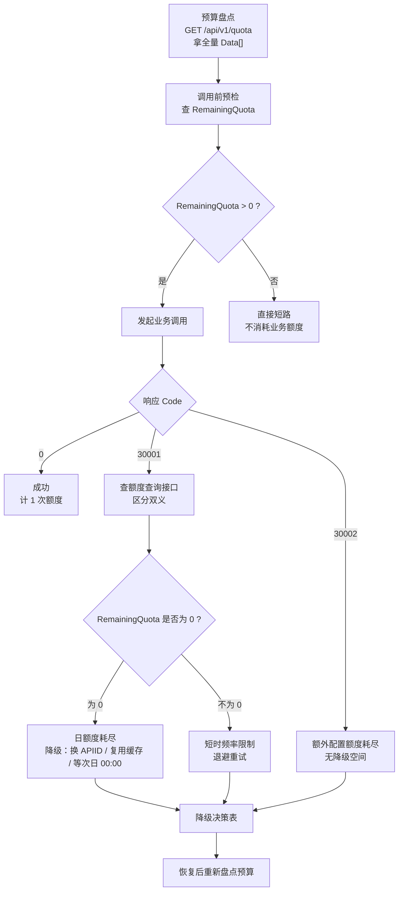

# 额度治理实操：从盘点到预检再到降级

知乎开放平台的每一次调用都要过两道关：**日额度**决定「今天还能调多少次」，**计费规则**决定「额度用完后这一次花谁的钱」。本文把额度从「一个会刷新的数字」变成「可以编程的事实」：先用查询接口盘点，再在调用前预检，最后把耗尽后的降级路径提前写好。

⚠️ 官方在各接口页公布的默认次数（如问题发现 100 次、创作能力 200 次、小工具 10 次）**都不是运行时真值**——官方原文明确：**实际额度以额度查询结果为准**。任何预算决策都必须以 `GET /api/v1/quota` 的返回为准。

## 一、额度全景：九个额度组

### 1.1 额度项与官方次数口径

| API ID | 名称 | 覆盖范围 | 官方公布的次数口径 |
| --- | --- | --- | --- |
| `global_search` | 全网搜索 | 全网搜索 | 官方文档未给出具体次数 |
| `zhihu_search` | 知乎搜索 | 知乎内容搜索 | 官方文档未给出具体次数 |
| `hot_list` | 热榜 | 知乎热榜 | 官方文档未给出具体次数 |
| `question_discovery` | 问题发现 | 问题推荐及问题回答摘要 | 默认每租户每自然日 **100 次**，未实名等低额度用户 **10 次** |
| `zhida_openai` | 直答 | 直答服务 | 官方文档未给出具体次数 |
| `tools` | 小工具 | PDF 解析及 PPT 生成 | **普通用户每天 10 次，低额度用户每天 2 次**（PDF 与 PPT 共用，不分别计算） |
| `knowledge` | 知识库 | 知识库文件上传、知识库列表、知识库内容列表及知识库检索 | 官方文档未给出具体次数 |
| `user_data` | 知乎用户数据 | 用户创作列表、关注、收藏及收藏夹数据 | 官方文档未给出具体次数 |
| `creator` | 创作能力 | 本人全文、评论、账号统计、单篇统计 | 默认每租户每自然日**共计 200 次**，未实名等低额度用户 **10 次** |

### 1.2 三条必须记住的额度事实

1. **「问题发现」= 问题推荐 + 问题回答摘要**，两者共用一个 100 次池。
2. **「创作能力」= 本人全文 + 评论 + 账号统计 + 单篇统计**，四者共用一个 200 次池。
3. **「小工具」= PDF 解析 + PPT 生成**，共用一个 10 次池；PDF 上传接口另有按租户计算的日请求限流（普通 10 次 / 低额度 2 次）。

⚠️ **官方文档未给出 `global_search`、`zhihu_search`、`hot_list`、`zhida_openai`、`knowledge`、`user_data` 这六组的具体次数**，也未给出价格表服务名与 `APIID` 的逐字映射表。不要凭印象写死数字。

## 二、Step 1：预算盘点（拉全量）

### 2.1 请求与响应

不传 `APIIDs`，一次拉回所有已配置的额度项：

```bash
curl 'https://developer.zhihu.com/api/v1/quota' \
  -H 'Authorization: Bearer <your_access_secret>' \
  -H "X-Request-Timestamp: $(date +%s)"
```

响应：

```json
{
  "Code": 0,
  "Message": "success",
  "Data": [
    {
      "APIID": "knowledge",
      "APIName": "知识库",
      "TotalQuota": 500,
      "TotalUsed": 12,
      "RemainingQuota": 488
    }
  ]
}
```

| 字段 | 类型 | 说明 |
| --- | --- | --- |
| `APIID` | String | 额度项 ID |
| `APIName` | String | 额度项名称 |
| `TotalQuota` | Int64 | 当前自然日总额度 |
| `TotalUsed` | Int64 | 当前自然日已使用额度 |
| `RemainingQuota` | Int64 | 当前自然日剩余额度，最低为 0 |

### 2.2 三条解析纪律

⚠️ **尚未接入额度配置的 API 会被省略**，不会导致整个列表失败。别把「列表里没有某一项」误读成「该项额度为 0」——显式请求多个 API 时同样只返回其中已配置的子集；若全部尚未配置，成功返回**空数组**。

⚠️ **`APIIDs` 参数只能出现一次**。多个 API ID 用逗号分隔，不要写成 `?APIIDs=a&APIIDs=b`。

⚠️ **账号关联多个租户时，查询结果会汇总相关租户额度**——返回的是合并后的数字，不是某一个租户的明细。

不传 `APIIDs` 时，返回顺序就是第一节表格中的顺序。

## 三、Step 2：按需查询单项

```http
GET /api/v1/quota?APIIDs=knowledge,zhihu_search
```

```bash
curl -G 'https://developer.zhihu.com/api/v1/quota' \
  --data-urlencode 'APIIDs=knowledge,zhihu_search' \
  -H 'Authorization: Bearer <your_access_secret>' \
  -H "X-Request-Timestamp: $(date +%s)"
```

用 `--data-urlencode` 而非手写 `-d`，避免逗号与特殊字符被错误转义。

**额度查询本身不消耗业务额度**，官方原文写明「该查询不会消耗业务额度」，因此可以放心高频轮询——`30001` 只在查询接口自身频率超限时出现。

## 四、Step 3：调用前预检

### 4.1 预检包装函数

把「查额度 → 判断 → 调用」封装成包装函数，`RemainingQuota` 不足就短路返回，省下必然失败的请求：

```python
import os
import time
import requests

BASE = "https://developer.zhihu.com"
SECRET = os.environ.get("ZHIHU_ACCESS_SECRET", "<your_access_secret>")


class QuotaExhausted(RuntimeError):
    """额度不足：在发起业务请求前就被拦下。"""

    def __init__(self, api_id, remaining):
        super().__init__("额度组 %s 剩余 %s，不足以发起调用" % (api_id, remaining))
        self.api_id = api_id
        self.remaining = remaining


def _headers():
    return {
        "Authorization": "Bearer %s" % SECRET,
        "X-Request-Timestamp": str(int(time.time())),
    }


def get_quota(api_ids=None):
    """查询额度。查询本身不消耗业务额度。"""
    params = {}
    if api_ids:
        # APIIDs 只能出现一次；多个 ID 用逗号分隔
        params["APIIDs"] = ",".join(api_ids)
    resp = requests.get(BASE + "/api/v1/quota", headers=_headers(),
                        params=params, timeout=30)
    body = resp.json()
    if body.get("Code") != 0:
        raise RuntimeError("额度查询失败 Code=%s Message=%s"
                           % (body.get("Code"), body.get("Message")))
    # 尚未接入额度配置的 API 会被省略，这里不补零
    return {item["APIID"]: item for item in (body.get("Data") or [])}


def guarded_call(api_id, func, *args, **kwargs):
    """调用前预检：额度不足直接短路，不浪费业务请求。"""
    quota = get_quota([api_id])
    item = quota.get(api_id)
    if item is None:
        # 未接入额度配置的 API，官方文档未给出其额度口径，放行但记录
        print("[quota] %s 未出现在额度列表中，跳过预检" % api_id)
        return func(*args, **kwargs)
    remaining = item.get("RemainingQuota", 0)
    print("[quota] %s remaining=%s/%s" % (api_id, remaining, item.get("TotalQuota")))
    if remaining <= 0:
        raise QuotaExhausted(api_id, remaining)
    return func(*args, **kwargs)


def fetch_zhihu_search(query):
    """用法示例：知乎搜索 GET /api/v1/content/zhihu_search"""
    resp = requests.get(
        BASE + "/api/v1/content/zhihu_search",
        headers=_headers(),
        params={"Query": query},
        timeout=30,
    )
    return resp.json()


if __name__ == "__main__":
    try:
        print(guarded_call("zhihu_search", fetch_zhihu_search, "怎么理解rave文化"))
    except QuotaExhausted as e:
        print("降级：%s" % e)
```

### 4.2 用法

用 `guarded_call("zhihu_search", ...)` 包装调用，`RemainingQuota` 为 0 时不会真的发出业务请求。

## 五、Step 4：按组分配预算

| 任务类型 | 用哪些额度组 | 优先级 | 理由 |
| --- | --- | --- | --- |
| 内容选题 | `zhihu_search` + `global_search` + `hot_list` | 中 | 三个独立组，互不挤占；先用 `zhihu_search` 精排，再用 `global_search` 扩面，`hot_list` 补时效 |
| 知识问答 | `knowledge` | 高 | 组内含文件上传、列表、内容列表、检索四项，共享一个池；其中列表类 1 元／千次、检索与上传 10 元／千次，但四项共用同一份额度 |
| 创作复盘 | `creator` | 高 | 全天 200 次的大池，但一次全量评论扫描就能吃掉大半 |
| 文档转 PPT / PDF 解析 | `tools` | 最高 | 全天只有 10 次（低额度 2 次），且 PDF 与 PPT 共用；必须排优先级，先跑真正要交付的 |
| 选题分发 | `question_discovery` | 中 | 100 次池，推荐与回答摘要共用 |
| 个人数据同步 | `user_data` | 低 | 官方文档未给出次数口径，按需取数并缓存 |
| 直答兜底 | `zhida_openai` | 中 | 官方文档未给出次数口径；直答另有 `zhida-fast-1p5` / `zhida-thinking-1p5` / `zhida-agent` 三档模型可选 |

⚠️ 组内配额如何拆分、接口之间有无优先级，**官方文档未给出**。上表的优先级是**调用方自定的调度策略**，不是平台承诺。

## 六、额度耗尽的处置流程



## 七、计费口径速查

### 7.1 逐字口径对照

以下每条均逐字对应官方《服务价格》页：

| 要点 | 官方原文口径 |
| --- | --- |
| 计费基准 | 下列服务**按成功调用次数计费** |
| 价格单位 | 人民币含税价，以「元／千次」展示；**不足千次也按实际付费调用次数计算** |
| 不计费的请求 | **鉴权失败、参数错误、触发限流等未成功的请求不计费** |
| 流式服务 | **流式服务开始输出有效内容后，按一次成功调用计量** |
| 免费额度重置 | 每日额度按**北京时间 00:00 重置**，未用完的次数**不结转** |
| 多 Secret | **同一知乎账号下的多个 Access Secret 共用该账号的额度** |
| 额度组 | **部分服务共用同一额度组**：调用组内任一服务，都会消耗该组的剩余免费次数 |
| 优惠性质 | **每日免费额度属于限时优惠，后续可能根据活动情况调整** |

### 7.2 余额扣减顺序

**余额扣减顺序**：免费额度用完后，调用费用依次从**体验余额**、**充值余额**中支付；**单次调用不拆分使用两种余额，余额不足时请求不执行**。

⚠️ 使用 **OAuth 授权查询其他用户数据时，费用归属于发起调用的开发者账号，不由授权用户支付**。

## 八、完整价格表

每日免费额度用完后，支持继续付费调用的服务单价：

| 服务 | 单价 | 归属分组 |
| --- | ---: | --- |
| 全网搜索 | 12 元／千次 | `global_search` |
| 知乎搜索 | 20 元／千次 | `zhihu_search` |
| 知乎热榜 | 10 元／千次 | `hot_list` |
| 直答 Agent | 20 元／千次 | `zhida_openai` |
| 用户创作内容摘要 | 10 元／千次 | `user_data` |
| 获取关注用户列表 | 10 元／千次 | `user_data` |
| 获取收藏夹以及收藏内容 | 10 元／千次 | `user_data` |
| 我的创作全文 | 10 元／千次 | `creator` |
| 我的创作评论 | 10 元／千次 | `creator` |
| 账号创作数据 | 10 元／千次 | `creator` |
| 单篇创作数据 | 10 元／千次 | `creator` |
| 问题回答 | 20 元／千次 | `question_discovery` |
| 知识库列表 | 1 元／千次 | `knowledge` |
| 知识库内容列表 | 1 元／千次 | `knowledge` |
| 知识库文件上传 | 10 元／千次 | `knowledge` |
| 知识库检索 | 10 元／千次 | `knowledge` |

⚠️ **价格表的服务名与 `APIID` 并非逐字一一对应，官方未给出映射表**。上表「归属分组」一列是依据官方《额度查询 API》页的「覆盖范围」列做的对应推断，官方并未声明价格表行与额度组一一映射。小工具（PDF 解析、PPT 生成）在官方价格表中**没有列出单价**，官方文档未给出。

⚠️ 官方在《每日免费额度》一节指向另一处入口查看实际额度与剩余次数：**「个人中心 - 用量统计 - 各接口限免额度」**。

## 九、降级策略表

| 触发条件 | 替代路径 | 说明 |
| --- | --- | --- |
| `global_search` 额度耗尽 | 改用 `zhihu_search` | 两个是**独立额度组**（全网搜索 vs 知乎内容搜索），互不挤占；结果覆盖面变窄但不消耗对方额度 |
| `zhihu_search` 额度耗尽 | 改用 `global_search` 或 `hot_list` | 同上，独立额度组 |
| 同一查询反复触发 | 复用 `SearchHashId` | 知乎搜索响应中 `Data.SearchHashId`（String，搜索请求标识）是**整次请求级**的标识，可作为请求级缓存键；命中缓存则跳过调用 |
| 同一内容反复取回 | 缓存 `ContentText` | 搜索结果的 `ContentText`（String，内容摘要）可落盘缓存，避免重复调用换同一份摘要 |
| 知识库检索额度紧张 | 缩小 `Limit` | 知识库检索 `Limit` 范围 `1..10`，按**文档结果数**计算而非片段数，调小即少消耗 |
| `tools` 额度耗尽（仅 10 次） | 延后到次日 00:00 重置；或先用本地已有的 PDF 直接转换，不重复调用小工具 | 每日额度按北京时间 00:00 重置且不结转。官方 MCP 统一服务只暴露搜索、热榜、直答四个工具，**不包含 PDF 解析与 PPT 生成**，因此小工具耗尽时没有等价的 MCP 替代路径 |
| 创作能力额度吃紧 | 优先拉账号统计而非全量评论 | `creator` 组四项共用 200 次池，账号统计一次调用即可覆盖多篇内容的整体表现 |
| 问题发现额度吃紧 | 减少 `Count` | `Count` 范围 `1-20`，默认 `5`；返回条目本来就可能不足 `Count` 或为空 |
| 需要他人授权数据 | 复用已授权的 `X-OAuth-Token` 结果 | 费用归发起调用的开发者账号，重复拉取不会让被授权方付费，但也同样消耗调用方额度 |
| 全部额度耗尽 | 等待次日 00:00 重置 | 免费额度不结转，重置后自动恢复 |

⚠️ 复用 `SearchHashId` 与缓存 `ContentText` 是**调用方自建的缓存策略**，官方文档未提供缓存接口或缓存 TTL 口径；官方文档也未说明搜索结果是否会随时间变化。

## 十、排错表

| 症状 | 官方定义的含义 | 判定方法 | 处置 |
| --- | --- | --- | --- |
| `30001` | 在问题推荐、问题回答、创作数据四接口中定义为「调用频率、并发限制**或**当日额度超过限制」 | 调 `GET /api/v1/quota?APIIDs=<组>`：`RemainingQuota` 为 0 → 日额度耗尽；不为 0 → 短时频率或并发限制 | 额度耗尽走降级表；频率限制退避后重试。**两者错误码相同，只能靠查额度区分** |
| `30001` | 在额度查询接口页定义为「请求频率超过限制，请稍后重试」 | 自身是查询接口的频率限制 | 降低轮询频率 |
| `30002` | 「额外配置的累计成功次数额度耗尽」 | 查额度后 `RemainingQuota` 仍不为 0，但额外配置额度已用尽 | 无免费降级空间；需等待额外配置刷新或改走其他额度组 |
| `30002` | 在小工具两接口中定义为「额度不足」 | `tools` 组 `RemainingQuota` 为 0 | 走 `tools` 降级路径 |
| `10001` | 额度查询接口页：「`APIIDs` 参数格式错误或包含未知 API ID；**旧客户端参数不兼容时提示更新到最新版 Zhihu CLI**」 | 检查 `APIIDs` 是否只出现一次、ID 是否拼写正确 | 修正参数；仍失败则升级 Zhihu CLI 到最新版 |
| `90001` | 额度查询接口页：「额度数据读取失败」 | 服务端读取异常 | 稍后重试 |
| `20001` | Access Secret 鉴权失败 | 检查 `Authorization` 与 `X-Request-Timestamp`（秒级，与服务端时间相差不能超过 10 分钟） | 同步客户端时钟，换有效 Secret |
| `Data` 为空数组 | 显式请求的 API 全部尚未接入额度配置 | 不传 `APIIDs` 拉全量看已配置项 | 按已配置项做预算，别把空数组当额度为 0 |

## 十一、延伸阅读

- 鉴权、额度与计费契约：[`../concepts/01-auth-and-quota.md`](../concepts/01-auth-and-quota.md)
- 接入面（MCP、Skill、CLI）的覆盖范围与参数体例：[`../concepts/09-integration-surfaces.md`](../concepts/09-integration-surfaces.md)
- 首次调用全流程实操：[`../examples/01-first-call-workflow.md`](../examples/01-first-call-workflow.md)
