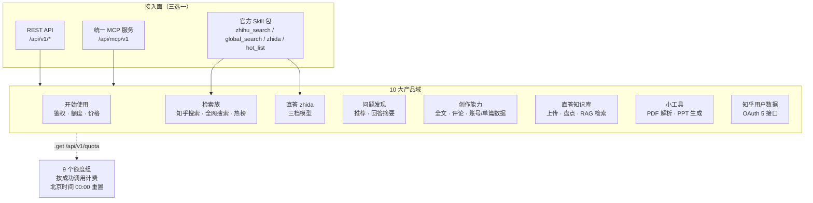

# 知乎数据开放平台：官方文档全集精读

> **本束与 [zhihu-cli](../zhihu-cli/index.md) 的关系**：两束并存不混写。[zhihu-cli](../zhihu-cli/index.md) 以 **Zhihu CLI 命令行工具**为主线（MCP over SSE 架构、凭证存放、105 条事实）；本束以 **31 篇官方 API 文档全集**为主线（120 条官方事实，逐条标注来源 key 与原文依据位置）。引用 CLI 侧结论须写明来自哪一束。

知乎数据开放平台把知乎的**公共内容**、**个人创作数据**、**知识库**与**文档工具**能力开放给 AI Agent 调用。官方文档站共 **10 个栏目 / 31 篇页面**，每篇都规定了路径、参数、响应字段、错误码与额度归属——本束把 31 篇逐篇精读、重组为三层可导航的教程。

核心判断有三条：

1. **能力按「产品域」划分，额度按「额度组」划分**——两者不是一一对应，一个域可能共用一个额度组（如「问题发现」的两个接口共用一组）。
2. **查本人用 Access Secret，查他人用 OAuth access_token**——两套凭证靠请求头切换，而**创作能力族不接受 OAuth 身份切换**。
3. **三条接入面（API / Skill / MCP）规格同源但体例不同**——REST 侧首字母大写、Skill 侧小写下划线、知识库侧 PascalCase、小工具侧 snake_case，四种命名同时存在。



## 阅读路径

| 你的目标 | 建议顺序 |
|----------|----------|
| 第一次接入 | [平台全景](concepts/00-platform-overview.md) → [鉴权与额度](concepts/01-auth-and-quota.md) → [上手实操](examples/01-first-call-workflow.md) |
| 做内容检索 | [搜索与热榜](concepts/02-search-and-hotlist.md) → [直答](concepts/03-zhida.md) → [问题发现](concepts/04-question-discovery.md) |
| 做知识库 RAG | [知识库四接口](concepts/06-knowledge-base.md) → [RAG 全链路实操](examples/02-knowledge-rag-workflow.md) |
| 看创作数据 | [创作能力](concepts/05-creator-capability.md) → [数据分析实操](examples/03-creator-analytics-workflow.md) |
| 接 Agent 运行时 | [接入面选型](concepts/09-integration-surfaces.md) → [小工具](concepts/07-document-tools.md) → [文档工具实操](examples/04-document-tool-workflow.md) |
| 管住成本 | [鉴权与额度](concepts/01-auth-and-quota.md) → [额度治理实操](examples/05-quota-governance.md) |

## 概念

* [平台全景——能力地图与文档导航](concepts/00-platform-overview.md)
* [鉴权、额度与计费——三条硬契约](concepts/01-auth-and-quota.md)
* [搜索与热榜——站内外两套检索与实时议题榜](concepts/02-search-and-hotlist.md)
* [直答——三档模型与流式协议](concepts/03-zhida.md)
* [问题发现——问题推荐与问题回答摘要](concepts/04-question-discovery.md)
* [创作能力——本人内容、评论与账号/单篇数据](concepts/05-creator-capability.md)
* [直答知识库——上传、盘点与 RAG 检索](concepts/06-knowledge-base.md)
* [小工具——PDF 解析与 PPT 生成的异步任务模型](concepts/07-document-tools.md)
* [用户数据与 OAuth——一个请求头切换数据主体](concepts/08-user-data-oauth.md)
* [接入面——MCP、Skill 与 CLI 的选型与纪律](concepts/09-integration-surfaces.md)

## 示例

* [从零到第一次成功调用](examples/01-first-call-workflow.md)
* [知识库 RAG 全链路实操](examples/02-knowledge-rag-workflow.md)
* [创作数据分析实操](examples/03-creator-analytics-workflow.md)
* [文档工具实战——PDF 与 PPT 异步链路](examples/04-document-tool-workflow.md)
* [额度治理实操——从盘点到预检再到降级](examples/05-quota-governance.md)

## 参考

* [官方文档页与本束页面映射表](references/source-map.md)
* [事实登记 F-001~F-120](references/facts.md)

```{toctree}
:hidden:
:maxdepth: 7

concepts/index
examples/index
references/index
log
```

```{toctree}
:hidden:
:maxdepth: 7

concepts/00-platform-overview
concepts/01-auth-and-quota
concepts/02-search-and-hotlist
concepts/03-zhida
concepts/04-question-discovery
concepts/05-creator-capability
concepts/06-knowledge-base
concepts/07-document-tools
concepts/08-user-data-oauth
concepts/09-integration-surfaces
examples/01-first-call-workflow
examples/02-knowledge-rag-workflow
examples/03-creator-analytics-workflow
examples/04-document-tool-workflow
examples/05-quota-governance
references/source-map
references/facts
log
```
