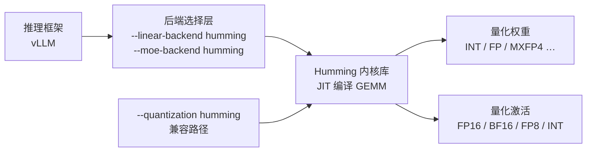

# Humming 是什么：项目身份与定位

> 事实层（What / Who / When）。本文回答四个问题：Humming 是什么、从哪来、跟谁比、适合谁。

## 一句话定位

Humming 是一个 **面向量化推理的高性能、轻量、高灵活的 JIT 编译 GEMM 内核库**——"a high-performance, lightweight, and highly flexible JIT (Just-In-Time) compiled GEMM kernel library specifically designed for quantized inference"（F-001）。

三个定语各有实指：

- **JIT 编译**：内核在运行时按具体 shape / dtype / 架构现场编译，而非预编译分发（F-043、F-080）。
- **轻量**：运行期依赖 8 项、以 `torch>=2.7` 为主；CUDA 侧只需 NVCC 或 NVRTC（F-005，差异见 [核验记录](../references/verification.md)）。
- **高灵活**：权重可任意 ≤8 bit，激活覆盖 FP16/BF16/FP8/FP4/INT8/INT4，量化粒度覆盖 group/block/channel/tensor（F-018~F-021）。

## 身份卡片

| 项目 | 值 | 出处 |
|------|-----|------|
| 仓库 | https://github.com/vllm-project/humming | F-002 |
| 本地检出版本 | `v0.1.18-1-g5b500b4`（commit `5b500b4`，2026-10-21） | F-003 |
| 许可证 | Apache-2.0 | F-004 |
| PyPI 包名 | `humming-kernels`（extras：`cu12` / `cu13`） | F-005 |
| Python 要求 | `>=3.10` | F-005 |
| 运行期依赖 | 8 项，以 `torch>=2.7` 为主（README「仅 torch 与 NVCC」为简化表述） | F-005 |
| 出身 | **Ant Group 与 vLLM community 联合开源** | F-009 |
| 命名由来 | 蜂鸟（hummingbird），呼应「轻量 + 高性能」 | F-010 |
| 兼容架构 | NVIDIA SM75+（Turing）起 | F-018 |
| 项目形态 | 库（library），非服务、非模型 | F-001 |
| 源码规模 | 76 个 Python 文件（约 21103 行）+ 74 个 CUDA/C++/头文件 | F-011 |
| 官方文档 | 仅 `docs/config.md`（442 行配置参考） | F-040 |

## 它解决什么问题

量化推理的计算瓶颈集中在 GEMM。通用 Marlin 类内核的问题是**位宽与架构覆盖窄**：只支持 4 位或 8 位，其他位数难加；且在 Hopper 之后必须用架构专属指令才能发挥硬件性能，大 batch 下表现不佳（F-091）。

Humming 的做法是**用 JIT 换取自由度**：因为内核是运行时针对「权重类型 × 激活类型 × scale 粒度 × GEMM 形态 × 目标架构」现场编译出来的，所以不必为每种组合预编译一份二进制——组合数量爆炸的问题被 JIT 消化掉。代价是首次编译耗时（官方口径单 kernel 1.82–1.88 秒，F-080），收益是覆盖并发生效（F-082~F-088）。

## 与同类内核的关系

Humming 的 README 直接列出四个灵感来源（F-094 同段）：

| 参照物 | 借鉴点 | 差异 |
|--------|--------|------|
| [DeepGEMM](https://github.com/deepseek-ai/DeepGEMM/) | Hopper/Blackwell 上的 FP8/低精度 GEMM 设计与 W8A8 路径 | Humming 走 JIT 路线，DeepGEMM 走 AOT 预编译路线 |
| Marlin Kernel（vLLM 内置） | 4bit 权重量化 GEMM 的核心思路 | Marlin 限于 4/8 bit 且架构专用；Humming 覆盖 ≤8bit 全谱并支持多架构自动分派（F-091） |
| lmdeploy GEMM | 量化推理算子工程经验 | — |
| CUTLASS | GEMM 分层与流水线设计范式 | Humming 自建更轻的分层，不引入 CUTLASS 的编译复杂度（F-080：NVCC 编译 23.35s vs 1.82s） |

> **性能对照中的基线是什么**：官方博客的**不同图表使用不同基线**——Dense W4A16 图用 **cuBLAS** 作为共同基线并与 Marlin 对比，Hopper 组对标 **DeepGEMM**，Blackwell B300 组对标 **DeepGEMM Contiguous**，SM120/121 组对标 **FlashInfer CUTLASS**。读倍数时务必先看该图的基线是谁——不是「比 Marlin 快 N 倍」而是「比该图的基线快 N 倍」。逐组对照见 [08 性能与基准](08-performance.md)。

## vLLM 生态位

Humming 不是独立服务，而是**作为 vLLM 的内核后端**存在：

三条接入路径互不重叠（F-074~F-077）：

1. `--linear-backend humming` / `--moe-backend humming`：让 **Dense 层或 MoE 层**走 Humming 内核，覆盖 vLLM 原生已支持的格式。
2. `--quantization humming`：**兼容路径**，用于「Humming 支持、但 vLLM 不再原生支持或尚未原生支持」的格式（官方举例 GPTQ INT3）。
3. 权重 schema 自动识别：`WEIGHT_SCHEMA_MAP` 收录 12 个条目（auto-round、awq、gptq、modelopt、quark、mxfp4、gpt_oss_mxfp4、compressed-tensors、bitnet、fp8、humming、auto_round，F-023），`INPUT_SCHEMA_MAP` 收录 5 个（F-024）。

vLLM 侧已为此专门实现两套逻辑：**Humming kernel 选择优先级**（`prefers_humming()` / `prioritize_humming()`——**自动优先仅限 compute capability == 90**，F-078）与**MoE 激活表达式翻译**（把 SILU/GELU/GELU_TANH/RELU2/SWIGLUOAI/SWIGLUOAI_UNINTERLEAVE/SWIGLUSTEP/SITU 及 4 个 NO_MUL 变体共 12 种翻译为 humming 可执行表达式，F-078）。

## 适用边界

**适合**：

- 量化推理的 GEMM 加速，尤其是 W4A16 / W4A8 / W8A8 与 MoE 路径（F-082~F-088）。
- 需要**长尾位宽**或**长尾 scale 粒度**的场景（权重位宽 ≤8 的完整整数与浮点类型，F-015；group/block/channel/tensor 粒度，F-018~F-021）。
- 多架构统一部署：从 SM75（Turing）到 SM121 均有专属启发式（F-056），换卡不需要换代码。
- 希望**用 JIT 换覆盖度**、且能接受首次编译耗时与缓存管理的团队。

**不适合 / 需谨慎**：

- **不允许运行时编译**的环境：某些生产环境禁写 `~/.humming/` 缓存目录（F-042），需预热缓存或改 `HUMMING_CACHE_DIR` 到持久卷。
- **权重格式在 vLLM 中已原生高性能支持**：直接换 Humming 未必更快，须按官方对照条件实测（F-082~F-088 的倍数有明确测试条件）。
- **对首次编译延迟敏感**：冷启动需 1.82–1.88 秒/ kernel，覆盖全部 M 档位约 2–4 秒（F-080、F-081）。
- **未文档化浮点格式**：需 CUBIN 补丁 + 架构白名单双条件，且源码明确警告 SM107 会抛 illegal instruction（F-028、F-029）。

## 延伸阅读

- [01 快速开始](01-quickstart.md)：十分钟跑通第一个量化 GEMM
- [03 架构总览](03-architecture.md)：三层配置 + JIT 编译栈的分工
- [07 vLLM 集成](07-vllm-integration.md)：三条接入路径的完整说明
- [信源登记簿](../references/source-map.md)：本文事实的编号出处
