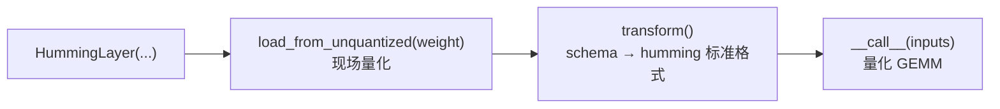

# 快速开始：安装到第一个量化 GEMM

> 入门层。本文给出可复制的最小闭环，并把安装、生命周期、缓存、报错四类最常卡住的点一次讲清。

## 一、安装

```bash
# 基础安装（仅 PyTorch 依赖）
pip install humming-kernels

# 按 PyTorch 的 CUDA 版本选择 extra
pip install "humming-kernels[cu12]"   # CUDA 12
pip install "humming-kernels[cu13]"   # CUDA 13

# 或从源码装
pip install git+https://github.com/vllm-project/humming.git
```

要点：

- **extras 的选择依据是 PyTorch 的 CUDA 版本，不是本机驱动支持的最高版本**（README.md:44-49）。
- 运行期依赖共 **8 项**（F-005，`pyproject.toml:23-33`）：`torch>=2.7`、`triton`（Windows 上是 `triton-windows`）、`numpy`、`safetensors`、`jinja2`、`cuda-bindings`、`tqdm`、`tabulate`。README 说「仅需 PyTorch 与 NVCC」是面向核心路径的简化表述（见 [核验记录差异 #5](../references/verification.md)）。
- CUDA 编译依赖走 extras。**NVRTC 可选**：装不上 `cuda.bindings.nvrtc` 时会自动回退到 NVCC（F-041）。
- Python 需 `>=3.10`（F-005）。

### 编译器选择顺序

Humming 在运行时决定用哪个编译器（F-041，`humming/jit/runtime.py:64-80`）：

```
HUMMING_COMPILER 环境变量（nvcc / nvrtc）
  ↓ 未设置
PPU 设备 → 强制 NVCC
  ↓ 否则
尝试 import cuda.bindings.nvrtc → 成功用 NVRTC，失败回退 NVCC
```

实测：NVCC 与 NVRTC 编译耗时几乎相同（1.82s vs 1.88s，F-080）。NVRTC 的优势是不需要完整的 CUDA Toolkit 工具链。

## 二、最小闭环

README 的示例（F-069，README.md:61-87）是最短路径：

```python
import torch
from humming.layer import HummingLayer

layer = HummingLayer(
    shape_n=8192,
    shape_k=8192,
    weight_config={"dtype": "int6"},
    torch_dtype=torch.float16,
).cuda()

weight = torch.randn((8192, 8192), dtype=torch.float16, device="cuda:0")
inputs = torch.randn((128, 8192), dtype=torch.float16, device="cuda:0")

# 1) 装载未量化权重并现场量化
layer.load_from_unquantized(weight)
# 2) 转成 humming 格式并准备默认内核
layer.transform()

# 3) 执行量化 GEMM（tuning_config 可选，默认自动选择）
output = layer(inputs)

print("Quantized GEMM Output:")
print(output)
print("\nReference Output:")
print(inputs.matmul(weight.T))
```

### 三个容易踩的点

**① 导入路径不是 `from humming import HummingLayer`。**
顶层 `humming/__init__.py` 只有 13 行，导出面收敛为 `import humming.ops` 与 `import humming.dtypes`，**不导出 `HummingLayer`**（F-007）。正确写法是 `from humming.layer import HummingLayer`。

**② `weight_config={"dtype": "int6"}` 是有意为之。**
Humming 支持**任意 ≤8 bit 的整数量化位宽**，6 位不是 8 的倍数（F-070）。这正是它相对 Marlin（只支持 4/8 位）的核心差异之一（F-091）。想换格式就改 `dtype` 字符串。

**③ 顺序不可颠倒。**
`transform()` 之前 `forward` 首行断言 `self.humming_config is not None`（F-067）。三步是固定的：`load_from_unquantized()` → `transform()` → `__call__()`（F-065）。

### 对拍的正确姿势

`inputs.matmul(weight.T)` 是**未量化**的参考值。量化 GEMM 与它的结果必然有误差——int6 权重量化的误差相当可观。示例只打印两者而不 assert，是正确的：要看的是**量级接近**与**无系统性偏差**，不是逐元素相等。

要严格验证精度，应当用更高位宽（如 int8 或浮点权重）做小规模对拍，或对比项目自带的 kernel 级测试（`tests/kernels/humming/`，含 `test_datatype.py`、`test_zero_point.py`、`test_scale.py` 等 9 个文件，F-098）。

## 三、生命周期三步详解



| 步骤 | 职责 | 约束与细节 |
|------|------|-----------|
| `load_from_unquantized()` | 接收未量化权重，按 `weight_config` 现场量化 | 断言输入 dtype ∈ {float16, bfloat16, float32}；形状须为 `(shape_n, shape_k)`，MoE 时为 `(num_experts, shape_n, shape_k)`（F-066） |
| `transform()` | 把 weight / input schema 统一到 humming 标准格式 | 内部先执行 `prepare_fp16_e8m0_scale` 处理「FP16 权重 + E8M0 scale」组合（F-068） |
| `__call__()` | 执行量化 GEMM | 前置断言 transform 已完成（F-067） |

### HummingLayer 字段

`HummingLayer` 是 `torch.nn.Module` 子类的 dataclass（F-063）：

| 字段 | 默认 | 说明 |
|------|------|------|
| `shape_n` / `shape_k` | 必填 | 权重矩阵形状 |
| `weight_config` | 必填 | 量化配置，如 `{"dtype": "int6"}` |
| `input_config` | — | 输入侧量化配置 |
| `pad_n_to_multiple` / `pad_k_to_multiple` | 1 | N/K 维填充对齐倍数 |
| `num_experts` | — | MoE 专家数 |
| `has_bias` | — | 是否带 bias |
| `torch_dtype` | 自动推断 | 见下 |

**`torch_dtype` 缺省推断规则**（F-064）：取 `torch.get_default_dtype()`；若不在 `[float16, bfloat16]` 内，则 SM≥80 选 bfloat16，否则选 float16。

## 四、缓存管理

JIT 编译的产物落在磁盘缓存里（F-042、F-044）：

| 路径 | 内容 |
|------|------|
| `~/.humming/cache/<hash>/` | 编译产物：`kernel.cubin`、`kernel.cu`（源码）、`signature.txt`、`stdout.log` / `stderr.log` |
| `~/.humming/tmp/` | 临时文件 |
| `~/.humming/tmp/module/` | 模块产物 |
| `~/.humming/tmp/lock/` | 文件锁目录 |

覆盖方式：`HUMMING_CACHE_DIR` / `HUMMING_TMP_DIR` 环境变量。

**编译签名**由编译器类名 + 类级签名 + 编译 flags + kernel 表达式 + kernel 源码 + `cuh_last_update_time()` 拼成；启用 CUBIN 补丁时额外拼入 `patch_cubin.cpp` 的内容哈希（F-043）。

其中 `cuh_last_update_time()` 是 `include/**/*.cuh` 的「**绝对路径 → mtime**」JSON 字典（F-043，`humming/jit/compiler.py:48-54`）。两个直接后果：

- **改任何 `.cuh` 都会让缓存全部失效**——升级依赖后首次调用会重新编译全部 kernel，属预期行为。
- **缓存不跨安装路径可移植**——绝对路径变了签名就变。镜像预热必须固定容器内的 Python 环境路径，否则运行时全量重编译（详见 [03 架构总览](03-architecture.md) 的「缓存的两个坑」）。

**并发安全**：多进程同时编译同一 kernel 时用文件锁（`FileLock`）保护（F-045）。但注意**锁在缓存命中检查之前获取**——即使缓存已命中，进程也要先串行取锁。多副本冷启动的成本上界 ≈ 副本数 × 单次编译耗时。

## 五、常见报错

### 编译失败

编译失败抛 `RuntimeError`，**消息中会给出缓存目录路径**（F-046）。直接去该目录看 `stderr.log` / `stdout.log` 与 `kernel.cu` 即可定位。

### 类型不被支持

`check_dtype()` 的断言会触发（F-013~F-017）。常见约束：

- 权重位宽 ≤ 8，且 **权重位宽不得超过激活位宽**（F-015）。
- 整数权重 + 浮点激活：权重必须无符号，且位宽严格小于激活（F-016）。
- 浮点权重 + 浮点激活：权重必须带符号（F-017）。
- 架构门槛（源码 `dtype_map`，F-013）：float16 / int4 / int8 需 **SM75**；bfloat16 需 **SM80**；float8e4m3 / float8e5m2 需 **SM89**；float4e0m3 / float4e2m1 / float8e3m4 需 **SM100**（UMMA 路径）或 **SM120**。
  - ⚠️ **INT4 门槛有口径差异**：README 支持矩阵写 **SM80+**，源码给 **SM75**（差异 #4）。类型合法性以源码为准，但 README 表述可能反映实测性能门槛——**在目标卡上实测**。
  - ⚠️ **FP4 门槛有口径差异**：README 写 SM120+，源码含 SM100 UMMA 路径（差异 #3）。以真机执行为准。

### 「未文档化」浮点格式触发 illegal instruction

使用 `float8e3m4` / `float4e0m3` 需同时满足两个条件：CUBIN 补丁已启用 **且** 架构在白名单（SM100/103/120/121）内（F-027、F-028）。源码明确警告 **SM107 执行这两种编码会抛 illegal instruction**（F-029）。详见 [09 进阶主题](09-advanced.md)。

## 六、下一步

- [03 架构总览](03-architecture.md)：三层配置各自管什么
- [05 调优与启发式](05-tuning.md)：TuningConfig 的默认值从哪来
- [04 内核设计](04-kernel-design.md)：三条流水线如何分工
- [02 量化模型](02-quantization-model.md)：支持矩阵与 scale 粒度全表
- 实战：[01 稠密量化 GEMM](../examples/01-dense-gemm.md)
