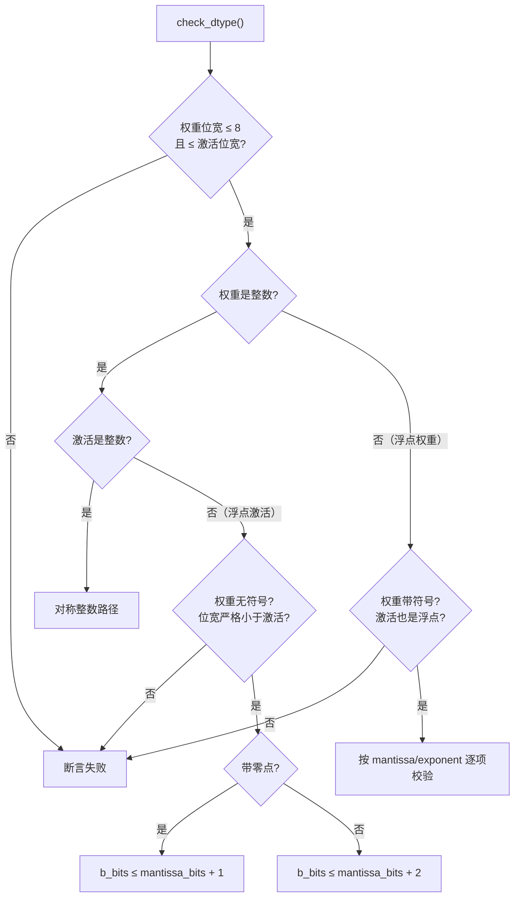

# 量化模型：统一表示与支持矩阵

> 核心层。本文是理解 Humming 一切取舍的钥匙：**权重与激活的类型、位宽、scale 粒度不是自由组合，而是一组受硬件与数学双重约束的合法集合。**

## 一、为什么有约束

GEMM 的核心是 `A × B`，其中 A 是激活、B 是权重。量化后两者都不再是标准浮点，MMA 指令对两端的表示方式有硬要求。Humming 的 `check_dtype()` 把这些要求编码成断言（F-013~F-017，`humming/kernel/humming.py:427-470`）。

两条最硬的规则：

1. **权重位宽 ≤ 8，且权重位宽 ≤ 激活位宽**（F-015）。——权重不能比激活「更精细」，因为 MMA 的累加器与指令格式由激活类型主导。
2. **架构门槛由激活类型抬升**（F-013）。——这不是软件偏好，是硬件事实：FP8 的 MMA 指令要到 SM89（Ada）才有，FP4 要到 SM100（Blackwell）或 SM120。

## 二、权重 × 激活支持矩阵

以 README 支持矩阵为准（F-018，README.md:24-32）：

| 激活类型 | 架构门槛 | 对称整数权重 | 带动态零点整数权重 | 任意有符号浮点权重 |
|---------|---------|-------------|------------------|------------------|
| **FP16** (e5m10) | SM75+ | INT1–8 | INT1–8 | kBits ≤ 8, kExp ≤ 5 |
| **BF16** (e8m7) | SM80+ | INT1–8 | INT1–8 | kBits ≤ 8 |
| **FP8** (e4m3) | SM89+ | INT1–5 | INT1–4 | kExp ≤ 4, kMan ≤ 3 |
| **FP8** (e5m2) | SM89+ | INT1–4 | INT1–3 | kExp ≤ 5, kMan ≤ 2 |
| **FP4** (e2m1) | SM120+ | INT1–3 | INT1–2 | kExp ≤ 2, kMan ≤ 1 |
| **INT8** | SM75+ | INT1–8 | INT1–7 | — |
| **INT4** | SM80+ | INT1–4 | INT1–3 | — |

> ⚠️ **FP4 门槛有口径差异**：源码 `check_dtype()` 对 float4e0m3 / float4e2m1 / float8e3m4 写的是「SM100（UMMA 路径）**或** SM120」双路径（F-013），README 只写 SM120+。详见 [核验记录差异 #3](../references/verification.md)。实际以真机执行为准。

**读表要点**：

- **激活越窄，权重可选范围越窄**。README 支持矩阵中，FP4 激活的对称整数权重只到 INT3、FP8 (e4m3) 只到 INT5——这是 README 表格本身给出的上限（矩阵的每个单元格都是激活与权重类型的**组合**上限，不只是单侧位宽比较）。
- **带动态零点的整数权重范围更窄**（如 FP8 e4m3 激活下 INT1–5 vs INT1–4，FP4 激活下 INT1–3 vs INT1–2）。零点引入了额外的一比特开销。
- **浮点权重受指数位与尾数位双重限制**。e5m2 允许 kExp ≤ 5 但 kMan ≤ 2，e4m3 允许 kExp ≤ 4 但 kMan ≤ 3——这是 FP8 家族本身的编码空间约束。

### 权重侧额外放宽的两个格式

权重侧（`operand_dtype_map`）比激活侧多允许 `float6e3m2` / `float6e2m3`，门槛同 FP4（SM100 UMMA 或 SM120，F-014）。这类 6 位浮点正是 MXMMA 混合精度的搭档（F-039）。

## 三、scale 粒度：四个维度

Humming 把「量化怎么做」拆成两个正交维度。

### 权重 scale 粒度（`WeightScaleType`，F-019）

| 取值 | 含义 |
|------|------|
| `GROUP` | 组内共享一个 scale，组大小由 `weight_scale_group_size` 指定 |
| `BLOCK` | 块级共享，块尺寸由 `weight_scale_group_size` / `weight_scale_group_size_n` 指定 |
| `CHANNEL` | 每个输出通道一个 scale |
| `TENSOR` | 整个张量一个 scale |
**缺省推断规则**（F-038，`humming/config/config.py:270-276`）——**只看 group size，不看权重数据类型**：

| 条件 | 推断结果 |
|------|---------|
| `weight_scale_group_size_n > 1` | `BLOCK` |
| `weight_scale_group_size == 0` | `CHANNEL` |
| 其余（`weight_scale_group_size_n` 为 0/1 且 group_size 非 0） | `GROUP` |

> ⚠️ **常见误解**：并非「整数权重默认 BLOCK、浮点权重默认 CHANNEL」。真正的规则只看 group size——例如 `weight_scale_group_size_n = 1` 且 `weight_scale_group_size = 128` 时会推断为 `GROUP` 而非 `BLOCK`。两者在 epilogue 的累加与量化位置上不同，选错会得到不同的量化结果。显式指定 `weight_scale_type` 总更安全。

**还有一个会覆盖推断结果的例外**：`LayerConfig` 在 `use_int_weight_scale` 或 `use_fused_e8m0_scale` 为真时，**强制把 `weight_scale_type` 改为 `GROUP`**（`humming/config/config.py:394-395`），并把提取出的最小指数因子转为二级 scale（每张量或每通道）。因此开启这两个开关时，上述推断规则不适用。

### 二级 scale（`WeightScale2Type`，F-020）

`NONE` / `CHANNEL` / `TENSOR`——用于两级缩放方案（如 FP8 权重 + 每通道二级 scale）。

### 输入量化模式（`InputQuantizationMode`，六态，F-021）

| 取值 | 说明 |
|------|------|
| `none` | 不量化 |
| `static_tensor` | 静态张量级量化 |
| `dynamic_token` | 动态 token 级量化 |
| `dynamic_group` | 动态 group 级量化 |
| `static_tensor_dynamic_group` | 静态张量 + 动态 group 混合 |
| `dynamic_group_token` | 动态 group + token 级 |

### scale 数据类型

BF16、FP16、E4M3、E5M2 与 **UE8M0**（源码中为 `float8e8m0`，映射 `torch.float8_e8m0fnu`，F-022）。UE8M0 是纯指数的 power-of-two scale，配合 MXFP4/MXFP8 家族使用。

## 四、schema：把外部格式统一进来

Humming 的核心设计是**在入口把各种量化格式统一到「Humming 标准格式」**（F-067，`transform()` 的职责）。

### 权重 schema 注册表（12 项，F-023）

`auto-round`、`auto_round`、`awq`、`bitnet`、`compressed-tensors`、`fp8`、`gptq`、`humming`、`modelopt`、`mxfp4`、`gpt_oss_mxfp4`、`quark`

### 输入 schema 注册表（5 项，F-024）

`compressed-tensors`、`fp8`、`humming`、`modelopt`、`quark`

> 两张表**不是同一集合**——只有部分 schema 同时提供权重侧与输入侧定义。这是接入新格式时最常见的第一个坑：权重能加载不代表输入侧也能对齐。

### 编码统一：offset-binary

Humming 内部整数权重**统一使用 offset-binary 编码**，即使源格式是有符号整数（F-030）。转换时执行 `pack_weight` / `unpack_weight`。

### 自动转换：对称整数 → 指数位为 0 的浮点

这是 Humming 最有意思的一处设计（F-026，`humming/schema/humming.py:290-319`）。

**动机**：指数位为 0（`e0mX`）的浮点格式，其可表示数值范围与同位宽对称整数**完全相同**——INT8 排除 -128、float8e0m7 也排除 -128，两者都能表示 -127~127（F-025，官方博客「Quantization Support」节）。

**条件**（全部满足才自动转换）：

1. 权重是整型
2. 位宽在 2–8 之间
3. 无整数零点
4. 权重中不含 0 值

**转换后**：`b_dtype` 变为 `FloatingPointType(num_bits, exponent_bits=0, mantissa_bits=num_bits-1)`。

**意义**：这样一来，同一份数值可以用**浮点 MMA 指令**处理，而浮点 MMA 在现代架构上往往比整数 MMA 更快。Humming 替你做了这个选择。

## 五、类型组合的完整判定

`check_dtype()` 的判定顺序（F-013~F-017）：

**关键点**（F-016）：

- **整数权重 + 浮点激活** → 权重必须**无符号**（`not self.b_dtype.is_signed`），且位宽**严格小于**激活。
- **浮点权重 + 浮点激活** → 权重必须**带符号**（`assert self.b_dtype.is_signed`）。

这两条不是随意的：带符号整数与浮点的对齐方式不同，混合时只能走一侧的约定。

## 六、MXMMA 原生混合精度

`MXMMA` 指令（F-037）支持原生混合精度，但**仅在特定组合下成立**（F-039，`humming/config/config.py:592-599`）：

- 激活为 `float8e4m3` 或 `float8e5m2`
- **且** 权重为 `float4e2m1` / `float6e3m2` / `float6e2m3`

其他组合下 MXMMA 不作为原生路径使用。

## 七、未文档化浮点格式

源码中存在两组**官方 README 未列出**的浮点格式（F-027，`humming/config/mma.py:43-47`）：

| 格式 | 出现位置 |
|------|---------|
| `float8e3m4` | `UNDOCUMENTED_FP_DTYPES` |
| `float4e0m3` | `UNDOCUMENTED_FP_DTYPES` |

**白名单**（`UNDOCUMENTED_FP_SM_VERSIONS`）：SM100、SM103、SM120、SM121。

**启用需双条件同时满足**（F-028）：CUBIN 补丁已启用（`is_cubin_patch_enabled()`）**且** 架构在白名单内。

⚠️ 源码注释明确警告：**SM107 执行这两种编码会抛 illegal instruction**；新增架构必须在真机测试后才可加入白名单（F-029）。

详见 [09 进阶主题](09-advanced.md)。

## 八、延伸阅读

- [03 架构总览](03-architecture.md)：这些类型如何映射到三层配置
- [05 调优与启发式](05-tuning.md)：设备能力如何反过来约束可行配置
- [04 内核设计](04-kernel-design.md)：packing 层级如何匹配 MMA 需求
- 实战：[01 稠密量化 GEMM](../examples/01-dense-gemm.md)
