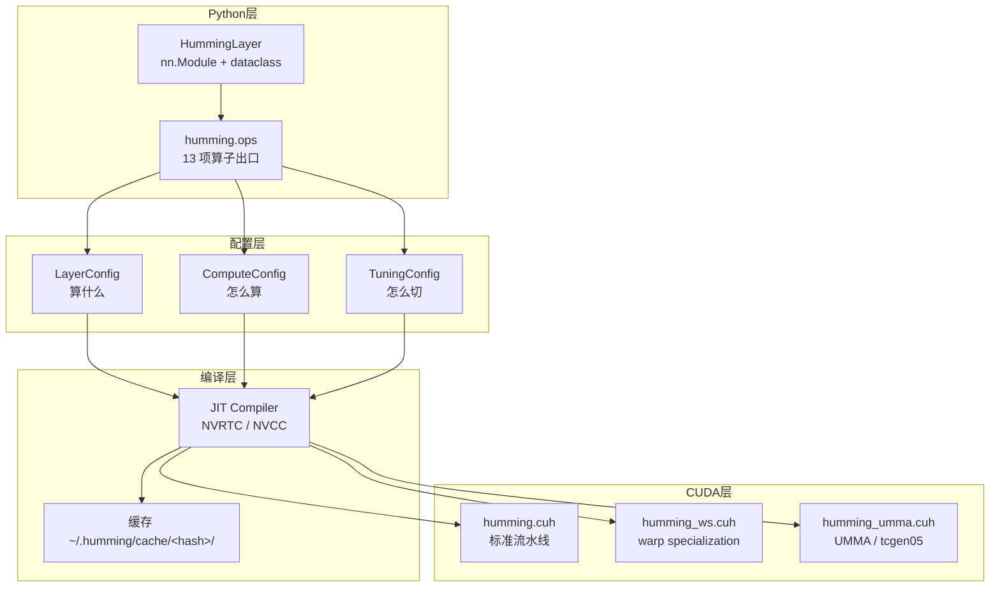
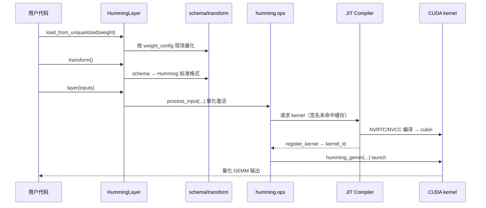

# 架构总览：三层配置与 JIT 编译栈

> 核心层。Humming 的架构可以概括成一句话：**用三层配置描述「要算什么」，用 JIT 把它编译成「怎么算」。**

## 一、整体结构



## 二、三层配置

官方博客以「Tuning Config」节引入了这套分层（F-031）。三层各有明确职责边界：

### LayerConfig —— 算什么

描述**问题本身**：形状、数据类型、量化参数、目标架构（F-032，`humming/config/config.py:31-70`）。

关键字段分组：

| 组 | 字段 |
|----|------|
| 架构 | `sm_version` |
| 形状 | `shape_n`、`shape_k`、`pad_shape_n`、`pad_shape_k`、`num_experts` |
| 类型 | `b_dtype`、`a_dtype`、`c_dtype`、`bs_dtype`（scale）、`as_dtype` |
| 输入量化 | `input_quant_mode`、`input_scale_group_size` |
| 权重 scale | `weight_scale_group_size`、`weight_scale_group_size_n`、`weight_scale_type`、`weight_scale_2_type` |
| scale 开关 | `use_int_weight_scale`、`use_fused_e8m0_scale` |
| 零点 | `has_zero_point`、`is_fp_zero_point` |
| 其他 | `has_bias`、`use_packed_k_layout` |

### ComputeConfig —— 怎么算

描述**计算语义**：GEMM 类型、计算选项、batch 不变性、input scale 布局（F-033，`config.py:491-520`）。

| 字段 | 说明 |
|------|------|
| `gemm_type` | 四态枚举（见下表），**其余属性由它自动推导** |
| `use_f16_accum` | 是否用 FP16 累加 |
| `use_batch_invariant` | batch 不变性（保证同输入同输出，与 batch 大小无关） |
| `use_m_major_input_scale` | input scale 是否 M-major 布局 |

**派生属性**（自动从 `gemm_type` 推导，无需手动设置）：`is_indexed_gemm`、`is_grouped_contiguous_gemm`、`is_grouped_masked_gemm`、`is_grouped_gemm`。

**约束**：indexed GEMM **不支持** m-major input scale（`assert not self.use_m_major_input_scale`，F-034）。

### TuningConfig —— 怎么切

描述**执行策略**：tile 形状、流水级数、warp 特化、访存、MMA 指令、并发、调度、TMA（F-035，`config.py:523-565`）。

| 组 | 字段 |
|----|------|
| MMA | `mma_type` |
| 分块 | `block_shape`、`warp_shape` |
| 流水 | `num_stages`（默认 2）、`use_stream_k`（默认 True） |
| 并发 | `num_ctas_per_sm`（默认 1） |
| warp 特化 | `use_warp_spec` |
| TMA | 逐张量的 `use_tma*` 开关 |
| 访存 | `smem_reuse_mode`、`multi_cast_size_a` / `_b`、`use_pdl`、`raster_group_m`、`evict_weights_first` |
| UMMA 专有 | `umma_num_dequant_warpgroups`、`umma_cta_group_size` |

> **完整逐字段参考**：官方 `docs/config.md`（442 行，F-040）。本包只摘关键字段，避免与上游文档产生双份维护。

## 三、黑话速查表

第一次读 Humming 源码或博客，这几个词会不断出现。先建立最小理解：

| 词 | 一句话是什么 | 为什么 Humming 需要它 | 在哪出现 |
|----|------------|------------------|---------|
| **MMA** | Tensor Core 的矩阵乘指令，一条指令完成一小块 A×B 的乘加 | 量化 GEMM 的计算核心 | `mma/all.cuh`、`wmma.cuh` |
| **WGMMA** | Hopper（SM90）引入的 warpgroup 级 MMA，一条指令由一个 warp group 驱动 | Hopper 上提升 MMA 吞吐 | `mma/wgmma.cuh` |
| **UMMA** | Blackwell（SM100+）的 tcgen05 指令，累加器落在 **TMEM**（Tensor Memory）而非寄存器 | 释放寄存器压力，支持更大的 tile | `mma/umma.cuh`、`utils/ptx/tcgen05.cuh` |
| **MXMMA** | 原生混合精度 MMA，同时处理块缩放的微缩放格式（MXFP8/MXFP4） | 直接消费 MX 量化 checkpoint，无需反量化重排 | `mma/mxmma.cuh`；仅 SM120/121（F-100） |
| **TMA** | Tensor Memory Accelerator，硬件化的异步批量拷贝引擎 | 让 global→shared 搬运不占计算线程 | `utils/ptx/tma.cuh` |
| **warp specialization** | 把线程分成「只负责取数」和「只负责计算」两组，用 `setmaxnreg` 分配寄存器预算 | 消除标准流水线中「所有线程都要为两种角色留寄存器」的浪费 | `humming_ws.cuh` |
| **stream-k** | 把同一个输出 tile 的计算拆分到多个 CTA，各 CTA 累加部分和 | 小 M 场景下 tile 不够填满 SM 时提升并行度 | `TuningConfig.use_stream_k`（默认开）；需配合 `locks`（F-101） |
| **rasterization（栅格化）** | 把 M 维输出块按二维栅格重排，而非线性顺序 | 改善 L2 cache 命中——让共享权重的 block 落在物理邻近的 SM | `tune/raster.py`、`TuningConfig.raster_group_m` |
| **PDL** | Programmatic Dependent Launch，让下一个 kernel 在前一个还在收尾时就开始启动 | 流水线化多个 GEMM，掩盖 kernel 启动开销 | `TuningConfig.use_pdl` |
| **offset-binary** | 把有符号整数编码成无符号：`-k` 映射为 `2^n - k` | 让 Humming 内部统一用无符号整数表示，避免符号处理分支 | `schema/humming.py:298`（F-030） |
| **e0mX** | 指数位为 0 的浮点格式（`float8e0m7`、`float4e0m3`） | 可表示范围与同位宽对称整数相同，能用浮点 MMA 加速整数权重 | `schema/humming.py:290-319`（F-026） |

**读完这张表**，`humming/include/humming/` 下的文件名就都能猜出职责了。

## 四、GEMM 四型与 MMA 四型

### GEMM 类型（`GemmType`，F-036）

| 取值 | 语义 | 典型场景 |
|------|------|---------|
| `DENSE` | 标准稠密矩阵乘 | 常规 FFN / Attention 投影层 |
| `INDEXED` | 按索引取权重行 | 共享专家、动态路由的稀疏取权重 |
| `GROUPED_CONTIGUOUS` | 分组连续布局 | MoE 专家权重连续排布 |
| `GROUPED_MASKED` | 分组 + 掩码 | MoE 专家容量受限、token 需要被丢弃 |

**前三种是逐 token 独立；`GROUPED_MASKED` 的关键区别是它允许「掩码掉」部分 token**——当 MoE 专家容量（capacity factor）不足时，多余 token 被丢弃而非路由到兜底专家。这是 MoE 推理中「负载不均衡」的标准处理方式。

### MMA 指令类型（`MmaType`，F-037）

| 取值 | 对应硬件 |
|------|---------|
| `MMA` | 通用 warp 级 MMA（SM75 起） |
| `WGMMA` | Hopper（SM90）的 warpgroup MMA |
| `UMMA` | Blackwell（SM100+）的 tcgen05 指令，累加器落在 TMEM |
| `MXMMA` | 原生混合精度，组合受限（F-039） |

### 架构与流水线的对应

**UMMA 支持判定**（F-099，`humming/config/config.py:91-95`）：`is_umma_supported` 要求 `sm_version // 10 in (10, 11)`——即 **SM100/101/110/111 可用；SM120/121（`//10 == 12`）不支持 UMMA**。

| 架构 | 主用 MMA | 主用流水线 | 备注 |
|------|---------|-----------|------|
| SM75 / SM80 / SM86 / SM87 | `MMA` | 标准流水线 | Turing / Ampere |
| SM89 | `MMA` | 标准流水线 | FP8 支持起点 |
| SM90 / SM90 H20 | `WGMMA` | 标准流水线 / warp specialization | **int4 权重不满足 WGMMA 条件，回落 `MMA`** |
| SM100 / SM103 / SM110 | `UMMA` | UMMA 流水线（tcgen05 + TMEM） | **SM103（B300）的 UMMA 不再支持 INT8 计算**，可退回更早的 MMA 路径但性能显著降低（F-102） |
| SM120 / SM121 | **`MXMMA`**（有前提） | 标准流水线 | **不支持 UMMA**；MXMMA 仅在 `use_block_scaled_mma`（即 MX 系浮点激活 + scale 粒度匹配）时启用，否则回落标准 `MMA`（F-100） |

## 五、JIT 编译栈

### 编译签名与缓存键

编译签名（F-043，`humming/jit/compiler.py:56-71`）由六部分拼成：

```
编译器类名
+ 类级签名
+ 编译 flags
+ kernel 表达式
+ kernel 源码
+ 头文件最后更新时间
[+ CUBIN 补丁时：patch_cubin.cpp 内容哈希]
```

**「头文件最后更新时间」入签名**是一个重要设计：任何头文件改动都会让全部缓存失效，避免旧二进制与新头文件不匹配。

### 缓存布局与产物

| 路径 | 内容 |
|------|------|
| `~/.humming/cache/<hash>/kernel.cubin` | 编译产物（二进制） |
| `~/.humming/cache/<hash>/kernel.cu` | 生成的 CUDA 源码（排查用） |
| `~/.humming/cache/<hash>/signature.txt` | 签名 |
| `~/.humming/cache/<hash>/stdout.log` / `stderr.log` | 编译日志 |
| `~/.humming/tmp/`、`~/.humming/tmp/module/`、`~/.humming/tmp/lock/` | 临时文件 / 模块 / 文件锁 |

覆盖环境变量：`HUMMING_CACHE_DIR`、`HUMMING_TMP_DIR`（F-042）。

### 并发与失败

- **并发**：`FileLock` 保护同一缓存目录，避免多进程同时写（F-045）。
- **失败**：抛 `RuntimeError`，消息中给出缓存目录路径（F-046）。

### ⚠️ 缓存的两个坑（落地必读）

**坑一：缓存不跨安装路径可移植。**

编译签名包含 `cuh_last_update_time()`——它是 `include/**/*.cuh` 的「**绝对路径 → mtime**」JSON 字典（F-043，`humming/jit/compiler.py:48-54`）。绝对路径随安装位置变化，因此：

| 场景 | 结果 |
|------|------|
| 构建镜像时在 `/opt/venv/...` 生成缓存，运行时挂载到 `/usr/lib/python3/...` | ❌ 签名不匹配，**全量重编译** |
| 同一镜像同一路径，不同机器 | ✅ 命中（前提是 `.cuh` 内容与 mtime 一致） |
| 多副本共享持久卷但安装路径不同 | ❌ 各副本重复编译 |

**对策**：镜像预热必须**固定容器内的 Python 环境路径**（如统一 `/opt/venv`）；或者干脆**不用镜像预热**，改用持久卷 + 首次启动预热。

**坑二：文件锁在缓存命中检查之前。**

源码顺序（F-045，`humming/jit/compiler.py:78-84`）是「先取 `FileLock`，再检查缓存是否命中」。这意味着**即使缓存已命中**，每个进程启动时也要先串行拿到那把锁。

**冷启动成本上界 ≈ 副本数 × 单次编译耗时**（1.82–1.88 秒/ kernel，F-080）。副本数多且启动时间敏感时，用共享持久卷 + 串行预热，比让 N 个副本同时抢锁更划算。

### 签名与补丁的关系

`patch_cubin.cpp` 的内容哈希**总是**拼入编译签名——判据是 `postprocess_cubin` 参数是否非 None（F-043，`humming/jit/compiler.py:68`），而该参数在运行时恒被传入（`humming/jit/runtime.py:101`）。因此**补丁内容变更会自动使缓存失效**，升级后无需手动清缓存。

环境变量 `HUMMING_DISABLE_PATCH_CUBIN=1` 只影响补丁**是否被执行**与未文档化 dtype 的可用性判定，**不影响缓存键**。

其他可用环境变量：`HUMMING_CACHE_DIR`、`HUMMING_TMP_DIR`（F-042）。

### 编译耗时

| 方案 | 耗时 | 条件 |
|------|------|------|
| CUTLASS + NVCC | 23.35 秒 | H200 server，CUDA 13.4，**关闭编译缓存** |
| Humming + NVCC | 1.82 秒 | 同上 |
| Humming + NVRTC | 1.88 秒 | 同上 |

（F-080，官方博客「Lightweight design」节。）覆盖单层 GEMM 全部受支持 M 档位约 2–4 秒，且可在模型 warmup 期间并行编译（F-081）。

**这组数字是 Humming「轻量」定位的核心证据**：相对 CUTLASS 的编译时间差达 **约 12.8 倍**（条件：H200 server + CUDA 13.4 + 关闭编译缓存），因为 JIT 只需为当前这一个具体配置编译一个 kernel，而不是展开 CUTLASS 的整套模板实例化。

## 六、Python 算子出口

`humming.ops` 的 `__all__` 共 **13 项**（F-047，`humming/ops/__init__.py:19-33`）：

| 类别 | 算子 |
|------|------|
| 内核注册 | `register_kernel`、`register_process_input_kernel`、`get_kernel_smem_size`、`launch_kernel` |
| 输入处理 | `process_input` |
| 权重工具 | `quant_weight`、`dequant_weight`、`repack_weight`、`pack_weight`、`unpack_weight` |
| GEMM | `humming_gemm` |
| 特殊格式 | `process_mxfp4_w4a8_weight` |
| 基准 | `tops_bench` |

### 内核注册

`register_kernel(cubin_path)` 通过 `torch.ops.humming.register_kernel` 向 C++ launcher 注册，返回 `(kernel_id, kernel_name)`（F-048，`humming/ops/launcher.py:6-8`）。**这是 Python 与 C++ 的边界**：Python 侧产出 cubin，C++ 侧负责 mmap 与 launch。

### humming_gemm()

全部参数为 **keyword-only**（F-049，`humming/ops/gemm.py:45-63`）：

| 组 | 参数 |
|----|------|
| 配置 | `layer_config`（序列化字符串）、`compute_config`、`tuning_config` |
| 张量 | `inputs`、`weight`、`weight_scale`、`weight_scale_2`、`input_scale`、`input_scale_2`、`zero_point`、`bias` |
| MoE | `sorted_ids`、`expert_ids`、`num_tokens_padded`、`expert_layout`、`locks` |

注意 `layer_config` 是**序列化字符串**——配置以字符串形式跨 Python/C++ 边界传递。

### process_input()

输入侧处理：量化、激活融合、scatter（F-050，`humming/ops/input.py:118-138`）：

| 组 | 参数 |
|----|------|
| 量化 | `quant_mode`、`quant_dtype`、`quant_group_size`、`group_scales`、`token_scales` |
| 激活 | `activation_type`、`activation_impl`、`hadamard_block_size` |
| 布局 | `layout` |
| MoE | `expert_tokens`、`scatter_idx` |

`hadamard_block_size` 的存在说明 Humming 支持 **Hadamard 变换**——一种用于压低激活动态范围、配合更激进量化的正交变换技术。

### process_input 内核的分层

进程输入内核按职责拆成五个文件（F-061，`humming/include/humming/kernel/process_input/`）：`activation.cuh`、`context.cuh`、`hadamard.cuh`、`quantization.cuh`、`thread_task.cuh`。

## 七、调用链全景



## 八、延伸阅读

- [02 量化模型](02-quantization-model.md)：类型与位宽约束的完整判定
- [04 内核设计](04-kernel-design.md)：三条流水线的 CUDA 分层
- [05 调优与启发式](05-tuning.md)：TuningConfig 的默认值从哪来
- [06 MoE 路径](06-moe.md)：四种 GEMM 型的实战取舍
