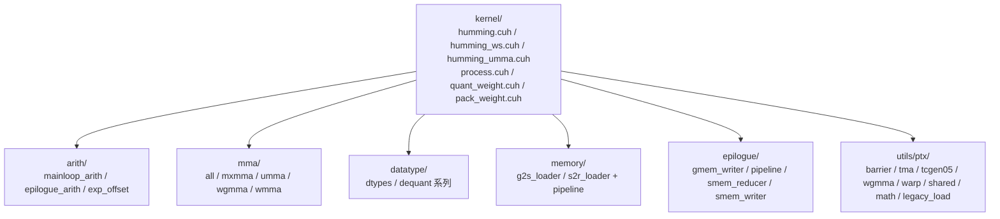

# 内核设计：CUDA 分层与三条流水线

> 核心层。Humming 的 CUDA 侧有 **74 个 CUDA/C++ 源文件**（63 个 `.cuh` + 7 个 `.h` + 4 个 `.cpp`），按「职责分层」组织。本页讲清三件事：三条流水线各适合什么场景、组件怎么分层、权重为什么要 repack。

## 一、三条流水线

同一种 GEMM 数学，三种硬件实现（F-051）：

| 流水线 | 文件 | 机制 | 目标架构 |
|--------|------|------|---------|
| **标准流水线** | `humming.cuh` | 同一 kernel 内所有线程**兼具 producer / consumer** 角色 | SM75 起通用 |
| **warp specialization** | `humming_ws.cuh` | 独立的 load 线程 + math 线程，用 `setmaxnreg` 分配寄存器预算 | SM90 及之后各档（UMMA 流水线强制开启） |
| **UMMA 流水线** | `humming_umma.cuh` | SM100+ 的 **tcgen05** 指令，累加器落在 **TMEM**（Tensor Memory） | SM100+ |

### 三者取舍

- **标准流水线**：最通用，寄存器压力由所有线程均摊。适合访存占比高或算力占比不高的场景（解码阶段、M 较小）。
- **warp specialization**：把「取数」与「算」拆成不同 warp 组，用 `setmaxnreg` 显式分配寄存器预算——load 线程少占寄存器、math 线程多占。这消除了标准流水线中「所有线程都要为两种角色留寄存器」造成的浪费。
- **UMMA 流水线**：Blackwell 的 tcgen05 指令由单个 warp group 驱动整个 MMA，累加器不再占用普通寄存器而落在 TMEM。这是 SM100 上的性能来源。

> 选择逻辑不在配置层硬编码，而是由 `TuningConfig.mma_type` + 设备启发式共同决定（见 [05 调优与启发式](05-tuning.md)）。

## 二、CUDA 组件分层

`humming/include/humming/` 下的七层（F-052）：



| 层 | 职责 |
|----|------|
| `kernel/` | 三条主流水线 + 权重处理（`quant_weight.cuh`、`pack_weight.cuh`、`dequant_weight.cuh`、`process_mxfp4.cuh`、`tops_bench.cuh`）+ `process_input.cuh` 入口 |
| `arith/` | 主循环算术（`mainloop_arith`）、尾声算术（`epilogue_arith`）、指数偏移（`exp_offset`） |
| `datatype/` | dtype 定义 + 六条反量化路径 |
| `mma/` | 五类 MMA 指令实现：`all`（通用）、`mxmma`、`umma`、`wgmma`、`wmma` |
| `memory/` | global→shared（`g2s_loader`）与 shared→register（`s2r_loader`）加载器及配套 pipeline |
| `epilogue/` | 结果写回：`gmem_writer`、写回流水线、`smem_reducer`（跨 block 规约）、`smem_writer` |
| `utils/ptx/` | PTX 级原语：barrier、TMA、tcgen05、wgmma、warp 指令、共享内存、数学函数、legacy load |
| 顶层 | `scheduler.cuh`（调度） |

**命名约定可读性很好**：`g2s` = global to shared，`s2r` = shared to register，`gmem`/`smem` = global memory / shared memory。

## 三、权重 repack：为什么必须重排

MMA 指令要求权重以特定的**分块 packing 布局**存放于显存，普通的 row-major 布局无法直接被 MMA 消费。Humming 用一个专用 kernel `weight_repack_nk` 完成重排（F-053，`humming/include/humming/kernel/process.cuh:130`）。

它的模板参数本身就说明了复杂度：

```cpp
template <
    uint32_t kNumBitsB, uint32_t kNumBitsA, bool kPackedInput,
    bool kShouldPreprocessForINT2FP, bool kShouldPreprocessWithZP,
    bool kShouldTransposeMiniBlock, uint32_t kGroupSizeZP,
    bool kUsePackedKLayout = false, bool kUseNativeDequant = false>
```

`kShouldPreprocessForINT2FP`（整数转浮点的预处理）、`kShouldPreprocessWithZP`（零点预处理）、`kShouldTransposeMiniBlock`（mini-block 转置）——每一项都对应量化格式的一个变体。

### packing 层级

源码注释给出了精确的层级定义（F-054，process.cuh:185-203）：

```
// 4bit:  [1][4][1][2][2][8]
// 8bit:  [2][2][2][2][2][4]
// 16bit: [4][1][4][2][2][2]
```

以 **16bit 激活**为例逐级拆解：

| 层级 | 维度 | 计算 |
|------|------|------|
| packing block | (n, k) = (64, 16) | 权重按 64 行 × 16 列的块组织 |
| INDEX1 (4) | k 方向 | 64 (total_k) / 16 (block_k) = 4 |
| INDEX2 (1) | n 方向 | 64 (total_n) / 64 (block_n) = 1 |
| INDEX3 (4) | 块内 n | 64 (block_n) / 16 = 4 → 每块切成 16×16 |
| INDEX4 (2) | 16×16 的 n | 16 / 8 = 2 |
| INDEX5 (2) | 16×16 的 k | 16 / 8 = 2 → 每块再切成 8×8 |
| INDEX6 (2) | 8×8 内 | 64 (total_elements) / 32 (num_threads) = 2 → 每线程处理 2 个元素 |

即：**64×16 的块 → 16×16 子块 → 8×8 子块 → 每线程 2 元素**，共六级索引。位宽不同则层级比例不同（4bit 与 8bit 各有自己的一组系数）。

**对齐约束**（源码 assert）：

- `padded_shape_n % 64 == 0`
- `padded_shape_k % (512 / kNumBitsA) == 0`
- `blockDim.x == 32`

这解释了 `LayerConfig` 中 `pad_shape_n` / `pad_shape_k` 的存在意义——**不是可选的优化，而是内核的前置条件**。

## 四、三条反量化路径

`datatype/` 下的反量化实现分三条（F-055）：

| 文件 | 路径 | 适用 |
|------|------|------|
| `dequant_native.cuh` | 原生格式 | 权重本身就是 MMA 可直接消费的类型（如 FP8） |
| `dequant_fused.cuh` | **融合进 GEMM 计算** | 主流路径：反量化与 MMA 在同一 kernel 内完成，省一次访存 |
| `dequant_single.cuh` | 独立 kernel | 需要单独产出反量化后张量时 |

另有 `dequant_prepare.cuh`（预处理）与 `base_conversion.cuh`（基础格式转换）。

**`dequant_fused` 是性能关键**：把反量化融进 GEMM 主循环，避免「读压缩权重 → 写出反量化权重 → 再读回来算」的两趟访存。对低比特权重（4bit/6bit）而言，这一趟往返的带宽成本往往大于算术成本。

> 这也解释了 `LayerConfig.use_packed_k_layout` 与 `use_fused_e8m0_scale` 等开关的存在——它们控制的是反量化能省多少访存。

## 五、进程输入内核

`process_input` 负责把上游激活转成内核能直接吃的形式：量化、激活融合、scatter（F-050）。CUDA 侧拆成五个文件（F-061，`kernel/process_input/`）：

| 文件 | 职责 |
|------|------|
| `activation.cuh` | 激活函数融合 |
| `context.cuh` | 上下文/元信息处理 |
| `hadamard.cuh` | Hadamard 变换 |
| `quantization.cuh` | 量化逻辑 |
| `thread_task.cuh` | 线程任务分配 |

**Hadamard 变换**值得单独一提：正交变换能把激活分布从长尾拉向近高斯，从而压低动态范围，让更激进的量化（如 INT4）可行。这是「量化友好化」的经典手段，Humming 把它做进了输入处理路径。

## 六、延伸阅读

- [03 架构总览](03-architecture.md)：三层配置与流水线选择的关系
- [05 调优与启发式](05-tuning.md)：tile 形状、流水级数如何被自动选定
- [06 MoE 路径](06-moe.md)：grouped 流水线的实际形态
- [09 进阶主题](09-advanced.md)：CUBIN 补丁如何作用于 UMMA 路径
