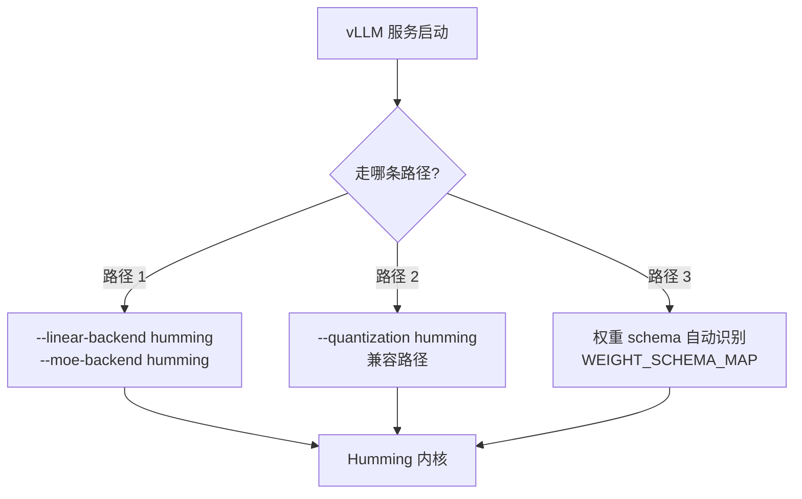

# vLLM 集成：三条接入路径

> 场景层。Humming 不是独立服务，它在 vLLM 里以**内核后端**的身份存在。本页讲清怎么接、什么时候接、以及有哪些坑。

## 一、三条路径总览



## 二、路径 1：后端切换（主路径）

vLLM 的 `MoEBackend` 与 `LinearBackend` 两个枚举均含 `"humming"` 取值，文档串释义为「Use Humming Mixed Precision kernels」（F-074，`vllm/config/kernel.py:137,255,326`）。

```bash
# Dense 线性层走 Humming
vllm serve <model> --linear-backend humming

# MoE 层走 Humming
vllm serve <model> --moe-backend humming
```

**适用**：格式 vLLM 原生已支持，只是想让内核换成 Humming。这是**官方推荐的 MoE 用法**（F-077）。

### 两条后端可独立设置

`linear-backend` 与 `moe-backend` 是分开的——可以只让 MoE 走 Humming 而 Dense 保持 vLLM 默认。这在混合架构模型（部分层 MoE、部分层 Dense）里很实用。

## 三、路径 2：量化兼容路径

```bash
vllm serve <model> --quantization humming
```

**定位**：用于「**Humming 支持、但 vLLM 不再原生支持或尚未原生支持**」的格式（F-077）。官方举例 **GPTQ INT3**。

**为什么需要它**：vLLM 会逐步移除对某些量化格式的原生支持（维护成本高），但这些格式的用户仍需要能跑。把它们转交给 Humming，是一条低成本的退路——Humming 支持任意 ≤8 bit 整数权重（F-010、F-070）。

### 明确的限制

**gpt-oss + mxfp4 组合**：vLLM 会**显式报错**并引导改用 `--moe-backend humming`（F-077）。这个组合不能走兼容路径——因为 mxfp4 需要 MXMMA 原生混合精度（F-039），而 vLLM 的 mxfp4 路径有自己的实现。

## 四、路径 3：schema 自动识别

vLLM 侧的量化方法注册表中有独立条目 `"humming"` → `HummingConfig`（F-075）。该类实现：

```python
get_min_capability() → 75          # 最低计算能力 SM75
get_supported_act_dtypes() → [bfloat16, half]
```

（F-075，`vllm/model_executor/layers/quantization/humming.py:152-165`。）

### 12 个权重 schema

`WEIGHT_SCHEMA_MAP` 收录 12 个条目（F-023）：

```
auto-round / auto_round / awq / bitnet / compressed-tensors / fp8
gptq / humming / modelopt / mxfp4 / gpt_oss_mxfp4 / quark
```

`INPUT_SCHEMA_MAP` 收录 5 个（F-024）：

```
compressed-tensors / fp8 / humming / modelopt / quark
```

**两张表不是同一集合**——只有部分 schema 同时有权重侧与输入侧定义。这是接入新格式时的常见坑：权重能加载，不代表输入侧量化配置能自动对齐。

### vLLM 侧集成代码分布

四处（F-076）：

| 位置 | 内容 |
|------|------|
| `quantization/humming.py` | `HummingConfig` / `HummingLayerQuantizationConfig` / `HummingLinearMethod` / `HummingMoEMethod` |
| `quantization/utils/humming/` | `activation.py` / `linear.py` / `moe.py` / `priority.py` / `schema.py` |
| `fused_moe/experts/fused_humming_moe.py` | MoE 融合执行路径 |
| `utils/humming.py` | `create_humming_locks` / `_patch_humming` |

## 五、Kernel 选择优先级

vLLM 侧并非无条件用 Humming。`utils/humming/priority.py` 提供两个函数（F-078）：

| 函数 | 作用 |
|------|------|
| `prefers_humming()` | 判断当前场景是否应当优先用 Humming |
| `prioritize_humming()` | 在候选后端中把 Humming 提到优先位 |

**这意味着**：即使你显式指定 `--moe-backend humming`，vLLM 内部仍会做场景判定。理解这一层对排查「为什么没走 Humming」很关键。

### ⚠️ 自动优先仅限 Hopper

源码常量（F-078，`utils/humming/priority.py:11`）：

```python
# Compute capabilities where Humming outranks Marlin.
_HUMMING_PREFERRED_CAPABILITIES = frozenset({90})
```

**`prefers_humming()` 仅在 compute capability == 90（H100 / H800 / H20）时返回 True**。

| 架构 | 自动优先 Humming | 如何启用 |
|------|----------------|---------|
| SM90（H100 / H800 / H20） | ✅ 是 | 无需额外配置 |
| SM100/103/110（Blackwell 数据中心） | ❌ 否 | **显式**指定 `--moe-backend humming` / `--linear-backend humming` |
| SM120/121（消费级 Blackwell） | ❌ 否 | 同上，显式指定 |
| SM75–SM89（Turing/Ampere/Ada） | ❌ 否 | 同上，显式指定 |

**注意 `prioritize_humming()` 的语义**：它只在「Humming 优先于 Marlin」时把 Humming 提到 Marlin 之前，**其他条目保持原相对顺序**（源码 docstring 明确）。在非 SM90 架构上它直接返回原列表。

### 激活类型降级告警

vLLM 侧对「该激活类型在此架构上性能不佳」的情况会打印告警并回退到更高精度（F-106，`utils/humming/schema.py:339`）：

| 激活类型 | 判为过时的条件 |
|---------|--------------|
| int4 | sm ≥ 90 |
| int8 | 103 ≤ sm < 110 |
| **任意 <16 bit 激活**（含 fp4 / fp8） | 100 ≤ sm < 120 |

**告警与回退是互斥的两个分支**（F-106）：

| 分支 | 行为 |
|------|------|
| `allow_fallback=False` | 打印「Humming {a_dtype} activation is slow on SM{sm_version} now.」，但**保留原激活、不回退** |
| `allow_fallback=True` | **静默**回退到更高精度激活（跳过过时 dtype），**不打印该告警** |

**实践含义**：看到这条告警说明该激活类型在此架构上性能不佳，但**实际执行的仍是原激活类型**——性能未变，只是被提醒了。而静默回退分支才会真正改变执行的精度。

### 显式选择激活类型

官方博客「Selecting Activation Types」节（F-105）：

**默认行为**：使用 checkpoint 指定的激活类型，**设备不支持时自动回退到更高精度**（无原生 MXFP4 的设备可自动走 FP8 / BF16 / FP16 路径）——同一份量化 checkpoint 因此可跨 GPU 代际运行。

**显式覆盖**：

```bash
vllm serve openai/gpt-oss-20b \
  --moe-backend humming \
  --quantization-config.moe.activation mxfp8
```

## 六、版本依赖

### 版本钉

vLLM 的 `requirements/cuda.txt` 中固定（F-071）：

```
humming-kernels[cu13]==0.1.17
```

注释为「Humming kernels for quantization gemm」。

### 版本滚动

| vLLM 版本 | humming-kernels 版本钉 |
|-----------|---------------------|
| v0.22.0 | 0.1.2 |
| v0.24.0 | 0.1.6 |
| v0.26.0 | 0.1.10 |
| v0.29.0 | 0.1.12 |
| v0.32.0 | 0.1.17 |

（F-072，由 `git log -S "humming-kernels" -- requirements/cuda.txt` 与逐 tag 比对得出。）

### ⚠️ 引入版本的口径差异

官方博客称「从 vLLM 0.29.0 起 CUDA 安装默认包含 Humming 依赖」，但**源码显示该依赖自 v0.22.0（2026-05-29）即已存在**（F-073）。

引入过程本身有过波折（F-072）：

```
2026-05-19  PR #42540  引入
2026-05-23  PR #43492  revert
2026-05-26  PR #43530  恢复
```

v0.29.0（2026-09-08）只是**当时的版本钉**为 0.1.12。

**引用纪律**：说「vLLM 默认带 Humming」时必须写明具体 vLLM 版本，不可只写「0.29.0 起」。详见 [核验记录差异 #1](../references/verification.md)。

## 七、集成实践要点

1. **优先用后端切换**：`--moe-backend humming` / `--linear-backend humming` 是主路径；`--quantization humming` 是兼容路径，只在格式不被 vLLM 原生支持时才用。
2. **注意能力门槛**：vLLM 侧 `get_min_capability() → 75`，即 SM75+（F-075）。
3. **激活 dtype 受限**：vLLM 侧 `get_supported_act_dtypes() → [bfloat16, half]`（F-075）——注意这是 **vLLM 集成路径**的限制，Humming 内核本身支持 FP8/INT8/INT4 激活（F-018）。两者不矛盾：内核能做什么 ≠ vLLM 集成层放行什么。
4. **schema 覆盖要核对**：确认你的模型权重格式在 12 项之一内。
5. **性能对照要有基线**：官方倍数以 vLLM Marlin 为基线（F-082~F-087），且带明确测试条件（F-079）。上生产前以自有负载实测。

## 八、延伸阅读

- [00 项目身份](00-overview.md)：Humming 在 vLLM 生态中的位置
- [06 MoE 路径](06-moe.md)：MoE 侧的具体机制与端到端数据
- [08 性能与基准](08-performance.md)：全部性能数字与测试条件
- 实战：[03 vLLM 服务化](../examples/03-vllm-serving.md)
