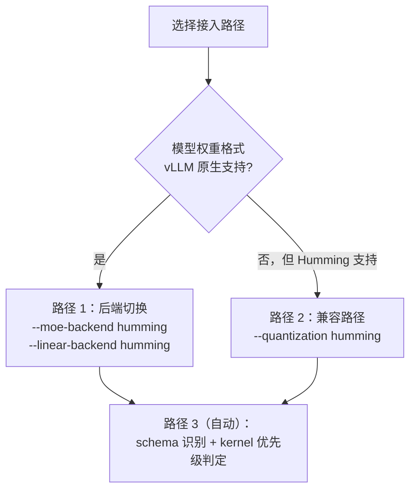

# 实战 03：vLLM 服务化

> 场景页。本文是**可直接照抄的部署手册**：怎么启、怎么确认生效、出错怎么办。

## 一、三条接入路径速查



| 路径 | 适用 | 官方推荐度 |
|------|------|-----------|
| `--moe-backend humming` | MoE 层走 Humming | ★★★ 官方首选 |
| `--linear-backend humming` | Dense 线性层走 Humming | ★★☆ 按需 |
| `--quantization humming` | 格式不被 vLLM 原生支持 | ★ 兼容路径 |

## 二、路径 1：后端切换（主路径）

### MoE 模型

```bash
vllm serve <model> --moe-backend humming
```

**官方明确推荐**这条路径用于 MoE（F-077）。

### Dense 模型

```bash
vllm serve <model> --linear-backend humming
```

### 混合架构

两个参数**独立生效**，可以只换其中一半：

```bash
vllm serve <model> --moe-backend humming --linear-backend humming
# 或只换一个
vllm serve <model> --moe-backend humming
```

### 常用组合

```bash
vllm serve <model> \
  --moe-backend humming \
  --tensor-parallel-size 8 \
  --max-model-len 32768 \
  --gpu-memory-utilization 0.90
```

## 三、路径 2：量化兼容路径

```bash
vllm serve <model> --quantization humming
```

**定位**：用于「Humming 支持、但 vLLM 不再原生支持或尚未原生支持」的格式。官方举例 **GPTQ INT3**（F-077）。

**为什么不推荐作为默认**：vLLM 会逐步移除对部分量化格式的原生支持，转交 Humming 是低维护成本的退路，而非「Humming 一定更快」。

### ⚠️ 明确的报错：gpt-oss + mxfp4

vLLM 侧源码逻辑（F-077，`quantization/humming.py:174-188`）：

```python
if user_quant == "humming" and hf_config is not None:
    model_type = hf_config.model_type
    quant_method = hf_quant_cfg.get("quant_method", None)
    if model_type == "gpt_oss" and quant_method == "mxfp4":
        msg = (
            "For gpt-oss model, use '--moe-backend humming' "
            "instead of '--quantization humming'."
        )
        raise ValueError(msg)
```

**遇到这个报错就照提示改**：

```bash
vllm serve <model> --moe-backend humming
```

**原因**：mxfp4 需要 MXMMA 原生混合精度（F-039），不能走兼容路径。

## 四、路径 3：schema 自动识别

vLLM 侧的权重 schema 注册表（F-023，12 项）：

```
auto-round / auto_round / awq / bitnet / compressed-tensors / fp8
gptq / humming / modelopt / mxfp4 / gpt_oss_mxfp4 / quark
```

输入 schema（F-024，5 项）：

```
compressed-tensors / fp8 / humming / modelopt / quark
```

**模型权重格式不在 12 项内** → Humming 无法自动识别，需要手动配置。

## 五、验证 Humming 是否真的生效

这是最容易踩的坑：**显式指定参数 ≠ 必然生效**。vLLM 侧有专门的优先级判定（F-078，`utils/humming/priority.py:3-26`）：

| 函数 | 作用 |
|------|------|
| `prefers_humming()` | 判断当前场景是否应当优先用 Humming |
| `prioritize_humming()` | 在候选后端中把 Humming 提到优先位 |

### 验证方法

**① 看启动日志**

vLLM 启动时会打印选中的后端。搜索关键字：

```bash
vllm serve <model> --moe-backend humming 2>&1 | tee serve.log
grep -i "humming\|moe_backend\|linear_backend" serve.log
```

**② 看 JIT 缓存目录**

Humming 被真正调用过才会产生编译缓存（F-042）：

```bash
ls -la ~/.humming/cache/
```

目录不存在 → Humming 没被走到。

**③ 看编译耗时**

真正走 Humming 时，首次请求会有明显的编译延迟（1.82–1.88 秒/ kernel，F-080）。**内核是在第一次真实前向时经 `prepare_kernels` 批量编译的**（按 M 区间并行），不是服务启动时。

```bash
# 方法 A：对比启动到首个请求的时间戳，差距明显说明触发了 JIT
grep -n "Application startup complete\|Received request" serve.log

# 方法 B：直接看缓存目录 —— 编译产物一定落在这里
ls -la ~/.humming/cache/
```

> **不要**用 `grep -i "torch.compile\|Capturing"` 判断——那是 vLLM 自己的 torch.compile 流程，与 Humming 的 JIT 是两套机制。**可靠信号是 `~/.humming/cache/` 目录内容变化**。

**④ 对比性能**

同一模型、同一负载，加/不加 `--moe-backend humming` 各跑一次基准（见 [04 基准对拍](04-benchmarking.md)）。**若无差异**，说明后端没换成功或该场景 Humming 无优势。

## 六、版本与依赖

### vLLM 侧的版本钉

```
humming-kernels[cu13]==0.1.17
```

（F-071，`requirements/cuda.txt:32-33`。）

### 版本滚动表（F-072）

| vLLM 版本 | humming-kernels |
|-----------|-----------------|
| v0.22.0 | 0.1.2 |
| v0.24.0 | 0.1.6 |
| v0.26.0 | 0.1.10 |
| v0.29.0 | 0.1.12 |
| v0.32.0 | 0.1.17 |

**⚠️ 引用纪律**：官方博客说「从 vLLM 0.29.0 起 CUDA 安装默认包含 Humming」，但源码显示**自 v0.22.0 起就已包含**（F-073）。0.29.0 只是当时的版本钉。要说清楚就写具体版本号。

### 手动安装

若 vLLM 环境里没有 humming-kernels：

```bash
pip install "humming-kernels[cu13]==0.1.17"
```

> 版本钉应与你的 vLLM 版本匹配——照上表选，或直接 `pip install humming-kernels` 取最新（但可能与 vLLM 侧代码不兼容）。

## 七、常见错误排查

| 报错 / 现象 | 原因 | 处理 |
|------------|------|------|
| `ValueError: For gpt-oss model, use '--moe-backend humming'` | gpt-oss + mxfp4 不能走兼容路径（F-077） | 改用 `--moe-backend humming` |
| 启动报找不到 humming-kernels | 依赖未装或 extras 错 | 装对应 extras（cu12/cu13） |
| 首次请求卡住几十秒 | JIT 编译 + 缓存未命中 | 正常；检查 `~/.humming/cache/` 可写 |
| 缓存目录不可写 | 容器只读文件系统 | 设 `HUMMING_CACHE_DIR` 到可写卷；预热缓存 |
| 性能无变化 | 后端未真正生效 | 用第五节四种方法验证 |
| 权限错误 / illegal instruction | 用了未文档化浮点格式且架构不在白名单（F-029） | 关闭未文档化格式或换架构 |
| 量化格式未识别 | 不在 12 个 schema 内（F-023） | 手动配置或换格式 |

## 八、生产部署建议

### 缓存预热

JIT 编译是**首次**成本，不是每次成本。生产环境建议：

1. **预热镜像**：在构建阶段跑一次 dummy forward，把 `~/.humming/cache/` 打进镜像
2. **持久卷**：多实例部署时把 `HUMMING_CACHE_DIR` 指向共享卷，避免每个实例重复编译
3. **容量规划**：缓存条目数随「M 档位 × 配置组合」增长。覆盖单层 GEMM 全部 M 档位约 2–4 秒（F-081）

### 灰度验证

```bash
# 1. 基线
vllm serve <model> --tensor-parallel-size 8 > baseline.log 2>&1 &
# 2. Humming 版
vllm serve <model> --moe-backend humming --tensor-parallel-size 8 > humming.log 2>&1 &
# 3. 同一负载打流量对比
```

**必测指标**：TTFT、TPOT、输出吞吐、端到端延迟分位。官方端到端数据的量级参考（F-089）：吞吐 14%–43%、TTFT 25%–32%、TPOT 约 31%。

> ⚠️ 该组官方数据**同时改了两件事**（内核替换 + 激活精度从 BF16 换到 tokenwise FP8），不能单独归因给 Humming 内核——你自己的对照实验也要注意保持单一变量，否则结论不可比。

### 多架构注意事项

| 架构 | 注意 |
|------|------|
| SM75 (Turing) | 最低门槛；vLLM 侧 `get_min_capability() → 75`（F-075）；**BF16 不可用**（源码门槛 SM80，F-013） |
| SM80/86/87/89 | 常规 |
| SM90 (Hopper) | 有独立 H20 启发式（F-056）；WGMMA 路径（**int4 权重会回落 MMA**）；**vLLM 自动优先 Humming 仅限此档**（F-078） |
| SM100/103/110 (Blackwell) | UMMA 路径（tcgen05 + TMEM）；**SM103（B300）的 UMMA 不支持 INT8**（F-102）；需显式指定后端 |
| SM120/121 | 消费级 Blackwell；**不支持 UMMA**（F-099），走 MXMMA（F-100）；需显式指定后端 |

**在非 SM90 架构上，vLLM 不会自动优先 Humming**（`_HUMMING_PREFERRED_CAPABILITIES = frozenset({90})`，F-078）——必须显式传 `--moe-backend humming` / `--linear-backend humming`。

**若日志出现激活过时告警**（如「Humming int4 activation is slow on SM90 now.」，F-106），说明该激活类型在此架构上被判为性能不佳。该告警**只提示不回退**——实际执行的仍是原激活类型；若 vLLM 配置启用了 `allow_fallback`，则走**另一条静默回退**路径（不打印告警）。无论哪种，都应评估此架构上是否值得继续用 Humming。

## 九、下一步

- [07 vLLM 集成](../concepts/07-vllm-integration.md)：机制层面的完整说明
- [06 MoE 路径](../concepts/06-moe.md)：MoE 侧细节与端到端数据
- [04 基准对拍](04-benchmarking.md)：量化验证效果
