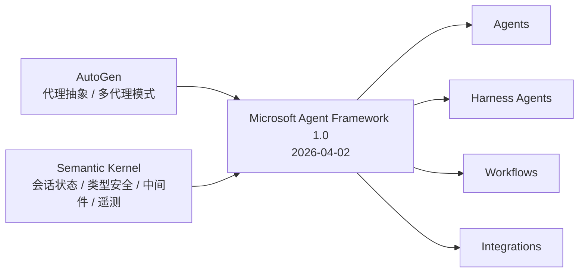

# MAF 是什么：1.0 定位、四支柱与语言矩阵

Microsoft Agent Framework（下称 MAF）是微软开源的 SDK 与运行时，用来构建 AI 代理和多代理工作流（F-001）。它不是又一个“提示词封装库”，而是把代理运行时、工具调用、会话状态、工作流编排、托管与可观测性放进同一套编程模型。理解 MAF 的第一步，是把它放回它诞生的位置：**AutoGen 与 Semantic Kernel 的收敛产品**。

## 一条产品线的收敛

MAF 于 2026-04-02 发布 1.0（F-002）。官方叙述中，它是 AutoGen 与 Semantic Kernel 两条产品线的直接继承者：由同一团队打造，把 AutoGen 的代理抽象与 Semantic Kernel 的企业能力（会话状态、类型安全、过滤器/中间件、遥测、模型与嵌入支持）合并，并新增基于图的工作流（F-003）。

这不是简单的“二合一”。AutoGen 擅长多代理对话模式，Semantic Kernel 擅长企业集成与插件体系；MAF 把两者的优点收敛为统一抽象，再用工作流补上“显式执行路径”这一层。对已有项目而言，这意味着迁移路径是官方支持的：SK 与 AutoGen 都有专门迁移指南（F-113）。

## 四支柱

官方把 MAF 的能力面组织为四个领域（F-004）：

| 支柱 | 解决的问题 | 典型读者 |
|------|-----------|---------|
| **Agents** | 单个代理如何接模型、调工具、带会话、加中间件、连 MCP | 应用开发者 |
| **Harness Agents** | 长任务代理如何自带规划、待办、压缩、文件记忆、审批、可观测性 | 做 Coding/研究/数据分析 Agent 的团队 |
| **Workflows** | 多代理/多函数如何按显式路径编排，支持检查点、HITL、可视化 | 平台与编排开发者 |
| **Integrations** | 模型提供程序、代理服务、工具、上下文、向量库、评估、UI 如何接入 | 集成与运维工程师 |

四者不是互斥选项。一个生产系统常见的组合是：用 Agents 写专家代理，用 Harness 承担长任务主循环，用 Workflows 把专家代理与确定性步骤串起来，最后用 Integrations 接模型、存储、可观测性与前端。

底层还有一组共用构件：模型客户端（Chat Completions 与 Responses）、`AgentSession` 状态管理、上下文提供程序、中间件与 MCP 客户端（F-004）。这些构件贯穿四支柱，也是后面几篇概念文档反复出现的主线。

## 语言矩阵：.NET、Python 与 Go 的真实边界

官方定位是“.NET 与 Python 提供一致的概念与 API”，Go 则是公共预览（F-005、F-012）。这句话需要拆开读：

| 语言 | 状态 | 安装入口 | 已知边界 |
|------|------|---------|---------|
| **Python** | 正式支持 | `pip install agent-framework`（或 `agent-framework-foundry` 子集） | 自托管包仍为预发布；FIDES 仅 Python |
| **.NET** | 正式支持 | `Microsoft.Agents.AI`（+ `Microsoft.Agents.AI.Foundry`） | 托管包为预发行版；Shell 执行仅 .NET |
| **Go** | 公共预览 | `go get github.com/microsoft/agent-framework-go` | 需 Go 1.26+；声明性代理、CodeAct、功能工作流未实现；无打包后台代理提供程序 |

Go 的边界在中文文档里写得很明确（F-005）。如果你在选型阶段看到“多语言”宣传，务必区分“正式支持”和“预览可用”：Go 目前支持 Harness、有界循环、规划与待办、RAG、语义聊天历史、嵌入与向量存储，但能力面小于 .NET/Python（F-005）。

## Agent 还是 Workflow？

这是 MAF 文档里最重要的一个决策表（F-011）：

| 用 Agent，当…… | 用 Workflow，当…… |
|---------------|------------------|
| 任务是开放式或对话式的 | 流程有定义完善的步骤 |
| 需要自主工具使用与计划 | 需要显式控制执行顺序 |
| 单次 LLM 调用（可能带工具）就足够 | 多个代理或函数必须协调 |

文档还给了一句更硬的判据：**“如果可以写一个函数来处理任务，就写函数，而不是用 AI 代理。”**（F-010）这句话值得贴在选型会议的白板上——它把“代理”从默认答案降级为“开放式任务的最后手段”。

## 它不是替代品清单

需要明确的非目标，避免误读：

1. MAF 不规定你必须用哪家模型。它通过模型提供程序接入 Foundry、Azure OpenAI、OpenAI、Anthropic、Bedrock、Vertex、Ollama、Mistral 等（F-094）。
2. MAF 不强制你用托管服务。Foundry 托管与自托管是运维选择，和协议选择相互独立（F-085）。
3. MAF 不保证第三方系统的合规性。官方明确提示：使用第三方服务器、代理、代码或非 Azure 直接模型的风险与成本由使用方承担。
4. 本知识包不是源码级解读。信源是官方文档、README 与 Releases；若需要逐行源码分析，应改用源码类工作流。

## 版本与时效

截至 2026-11-10，GitHub Releases 最新为 `python-1.21.0`（2026-10-08）与 `dotnet-1.21.0`（2026-09-11）（F-008）。从 1.0 到 1.21 只用了约六个月，说明 API 仍在快速演进。阅读本知识包时，请把“包名、类名、默认行为”当作**该时点的快照**，并在落地前对照最新文档。

这也是本 bundle 设置 `stale_after: 2027-05-31` 的原因：框架半年内的变化足以让部分细节过期。

## 下一步

- 想立刻跑起来：读 [快速开始与最小代理](01-quickstart.md)。
- 想理解代理内部如何组装：读 [代理管道与中间件](02-agent-architecture.md)。
- 想直接做长任务代理：读 [Agent Harness](03-harness.md)。
- 想编排多代理：读 [工作流与编排](07-workflows.md)。

## 已知边界

1. 本文的“四支柱”采用 Learn 概述页的组织方式；README 的“Key Features”是另一种产品视角，两者不冲突但分类不同（F-098）。
2. 语言矩阵只覆盖官方三个 SDK；社区绑定不在本文范围。
3. Go 的预览能力会随版本变化，F-005 的“未实现”清单以 2026-10 文档为准。
