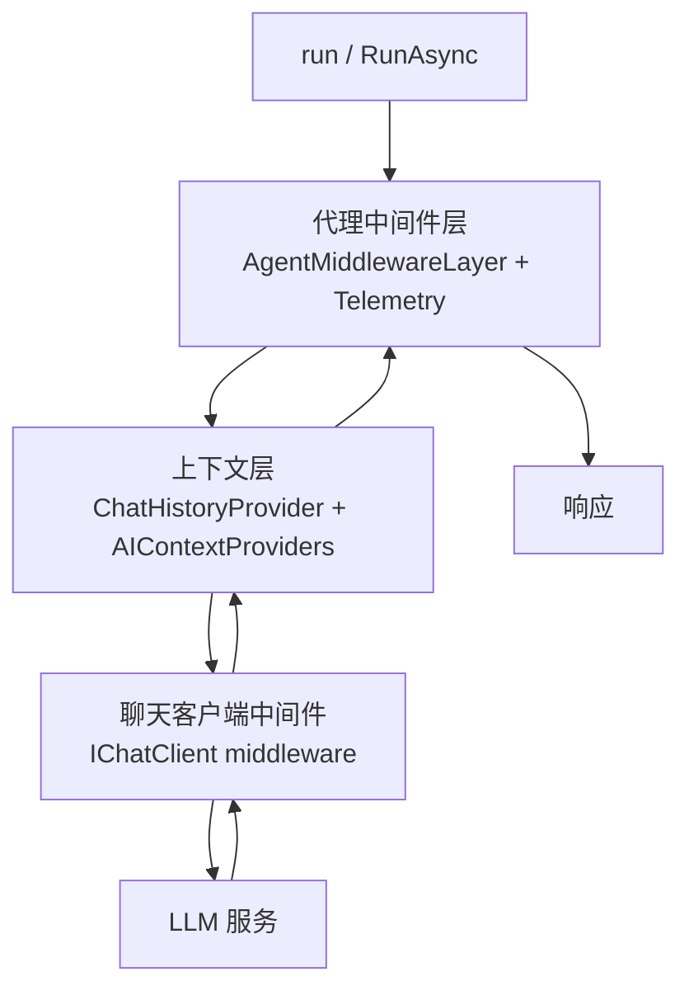

# 代理管道与中间件：三层结构、执行顺序与扩展点

很多框架把“代理”做成一个黑盒：输入消息，输出回复，中间发生什么不可见。MAF 的选择相反——它把代理拆成一条分层管道，并允许你在每一层插入中间件。理解这条管道，才能判断一段自定义逻辑应该放在哪里，以及为什么它有时不生效。

## 三层结构

以 .NET 的 `ChatClientAgent` 为例，管道分三层（F-021）：

| 层 | 组成 | 作用 |
|----|------|------|
| **代理中间件层** | `AgentMiddlewareLayer` + `AgentTelemetryLayer` | 拦截整个代理运行，做日志、校验、转换、遥测 |
| **上下文层** | `ChatHistoryProvider`（单个）+ `AIContextProviders`（列表） | 加载历史、注入记忆/检索文档/动态指令 |
| **聊天客户端层** | `IChatClient` + 可选客户端中间件 | 与具体 LLM 服务通信 |

Python 的 `Agent` 类用另一种组合方式表达同一分层：外层 `AgentMiddlewareLayer` + `AgentTelemetryLayer` + `RawAgent`，聊天客户端侧是 `FunctionInvocation`、聊天中间件与 `RawChatClient`（F-023）。



## 一次运行的执行顺序

官方给出的顺序可以当作排查问题的检查表（F-022）：

1. 代理中间件执行（如果配置）。
2. `ChatHistoryProvider` 把对话历史加载进请求消息列表。
3. `AIContextProviders` 添加消息、工具或指令。
4. `IChatClient` 中间件执行（如果装饰了客户端）。
5. 请求发送给 LLM。
6. 响应沿相同的层返回。
7. 历史提供程序与上下文提供程序收到新消息通知，用于存储。

在 Python/Go 的运行时里，顺序还包含“提供程序中间件”这一层：历史与上下文提供程序之后、底层模型之前，负责工具自动调用、结构化输出与响应编写（F-023）。这意味着：**如果你想让自定义逻辑看到最终的工具列表，应该放在提供程序中间件之后；如果你想改写用户输入，放在代理中间件更合适。**

## 三类中间件

MAF 支持三种中间件，作用域不同（F-024）：

| 类型 | 拦截点 | 适合做什么 | 不适用 |
|------|--------|-----------|--------|
| **代理运行中间件** | 每次 `run` 的输入/输出 | 审计、日志、租户校验、结果改写 | 看不到单次工具调用细节 |
| **函数调用中间件** | 每次函数工具调用 | 参数校验、审批、调用结果替换 | 不影响模型请求本身 |
| **IChatClient 中间件** | 每次模型调用 | 请求头、模型路由、响应缓存 | 不能用于不使用本地聊天客户端的远程代理 |

多个同类中间件形成链，每个实例通过 `next` 调用下一个（F-024）。.NET 的代理构建器写法：

```csharp
var agent = originalAgent
    .AsBuilder()
    .Use(runFunc: MyAgentMiddleware, runStreamingFunc: MyStreamingMiddleware)
    .Use(CustomFunctionCallingMiddleware)
    .Build();
```

一个容易忽略的细节：如果只提供非流式中间件，流式调用会退化为非流式，以满足中间件语义（F-025）。要么同时提供 `runStreamingFunc`，要么使用 `sharedFunc` 重载——但共享重载不能拦截或替换输出，只适合改输入。

## 上下文提供程序：比“记忆”更一般的注入点

上下文提供程序不是简单的“记忆插件”。它在每次 LLM 调用前运行，产出完整的消息历史并注入附加上下文（F-021、F-022）。典型用途：

1. 聊天历史（`ChatHistoryProvider` / `InMemoryHistoryProvider`）。
2. 长期记忆或用户偏好。
3. RAG 检索到的文档片段。
4. 动态指令（按租户、按任务切换系统提示）。

Python 用统一的 `context_providers` 列表，历史提供程序与上下文提供程序放在同一个列表里；.NET 则把 `ChatHistoryProvider` 与 `AIContextProviders` 分开（F-021）。这个差异会影响你迁移代码时的注册方式，但不影响概念模型。

上下文提供程序还可以通过 `SessionContext.extend_middleware()` 为单次调用附加聊天或函数中间件（F-026）。这让“某个检索器需要自己的请求改写逻辑”成为可能，而不必全局注册中间件。

## 会话：状态容器，不是授权边界

`AgentSession` 是跨运行复用的状态容器。C# 是抽象基类加 `StateBag`；Python 有 `session_id`、`service_session_id`、`state`；Go 是类型化键值容器（F-027）。

会话可以序列化/反序列化，但有两条硬约束（F-028、F-029）：

1. **会话专用于特定代理或服务**。换代理配置或提供程序复用，可能让上下文失效。
2. **服务端会话 ID 不是最终用户授权边界**。当多个最终用户共用一个 API key 或项目时，不能把 `service_session_id` / `previous_response_id` / `conversation_id` 直接回显给客户端并原样接收。正确做法是服务端存储 ID、客户端只拿你的映射 ID、恢复前校验归属。

第 2 条是安全设计，不是使用技巧。文档专门用一段警告说明“托管模式的风险”：共用后端密钥、回显服务端 ID、不检查所有权，三者叠加就是越权入口（F-029）。

## 远程代理与专用代理

并非所有代理都走完整的 `ChatClientAgent` 管道。`A2AAgent`、`GitHubCopilotAgent`、`CopilotStudioAgent` 与远程服务通信，不使用本地 `IChatClient`，因此不能加聊天客户端中间件；但它们仍支持代理级中间件（F-021 的补充说明）。

Python 的 `GitHubCopilotAgent` 通过 Copilot CLI 发请求，不走本地聊天客户端，但仍支持代理中间件与 `context_providers`；提供方添加的消息与指令会进入发送给 Copilot 的提示（F-021 补充）。

设计含义：如果你要写“对所有代理都生效”的横切逻辑（审计、租户隔离），放在代理中间件；如果你要改模型请求（温度、响应格式、缓存），放在聊天客户端中间件，并接受它只对本地聊天客户端代理生效。

## 一个排查顺序

当自定义逻辑“没生效”时，按这个顺序查：

1. 中间件注册在代理级还是运行级？运行级是否覆盖了代理级？
2. 是否只提供了非流式中间件，而调用走了流式？
3. 逻辑是否依赖工具列表，但放在了上下文层之前？
4. 代理是否是远程类型（A2A/Copilot），根本不走聊天客户端中间件？
5. 上下文提供程序是否在 `close()` 前没有 flush？Python 的 `close()` 会发布延迟连接的 MCP 工具（F-020）。

## 已知边界

1. 不同专用代理的管道可能与本图不同；官方明确说“专用代理的工作方式可能与此处所述的管道不同”（F-021 注释）。
2. 中间件的异常传播与终止语义在不同语言 SDK 中不完全一致；本文只描述官方明确给出的共同行为。
3. 会话并发复用没有官方安全承诺，应用层需自行串行化。
