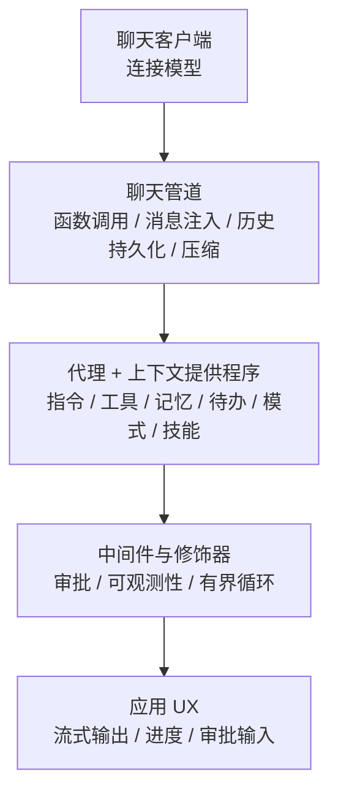

# Agent Harness：把聊天客户端变成能干长任务的代理

普通代理的循环很短：模型决定调一个工具，工具返回，模型再决定。任务一长，问题就来了——上下文会溢出、计划会丢、用户会被反复弹出的审批打断、进程重启后状态全没了。Agent Harness 就是对这些问题的产品化回答。

## 它是什么

官方定义：Harness 是“代理工具/运行时基架”，驱动模型与工具调用、管理聊天状态与上下文、应用审批策略，并让代理通过多步骤任务（F-033）。

关键点是：**Harness 不是另一个运行时**。它由现有的 MAF 构件组合而成（F-034）：



生成结果仍是普通代理：.NET 是 `HarnessAgent`（派生自 `AIAgent`），Python 是 `create_harness_agent` 返回的 `Agent`，Go 是 `harness.AgentConfig` 配置的 `*agent.Agent`（F-035）。这意味着 Harness 代理可以继续使用会话、上下文提供程序、工作流与托管能力，不需要特殊 API。

## 一行创建

.NET：

```csharp
AIAgent agent = chatClient.AsHarnessAgent();
AgentSession session = await agent.CreateSessionAsync();
```

Python：

```python
agent = create_harness_agent(client=client)
session = agent.create_session()
```

博文把这称为“用单个方法把任意聊天客户端变成完整 Harness 代理”（F-100）。但“一行”只创建默认配置；要调压缩阈值、文件存储、审批规则，需要传 `HarnessAgentOptions` / `create_harness_agent` 的参数。

## 能力矩阵

官方能力矩阵（F-036、F-038、F-039）可以整理成下面这张表：

| 能力 | Harness 行为 | 默认状态 |
|------|-------------|---------|
| 函数调用 | 支持每次请求的迭代上限；Go 由提供程序构造函数控制工具循环 | 启用 |
| 每次服务调用的历史持久化 | 工具调用循环中每次模型调用后都保存历史 | 启用 |
| 压缩 | .NET/Python 需令牌限制或自定义策略；Go 需显式组合 provider | 条件启用 |
| 待办事项 | 添加/完成/移除/列出，存在会话状态 | 默认启用 |
| 计划/执行模式 | 分离规划与行动 | 默认启用 |
| 文件记忆 | 会话级文件记忆 | 默认启用 |
| 文件访问 | 共享文件访问 | 手动启用 |
| 工具审批 | 永久审批与自动审批规则 | 默认启用 |
| OpenTelemetry | 代理可观测性 | 默认启用 |
| Web 搜索 | 所选聊天客户端支持时添加，可用 `DisableWebSearch` 关闭 | 条件启用 |
| 智能体技能 | .NET/Go 默认启用；Python 需提供程序或路径选择加入 | 语言差异 |
| 后台代理 | .NET/Python 可选并行委派；Go 无打包提供程序 | 可选 |

这张表最重要的信息不是“有什么”，而是“默认开什么”。Harness 的默认值偏向“能干活”：待办、模式、文件记忆、审批、遥测都默认开；共享文件访问与后台代理则保守关闭。做安全评审时，应逐项确认这些默认值是否符合你的威胁模型。

## 构建块细节

博文列出的 Harness 构建块（F-040）：

1. **FileMemoryProvider**：会话级文件记忆，让代理跨轮次持久化笔记/学习结果，存放在 `agent-file-memory/{session}/`。
2. **FileAccessProvider**：通用文件访问，代理可读写其操作所需文件。
3. **TodoProvider**：在会话状态中跟踪工作项（添加、完成、移除、列出）。
4. **AgentModeProvider**：支持“计划”与“执行”两种模式，把规划与行动分开。
5. **AgentSkillsProvider**：从文件系统发现并执行技能，实现模块化能力注入。
6. **BackgroundAgentsProvider**：把子任务委派给并行运行的子代理，做扇出编排。
7. **托管 Web 搜索**：开箱即用，可用 `DisableWebSearch` 关闭。
8. **Shell 执行（仅 .NET）**：通过沙箱化 `ShellExecutor` 运行 shell 命令。

中间件与定制（F-041）：

1. `ToolApprovalAgent`：为敏感工具调用提供“不再询问”的审批规则。
2. `OpenTelemetryAgent`：按 OpenTelemetry Semantic Conventions 自动追踪。
3. 可插拔存储后端：`FileMemoryStore` / `FileAccessStore` 可换成任何 `AgentFileStore` 实现（文件系统、blob 存储等）。

关于文件记忆路径：`agent-file-memory/{session}/` 只出现在博文，Learn 只说明“会话级文件记忆默认启用”。本知识包把它标注为**博文单源**，不要当作稳定 API 契约（见 [核验报告](../references/verification.md)）。

## 压缩：能力存在，但默认不“自动”

这是博文与文档之间最需要澄清的一处。博文把“自动上下文压缩”写成开箱能力，描述为“监视令牌用量并在循环中途压缩聊天历史”（F-101）。Learn 的能力矩阵则明确：在 .NET 与 Python 中，压缩在**提供令牌限制或自定义策略时**启用；Go 需要显式组合 provider（F-037）。

正确的理解是：

1. Harness 提供压缩机制与默认策略。
2. 但“自动”需要你给出预算边界（最大上下文窗口、最大输出），否则框架不知道何时该压。
3. 不给预算就期待“自动压缩”，是常见的误配。

博文的表述是公告口径，文档的表述是配置口径；落地时以文档为准。

## 指令合并顺序

Harness 自带一套“有主见”的系统指令，用于任务拆解、工具使用与推理模式。合并顺序是：**Harness 指令在前，你的自定义指令在后**（F-042）。这个顺序有语义：先建立工作方式，再叠加业务约束。如果你写“忽略之前的指令”，会同时覆盖 Harness 的工作方式，通常不是想要的结果。

## 会话与历史

Harness 会话与普通代理使用同一 `AgentSession` 生命周期（F-044）。差别在于历史持久化粒度：普通代理在一次 `run` 结束后保存历史；Harness 在工具调用循环中的**每次模型调用后**都保存（F-043）。这让长循环在崩溃后更容易恢复，但也意味着写入更频繁。

默认历史提供程序是 `InMemoryChatHistoryProvider`（.NET）/ `InMemoryHistoryProvider`（Python）；要持久化到数据库或 blob，需要替换历史提供程序（F-043）。

## 语言与实验性边界

1. **Shell 执行仅 .NET**（F-040）。Python/Go 的 Harness 没有打包的 Shell 工具。
2. **后台代理实验性**，且 Go 无打包提供程序（F-068、F-069、F-070）。
3. **技能默认值因语言而异**：.NET/Go 默认启用，Python 需选择加入（F-039）。
4. **Go 的 Harness 需要显式组合 provider**，能力面小于 .NET/Python（F-005、F-037）。

## 什么时候该用 Harness

适合：

1. 研究、编码、数据分析等需要多步工具调用的长任务。
2. 需要计划/待办可见性，让用户知道代理在做什么。
3. 需要审批、文件记忆、可观测性等生产护栏。
4. 想快速得到一个“能干活”的代理，而不是自己拼装十几个提供程序。

不适合：

1. 单轮问答或简单 RAG——Harness 的默认能力会成为负担。
2. 需要完全确定性执行路径——应该用工作流，而不是让 Harness 自主规划。
3. 对文件系统访问零容忍的场景——默认文件记忆会写盘，需要显式关闭或替换存储。

## 示例

可演练版本见 [Harness 代理与会话复用](../examples/02-harness-session.md)。

## 已知边界

1. 能力矩阵会随版本变化；本文以 2026-10 文档为准。
2. 文件记忆的默认目录模板为博文单源。
3. 压缩策略的具体阈值与算法未在文档中给出，需阅读 SDK 源码或实验确定。
