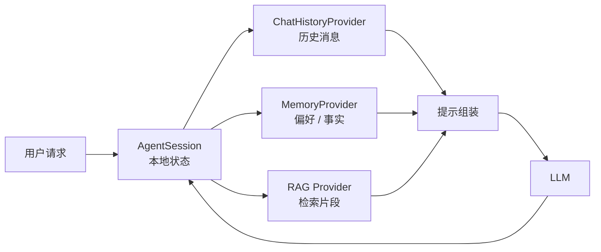

# 记忆、RAG 与多用户边界

“让代理记住”是需求里最常见、也最容易做错的一件事。MAF 把记忆拆成三层：会话状态（session）、上下文注入（context providers）、外部检索（RAG）。三者解决不同问题，混用会导致上下文膨胀或越权。

## 三层记忆

| 层 | 载体 | 解决什么 | 生命周期 |
|----|------|---------|---------|
| **会话状态** | `AgentSession` | 多轮对话、待办、模式、审批状态 | 一次会话；可序列化 |
| **上下文注入** | `ChatHistoryProvider` / `AIContextProviders` | 历史消息、用户偏好、动态指令 | 每次模型调用前 |
| **外部检索** | RAG 提供程序（如 `TextSearchProvider`） | 知识库、文档、网页 | 按查询检索 |

官方对话指南把相关页面组织为：Session（结构与序列化）、上下文提供程序、上下文压缩、存储、聊天历史记忆提供程序（F-050）。这条学习路径的顺序是有道理的：先懂状态容器，再懂注入，再懂检索。

## 会话：显式、可序列化、专用

`AgentSession` 是跨运行复用的状态容器（F-027）：

1. C#：抽象基类 + `StateBag`；具体实现可能带远程历史 ID。
2. Python：`session_id`（本地唯一）、`service_session_id`（远程服务会话）、`state`（可变字典）。
3. Go：类型化键值容器，`Set/Get/Delete`。

会话可以序列化为 JSON 并恢复（F-028）。两条硬约束：

1. **会话专用于特定代理或服务**。换代理配置或提供程序复用，可能让上下文失效。
2. **服务端会话 ID 不是授权边界**（F-029）。

第 2 条值得展开，因为它是真实漏洞的常见来源。

## 多用户越权：一个具体的坏模式

文档描述的风险模式是（F-029）：

1. 多个最终用户共用一个后端 API key 或项目。
2. 应用把服务端会话 ID（`resp_*`、`conv_*`）原样回显给客户端。
3. 客户端下次请求带回这个 ID，应用不检查归属就恢复会话。

结果：用户 A 拿到用户 B 的会话 ID，就能继续 B 的对话，甚至读到 B 的历史。

正确做法：

1. 服务端存储 `service_session_id`，不要直接给客户端。
2. 客户端只拿你自己的会话标识（映射 ID）。
3. 恢复前校验当前认证用户/租户是否拥有该会话。
4. 不要把 `previous_response_id` / `conversation_id` 当作最终用户授权凭证。

这条建议与具体框架无关，是所有“服务托管历史”的通用安全要求；MAF 文档把它写在 Session 页，是因为 API 设计容易诱导错误用法。

## 历史提供程序与存储

默认情况下，代理把聊天历史存在 `InMemoryChatHistoryProvider`（或由基础 AI 服务托管），具体取决于服务的需求（F-030）。要持久化，替换历史提供程序：

```csharp
AIAgent agent = new ChatClientAgent(chatClient, new ChatClientAgentOptions
{
    ChatHistoryProvider = new InMemoryChatHistoryProvider(),
    AIContextProviders = [new MyMemoryProvider(), new MyRagProvider()],
});
```

Python 用统一的 `context_providers` 列表：

```python
agent = Agent(
    client=my_client,
    context_providers=[
        InMemoryHistoryProvider(),
        MyMemoryProvider(),
        MyRagProvider(),
    ],
)
```

（F-021、F-030）

选择存储时的三个问题：

1. **谁拥有历史**：应用、模型服务，还是两者都有？冲突时以谁为准？
2. **保留多久**：会话 TTL、合规删除、用户注销后的清理。
3. **怎么加密**：历史里可能有 PII；持久化前要明确加密与访问控制。

## 压缩：上下文预算管理

对话变长后，历史会挤占上下文窗口。MAF 提供上下文压缩机制；在 Harness 中，压缩在 .NET/Python 里需要令牌限制或自定义策略才启用，Go 需显式组合 provider（F-037）。

压缩策略的取舍：

| 策略 | 优点 | 风险 |
|------|------|------|
| 截断旧消息 | 简单、可预测 | 丢失早期约束 |
| 摘要旧消息 | 保留语义 | 摘要可能失真；需额外模型调用 |
| 检索式记忆 | 只取相关片段 | 依赖检索质量 |
| 技能/工具结果卸载 | 释放大块上下文 | 后续需要时得重新加载 |

MAF 没有强制一种策略；它提供机制与钩子，具体策略由应用决定。

## RAG：TextSearchProvider 的两种模式

RAG 通过上下文提供程序实现：在模型调用或搜索工具之前注入检索内容（F-057）。`TextSearchProvider` 是现成实现（F-058），支持：

1. **每次调用前搜索**（`SearchTime = BeforeAIInvoke`）：适合“每轮都需要知识”的客服/问答。
2. **以函数工具形式按需搜索**：适合“模型自己决定要不要查”的研究型代理。

它还可以保留聊天历史的滚动窗口（例如最近 6 条）用于构造查询（F-058）：

```csharp
TextSearchProviderOptions textSearchOptions = new()
{
    SearchTime = TextSearchProviderOptions.TextSearchBehavior.BeforeAIInvoke,
    RecentMessageMemoryLimit = 6,
};
```

搜索适配器是一个返回 `TextSearchResult` 的函数，可接任意搜索技术（Azure AI 搜索、Web 搜索引擎等）（F-060）。`SourceName` 与 `SourceLink` 可选，但若代理要引用来源就应提供（F-059）。

### 引用来源的工程价值

让代理“带引用”不只是体验问题，而是可核验性：

1. 用户能点开原文核对。
2. 评测能判断“答案是否有依据”。
3. 出问题时能定位是检索错还是生成错。

所以：**检索结果没有来源名/链接时，不要假装有引用**。宁可在回答里说“根据内部知识库”，也不要把编造的 URL 塞进答案。

## Graph RAG 与 Go

文档另列 Graph RAG 与 Go 中的 RAG 支持（F-060）。Graph RAG 适合实体关系密集的领域（组织架构、供应链、法规条款）；它的代价是构图与维护成本高，不适合纯文档问答。

Go 的 RAG 能力存在，但整体能力面小于 .NET/Python（F-005）。

## 一个记忆架构模板



落地时按这个顺序问：

1. 这条信息该进会话、历史、记忆还是检索？
2. 它的生命周期多长？谁负责删除？
3. 它是否跨用户？跨用户就必须有归属校验。
4. 它是否需要引用来源？

## 已知边界

1. 压缩算法的具体实现与阈值未在文档中给出。
2. 历史提供程序的存储接口在不同语言 SDK 中名称不同；本文给的是概念映射。
3. Graph RAG 的官方细节需要查专门的集成页，本文只做定位。
4. 多用户边界建议是通用安全实践，不是 MAF 自动提供的保证。
