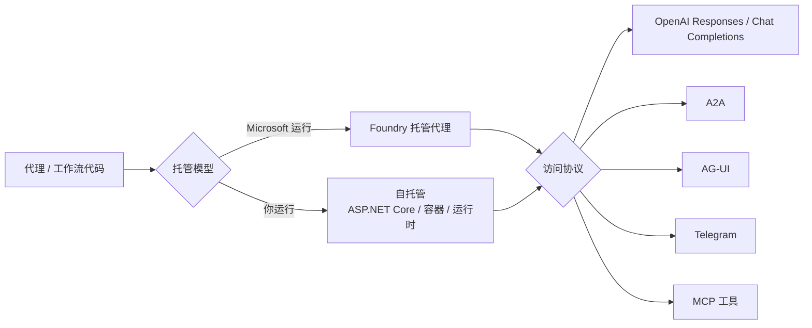

# 托管、协议与运维：从本地代理到生产服务

代理在本地跑通只是开始。生产问题接着来：谁运行容器？怎么扩缩容？会话状态存哪？客户端用什么协议？崩溃后怎么恢复？MAF 把这些问题分成两个独立决策：**托管模型**与**访问协议**。

## 两个独立决策

官方明确：托管模型是“谁运行基础设施”的运维选择，与客户端访问协议相互独立（F-085）。这个解耦很重要——你可以自托管但用 OpenAI 兼容协议，也可以 Foundry 托管但用 A2A 接内部系统。



## Foundry 托管代理

状态：**已正式发布（GA）**（F-086）。适合“不想管基础设施，但要生产级会话与观测”的团队。

博文列出的开箱能力（F-087）：

1. **缩容到零**：空闲不计费，下次请求拉起。
2. **缩容后文件系统保留**：文件、磁盘状态、会话身份跨缩容保留，代理从上次位置继续。
3. **每会话 VM 隔离沙箱**：每个会话独立、状态持久。
4. **内置可观测性**：MAF 的 OpenTelemetry 追踪零接线流入 Application Insights。
5. **版本化**：代理版本可管理。

把本地代理变成托管代理只需少量代码（F-088）：

```csharp
using Microsoft.Agents.AI.Foundry.Hosting;

var builder = WebApplication.CreateBuilder(args);
builder.Services.AddFoundryResponses(agent);

var app = builder.Build();
app.MapFoundryResponses();

app.Run();
```

```python
server = ResponsesHostServer(agent)
server.run()
```

注意：博文把“内置身份、自动扩缩容、托管会话状态、可观测性、版本化”列为托管服务能力；这些细节多为博文单源，落地前应查 Foundry 文档确认配额、区域与计费（见 [核验报告](../references/verification.md)）。

## 自托管

状态：.NET 托管包为预发行版；Python 自托管包为预发布（F-086）。适合“需要应用级控制，或必须接现有基础设施”的团队。

自托管助手提供什么（F-090）：

| 助手 | 作用 |
|------|------|
| `AddAIAgent` | 向依赖注入注册命名 `AIAgent` |
| `AddWorkflow` | 注册命名工作流 |
| `AddAsAIAgent` | 把工作流暴露为标准代理接口 |
| `IHostedAgentBuilder` | 配置与该代理关联的托管服务 |
| `AgentSessionStore` | 按应用/协议提供的延续 ID 加载与保存会话 |

一个最小 ASP.NET Core 宿主（F-089 的示例结构）：

```csharp
WebApplicationBuilder builder = WebApplication.CreateBuilder(args);
var hostedAgent = builder.AddAIAgent("weather-agent", (_, _) => agent);

WebApplication app = builder.Build();
app.MapOpenAIResponses(hostedAgent);
app.Run();
```

自托管意味着这些责任回到你身上：

1. 路由、身份、授权、请求策略。
2. 存储与扩缩容。
3. 中间件管道、请求校验、允许的模型选项。
4. 持久存储与会话安全。

## 协议选择

协议与托管模型解耦（F-091）：

| 协议 | 用途 | 备注 |
|------|------|------|
| OpenAI Responses / Chat Completions | 兼容 OpenAI 生态的端点 | 自托管与 Foundry 都支持 |
| A2A | 代理到代理协议 | 暴露或调用远程代理 |
| AG-UI | 基于 Web 的代理应用 | 预览 |
| Telegram Bot | 自托管原生集成 | 适合快速做 Bot |
| MCP 工具 | 把代理/工作流作为 MCP 工具暴露 | 适合被其他代理调用 |
| Microsoft 365 Activity | Foundry 托管专用 | 接 M365 频道 |

选择建议：

1. 已有 OpenAI 客户端 → Responses / Chat Completions。
2. 多代理跨团队/跨厂商 → A2A。
3. 自己的 Web 前端 → AG-UI 或 Responses + 自定义前端。
4. 要把能力给其他代理用 → MCP 工具。

## Durable Extension：持久执行

当代理或工作流需要“跑几天、崩溃恢复、跨主机扩展、等待人工不烧算力”，用 Durable Extension（F-092）。

它把 MAF 编程模型与 Durable Task 基础设施（如 Durable Task Scheduler）结合，提供：

1. 跨请求与工作者执行自动保留状态。
2. 失败后恢复，不丢会话上下文、不重复已完成工作。
3. 按需跨分布式无状态工作者扩展。
4. 多代理工作流的可靠执行保证。
5. 图工作流的检查点。
6. 暂停等待人工/外部事件，不占计算或模型 token。
7. 流式传递恢复（配置流代理如 Redis 时）；持久完成需单独确认。
8. 会话 TTL 清理与仪表板监控。

两种托管模型（F-093）：

| 模型 | 适合 |
|------|------|
| **Azure Functions** | 无服务器、内置扩缩容、触发器/绑定、MCP 服务器触发器 |
| **自带计算/自承载** | 自有 worker、服务、容器、Kubernetes、现有基础设施 |

语言支持：C# 与 Python；Go 走 A2A 托管与 Go 仓库（F-093）。

## 可观测性

MAF 内置 OpenTelemetry（F-036、F-098）：

1. 代理级 span、事件、指标。
2. 工作流范围、指标、事件与传递状态（F-083）。
3. Foundry 托管时追踪流入 Application Insights（F-087）。

落地建议：

1. 给每个代理/工作流加业务属性（租户、任务类型、版本），否则追踪只能看延迟。
2. 记录工具调用参数时要脱敏；追踪系统常是 PII 泄露点。
3. 把“审批等待时间”单独建指标；它常是长任务的主要延迟来源。

## 成本边界

托管与持久执行都有成本模型，文档不提供统一报价。可控的杠杆：

1. **缩容到零**：空闲不计费，但冷启动有延迟。
2. **会话 TTL**：及时清理空闲会话，避免存储无限增长。
3. **上下文压缩**：减少 token 用量（见 [Agent Harness](03-harness.md)）。
4. **CodeAct**：把多回合压成一回合，降低 token 与延迟（见 [Build 2026 与迁移](09-build2026-migration.md)）。
5. **检查点频率**：越频繁越安全，但存储与序列化成本越高。

## 上线检查表

1. 托管模型选了吗？Foundry 还是自托管？
2. 协议选了吗？客户端兼容性验证了吗？
3. 会话存哪？多用户归属校验做了吗？
4. 崩溃恢复策略是什么？检查点还是 Durable？
5. 可观测性接了吗？PII 脱敏了吗？
6. 审批与 FIDES 策略在生产模式吗？
7. 成本上限与告警设了吗？

## 已知边界

1. 托管与计费细节以 Azure/Foundry 官方文档为准；本文只给能力面。
2. 自托管包处于预发布/预发行，API 可能变化。
3. Durable Extension 的部署细节（存储、调度器、网络）需查专页。
4. 协议的具体版本与兼容矩阵未在本文展开。
