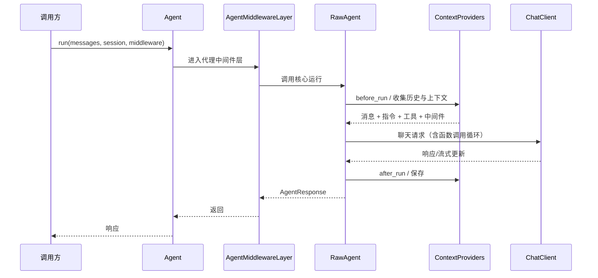

# 核心运行时：Agent 类组合、中间件流水线与会话注入

文档篇把代理描述为“三层管道”。源码篇要回答更具体的问题：这三层在 Python 里由哪些类实现，`Agent.run` 到底接受什么，上下文提供程序在什么时候被调用。

## 继承与组合：三个类，三种职责

`_agents.py` 定义了三个关键类型（F-129）：

```text
SupportsAgentRun (Protocol)
        ↑
    BaseAgent
        ↑
    RawAgent
        ↑
      Agent  ← 同时混入 AgentMiddlewareLayer、AgentTelemetryLayer
```

| 类 | 职责 | 何时用 |
|----|------|--------|
| `BaseAgent` | 会话创建、会话解析、`as_tool`、序列化基础 | 自定义代理的基类 |
| `RawAgent` | 核心运行逻辑：准备上下文、调聊天客户端、解析响应、`as_mcp_server` | 想要最小实现、不要中间件与遥测 |
| `Agent` | 组合 `AgentMiddlewareLayer` + `AgentTelemetryLayer` + `RawAgent` | 绝大多数场景（类文档称“推荐的代理类”） |

（F-129、F-130、F-165）

这个设计回答了一个常见疑问：**中间件不是 `RawAgent` 的内置逻辑，而是外层包装**。`RawAgent` 本身不知道中间件；`Agent` 通过在继承链上混入 `AgentMiddlewareLayer`，把中间件套在核心运行之外。遥测同理。

## Agent.run 的十个参数

`Agent.run` 的签名（简化）包含（F-131）：

```python
async def run(
    messages=None,
    *,
    stream=False,
    session=None,
    middleware=None,
    tools=None,
    options=None,
    compaction_strategy=None,
    tokenizer=None,
    function_invocation_kwargs=None,
    client_kwargs=None,
): ...
```

三个容易忽略的点：

1. **`middleware` 是运行级参数**，与构造时的代理级中间件叠加；这不是“覆盖”，而是两层。
2. **`compaction_strategy` 可按运行传入**，不必改代理配置；适合“这一次对话特别长”的场景。
3. **`tools` 可按运行传入**，用于临时给某次调用加工具；长期工具应放构造参数。

## 三条 pipeline，不是一个

`_middleware.py` 里不是一条链，而是三条（F-132）：

| Pipeline | 包装对象 | 触发点 |
|----------|---------|--------|
| `AgentMiddlewarePipeline` | 代理运行 | 每次 `run` |
| `FunctionMiddlewarePipeline` | 函数工具调用 | 每次工具执行 |
| `ChatMiddlewarePipeline` | 聊天客户端调用 | 每次模型调用 |

`AgentMiddlewareLayer` 负责代理级 pipeline 的缓存与执行；`ChatMiddlewareLayer` 负责聊天侧的中间件层（F-132）。两个异常类型 `MiddlewareTermination` 与 `MiddlewareFailure` 区分“主动终止”与“执行失败”（F-133）——这个区分很重要：终止是控制流，失败是错误，混用会让重试逻辑误判。

`MiddlewareBundle` 则把一组中间件打包，供 Harness 或扩展一次性注册（F-132）。

## 会话注入：ContextProvider 的两个钩子

`_sessions.py` 的核心不是“存消息的字典”，而是一组生命周期钩子（F-134、F-135）：

```python
class ContextProvider:
    async def before_run(self, ...): ...
    async def after_run(self, ...): ...
```

`SessionContext` 在运行期间承担“可变上下文”的角色，提供（F-135、F-166）：

1. `extend_messages(...)`：追加消息。
2. `extend_instructions(...)`：追加指令。
3. `extend_tools(...)`：追加工具。
4. `extend_middleware(...)`：为本次运行追加中间件。
5. `get_messages(...)`：读取当前消息。
6. `response` 属性：读取本次运行的 `AgentResponse`。

`HistoryProvider` 继承 `ContextProvider`，额外提供 `get_messages` / `save_messages`（F-134）。这解释了文档里“历史提供程序是上下文提供程序的一种”的说法：它不是特殊通道，而是同一钩子体系里的一个实现。

`_RunPersistenceGate` 是另一个值得注意的类（F-134）：它提供 `collect`、`flush`、`drop`、`accepts`，用于把“运行期间产生的持久化任务”收集起来，在运行结束前统一刷新。这对应文档说的“输出发布/存储前的持久化闸门”。

## 压缩：九个策略，不是一句“自动压缩”

`_compaction.py` 定义 `CompactionStrategy` 协议与九个具体策略（F-136）：

| 策略 | 思路 |
|------|------|
| `TruncationStrategy` | 截断 |
| `SlidingWindowStrategy` | 滑动窗口 |
| `SelectiveToolCallCompactionStrategy` | 选择性保留工具调用 |
| `ToolResultCompactionStrategy` | 压缩工具结果 |
| `SummarizationStrategy` | 摘要 |
| `TokenBudgetComposedStrategy` | 按 token 预算组合 |
| `ContextWindowCompactionStrategy` | 按上下文窗口压缩 |
| `AgentTriggeredCompactionStrategy` | 由代理触发 |
| `UnloadSkillsCompactionStrategy` | 卸载已加载技能 |

`CompactionProvider(ContextProvider)` 把压缩接入上下文管道（F-137）。这就把文档里的“压缩需要配置”落到了实处：不是框架偷偷压，而是你选策略、给预算，`CompactionProvider` 在钩子里执行。

## 代理即工具、代理即 MCP

两个方法把“代理”变成“能力”（F-165）：

1. `BaseAgent.as_tool(...)`：把代理包装成函数工具。
2. `RawAgent.as_mcp_server(...)`：把代理暴露为 MCP 服务器。

这解释了文档里“代理即工具”和“MCP 工具”两种集成形态在实现上是不同方法，不是同一个开关。

## 一张请求路径图



## 已知边界

1. 本文按类名与方法名描述结构，未逐行分析实现细节（如 pipeline 的异常传播）。
2. `Agent.run` 的完整重载有多个，本文只列共同参数。
3. 压缩策略的具体算法未展开；需读各策略类实现。
4. 源码为 main 快照（1.25.0），与 1.21 发布版可能不同（F-164）。
