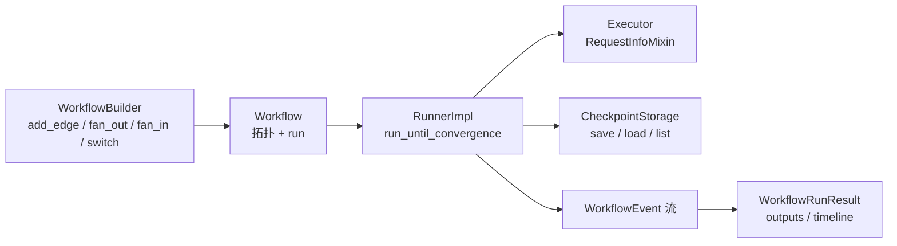

# 工作流源码：Builder、Runner 与检查点协议

文档篇把工作流讲成“执行器 + 边 + 事件 + 状态”。源码篇把它落到三个可读的对象：`WorkflowBuilder` 负责搭图，`RunnerImpl` 负责跑图，`CheckpointStorage` 负责存图的状态。

## 搭图：WorkflowBuilder 的六类连边

`_workflow_builder.py` 的 `WorkflowBuilder` 提供（F-148）：

| 方法 | 用途 |
|------|------|
| `add_edge` | 一对一顺序边 |
| `add_fan_out_edges` | 一个执行器扇出到多个 |
| `add_fan_in_edges` | 多个执行器扇入到一个 |
| `add_switch_case_edge_group` | 条件分支（switch/case） |
| `add_multi_selection_edge_group` | 多选分支 |
| `add_chain` | 一次性串起一条链 |
| `build` | 产出 `Workflow` |

这比文档的“边与条件”更具体：扇出/扇入是显式方法，不是靠多个 `add_edge` 拼出来；条件分支有专门的 edge group，而不是在 executor 里写 `if`。

`build()` 之前，builder 会把 `SupportsAgentRun` 的候选包装成 executor（`_maybe_wrap_agent`），所以代理可以直接作为节点传入（F-148）。

## 跑图：Workflow 与 WorkflowRunResult

`_workflow.py` 定义 `Workflow`（F-149）。它的方法分成两类：

1. **查询拓扑**：`get_start_executor`、`get_output_executors`、`get_intermediate_executors`、`get_executors_list`。
2. **执行**：`run`（多个重载，支持流式/非流式/检查点）。

`WorkflowRunResult` 继承 `list[WorkflowEvent]`，提供：

1. `get_outputs()`：最终输出。
2. `get_intermediate_outputs()`：中间输出。
3. `get_request_info_events()`：HITL 请求事件。
4. `status_timeline()`：状态时间线。

这解释了一个常见困惑：为什么示例里既 `async for event in workflow.run(..., stream=True)`，又 `result.get_outputs()`。前者拿事件流，后者拿结构化结果；两者不是互斥 API，而是同一运行的不同视图。

## 收敛循环：RunnerImpl

`_runner.py` 的 `RunnerImpl` 是执行心脏（F-150）：

| 方法 | 作用 |
|------|------|
| `run_until_convergence` | 驱动迭代直到收敛 |
| `_run_iteration` | 单次迭代 |
| `create_checkpoint_if_enabled` | 按配置创建检查点 |
| `build_checkpoint` | 组装检查点对象 |
| `restore_checkpoint` | 从检查点恢复 |
| `_save_executor_states` / `_restore_executor_states` | 执行器状态存取 |
| `_save_edge_runner_states` / `_restore_edge_runner_states` | 边运行器状态存取 |

“超级步”在实现上就是一次 `_run_iteration`：执行器完成、边路由、事件发出，然后在迭代边界创建检查点。恢复时不是重放事件，而是恢复执行器与边运行器的状态（F-150）。

这带来一个工程约束：**执行器状态必须可序列化**，否则检查点会失败或丢状态。

## 检查点协议：三个方法

`_checkpoint.py` 定义 `CheckpointStorage` 协议（F-151）：

```python
class CheckpointStorage(Protocol):
    async def save(self, checkpoint: WorkflowCheckpoint) -> CheckpointID: ...
    async def load(self, checkpoint_id: CheckpointID) -> WorkflowCheckpoint: ...
    async def list_checkpoints(self, *, workflow_name: str) -> list[WorkflowCheckpoint]: ...
```

内置实现：

1. `InMemoryCheckpointStorage`：进程内，测试/演示。
2. `FileCheckpointStorage`：本地磁盘。
3. `CosmosCheckpointStorage`：在 `azure-cosmos` 包中（文档 F-078）。

`WorkflowCheckpoint` 捕获的是“运行状态”，包括执行器状态、待处理消息、请求/响应与共享状态（文档 F-078）。协议只有三个方法，意味着你可以接自己的数据库，而不改工作流代码。

安全提醒：`FileCheckpointStorage` 的序列化格式与 `Pickle` 风险在文档中已提示（F-078）；源码层没有替你做加密或访问控制。

## 函数式工作流：另一套类

`_functional.py` 定义（F-152）：

1. `FunctionalWorkflowDefinition`：定义。
2. `FunctionalWorkflow`：运行对象，支持 `.as_agent()`。
3. `FunctionalWorkflowAgent`：把函数式工作流包装成代理。
4. `RunContext` / `StepWrapper`：运行上下文与步骤包装。

这与图 API 的关键差异不在“有没有类”，而在控制流：函数式用 Python 原生 `if`/循环/`asyncio.gather`，图 API 用边与条件。两者都能 `as_agent()`，所以对上层调用方可以统一。

## HITL 在源码里的位置

`Executor` 继承 `RequestInfoMixin`（F-147 的 `_executor.py` 结构）。这意味着“请求人工输入”不是外挂机制，而是执行器的基础能力：执行器可以发出请求、挂起，等响应到达后继续。

配合 `WorkflowRunResult.get_request_info_events()`，应用层可以：

1. 运行工作流到请求点。
2. 取出请求事件，展示给人。
3. 提交响应，恢复运行。

## 一张图看懂三个对象



## 与文档篇的差异

文档说“检查点在超级步边界创建”。源码进一步说明：超级步 = `_run_iteration`，检查点由 `create_checkpoint_if_enabled` 在迭代边界创建（F-150）。这句话的实践含义是：**检查点粒度由迭代边界决定，不是由单个执行器决定**。

## 已知边界

1. 未逐行分析边运行器的调度算法与并发模型。
2. `CosmosCheckpointStorage` 位于独立包，本文未读其实现。
3. 函数式工作流的实验性状态未在源码中标注为 stable；按文档视为实验。
4. 检查点序列化格式可能随版本变化，跨版本恢复需测试。
