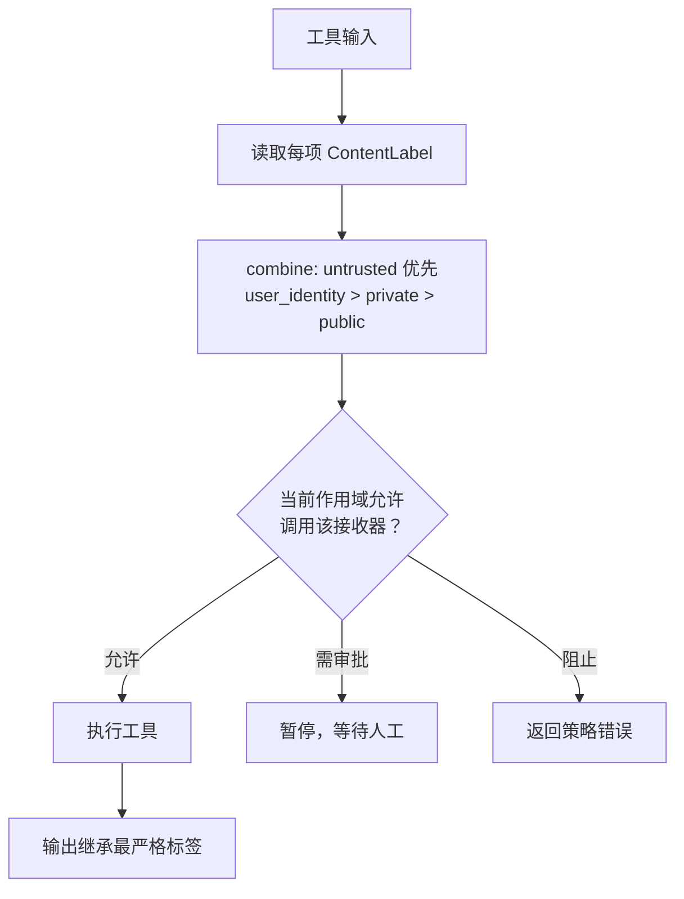

# FIDES 源码：标签、作用域与策略中间件如何咬合

文档篇讲了 FIDES 的威胁模型与四个组件。源码篇回答两个更硬的问题：标签在代码里是什么类型，策略在什么作用域里生效。

## 标签是两个枚举，不是一个字符串

`security.py` 定义（F-153）：

```python
class IntegrityLabel(str, Enum):
    TRUSTED = "trusted"
    UNTRUSTED = "untrusted"

class ConfidentialityLabel(str, Enum):
    PUBLIC = "public"
    PRIVATE = "private"
    USER_IDENTITY = "user_identity"
```

把标签做成枚举而不是自由字符串，带来两个好处：

1. **组合规则可判定**：`untrusted` 战胜 `trusted`，`user_identity > private > public`，不需要解析文本。
2. **默认值可收敛**：未标注工具输出可以统一落到 `UNTRUSTED` + 默认机密性，实现 fail closed。

`ContentLabel` 是携带这两个轴的载体（F-153）。它不是“给消息加个元数据字段”那么简单：它要能随内容项传播，并在工具调用边界被读取。

## 两个中间件，一攻一守

FIDES 的核心行为由两个 `FunctionMiddleware` 实现（F-153）：

| 中间件 | 角色 | 做什么 |
|--------|------|--------|
| `LabelTrackingFunctionMiddleware` | 传播 | 读取输入标签，取最严格值，写到输出；可隐藏变量引用后的不受信任字节 |
| `PolicyEnforcementFunctionMiddleware` | 拦截 | 在工具执行前检查当前作用域标签，决定阻止/审批/允许 |

两者都继承 `_SecurityScopeBinding`（F-153 的类清单）。这个基类说明它们不是无状态工具：它们需要绑定到一个安全作用域，而作用域挂在会话上。

## 作用域：为什么“会话”是安全边界

`security.py` 有 `_SecurityScope` 与 `_SecurityScopeBinding` 两个内部类（F-153）。`SecureAgentConfig` 的文档字符串明确：安全状态存放在活动 `AgentSession`（F-154）。

这解决了一个真实问题：同一个代理进程可能同时服务多个用户。如果标签是进程全局的，用户 A 的“不受信任内容”会污染用户 B 的策略判断。把作用域绑定到会话，才能做到“每个对话独立判断”。

源码还保留了一个兼容路径：没有活动配置时，`quarantined_llm` 走进程全局 fallback（`set_quarantine_client`）（F-154 的 Note）。这是迁移期的妥协，不是推荐用法。

## SecureAgentConfig：一个 ContextProvider

`SecureAgentConfig(ContextProvider)` 是接入点（F-154）。它的构造示例（源码 docstring）：

```python
from agent_framework.security import SecureAgentConfig

security = SecureAgentConfig(
    allow_untrusted_tools={"fetch_external_data"},
    block_on_violation=True,
)
```

它做三件事：

1. 注入安全工具（`quarantined_llm`、变量检查等）。
2. 注入安全指令。
3. 通过 `get_middleware()` 提供两个策略中间件。

这意味着接入 FIDES 不需要改代理循环，只要把 `SecureAgentConfig` 放进上下文提供程序列表。代价是：它依赖上下文提供程序的钩子顺序，必须确保在工具调用前生效。

## 变量隔离：ContentVariableStore

`ContentVariableStore` 与 `VariableReferenceContent`（F-153）解决“不让原始不受信任字节进入主模型”的问题：

1. 不受信任内容被存入变量库。
2. 主模型看到的是变量引用，不是原文。
3. 需要处理时，交给隔离的无工具模型（`quarantined_llm`）。

这与文档的“四个组件”一一对应（F-064）。源码层的价值在于：你能看到变量库是会话作用域的一部分（`_ScopedVariableStore`），不是全局缓存。

## MCP 也有代理层

`SecureMCPToolProxy`（F-153）是 MCP 工具的安全代理。这回答了一个文档没展开的问题：MCP 工具的标签从哪来？答案是经过代理层，在调用边界打标/检查，而不是假设 MCP 服务器会自觉遵守。

## .NET：零命中

在 `dotnet/src` 全目录检索 `IntegrityLabel|Fides|FIDES`，零命中（F-155）。这与文档“FIDES 目前仅 Python”一致（F-063）。

对 .NET 团队的实践含义：

1. 不要假设 `Microsoft.Agents.AI` 有等价的标签中间件。
2. 高风险工具仍应走审批 + 参数校验 + 最小权限。
3. 如果必须做确定性信息流控制，需要在应用层自建，或把敏感流程放到 Python 侧。

## 一个策略执行的心智模型



这张图对应源码的两个中间件与 `combine_labels` 规则（F-064、F-153）。注意最后一步：输出继承标签，所以一次“可信工具读不受信任数据”会产出不受信任结果，后续接收器仍会被拦。

## 已知边界

1. 本文未展开 `PolicyEnforcementFunctionMiddleware` 的策略匹配细节。
2. `SecureMCPToolProxy` 的具体代理协议未逐行阅读。
3. FIDES 为实验性，类名与参数可能变化。
4. .NET 零命中是静态检索结论；不排除未来版本新增。
