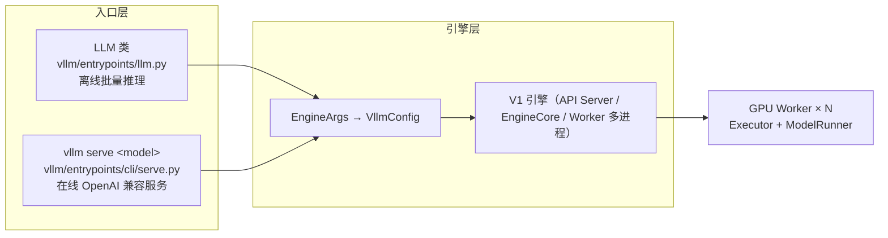

# vLLM 是什么：项目身份与整体架构定位

> 事实层（What / Who / When）。本文回答四个问题：vLLM 是什么、从哪来、怎么用、适合谁。

## 一句话定位

vLLM 是一个**高吞吐、省显存的 LLM 推理与服务平台**（"A high-throughput and memory-efficient inference and serving engine for LLMs"，F-001）。它把三件事做到了极致：用 PagedAttention 把 KV cache 切成块按需分配（F-030），用 continuous batching 让 prefill/decode 请求混编同行（F-034），用 OpenAI 兼容 API 让接入零成本（F-062）。

## 身份卡片

| 项目 | 值 | 出处 |
|------|-----|------|
| 仓库 | https://github.com/vllm-project/vllm | F-002 |
| 本地检出版本 | `v0.32.1rc0-283-g7d5335936c`（2026-10-22） | F-002 |
| 官网 stable 版本 | 0.32.0（另提供 Nightly） | F-003 |
| 许可证 | Apache-2.0 | F-004 |
| 主语言 | Python（引擎）+ C++/CUDA（内核，`csrc/`）+ Rust（部分组件） | F-002 |
| 出身 | UC Berkeley Sky Computing Lab 发起；PyTorch Foundation 托管项目 | F-005 |
| 社区规模 | 2000+ 贡献者（官方口径）；GitHub 95K+ Star、3.8K+ 贡献者（官网 2026-10-22 时点） | F-005/F-006 |
| 核心论文 | Kwon et al., *Efficient Memory Management for LLM Serving with PagedAttention*, SOSP 2023 | F-007 |
| Python 要求 | 官网 3.10+（3.12+ 推荐）；本地 quickstart 标注 3.11–3.14 | F-008 |

## 两大入口

vLLM 的所有能力都收敛到两个入口，其余形态（Docker、Ray、gRPC、批处理）都是它们的部署变体：

- **离线推理**：`from vllm import LLM, SamplingParams`，一次提交一批 prompt，同步拿回 `RequestOutput` 列表。适合批量数据生成、离线评测、合成数据（F-060）。
- **在线服务**：`vllm serve <model>` 启动 HTTP 服务（默认 `http://localhost:8000`），暴露 `/v1/completions`、`/v1/chat/completions` 等 OpenAI 兼容端点，可直接替换 OpenAI API（F-062、F-064）。

两者共享同一套引擎与配置体系：`EngineArgs`（约 3000 行的参数数据类）统一接收全部引擎参数，收敛为 `VllmConfig` 在各类间传递（F-013、F-061）。

## 版本谱系与 V0/V1 之变

- **V0（2023–2024）**：初代架构，PagedAttention 与 continuous batching 的发源地；功能独立演进导致系统复杂化（F-016）。
- **V1（2025-01 alpha，2026 年已成唯一引擎）**：重写调度器、KV cache 管理、worker、采样器与 API server，目标四点——简单模块易修改、近零 CPU 开销、优化统一、零配置默认开启（F-017）。V0 已**完全废弃**（RFC #18571，F-016）。
- **当前（v0.32.x）**：月均一个小版本的快节奏迭代；本束即基于 `v0.32.1rc0` 检出（F-002）。

## 生态位

- **对上**：是 LangChain/LlamaIndex/Dify 等应用框架与 OpenAI SDK 的**兼容后端**（drop-in replacement，F-062）。
- **对下**：通过平台插件覆盖 NVIDIA CUDA、AMD ROCm、Intel XPU/CPU、Google TPU、华为昇腾、AWS Neuron、IBM Spyre、Apple Silicon 等硬件（F-121、F-122）。
- **对同级**：与 llama.cpp（本地/端侧，见 [llama.cpp 知识包](../../llama-cpp-local-inference/index.md)）、SGLang、TensorRT-LLM 构成 LLM 推理引擎的主要选项；vLLM 的差异化在生态广度（200+ 架构、硬件插件）与服务完整度（F-081、F-122）。

## 适用边界

- **适合**：多模型多硬件的统一服务化部署、高并发在线推理、批量离线生成、RL/推理一致性训练场景（F-139）。
- **不适合**：单机单卡的轻量一次性脚本（直接 transformers 更轻）；端侧/移动端（llama.cpp 生态更合适）；对许可证有 Copyleft 顾虑的场景注意依赖组件的许可证（vLLM 本体 Apache-2.0，F-004）。

## 延伸阅读

- [01 快速开始](01-quickstart.md)：十分钟跑通两个入口
- [03 架构总览](03-architecture.md)：入口之下的进程与类层次
- [信源登记簿](../references/facts.md)：本文事实的编号出处
