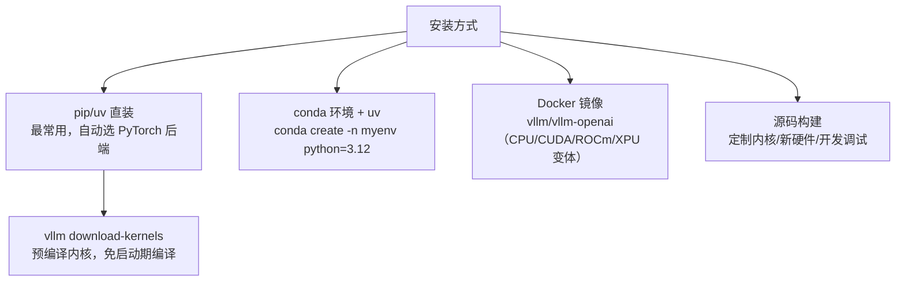

# 安装与硬件平台

vLLM 的硬件策略是「**主仓库统一 API + 仓库外硬件插件**」：主仓库直接支持 NVIDIA/AMD/Intel/CPU，其余加速器由独立插件项目承接（F-121、F-122）。

## 硬件平台矩阵

| 平台 | 支持方式 | 安装入口 | 出处 |
|------|---------|---------|------|
| NVIDIA CUDA GPU | 主仓库一等公民 | `uv pip install vllm --torch-backend=auto` | F-121 |
| AMD ROCm GPU | 主仓库 | `--extra-index-url https://wheels.vllm.ai/rocm/`（ROCm 7.0、glibc≥2.35、Python 3.12） | F-121 |
| Intel GPU（XPU） | 主仓库 | 官方 Docker 镜像（v0.26.0 起），nightly `vllm/vllm-openai-xpu:nightly` | F-121 |
| x86/ARM/PowerPC CPU | 主仓库 | 见安装指南 CPU 页（含 IBM Z S390X） | F-121 |
| Google TPU | 仓库外插件 | `uv pip install vllm-tpu` | F-121 |
| 华为昇腾 NPU | 仓库外插件 | vllm-ascend（依赖 NPU 硬件与 CANN 版本） | F-122 |
| AWS Neuron | 仓库外插件 | vllm-neuron | F-122 |
| IBM Spyre | 仓库外插件 | vllm-spyre | F-122 |
| Intel Gaudi | 仓库外插件 | vllm-gaudi | F-122 |
| Apple Silicon | 仓库外项目 | vLLM-Metal（MLX 后端，需 mlx-community 模型） | F-121 |
| 百度昆仑 XPU / 寒武纪 MLU | 仓库外插件 | vLLM-Kunlun / vllm-mlu | F-122 |

> 官网首页「Universal Compatibility」宣称 "One engine, endless possibilities. Run any model on any hardware"——统一的是 **API 与引擎语义**，不是同一个二进制（F-121）。

## 四种安装方式



1. **uv/pip 直装**（推荐，F-120）：
   ```bash
   uv pip install vllm --torch-backend=auto
   vllm download-kernels
   ```
   `download-kernels` 安装预编译内核；不装则 Hopper 及以上 GPU 会在启动时下载并现场编译，多花数分钟。FlashInfer 随 vLLM 安装但其预编译内核同样需要该命令（F-120）。
2. **conda**：`conda create -n myenv python=3.12 -y && conda activate myenv && pip install --upgrade uv && uv pip install vllm --torch-backend=auto`（F-120）。
3. **Docker**：官方镜像 `vllm/vllm-openai` 系列；ROCm/XPU 提供 nightly 变体（F-121、F-123）。
4. **源码构建**：需要定制 CUDA 内核、启用新硬件或参与开发时使用；入口 `setup.py` + `CMakeLists.txt`（`csrc/` 为 C++/CUDA 内核，`rust/` 为 Rust 组件，F-002）。

## 硬件插件机制

插件遵循仓库内的 [Hardware-Pluggable RFC] 设计（`docs/design/plugin_system.md`）：平台探测（`vllm/platforms/`）、注意力后端、worker 实现均可外挂。新增硬件的官方建议路径是写插件而非改主仓库——联系 Slack（slack.vllm.ai）或 collaboration@vllm.ai（F-122）。

对使用者的含义：

- 主仓库版本与插件版本有兼容矩阵，升级 vLLM 前先查插件仓库的版本支持；
- TPU/Ascend 等平台的功能子集以各自文档站为准（如 TPU 的 recommended models & features 页，F-122）。

## 版本通道选择

- **Stable（0.32.0）**：当前测试最充分、受支持的版本，生产默认（F-003）。
- **Nightly**：追新特性/硬件支持，接受更高波动（F-003）。
- **本地检出（0.32.1rc0）**：release candidate，本知识包的源码口径（F-002）。

## 常见坑

| 现象 | 原因与处理 |
|------|-----------|
| 启动慢数分钟且日志在编译内核 | 未执行 `vllm download-kernels`（F-120） |
| `The provided PTX was compiled with an unsupported toolchain` | CUDA 驱动与 PyTorch 后端版本不匹配，按官网 troubleshooting 调整 `--torch-backend`（F-003） |
| ROCm 安装失败 | 检查 ROCm 7.0、glibc≥2.35、Python 3.12 三前提（F-121） |
| 昇腾/TPU 行为与文档不符 | 插件版本与主仓库版本错位，以插件仓库矩阵为准（F-122） |

## 延伸阅读

- [01 快速开始](01-quickstart.md)：CUDA 环境十分钟闭环
- [12 分布式推理与扩展](12-distributed.md)：多机多卡的部署参数
- [13 进阶主题](13-advanced.md)：Docker/生产栈与 PD 分离部署
