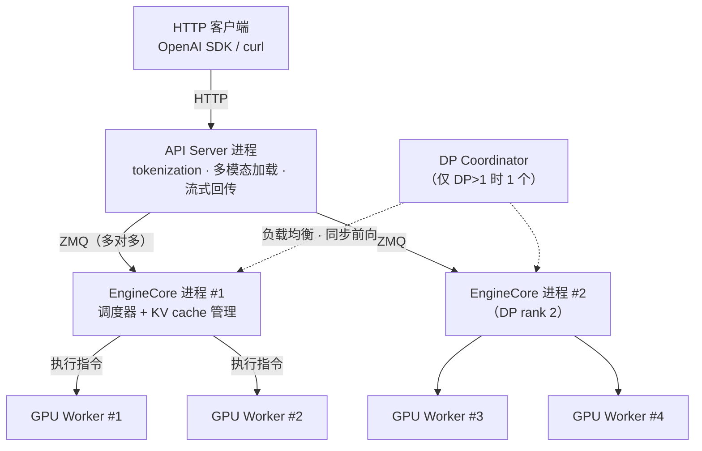
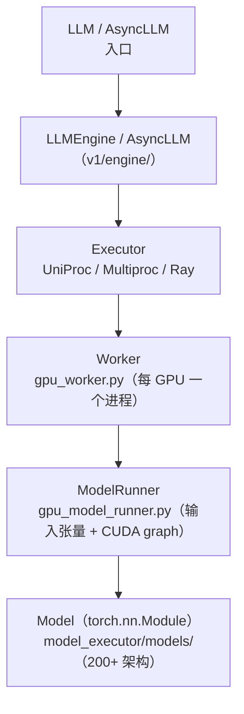
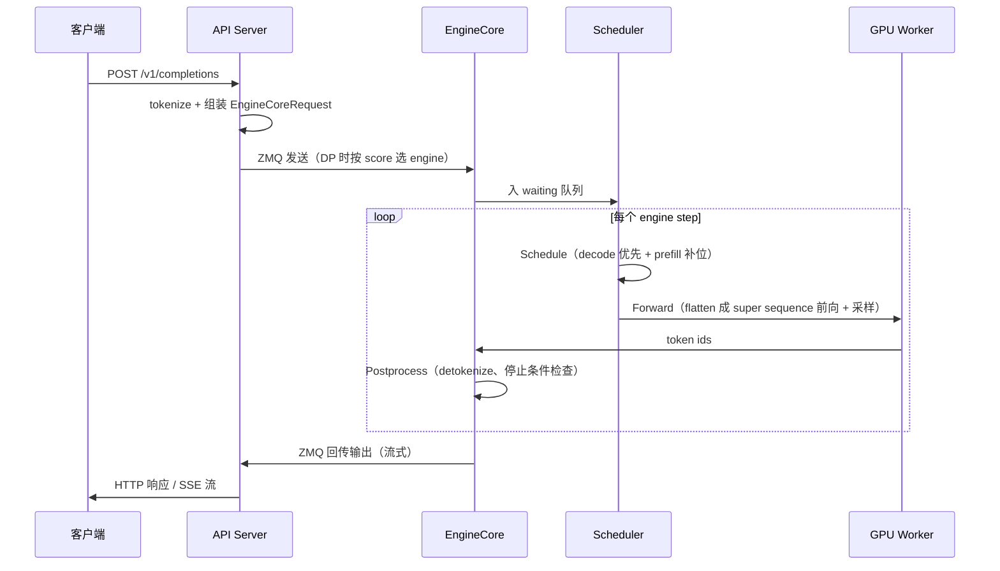

# 架构总览：入口、进程与类层次

vLLM V1 用**多进程分离关注点**换取吞吐与可维护性：HTTP 与输入处理、调度与 KV 管理、GPU 执行各自独立成进程，经 ZMQ 消息队列连接（F-010、F-012）。本文给出进程模型、类层次与请求生命周期三张地图。

## V1 进程架构



四类进程的职责与计数（F-010）：

| 进程 | 职责 | 计数 |
|------|------|------|
| **API Server** | HTTP 请求、输入处理（tokenization、多模态数据加载）、结果流式回传 | 默认 1；DP 时自动扩到 DP 个，也可 `--api-server-count` 手动设 |
| **EngineCore** | 运行调度器、管理 KV cache、协调模型执行的 busy loop | 每 DP rank 1 个 |
| **GPU Worker** | 加载模型权重、执行前向、管理 GPU 显存 | 每 GPU 1 个（= DP × PP × TP） |
| **DP Coordinator** | DP rank 间负载均衡、MoE 同步前向 | DP>1 时 1 个，否则 0 |

计数公式：**Total = A + DP + N（+1 if DP>1）**，其中 N = DP × PP × TP = GPU 总数（F-011）。

两个官方算例（F-011）：

- 单节点 4 卡 `vllm serve -tp=4`：1 API server + 1 engine core + 4 GPU worker = **6 进程**；
- 8 卡 `vllm serve -tp=2 -dp=4`：4 API server + 4 engine core + 8 GPU worker + 1 DP coordinator = **17 进程**。

通信拓扑：每个 API server 经 ZMQ 连接**所有** engine core（多对多），任一 API server 可把请求路由到任一 engine core；API server 内多个媒体加载线程由 `VLLM_MEDIA_LOADING_THREAD_COUNT` 控制（默认 8）（F-010、F-012）。

## 类层次与三大设计选择

源码位置：`vllm/entrypoints/llm.py`（LLM）、`vllm/v1/engine/`（async_llm/core/llm_engine）、`vllm/v1/executor/`、`vllm/v1/worker/`、`vllm/model_executor/models/`（F-002）。



设计选择一：**单一配置对象 VllmConfig**。所有类从同一个 `VllmConfig` 读取自己关心的配置，它实质是「引擎级全局状态」。新增特性只需在 `VllmConfig` 加字段，不必改引擎/Worker/模型的构造函数签名（F-013）。

设计选择二：**统一模型构造签名**。所有模型（含多模态子模型）统一为：

```python
def __init__(self, *, vllm_config: VllmConfig, prefix: str = ""):
```

keyword-only 强制杜绝旧式传参；`prefix` 用于按 state-dict 名字差异化初始化（如非均匀量化、vision/language 子模型）（F-014）。仓库外老模型用 shim 类适配（F-083）。

设计选择三：**初始化时切分与量化权重**。TP 切分与量化发生在权重创建时而非加载后——405B 模型（约 810GB 权重）在 16×H100 上每卡只需加载约 50GB 分片，避免「全量加载再切分」的翻倍显存（F-015）。

## 请求全生命周期

以一个 `curl /v1/completions` 为例（F-060、F-041、F-113）：



DP 部署时 API server 的选路打分公式为 `score = len(waiting) * 4 + len(running)`，取最小者（F-113）。

engine step 内部恒为三段（F-041）：

1. **Schedule**：决定本步跑哪些请求——先给 running 队列的 decode 请求分配 KV slot，再用剩余 token 预算从 waiting 队列纳入（chunked）prefill；
2. **Forward pass**：Worker/ModelRunner 执行前向并采样；所有序列被 **flatten 拼成一条 super sequence**，靠 position 索引与 attention mask 隔离——这是 continuous batching 免 right-padding 的关键（F-034）；
3. **Postprocess**：追加 token、detokenize、检查停止条件（长度上限、EOS、`stop_token_ids`、stop strings），完成的请求释放 KV block 回块池。

停止条件细节：`stop_token_ids` 会出现在输出里，stop strings 不会（输出截断到首次出现处）（F-041）。

## 与 V0 的关键差异

| 维度 | V0 | V1（当前） |
|------|-----|-----------|
| 引擎状态 | 已完全废弃（RFC #18571） | 唯一引擎（F-016） |
| 调度 | prefill/decode 分离步骤 | 统一调度器混合同一步（F-018） |
| chunked prefill | 按模型条件启用 | 默认尽可能开启（F-019） |
| CUDA graph 显存 | 较小 | 占用更多（F-019） |
| logprobs 语义 | 处理后概率 | 默认原始 raw logprobs（`--logprobs-mode` 可调，F-019） |
| prompt logprobs + 前缀缓存 | 可缓存 | 不缓存，重算全量 prefill（F-019） |

## 延伸阅读

- [04 调度与批处理](04-scheduling.md)：Schedule 段的细节
- [05 KV 缓存与 PagedAttention](05-kv-cache.md)：块池与哈希复用
- [06 执行层：Executor 与模型运行](06-execution.md)：Forward 段的细节
- [12 分布式推理与扩展](12-distributed.md)：TP/PP/DP 如何映射到上述进程
