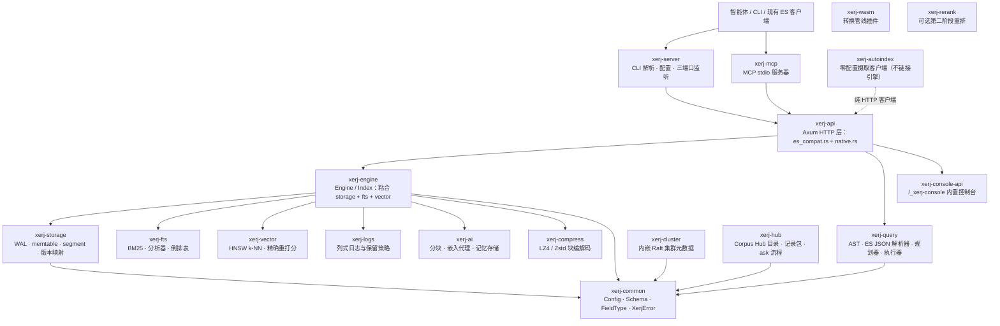

# XERJ 整体架构

XERJ 是一个用 Rust 从零实现的 AI 原生搜索引擎，同时覆盖向量检索与日志分析，以 Apache-2.0 发布，交付形态是**一个静态二进制**（61.6 MB，含神经嵌入后端；F-013）。它不共享 Elasticsearch 或 Lucene 的任何代码与架构（F-007），但实现了 Elasticsearch 8.x 的 HTTP 线协议，作为零迁移的接入桥梁（F-008）。

## 定位：ES 兼容是传输层，不是产品

这是理解本项目最重要的一件事。`docs/WHY_XERJ.md` 的副标题就是「为什么『兼容 Elasticsearch』是这台引擎最不有趣的部分」（F-010）。XERJ 自己给出的设计出发点是：一个拿到陌生数据的 AI 智能体，面对经典搜索引擎解决不了的三个问题（F-011）：

| 智能体的问题 | XERJ 的答案 | 经典搜索引擎的对应物 |
|---|---|---|
| 入库（Onboarding） | `xerj autoindex <folder>`——内容嗅探、流式抽取、类型推断、显式映射、幂等 id、junk 记录但从不致命、`kill -9` 可恢复 | 人工设计映射 + Logstash/Beats 管线 |
| 定位（Orientation） | `xerj autoindex map` + `autoindex-catalog` 索引：数据集、计数、每字段类型与示例值、带证据的跨数据集关联、开箱即用的查询、引擎记录的坑 | 只有 `_cat/indices` |
| 连续性（Continuity） | `/_memory/{ns}`——写入/召回、命名空间、语义召回、去重、元数据过滤、新近度混合 | 需要自己搭 |

因此评估 XERJ 的正确顺序是：先跑旗舰回路（`autoindex` → `autoindex map` → 查询），再讨论 DSL 覆盖度。反过来做（先测 ES 兼容性）会得出「又一个 ES」的结论，并错过它真正稀缺的部分。

> **反常识**：一致性套件通过了 ES 8.x YAML 的 1366/1369 个用例（F-149），这很自然会让人把它读成「Rust 写的 ES」。但一致性命中的只是**语法面**；XERJ 真正稀缺的是 ES 没有的那三件（无映射设计的摄取、面向智能体的目录与字段图、命名空间记忆）。

## crate 分层

工程根在 `engine/`，共 18 个 crate（F-002），Rust 代码 521,684 行、552 个源文件（F-003、F-004）。按职责分层如下（F-016、F-017）：



> `docs/ARCHITECTURE.md` 的 crate 职责表只列了 **16 行**（15 个 crate + `tests/es-compat-yaml` 测试 harness），**`xerj-hub` 与 `xerj-mcp` 不在该表内**（F-016）——读官方架构文档时容易漏掉这两个 crate。

四个值得单独记住的边界：

- **`xerj-autoindex` 不链接 `xerj-engine`**（F-027）。它是一个纯 ES 兼容 HTTP 客户端，因此可以指向真实 Elasticsearch，也可以与引擎分开升级，并且无法拖垮服务端。
- **`xerj-cluster` 的 Raft 只管集群元数据**，不承载数据（F-017）；数据面是单机 LSM 风格结构。
- **`xerj-hub` 承载 Corpus Hub**（目录、记录包、`xerj ask` 流程），它不与索引引擎耦合，而是与「语料」打交道。
- **`xerj-rerank` 是唯一在搜索期外呼的组件**，且它不被 `xerj-engine` 链接（`docs/ARCHITECTURE.md:63`），因此可以整体摘除而不影响核心检索。

## 运行形态：三个并发端口

服务器入口启动三个并发 TCP 监听（F-018）：

| 端口 | 协议 | 用途 |
|---|---|---|
| :9200 | HTTP | ES 兼容表面（`_search`、`_bulk`、`_cat`、kNN、`hybrid`…） |
| :8080 | HTTP | 原生 REST API（`/v1/systemone` 等） |
| :8081 | gRPC（明文 h2c） | `XerjSearch` 服务 |

进程在 SIGTERM 或 SIGINT 上优雅关闭（F-019）。除 HTTP 表面外，还提供一个绕过 HTTP 栈直接摄入 NDJSON 的 `index` 子命令（F-020）——它绕开 axum、hyper、tokio 请求调度与 bulk 响应序列化，是最快的摄入路径。

### 分配器不是细节

`xerj-server` 在非 MSVC 目标上把 jemalloc 设为全局分配器（F-021），Linux 下的运行参数为 `background_thread:true,dirty_decay_ms:1000,muzzy_decay_ms:1000`（F-022）。理由记录在源码注释里：6,200 万条记录批量装载下，glibc malloc 保留已释放的堆页不归还给 OS，匿名 RSS 每摄入一条文档增长约 4–5 KB（15.5M 文档时 83 GB），直至被内核 OOM 杀死；开启后台线程与 1 秒脏页衰减后，同样的负载保持工作集 RSS 持平，摄入吞吐代价在噪声内（F-023）。

> 这是「读源码读出运维事故」的一个例子：分配器配置在源码里只有一行，但它的存在理由是一次数千万级文档的 OOM。

## 搜索路径

一个搜索请求自前向后经过四个 crate（F-078）：

```
POST /{index}/_search
  → xerj-api      Axum handler（es_compat.rs）
  → xerj-query    parse_request()：ES JSON → SearchRequest（QueryNode 树）
  → xerj-engine   Engine::get_index() 定位索引
  → xerj-engine   Index::search()
       ├─ memtable scan        内存 BM25（ShardedFtsMemtable）
       ├─ segment scan         磁盘 FTS（FtsIndexReader + BM25）
       ├─ doc_matches_query()  term 级 / geo 谓词求值
       ├─ run_aggs()           聚合管线（size:0 走列式快速路径）
       └─ apply_source_filter()、apply_highlight()
  → SearchResult → JSON
```

两条关键性质：

1. **查询同时匹配内存 memtable 与磁盘 segment，结果合并**（F-079），所以刚写入的文档立即可检索，不需要等待 flush。
2. **命中物化有上界**：对 `size > 0` 的请求，只物化前 `from + size` 个候选（F-080），避免为整条结果集分配内存。

## 摄取路径

写入经 WAL 进入分片 memtable，再 flush 成不可变 segment，最后由后台合并压实（F-082）：

```
PUT /{index}/_doc/{id}   或   POST /_bulk
  → xerj-api → xerj-engine → xerj-storage（IndexStore）
       ├─ WAL append        分片 Mutex<WalWriter> + 全局 AtomicU64 seq_no
       ├─ storage memtable  向上取整到 2 的幂的哈希分区
       ├─ FTS memtable      engine.ingest_shards 哈希分区
       ├─ flush             按分片 fan-out，每个分片排出并写不可变 segment
       │                    （含 FTS / doc-values 边车，LZ4/Zstd 块）
       └─ merge             后台合并压实小 segment；_forcemerge 同步且静默
```

分片数是三个**互相独立**的域：WAL writer 分片、向上取整后的存储 memtable 分区、以及 FTS memtable 分区（F-084）。`engine.ingest_shards` 被校验为非零且不超过 256 的 2 的幂（F-083）。文档没有承诺它们一一对应——这是一个容易被误读为「bug」的地方，实际上是刻意的域分离。

## 恢复

重启时引擎无外部协调器即可从磁盘重建状态（F-085）：

```
Engine::new() 扫描 data_dir/
  → 每个索引目录：Index::open()
       ├─ IndexStore::open()   把 WAL 重放进存储 memtable
       ├─ WalReader::replay()  从 WAL 条目重建 FTS memtable
       └─ doc_count = segments + memtable
```

这条路径解释了一个常见困惑：为什么 `doc_count` 是「segment 数 + memtable 数」而不是磁盘上的文件数——因为最近写入的数据还在 memtable 里。

## 兼容边界

ES 8.x 线协议的实现面覆盖 indices、documents、bulk、search、aggregations、mappings、kNN、scroll、reindex 与 `_cat` 端点，Kibana 与官方客户端库可直接连接（F-152）。一个必须知道的边界：**scroll 是有界的前置快照而非逐 segment 游标**——精确总数超出快照窗口的查询被拒为 400 而非静默截断，任意大小的结果集应使用 `search_after`（F-153）。

一致性门禁是**零失败**语义：通过与跳过的总数会随上游套件变化，判定应基于失败数而非固定总数（F-151）。基准方面，最新闭环对拍（对照 live Elasticsearch 8.13.4）得分 55 胜、26 平、4 负，含 1.72 倍摄入吞吐与 1.61 倍更小的磁盘占用（F-154）；四处失败全部集中在「高写入速率下运行的读 p99」这一格，并被完整写出而非略去（F-155）。详见 [07 ES 兼容与基准诚实性](/concepts/07-es-compat-and-benchmarks.md)。

## 学习路径导览

本 bundle 的 `concepts/` 按「入门 → 核心 → 进阶」分三段组织：

- **00 整体架构**（本文）→ 建立「ES 兼容是传输层」的心智模型
- [01 安装与快速上手](/concepts/01-getting-started.md) → 跑通第一个索引与查询闭环，理解信任边界
- [02 autoindex 零配置流水线](/concepts/02-autoindex-pipeline.md) → 一个文件夹如何变成类型化索引
- [03 MCP 智能体接口](/concepts/03-mcp-agent-surface.md) → 智能体如何接上它
- [04 检索路径与响应裁剪](/concepts/04-search-query-path.md) → 查询怎么走、结果怎么裁
- [05 向量、嵌入与混合检索](/concepts/05-vector-and-hybrid.md) → 向量从哪来、什么时候准
- [06 智能体记忆与第二大脑](/concepts/06-agent-memory-and-brain.md) → 跨会话的连续性
- [07 ES 兼容与基准诚实性](/concepts/07-es-compat-and-benchmarks.md) → 兼容到什么程度、哪里会输
- [08 参考编码与语料库](/concepts/08-reference-coding.md) → 把别人的代码变成自己的语料

若目标仅是**让智能体接上本地检索**，读 00 → 01 → 03 → 04 即可；若要**评估能否替掉 Elasticsearch**，加读 02、07；若做**编码类智能体**，加读 05、08。

## 相关概念

- [01 安装与快速上手](/concepts/01-getting-started.md)：信任边界、CLI 全景与认证
- [02 autoindex 零配置流水线](/concepts/02-autoindex-pipeline.md)：摄取侧的完整机制
- [03 MCP 智能体接口](/concepts/03-mcp-agent-surface.md)：智能体接入面
- [07 ES 兼容与基准诚实性](/concepts/07-es-compat-and-benchmarks.md)：兼容边界与记分卡
- 事实来源：[事实清单](/references/facts.md)
- 架构剖析：[架构洞察](/references/insights.md)
