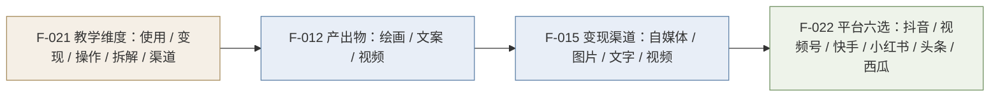

# 变现渠道与平台资源

> **本篇层级**：**事实层 + 结构层**。登记材料给出的变现分类与平台范围，并**明确标出材料的留白**；本篇不做方法论补足。
> **信源距离**：课程方**自宣型**。变现方法与收益均为主体自述/承诺性陈述。

## 一、四类变现方式

材料在"增加副业收入"条（F-015）中给出四类变现方向：

| # | 类别 | 材料措辞 | 层级 |
|---|------|---------|------|
| 1 | **自媒体变现** | 做自媒体变现 | 〔承诺性陈述〕 |
| 2 | **图片类变现** | 图片类变现 | 〔承诺性陈述〕 |
| 3 | **文字类变现** | 文字类变现 | 〔承诺性陈述〕 |
| 4 | **视频类变现** | 视频类变现 | 〔承诺性陈述〕 |

> **留白事实**：材料**只给类目名，不给任何一条具体路径**——没有说明收入来源形式（广告分成/带货/接单/知识付费/版权授权）、没有给出定价或佣金结构、没有说明冷启动门槛、也没有区分四类之间的难度差异。任何"AI 自媒体月入 X 万"式推演都**不属于本材料的内容**。

## 二、六个目标平台

材料列举六个平台（F-022）：

| # | 平台 | 内容形态（推断） | 材料是否展开 |
|---|------|----------------|-------------|
| 1 | **抖音** | 短视频 | ❌ |
| 2 | **微信视频号** | 短视频（社交裂变） | ❌ |
| 3 | **快手** | 短视频 | ❌ |
| 4 | **小红书** | 图文 + 短视频 | ❌ |
| 5 | **今日头条** | 图文 + 微头条 | ❌ |
| 6 | **西瓜视频** | 中长视频 | ❌ |

> **内容形态列为推断**：材料未说明各平台的适配内容类型；"推断"列由平台本身的内容形态特性推导，**不得作为材料主张引用**。
> **选型逻辑（推断）**：六平台中四个以短视频为主（抖音/视频号/快手/西瓜）、两个以图文为主（小红书/头条），覆盖了国内主流的**内容分发 + 流量变现**两类路径，且**均为低门槛入驻**。这一组合与材料"人人都能做"的定位自洽。

## 三、两套分类的对齐缺口

材料在两处使用了**不同维度**的分类体系：

| 出处 | 分类维度 | 类目 |
|------|---------|------|
| F-012（第一节） | **产出物形态** | AI 绘画 / AI 原创文案 / AI 原创视频 |
| F-015（第二节） | **变现渠道** | 自媒体 / 图片 / 文字 / 视频 |
| F-021（第三节） | **教学维度** | AI 使用 / 变现方法 / 软件操作 / 案例拆解 / 平台资源渠道 |

> **缺口性质**：三套分类**只有 F-012 与 F-015 在"图片/绘画"和"视频"两项上近似重合**，"文案"与"文字"可视为同义，但**F-012 的"AI 绘画"在 F-015 中没有独立对应的变现通道**（图片类变现是否即绘画？未说明）。材料从未说明"用什么产出物 → 发到哪个平台 → 通过哪种机制收钱"这条完整链路。**读者无法从本材料推导出可执行的动作序列**——这直接决定了本 bundle 不设 `examples/`（骨架判定见 [03-self-claim-verification-pattern.md](03-self-claim-verification-pattern.md) §五）。

## 四、课程目标到变现链路的映射

材料给出的教学五维度与上述变现要素的对应关系：

| 教学维度（F-021） | 对应变现链路要素 | 材料覆盖度 |
|------------------|----------------|-----------|
| AI 的使用 | 产出物生成（绘画/文案/视频） | ❌ 未展开 |
| 软件的操作 | 工具链选择 | ❌ 未展开（无任何工具名） |
| 案例的拆解 | 可复制的作品范式 | ❌ 未展开 |
| 变现的方法 | 四类变现的机制 | ⚠️ 仅列名 |
| 多平台的资源渠道 | 六平台清单 | ✅ 已列名 |

> **覆盖度小结**：五维度中仅"资源渠道"被实质列出，"变现方法"止于类目名，其余三项完全空缺。**课程真正承载知识的位置是三天的直播课，而不是这份导学材料**。

## 五、与本库既有 AI 变现资产的分工

本库已有两束同主题资产，本 bundle 与它们**互补而非重复**：

| 束 | 层级 | 回答的问题 | 与本篇关系 |
|---|------|-----------|-----------|
| **本束** | **课程事实层** | 某门具体 AI 变现课**宣称**教什么、覆盖哪些平台 | — |
| [ai-monetization](../../../../../sheke/industry/ai-monetization/index.md) | 方法层 | 按 13 章流程**怎么做**（市场分析→商业模式→技术选型→产品→营销→定价→三大场景→实施） | 本束只给平台与类目，方法层的流程**不重复** |
| [monetization-essence](../../../../../sheke/industry/monetization-essence/index.md) | 本质层 | 变现**是什么**、为什么能变现、七条公理与 133 种方案目录 | 本束的"四类变现"属渠道层分类，本质层给出的是**上位的价值-通道映射**，可作其上位解释 |

> **互链价值**：本篇的四类变现（自媒体/图片/文字/视频）在本库中可对应到 `monetization-essence` 的**变现通道分类学**（concepts/03-channel-taxonomy.md）；该束的合规红绿区（concepts/04-compliance-zones.md）对本篇"只列名不展开"的变现路径构成重要补充——**本材料未提示任何合规约束**。

## 六、本篇边界

- **收益无任何数据**：四类变现均无收益区间、无案例、无统计口径。
- **无平台规则**：无入驻条件、无算法逻辑、无分成机制、无违规红线（合规问题见 `monetization-essence` 的红绿区）。
- **无工具清单**：材料提到"软件的操作"维度，但正文未出现任何 AI 工具名称、模型名称或版本号。
- **两套分类不对齐**：见 §三，该缺口是材料本身的结构缺陷，非本 bundle 的转述遗漏。
- **「2026 AI 赚钱的元年」（F-038）不可核验**：无独立出处，属承诺性陈述，不作事实引用。
