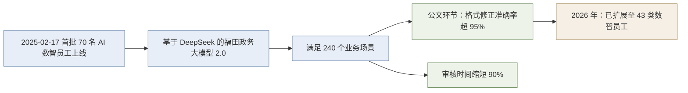

# 政策与产业信号（含企业家引语核验）

> **本篇层级**：**机制层**（Why）。材料用"最近发生的大事"为学习动机做支撑，这一层的事实可被独立核验；而把事实串成"所以你现在学 AI 就能赚钱"的推演属**课程方洞察**，与事实严格分层。
> **本篇的处理原则**：**只保留核实后的表述**，源文口径留档于 [verification.md](../references/verification.md) §二。

## 一、深圳"AI 公务员"事件（全文最重要的量化论据）

### 1.1 源文口径与核实值

| 项 | 源文（F-025） | 核实值 | 编号 |
|---|---------------|--------|------|
| 人数 | 首批 **70 名**上岗 | 70 名"AI 数智员工" | F-040 |
| 场景 | 覆盖场景 **240 个** | 官方口径"首批满足 **240 个业务场景**使用" | F-041 |
| 错误率 | **错误率控制在 5% 以内** | 该数字**仅限公文处理环节**：格式修正准确率**超 95%**、审核时间**缩短 90%** | F-042 |
| 时间 | 列入"2026 年最近发生的大事" | **2025-02-17** 上线 | F-040 |
| 技术底座 | 未提及 | 深圳市福田区政务大模型 **2.0 版**，基于 **DeepSeek** 开发 | F-040 |
| 后续规模 | 未提及 | 截至 2026 年，福田区已上线 **43 类** AI 数智员工（民生诉求助手、AI 办公智能体、"福小 i"等），构建超级智能体生态 | F-043 |

### 1.2 为什么这组数字值得单列

这是全材料中**唯一一组可被完整核验的三层数字**（人数 / 场景数 / 质量指标），也是唯一能支撑"AI 已进入真实政务生产环节"而非"AI 只是个概念"的论据。其核验后的事实链比源文更强：

> **解读边界**：这组数字证明的是**"政务场景中已存在可量化的 AI 落地"**，它**不**证明"学 AI 就能赚钱"——两者之间隔着材料完全未展开的"技能 → 作品 → 流量 → 收入"链路（见 [01-monetization-channels.md](01-monetization-channels.md) §三的缺口分析）。

## 二、政策三件套

| # | 文件 | 核实后的关键表述 | 日期 | 编号 |
|---|------|----------------|------|------|
| 1 | **2026 年政府工作报告** | 十四届全国人大四次会议于 **2026-03-05** 审议通过；首提"**打造智能经济新形态**"，部署"**深化拓展『人工智能+』**" | 2026-03-05 | F-044 |
| 2 | **"十五五"规划纲要**（2026—2030） | 于 **2026 年 3 月**发布；含"**促进模型算法迭代创新**"专节，提出鼓励**多模态、智能体、具身智能、群体智能**等技术创新 | 2026-03 | F-045 |
| 3 | **国资委深化央企"AI+"专项行动** | 首次部署会议在 **2025-02**；**2026-03** 召开深化部署会，并发布央企人工智能战略性高价值场景等成果 | 2025-02 / 2026-03 | F-046 |

> **三项均 ✅ 通过 P0 核验**（P0-1/P0-2/P0-6）。材料把三份文件并置为"政策支持"论据是**成立**的。
> **但配文越界**：材料在政策事实之后紧接"**AI 将成为未来 10 年的两大红利方向**"（F-026）——该表述**未检索到任何权威出处**，属源文自造，却以政策口吻呈现，使读者误以为这是政策结论（勘误 7）。

## 三、央视网 AI 作品

| 项 | 源文（F-036） | 核实值 | 编号 |
|---|---------------|--------|------|
| 作品形态 | 央视网全流程 AI 文生视频 + AI 配音，意象含"云雾缭绕、松石峥嵘、红墙金瓦、一城一景" | 权威对应物为两部：**《大美中国》云南风景篇**（大纲到画面脚本用 ChatGPT 生成、画面及图生视频用 EQMJ 生成）与**《AI 春晚》龙年特供节目**（采用声音克隆技术实现旁白） | F-052 |
| 结论 | —— | ✅ 作品存在性与"全流程 AI"属性成立；但源文视频与公开作品**未能逐一对应** | —— |

> **方法论价值**：《大美中国》云南风景篇的生成链路（**ChatGPT 写脚本 → EQMJ 图生视频**）是可复现的"人机分工"样本——但材料只给了成品画面，**未给出任何工具名或步骤**。

## 四、四位企业家引语：逐条核验与更正

这是本 bundle 证据质量最薄弱的环节。材料以四段短视频配四段引语构成"权威背书"，经核验的结果如下：

| 人物 | 源文身份标注 | 核实后身份 | 引语核实结论 | 处理 |
|------|------------|------------|-------------|------|
| **雷军** | 全国人大代表 | 2026 年**确为**全国人大代表 ✅ | 「会用 AI 就是机会」近似出处为**2025 年初**受访表述；2026 年两会建议主题为**人形机器人从"学徒工"转向"正式工"** | 拆为两条独立事实分别标注时间 |
| **马云** | **阿里巴巴集团总裁** ❌ | 阿里巴巴集团**合伙人**；主席蔡崇信、CEO 吴泳铭 | 「AI 比互联网风口大 **100 倍**」**未检索到可靠原始出处** ❌ | 不引为企业家原话；改引吴泳铭 2026-09-22 云栖大会"机器思考总量达人类 1000 倍以上"（F-048） |
| **任正非** | **华为手机老总**（非正式头衔） | 华为创始人 | 原始形态为"社会最终要走向人工智能的，**不接受教育的人连做工人的机会都没有**"（2019 年央视采访语境） | 引用原始形态并标注 2019 年语境 |
| **周鸿祎** | **360 浏览器创始人** ❌ | **360 集团创始人** | 「最有力的能力增强器」**未检索到逐字出处**；2026 年作为全国政协委员的公开表述为"人工智能本质是人类智能的延伸，是工具而非主体" | 修正身份 + 改用可核验的 2026 年表述 |

> **模式识别**：4 段引语中 **1 段完全无法核验**、**3 段为改写压缩或无法逐字定位**；4 处身份标注中 **2 处错误**（"阿里巴巴集团总裁""360 浏览器创始人"），另 2 处使用非正式或模糊称谓（"华为手机老总""全国人大代表雷军"作为话题标签）。这组特征指向一个结论：**材料是二手转述整理，不是原始采访汇编**。详见 [03-self-claim-verification-pattern.md](03-self-claim-verification-pattern.md) §四的反模式 2 与反模式 3。

## 五、课程方归纳的"AI 三大特性"

材料归纳了 AI 的三项特性（F-032），这是课程方**自己的框架**（非引用他人）：

| # | 特性 | 材料表述 | 性质评估 |
|---|------|---------|---------|
| 1 | **可用性** | 从顶级企业家到普通员工、老百姓，任何层次都可使用的工具 | 合理的**普及性判断**，但"任何层次"未给边界 |
| 2 | **易用性** | 无需技术背景、无需 AI 背景，不限年纪与学历，且做出的效果"非常好" | 前半成立；**"效果非常好"属不可核验断言** |
| 3 | **进化性** | 实时迭代更新、自我学习、修复迭代 | 前半成立（模型确实持续更新）；**"自我学习"作为能力描述模糊**，未区分"持续训练"与"人工反馈迭代" |

> **框架价值**：这三项特性在功能上等价于"**低门槛 + 持续进化**"的普及性论证，与"任何人任何时候都能用"的定位自洽，是材料中少数**内部逻辑自洽且无外部依赖**的自造框架。
> **框架缺口**：三项特性回答的是"**为什么人人都能学**"，但**没有回答"学了能赚到什么"**——收益侧完全交给 F-015/F-023/F-038 的承诺性陈述承担。

## 六、第四次工业革命类比

材料称当下处于"**第四次工业革命**入口"，以大数据、人工智能、物联网等信息技术为基础的"超连接"，比作下一个"**互联网 20 年**"的机遇（F-037）。

> **性质**：修辞类比，**无事实对应物**，不作核验。
> **逻辑地位**：这是材料中**唯一一处显式的宏观因果推演**——它承担了"把分散时事串成一条趋势线"的叙事功能。其成立与否，取决于读者是否接受"技术周期=个人机会窗口"这一隐含等式，而该等式在材料中**从未被论证**。

## 七、本篇边界

- **政策不等于收益**：三份政策文件的表述均已核实，但"政策推动 AI → 学 AI → 赚钱"这条链路的中间环节（技能积累、作品产出、平台分发、收益实现）在材料中完全缺失。
- **引语不可作权威背书**：即便引用属实，本材料使用引语的目的是**制造共识感**而非传递可核验信息；引语本身也不构成任何可操作的判断依据。
- **产业案例的覆盖极窄**：唯一的量化案例来自**政务**场景，与材料主打的**自媒体变现**场景之间无迁移依据。
- **无竞争视角**：材料不含任何关于 AI 变现赛道竞争强度、平台政策变化、AI 工具同质化的事实或判断，读者会低估"门槛低=竞争同样低"这一反面事实。
