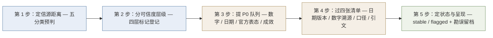

# 自宣材料五步核验

> **模式层级**：**L1 可迁移模式**（方法论层）。本篇不是对导学材料内容的转述，而是**从本次核验过程中逆向萃取的通用作业规程**——下次遇到任何"课程方/厂商自宣型材料"时照此执行。
> **实证基础**：本 bundle 的 53 条 F 编号、13 项 P0 核验、7 则勘误与 `status: flagged` 判定，构成模式的全部证据来源。

## 一、模式定义

| 项 | 内容 |
|---|---|
| **模式名** | **自宣材料五步核验** |
| **一句话** | 面对自宣型材料，**先定信源距离 → 再分可信度层级 → 再提 P0 队列 → 再过四张清单 → 最后定状态**，任何一步跳过都会把宣传话术当事实沉淀。 |
| **解决什么问题** | 自宣材料天然携带"可信外观"：有名人引语、有政策背书、有精确数字、有可视化成果图。这些要素**看起来像证据，但它们的生成动机是说服而非描述**。本模式提供把"说服性材料"降维为"可消费事实"的作业规程。 |
| **不解决什么** | 不判断材料所推销的产品/课程**好不好**；只判断材料中**哪些陈述能被独立证实**。 |

## 二、触发场景

### 适用于

- **课程方/培训机构**的导学材料、宣传册、直播预告、社群资料
- **厂商/供应商**的产品发布稿、白皮书、案例集、效果汇报
- **招商/加盟/代理**宣传材料、收益测算表
- **投资路演**材料、融资 BP 中的市场与成效数据
- **用户评价汇编**、"XX 亲测有效"类合集
- 任何**由利益相关方自己生产**、但将被当作第三方信息消费的文档

### 不适用于

- **作者一手实测**（自己写的教程、自己的实测报告）——其数据本身就是一手证据，不需要"降维"
- **纯第三方综述**（媒体深度报道、行业白皮书 by 无利益方机构）——信源距离已是第三档，按常规事实登记即可
- **一手代码/官方文档**——以"可运行/可复现"为准，不走可信度分级
- **用户自行发起的咨询**（"帮我看看这份材料靠谱吗"）——属问答而非知识沉淀

> **判别开关**：问一句「**这份材料的作者是否从我说这句话中获益？**」——是 → 走本模式；否 → 不走。

## 三、核心五步

### 第 1 步：定信源距离（五分类预判）

把材料归入五档之一，并**在 bundle 顶部写明**：

| 档位 | 含义 | 默认核验强度 |
|------|------|------------|
| 官方发布 | 一手机构的正式发布物 | 事实登记 + 关键项核验 |
| 作者一手实测 | 作者自用工具的实测数据 | 事实登记 + 注明不可外推 |
| 开源项目文档 | 仓库 README / 官方文档 | 一手直读核验 |
| 第三方综述 | 无利益方的媒体/机构综述 | 常规核验 |
| **厂商/机构自宣** | **本文档所属档位** | **所有成效数字默认 P0 必核验** |

> 本案例实证：材料为**课程方自宣型**（招生/开课预热用途），故全部成效数字、学员成果、收益承诺一律视为**主体自述**，并据此在 bundle index 顶部加"自宣数据"提示块。

### 第 2 步：分可信度层级（四层标记）

对**每一条**陈述打标，不允许有无标记的句子混进正文：

| 层级 | 定义 | 举例 |
|------|------|------|
| 〔公共事实〕 | 可由独立权威来源核验的客观陈述 | 深圳首批 70 名 AI 数智员工上线 |
| 〔主体自述〕 | 材料方对自身课程/产品/成果的陈述 | 课程时长三天、平台清单六个 |
| 〔转述引语〕 | 经视频或口播转述的他人言论 | "马云说 AI 比互联网风口大 100 倍" |
| 〔承诺性陈述〕 | 面向受众的收益/效果承诺 | "越早学习越早受益""2026 是 AI 赚钱的元年" |

> **关键纪律**：**主语不等于信源**。材料写"雷军谈 AI"，主语是雷军，但**信源是课程方的二手转述**——故必须标〔转述引语〕而非〔公共事实〕。这一区分是本模式拦截最多误判的一环。

### 第 3 步：提 P0 队列

自宣型材料的 P0 判定标准（**穷举式，不依赖直觉**）：

- **数字类**：人数、场景数、准确率、错误率、倍数、金额、时长
- **日期类**：上线日、发布日、政策生效日、事件年份
- **官方表态类**：领导人/高管/机构对企业或技术的定调
- **成效类**：提效倍数、节省工时、成本下降、学员/用户成果
- **身份类**：人物头衔、机构职级、产品归属

> **身份类必须入队**：本案例的 3 处头衔错误（"阿里巴巴集团总裁""360 浏览器创始人""华为手机老总"）若不入 P0，将直接进入正文而不被发现。

### 第 4 步：过四张清单

| 清单 | 查什么 | 典型失误 |
|------|-------|---------|
| ① 日期/版本表 | 事件年份、政策发布日、产品版本 | 旧事件并入"今年最近发生的大事" |
| ② 成效数字溯源表 | 每个数字的**原始出处** | 无出处的倍数；把环节指标当总体指标 |
| ③ 口径对照表 | 数字的地域/时间/统计口径限定词 | 环节准确率 → 全局错误率 |
| ④ 引文逐字核对表 | 引语原文 + **发言人身份** | 改写压缩；头衔张冠李戴 |

> **四张清单的关系**：①②防"时间与数字失真"，③防"口径拔高"，④防"人物与话语失真"。四者**不可互相替代**——本案例中①②各命中 1 处、③命中 2 处、④命中 4 处，分布均匀说明缺一张就会漏一类。

### 第 5 步：定状态与呈现

| 判定条件 | 状态 | 附加动作 |
|---------|------|---------|
| P0 全部通过，或失败项**非核心声明** | `stable` | 勘误必须完整落实 |
| P0 出现 ❌ 且失败项为**核心声明**（主结论/主推事实） | **`flagged`** | ① verification.md 顶部明示 ② index.md 已知边界提示 ③ index 顶部加"自宣数据"提示块 ④ `stale_after` 前安排复核 |

**呈现纪律（三条同时成立）**：

1. **源文错误不静默照搬**——正文呈现**核实后的正确值**，源文口径留档于 verification.md。
2. **不可核验内容只登记存在性**——如本案例的 20 个视频与 5 张图片：记录"存在"，不判断"内容为真"。
3. **承诺性陈述不作事实核验**——收益承诺进承诺队列，不进 P0 队列，避免把"无法证伪"误判为"已证伪"。

## 四、反模式（6 条，均来自本案例实证）

| # | 反模式 | 本案例表现 | 后果 | 正确做法 |
|---|-------|-----------|------|---------|
| 1 | **权威感当证据** | 用 4 位知名企业家引语充当"AI 有价值"的论据 | 4 段引语中 1 段**完全不可核验**、3 段无法逐字定位，论据强度≈0 | 引语只作氛围材料；论据必须换成可核验数字（如深圳政务 AI 三层数字） |
| 2 | **头衔抄错不核** | "阿里巴巴集团总裁""360 浏览器创始人""华为手机老总" | 人物身份错误会直接摧毁整份材料可信度 | 身份入 P0 队列；核到官方领导页/官网 |
| 3 | **引语改写压缩** | 任正非原话"不接受教育的人连做工人的机会都没有" → "你不学习连做工人的机会都没有" | 主语与条件双重偷换，读者以为近期表态 | 引用原始形态并标注原始语境年份 |
| 4 | **环节指标放大为总体** | "错误率控制在 5% 以内"实为公文环节**准确率** | 把局部最优读成系统级可靠，风险判断反转 | 口径对照表逐项限定词核对 |
| 5 | **时间错位** | 2025-02-17 上线的深圳 AI 公务员，被列入"2026 年最近发生的大事" | 读者误判趋势起点与新鲜度 | 日期表逐项核对到发布日 |
| 6 | **自造表述伪装成政策结论** | "AI 将成为未来 10 年的两大红利方向"紧跟在政策文件事实之后 | 读者把自造观点误记为政策原话，本 bundle 自身也会污染 | 自造表述必须显式标注为材料主张，禁止裸引 |

> **反模式对等**：6 条反模式**每一条都有本案例的具体实例与编号**，可回溯到 [verification.md](../references/verification.md) 与 [article-source.md](../references/article-source.md)，而非通用说教。

## 五、骨架判定：本案例为何不设 `examples/`

OKF bundle 是否设 `examples/` 取决于**操作可复现性两问**，两问皆"否"时不设：

| 两问 | 本案例答案 | 依据 |
|------|-----------|------|
| **问一**：读者能否照材料做出**可复现的具体成果**（安装/配置/代码/调用流程）？ | **否** | 全文无任何工具名称、模型名称、版本号、界面说明或案例文本；五维度中三项完全空缺 |
| **问二**：读者能否照材料**完成一次完整操作**（输入→步骤→输出）？ | **否** | 三套分类互不对齐（见 [01-monetization-channels.md](01-monetization-channels.md) §三），"产出物→平台→变现机制"链路断裂 |

→ **骨架判定**：只建 `concepts/` + `references/` + `index.md` + `log.md`，**不建 `examples/`**。

> **通用化**：自宣型材料天然倾向"只讲可能性不讲步骤"，故多数课程宣发类 bundle 都应落到同一骨架。`examples/` 的存在与否由**读者可复现性**决定，**不由材料篇幅或商业价值决定**——这是本模式的直接推论。

## 六、检验标准（做完怎么知道做对了）

| # | 检查项 | 通过标准 | 本案例实测 |
|---|-------|---------|-----------|
| 1 | P0 队列闭合 | 每项 P0 都有 ✅ / ⚠️ / ❌ 结论，❌ 项逐条列明 | ✅ 13/13 闭合（7 / 5 / 1） |
| 2 | 勘误落实 | 每处 ⚠️ 在**正文**呈现核实值，且源文口径在 verification.md 留档 | ✅ 7 则勘误全部落实 |
| 3 | 身份核验 | 所有人物头衔均有权威出处或显式标注为原文口径 | ✅ 4 位人物全部更正 |
| 4 | 不可核验内容处理 | 只登记存在性，不作内容判断 | ✅ 20 视频 + 5 图片仅记存在性 |
| 5 | 承诺性隔离 | 收益承诺与事实分表登记，不混入事实清单 | ✅ 4 条承诺性陈述独立标记 |
| 6 | 状态自洽 | `status` 与 P0 失败项是否核心声明一致 | ✅ ❌ 命中核心声明 → `flagged` |
| 7 | 提示块到位 | 自宣型材料的 bundle index 顶部有"自宣数据"提示块 | ✅ 已置顶 |
| 8 | 骨架自洽 | `examples/` 的取舍可用两问复现 | ✅ 两问皆否 → 不设 |

## 七、跨场景迁移示例

**场景迁移 1：某 SaaS 厂商的产品发布稿**

- 第 1 步：厂商自宣 → 全部成效数字入 P0
- 第 3 步：「效率提升 300%」「准确率 99.2%」「已服务 5000+ 企业」全部入队
- 第 4 步②：查每个数字的原始出处——若仅见于厂商自身页面且无第三方复现 → 标〔主体自述〕，正文加"厂商自述数据"提示
- 第 4 步④：查客户引语——**客户方是否真的说过**（与本案例的企业家引语同构）
- 第 5 步：核心成效不可核验 → `flagged`

**场景迁移 2：某加盟招商手册的"月入 3 万"测算**

- 第 2 步：整张收益测算表标〔承诺性陈述〕
- 第 4 步③：口径对照——"月入 3 万"是流水还是净利？投入多少？回本周期多长？
- 结论：收益承诺不作事实核验，但**必须**在正文标明"此为招商方测算，非历史实绩"——这一步即使不做 P0 核验也必须做

**场景迁移 3：某知识付费社群的用户好评汇编**

- 第 1 步：社群方自宣 → 进入本模式
- 第 2 步：每条好评标〔转述引语〕，**截图不构成证据**
- 第 4 步④：抽查引语是否可定位到原始发言；无法定位的降级为"未证实反馈"

> **三例与本案例的共同结构**：所有失败点都落在同一处——**用"看起来像证据的呈现形式"（引语/数字/截图/政策）替代"可核验的事实来源"**。

## 八、成熟度与局限

| 项 | 说明 |
|---|------|
| **成熟度** | **L1（已在真实案例完整执行一次）**——13 项 P0、7 则勘误、`flagged` 判定、骨架取舍均有可回溯产出物 |
| **样本量** | 单一案例（1 份课程导学材料）。已在 3 个非 AI 变现场景做迁移推演，**尚未在真实项目复现** |
| **未覆盖** | ① 视频/音频内容的**转写级核验**（本案例因无转写文本而整体不可核验，若源材料含字幕则可大幅提升覆盖率）② 学员效果图片的**图像内容核验**（本案例不适用）③ 付费墙内材料的**合规获取路径** |
| **下一步** | 在第二份自宣材料上复现，把本模式从 L1 升到 L2（跨案例验证后固化为可复用 SOP） |

> **模式登记位置**：本模式为本 bundle 内部产出，**未**写入 `docs/retrospective/patterns/methodology-patterns/` 方法论模式库——按 SpecWeave 治理规则，跨案例验证（L2）后才具备入库资格。
