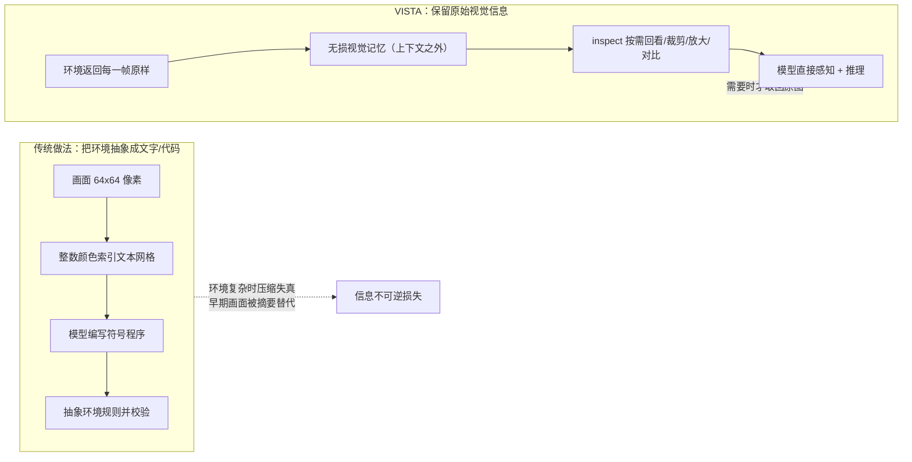

# 00 · VISTA 总览

## 一句话

**VISTA 是 MIT 团队（何恺明等）提出的一个"视觉原生 Harness"**：它不训练任何模型，而是把交互环境返回的每一帧原样保存到上下文之外，并给模型配一套"按需回看"的工具，让通用多模态模型获得**长时程视觉**（long-horizon vision）[F-001][F-002][F-060]。

论文坐标：arXiv:2610.02200《VISTA: A Visual Harness for Reasoning in an Interactive World》，2026-10-01 提交，MIT，CC BY 4.0，代码以 MIT License 开源于 `github.com/joshhhhhan/VISTA` [F-045][F-075]。

**作者**：Qiushi Han、Keya Hu、Linlu Qiu（前三位为共同第一作者）、Cathy Wu、Kaiming He，均属 MIT [F-042][F-046]。其中 Qiushi Han 在 MIT 运筹研究中心名录上登记名 **Josh Han**，导师 Cathy Wu [F-043]。

## 它要解决的问题是什么

### 问题 1：既有做法把世界压缩成了文字

在 ARC-AGI-3 这类交互式视觉基准上，已有的主流思路是**先把画面转换成由数字组成的文本网格**（以整数颜色索引逐行编码），再让模型编写程序来模拟环境规则、验证行动方案——即所谓基于代码的世界模型 [F-017][F-061]。

论文指出这条路线的根本困难：**环境越复杂，物体的外观、空间关系和动态变化就越难被完整地转化成文字和代码** [F-018]。文字网格能表达"哪个格子是红"，却很难表达"这个红色小方块的朝向标记是什么"——而后者恰恰可能是通关的关键细节。

### 问题 2：上下文会淘汰掉"还没被注意到"的细节

随着交互历史变长，早期的观察**可能被移出上下文，或被文字摘要替代** [F-018][F-062]。这带来一个不对称难题：

> **模型第一次看到一张图时，未必知道哪个细节会在后面变得重要** [F-015]。

如果记忆机制在写入时就要决定"什么值得记住"，它就必须提前知道后面会需要什么——而这是做不到的。视觉信息也很难提前用一份文字笔记完整记录下来，更难保证后续执行任务时记录的信息依然够用 [F-016]。

### VISTA 的研究问题表述

> 如何在不额外训练基础模型的情况下，让智能体在推理需要时，重新检查过去看到的视觉信息？[F-019]

论文摘要给出的答案是"给通用多模态模型长时程视觉" [F-060]，方法层面则是三组件的组合 [F-024]——详见 [01 三组件机制](01-visual-harness-components.md)。

## 与传统做法的根本分野

两条路线不是互斥的技术选型，而是**信息保真度与可编程性之间的权衡**：博文的概括是"相比传统将环境抽象成文字或代码的做法，VISTA 保留原始的视觉信息"[F-003]。

| 维度 | 文本网格 + 代码世界模型 | VISTA 视觉原生 Harness |
|------|------------------------|---------------------|
| 环境表示 | 离散、可执行、可校验 | 原始像素、不可程序化 |
| 细节保真 | 受限于颜色索引与程序表达能力 | 无损保留每一帧 |
| 可验证性 | 强（程序可运行验证） | 弱（依赖模型自身推理） |
| 上下文成本 | 低（文本压缩比高） | 需外部存储，但上下文侧只放最后一帧 [F-032] |
| 额外训练 | 无 | 无 [F-054] |

> **解读（假设）**：两条路线并非取代关系。VISTA 论文 §4.2 表 1 也列出 program-synthesis 类对比系统（Schema 95.35、Retrodict 99.86、Tycho 100.00），说明在 ARC-AGI-3 上"写程序"路线同样能达到满分水平 [F-077]。VISTA 的主张是**另一条同样有效的路径**，尤其适用于视觉细节不可预先形式化的环境。

## 边界：它不是什么

- **它不是新模型**。§3.2 明确："The harness is purely mechanical and **does not involve any trained model**"——它只执行模型请求的工具调用、返回图像或像素值、对无效请求报错 [F-054]。环境理解、行动规划和推理仍由现成的多模态模型完成 [F-034][F-035]。
- **它不是"视觉经验自动变强"**。模型不会因为看过更多帧就获得新能力；变化的是模型**获取、保存和使用视觉信息的方式** [F-035]。机制上，模型"可根据眼下的问题，将过去看过的画面重新调入上下文，参与当前的判断与推理"[F-004]，视觉经验因此成为"模型随时调用、反复检查的上下文"[F-005]。
- **它不保证在未见题目上同样有效**。论文 §6 自己承认：所用模型在公开基准之后发布，**无法排除这些游戏已被纳入训练数据**；在 ARC-AGI-3 私有集上评估才是更强的泛化检验 [F-068]。这一条博文完全未提及，是解读"满分 100"时不可省略的前提，详见 [05 局限与实践](05-limitations-and-practice.md)。
- **它不等于"通用多模态能力已达人类水平"**。基准所有者 ARC Prize 明确：公开集分数**永不进入官方榜**，公开集评估"绝不能视为 AGI 进展的有效度量"，社区榜成绩自报且不予核验；官方自己开源的 harness 仅以**人类回放**就能在全部公开环境上取得 100% [F-084]。

## ARC-AGI-3 是什么（读数字前先看这里）

ARC-AGI-3 是一套**交互式**视觉推理基准 [F-084]：

| 项 | 规格 |
|----|------|
| 画面 | **64×64** 网格，每格取自 **16** 种颜色之一 |
| 结构 | 每个环境**至少 6 关** |
| 动作 | 5 个关键动作 + **Undo**（回到上一状态） |
| 规则 | **不预先给出**游戏规则与目标——智能体须通过观察和行动自行摸索 |
| 数据集 | 公开 25 / 半私有 55 / 完全私有 55；私有集刻意与公开集分布外 [F-074] |

> **为什么它难**：基准不告诉你规则，也不告诉你目标。你只能通过"看画面 → 试一个动作 → 看结果"来推断世界模型——这正是传统文字网格路线的用武之地，也是 VISTA 的用武之地。

## 头条结果（先看数字，再看限定）

| 模型 | ARC-AGI-3 公开 25 局 | RHAE 得分 | 官方实现基线 |
|------|-------------------|----------|--------------|
| Claude Opus 5.0（xhigh）+ VISTA | 全部通关 | **100.00** | 40.68（high，官方协议）[F-047][F-077] |
| GPT-5.6 Sol（max）+ VISTA | 全部通关 | **99.00** | 13.33（同模型同 effort）[F-049][F-077] |
| GLM-5.3 Flash 320B（开源权重） | — | 66.93 | — [F-063] |

> **对照时注意**：40.68 与 100.00 之间不只差 harness，还差推理强度（high vs xhigh）与评测协议（官方 5× 动作预算 / 12 小时 vs 2,000 动作 / 48 小时）[F-077][F-079]。严格同模型同 effort 的对照是 **Sol(max) 13.33 → 99.00**。

RHAE（Relative Human Action Efficiency）是 ARC-AGI-3 的官方指标，计分口径与"满分 100"的含义见 [03 ARC-AGI-3 结果](03-arc-agi3-results.md)。

> **限定（必读）**：ARC Prize 官方明确"永不把任何系统的公开集分数登入官方榜"，公开集评估"绝不能视为 AGI 进展的有效度量"，且官方自己开源了一个**以人类回放即可得 100%** 的 harness [F-084]。因此"满分 100"的意义不在分数本身，而在"**不用程序合成也能达到这个水平**"。

## 下一步

- 想了解**具体怎么实现** → [01 三组件机制](01-visual-harness-components.md)
- 想了解**记忆如何组织与交接** → [02 记忆与上下文](02-memory-and-context.md)
- 想看**完整实验与消融** → [03 ARC-AGI-3 结果](03-arc-agi3-results.md)

## 相关

- [AI 工程方法论]](../../../practice/ai-engineering-methodology/index.md)：Harness 工程与 Agent 评测谱系——VISTA 是"上下文工程 + 视觉记忆"路线的实证样本
- [MiniT2I 极简像素空间文生图]](../../minit2i/index.md)：同为何恺明团队的视觉表征研究，可对照"极简化"与"保真化"两种取向
- [Agent Lightning]](../../agent-lightning/index.md)：同为 harness 范式工作，可对照"harness 参与训练"与"harness 只做编排"两条路线
- [事实登记](../references/article-source.md) · [核验与勘误](../references/verification.md) · [知识地图](../references/knowledge-map.md)
