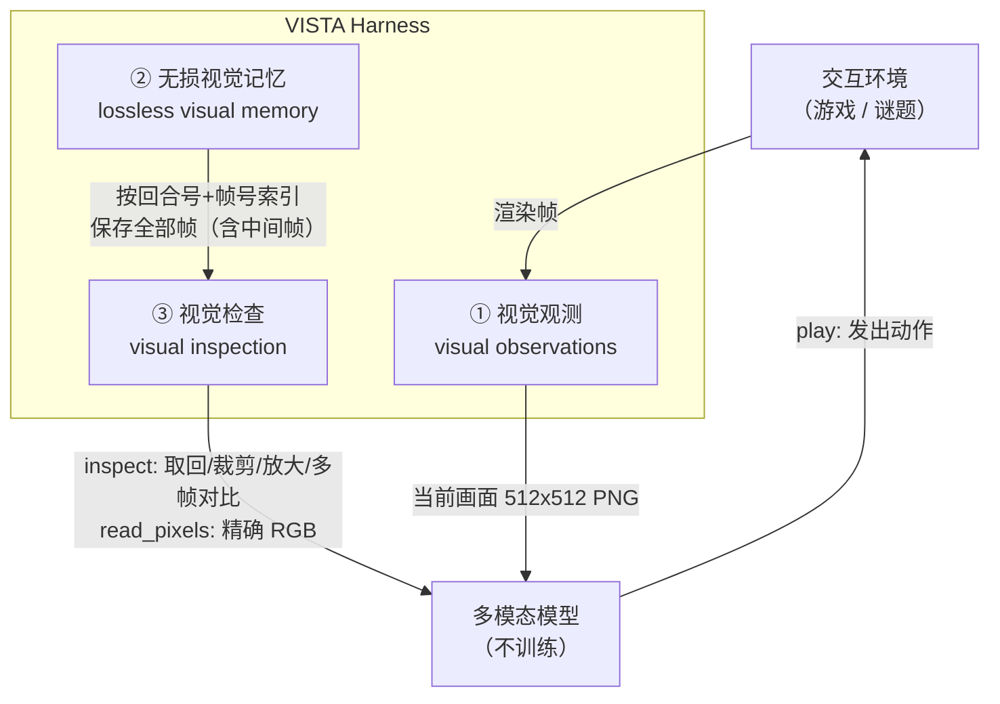

# 01 · 三组件机制

> **术语提示（勘误 E-1）**：量子位博文把第三个组件写作"**主动视觉检查**"，论文 §3.1 的官方名称是 **visual inspection（视觉检查）**，图 3c 标注为 *model-directed visual inspection*。本文按论文原词呈现。

## 组件全貌

论文 §3.1 原文给出三个组件及其分工：

> "We introduce three key visual harness components: **visual observations**, which allows the agent to perceive the environment through rendered images; **lossless visual memory**, which preserves visual observations in their original form; and **visual inspection**, which allows the model to revisit visual evidence and examine details as needed." [F-050]

三者的关系是：**观测负责"进来"，记忆负责"留住"，检查负责"再用"**。

## ① 视觉观测（visual observations）

让 Agent 通过渲染出的图像直接感知环境。

- **分辨率处理**：在 ARC-AGI-3 实验中，VISTA 会把官方提供的 **64×64** 画面放大为 **512×512** 的 PNG 图像，同时保留物体的颜色、外观和空间关系 [F-025]。论文 §4.3 给出精确口径：Agent 接收当前渲染状态的 512×512 PNG 图像，由官方 64×64 帧经 **8× 最近邻放大**得到 [F-055]。
  - **解读（假设）**：为什么是最近邻而非插值——最近邻不引入新颜色值，网格边界与原始像素值一一对应，避免模型看到"插值出来的颜色"后按不存在的规则推理。这是本束的推断；论文只给出"8× 最近邻"这一事实，未解释选择理由。项目页另提到单元格之间加一像素网格线，**该细节论文未载**。
- **上下文侧成本**：默认每次动作后**只向模型呈现最后一帧** [F-032][F-070]。

## ② 无损视觉记忆（lossless visual memory）

论文 §3.1：

> "The harness stores **every frame returned by the environment, including intermediate animation frames, in its original form**… Each frame is indexed by turn and frame number and remains available throughout the interaction, **independently of what is retained in the model's current context**." [F-051]

三个关键性质：

1. **全量**：连动作过程中的动画中间帧也保存 [F-020][F-026]。这意味着模型可以回看"动作是怎么一步步发生的"，而不只是动作前后的两个静止画面 [F-052]。
2. **原始形式**：不压缩、不重编码、不做摘要。像素级的细节被完整保留。
3. **在上下文之外**：记忆的存活不依赖模型当前上下文是否还有空间——即使某一帧早已被上下文淘汰，它仍在档案里等待调取。

> **解读（假设 M1）**：全量存储之所以必要，源于"首次观察无法预知后续哪个细节会变重要"（[F-015]）。任何在写入时就要决定"什么重要"的记忆机制（摘要、文本网格）都必须提前猜对，而保留原始形式是对冲这一不确定性的唯一办法。代价是存储成本上升，收益是"未来可能需要"的期权。

## ③ 视觉检查（visual inspection）

模型主动调取历史视觉证据的工具集。附录 A.4 算法 1 给出 `inspect(question, views) -> images` 的签名，每个 view 形如 `{label, turn, frame=final, region=full}`，其中 `region = {x, y, w, h}`，每个 view 返回一张图。

工具集完整清单（附录 A.4 算法 1）[F-083]：

| 工具 | 作用 |
|------|------|
| `inspect(question, views) -> images` | 取回历史帧；`view = {label, turn, frame=final, region=full}`，`region = {x, y, w, h}`，**每个 view 返回一张图** |
| `read_pixels` | 返回选中像素的**精确 RGB 数值** |
| `history` | 无损保存并允许 Agent **主动回看任意历史帧** |

论文 §3.1 把 `inspect` 的能力分成两个维度：

| 维度 | 能力 | 论文表述 |
|------|------|---------|
| **跨时间（across time）** | 取回任意早期回合的多帧、比较状态、重放动作的中间动画帧 | "retrieve and inspect multiple frames from arbitrary earlier turns… to revisit past visual evidence, compare states, and replay how an action unfolded through its intermediate animation frames" [F-052] |
| **跨空间（in space）** | 请求任意矩形区域的放大视图 | "request an enlarged view of any rectangular region" [F-052] |

此外还有一个独立工具 **`read_pixels`**，返回**精确的 RGB 值**——当模型需要确认"这个格子到底是不是纯红"时，不必靠视觉判断。

对应到博文的表述：通过 `inspect` 工具，模型可以指定某个历史回合调出对应画面，也可以裁剪、放大局部区域检查细节；还能一次调出多帧画面，对比动作前后的变化 [F-027]。在 ARC-AGI-3 评测中，VISTA 既能比较不同时刻的画面，也能放大局部，检查小方块上的朝向标记 [F-021]。

## "显式注意力"：三组件合起来提供的东西

论文 §3.1 明确指出，三组件共同构成：

> "an **explicit attention mechanism over the interaction history**, allowing it to select which frames and regions to examine during reasoning." [F-059]

§4.4 进一步称之为 **re-attention mechanism**，并以定性案例说明 Agent 如何从中获益。博文把这一机制的价值概括为：视觉经验成为模型"随时调用、反复检查的上下文"[F-005]，而"既保留了完整的视觉信息，也避免大量历史图片持续占用上下文空间"[F-033]（作者观点）。

**注意**：这是一个**语境层机制**，不是模型能力层机制。论文 §3.2 明确 Harness "does not involve any trained model" [F-054]——模型不会因此学会新的视觉能力，改变的是模型**能看到什么、能看到多细**。

## 执行流程中的使用位置

论文描述的每回合循环，与博文表述一致 [F-028][F-029]：

1. **观察**：读取当前画面与可用动作；
2. **形成假设**：结合此前积累的经验，判断当前环境状态，提出下一步行动的假设；
3. **取证**（信息不足时）：调用 `inspect` 回看历史画面、放大局部区域，甚至读取具体像素值；
4. **预测**：不直接行动——先预测本次操作可能带来什么变化；
5. **执行并对比**：动作执行完毕后，将实际结果与预测对比，检查判断是否正确；
6. **修正**：据此修正对游戏规则的理解。

第 4-6 步是"预测—执行—对比"的闭环，与单纯的"看到就走一步"有本质区别：它把每次动作变成一次**可证伪的实验**。

## 上下文侧的三条约束

| 约束 | 内容 | F |
|------|------|---|
| 默认只给最后一帧 | 每次动作后只呈现最终帧，中间帧全部归档 | [F-032][F-070] |
| 记忆独立于上下文 | 档案中的帧不因上下文淘汰而丢失 | [F-051] |
| 交接摘要 | 上下文接近上限时先整理交接摘要再进入新窗口；文字笔记、动作历史、视觉档案都保留 | [F-031] |

## 下一步

- 记忆如何与文字笔记配合、如何交接 → [02 记忆与上下文](02-memory-and-context.md)
- 三个组件的消融贡献各是多少 → [03 ARC-AGI-3 结果](03-arc-agi3-results.md)

## 相关

- [事实登记](../references/article-source.md) · [核验与勘误](../references/verification.md) · [知识地图](../references/knowledge-map.md)
