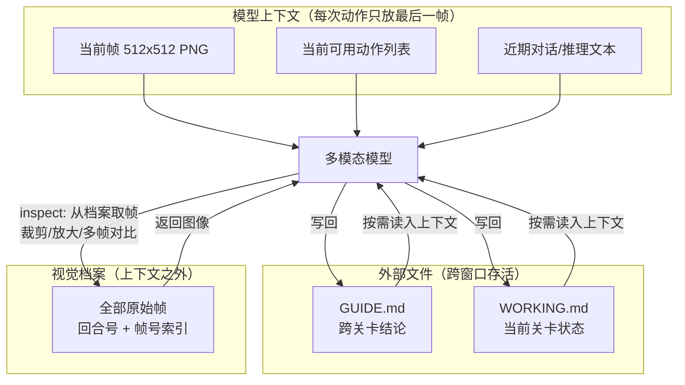

# 02 · 记忆结构与上下文管理

## 三层记忆

VISTA 的记忆不是一块，而是**三个生命周期不同的载体**：

| 层 | 载体 | 内容 | 生命周期 | F |
|----|------|------|---------|---|
| 原始证据层 | **无损视觉档案** | 环境返回的每一帧原始图像（含动画中间帧），按回合号 + 帧号索引 | 全程可用，随上下文压缩而保留 | [F-020][F-026][F-051] |
| 结论沉淀层 | **GUIDE.md** | 对环境的理解、跨关卡（乃至跨会话）仍可能有用的规则与经验 | 跨关卡、跨会话保留 | [F-030][F-053] |
| 当前状态层 | **WORKING.md** | 当前关卡的状态、进度与后续计划 | 临时状态；跨 RESET 与上下文重启保留，**关卡推进后清空** | [F-030][F-053] |

论文附录 A.2 的分工表述最为清楚：

> "GUIDE.md stores **reusable knowledge about the game across levels and sessions**, while WORKING.md stores **temporary state and plans for the current level**." [F-053]

论文附录 A.4 进一步说明 WORKING.md 的边界：它在 RESET 与上下文重启时被保留，但**关卡推进时清空** [F-053]。

## 为什么"证据"和"结论"必须分开存

这是 VISTA 设计中最容易被忽视、却最有迁移价值的一点。

博文的表述是：

> 文字笔记记录模型当前的理解，原始画面保留供它重新判断的证据 [F-022]。

这句话点出了两种不同性质的信息：

- **结论**（文字）："第三关的跳台高度是 2 格"——可压缩、可继承、跨关卡有用，但压缩必然有损；
- **证据**（像素）："第三关第 7 次跳跃中那个小方块的朝向标记"——不可压缩，但**只有在需要时**才值得占用注意力。

如果只保留结论，就回不到原始证据去复核一个错误的结论——模型会"确信"一个被摘要扭曲过的观察。如果只保留证据，模型每次都要重新扫全量帧才能提取规则，成本不可接受。

> **解读（假设 M4）**：三层结构的真正价值不在于"记得更多"，而在于**给每类信息配了匹配的清理策略**。把三者混在一个笔记文件里，必然出现"上下文越滚越大但有效信息不增"——因为原始证据无法被压缩，却又从不清理。

## 上下文交接：换窗口时不丢东西

当上下文接近上限时，模型先整理一份**交接摘要**，再进入新的上下文窗口继续执行任务 [F-031]。

交接时保留下来的东西有三类：

1. **文字笔记**（GUIDE.md 的跨关卡知识 + WORKING.md 的当前状态）
2. **动作历史**
3. **视觉档案**（全部原始帧）

三类都保留，是 VISTA 与"只有对话历史"式 Agent 的关键差别——交接时**不会**因为上下文换窗而丢失"我之前看到过什么"。

## 上下文预算的三层分工

**预算策略**：上下文侧只放最后一帧 [F-032]，把"可能有用但现在不需要"的画面全部推到档案里；档案的取回由模型自己决定何时发起。这正是"显式注意力"的落地形式——模型自己决定现在要回看哪一帧、哪个区域 [F-059][F-023]。

## 与 Anthropic harness 笔记法的同构

VISTA 的双笔记结构与 Anthropic 2025-11 的 harness 做法在**结构上同构**，介质不同：

| 维度 | Anthropic《Effective harnesses for long-running agents》 | VISTA |
|------|--------------------------------------------------|-------|
| 未完成事项 | `feature_list.json` 特性清单（每项标记为 failing 等状态） | WORKING.md：当前关卡状态、进度与计划 [F-030] |
| 已完成工作 | `claude-progress.txt` 进度文件 + git 提交历史 | GUIDE.md：跨关卡可复用的规则与经验 [F-030] |
| 跨窗口衔接 | "finding a way for agents to quickly understand the state of work when starting with a fresh context window" | 交接摘要 + 笔记与视觉档案全部保留 [F-031] |

**归因边界（勘误 E-2）**：Anthropic 该文确实发布于 2025-11-26，内容与博文的转述吻合——该 Harness "通过任务清单记录尚未完成的事项，通过进度文件和代码记录保存已经完成的工作"[F-011][F-012] [F-072]——博文的"去年 11 月"表述**成立**。但必须指出：**VISTA 论文并未引用该文**，其 64 条参考文献中唯一的 Anthropic 出处是 Claude Opus 5 的模型公告 [F-071]。因此"Anthropic 的 harness → VISTA 的视觉 harness"是**博主的叙事承接**，不是论文主张的引用关系。博文进一步断言这类文字/代码 harness "在一定程度上推动了这一波 Agent 能力的爆发"[F-013]——这是**作者观点**，本束不作事实结论使用。

> **解读（假设 M4 的迁移）**：把 VISTA 的三层结构与 Anthropic 的两层笔记法并置，可以看出一个可复用的设计模式——**凡是需要跨上下文窗口/跨任务存活的信息，都应该落在外部文件而非上下文里**；而落在外部之后，仍需按"结论 vs 证据"分层，因为两者的压缩比与清理时机完全不同。

## 可迁移实践（摘自知识地图迁移层）

| 编号 | 做法 | 检验标准 |
|------|------|---------|
| T1 | 对不可预判重要性的信息，保留原始形式 + 提供检索工具 | 需要"三个月前某张图的某个像素"时，能否在有限步内取回 |
| T2 | 按生命周期把记忆拆成"跨任务结论 / 当前任务状态 / 原始证据"三类，分别定义清理策略 | 上下文体积是否随任务时长线性增长；有效信息占比是否下降 |
| T3 | 评测 Agent 时固定模型、只换 harness | 结论能否表述为"在同一模型上，编排带来 X 提升" |
| T4 | 引用基准满分类结论时强制附带"限定三件套" | 他人能否独立复述而不被误导 |
| T5 | 区分"论文主张 / 媒体转述 / 执行者解读"三层 | 读者能否分辨哪句是作者说的、哪句是我说的 |

> 完整的适用/不适用边界与检验标准见 [知识地图 · 迁移层](../references/knowledge-map.md)。

## 下一步

- 三组件的消融贡献与完整实验数据 → [03 ARC-AGI-3 结果](03-arc-agi3-results.md)
- 这套结论能迁移到哪些环境、边界在哪 → [04 跨基准验证](04-cross-benchmark-validation.md)

## 相关

- [AI 工程方法论]](../../../practice/ai-engineering-methodology/index.md)：Harness 工程与上下文工程的谱系定位
- [planning-with-files 像 Manus 一样工作]](../../../practice/planning-with-files/index.md)：3-File Pattern 文件系统外存——与本篇"笔记 + 视觉档案"外存思路可对照
- [事实登记](../references/article-source.md) · [核验与勘误](../references/verification.md) · [知识地图](../references/knowledge-map.md)
