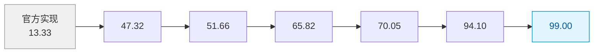

# 03 · ARC-AGI-3 结果与计分口径

## 主结果

| 模型 / 方案 | 完成情况 | RHAE | 动作数 | F |
|------------|---------|------|--------|---|
| **Claude Opus 5.0 + VISTA** | 25/25 公开游戏全部通关 | **100.00** | 7,302 | [F-047][F-048] |
| 人类参考（首次游玩） | 25/25 | 100（参照系） | 17,135 | [F-048] |
| 官方实现 + Opus 5.0 | — | 40.68 | — | [F-047][F-064] |
| **GPT-5.6 Sol + VISTA** | 25/25 公开游戏全部通关 | **99.00** | — | [F-049] |
| 官方实现 + GPT-5.6 Sol | — | 13.33 | 10,619 | [F-064] |
| GLM-5.3 Flash 320B（开源权重）+ VISTA | — | 66.93 | — | [F-063] |

论文摘要原文：

> "VISTA improves Claude Opus 5.0's Relative Human Action Efficiency score from **40.68** to a perfect **100.00**, with the model completing all **25** public games using **57.4% fewer actions** than first-time human participants." [F-047]

动作数对照：VISTA 共用 **7,302** 个动作，比人类参考的 **17,135** 个动作少 **57.4%** [F-048]。

> **限定（勘误 E-5）**：博文只说"满分 100"，未给基线。补上基线才能看清提升幅度：Opus 5.0 从 40.68 → 100.00，GPT-5.6 Sol 从 13.33 → 99.00。

## RHAE 是什么：官方计分口径

RHAE（Relative Human Action Efficiency，读作 "ray"）是 ARC-AGI-3 的**官方**指标 [F-073]：

| 规则 | 内容 |
|------|------|
| 单关得分 | （人类基线动作数 / AI 动作数）² |
| 单关上限 | 人类基线的 **1.15 倍** |
| 未通关关卡 | 计 **0** 分 |
| 游戏得分 | 各关得分的**加权平均**（以关卡序号 1-indexed 为权重） |
| 总分 | 各游戏分的**平均**，最终落在 **0%–100%** |
| 人类基线 | 每关"动作数最少者"的**上中位数**（upper median human） |

**因此"满分 100"的确切含义**：AI 必须在**全部 25 个游戏的全部关卡**上完成通关，且每一关的动作效率都不低于人类基线（单关最多可超出 1.15 倍）。不是部分关卡的高分累加。

> 这解释了动作数口径的重要性：RHAE 是**平方**关系，动作效率翻倍直接导致分数翻四倍，因此 7,302 vs 17,135 的差距在分数上被放大。

## 消融阶梯：每个组件值多少分

论文 §4.3 给出逐步累积组件后的 RHAE 序列 [F-065]：

```
13.33  →  47.32  →  51.66  →  65.82  →  70.05  →  94.10  →  99.00
官方实现   +组件1    +组件2    +组件3    +组件4    +组件5    +组件6
```



**读法**：最大的单次跃升发生在**第一步**（13.33 → 47.32，+33.99），说明"把原始画面直接给模型看"这一件事本身就贡献了绝大部分增益；后续组件是在此基础上的增量打磨（+4.34、+14.16、+4.23、+24.05、+4.90）。最后一步 +4.90 对应从 94.10 到 99.00。

> **解读（假设 M2）**：这条阶梯是"VISTA 不训练模型"这一说法的最有力证据——**同一批模型**，仅通过编排组件的逐步叠加，RHAE 从 13.33 走到 99.00。因此这一跃升发生在**语境编排层**，而非模型能力层 [F-054][F-065]。这也意味着：评估这类工作的增益时，基线必须固定模型、只换 harness，否则无法归因。

## 多次运行方差（勘误 E-4）

博文只给单点数字，论文附录 B.1 给出三次运行的波动 [F-067]：

| 指标 | 三次运行 | 均值 ± 标准差 |
|------|---------|--------------|
| ARC-AGI-3（RHAE，Sol） | 99.00 / 98.90 / 99.23 | 99.04 ± 0.17 |
| GameWorld 成功率 | 64.7% / 64.7% / 60.6% | 63.33 ± 2.37% |
| GameWorld 进度 | 81.0% / 80.0% / 76.9% | 79.30 ± 2.14% |
| BabyVision 准确率 | 61.5% / 61.5% / 66.7% | 63.23 ± 3.00% |

**读法**：ARC-AGI-3 的波动极小（±0.17），"99 / 100"是稳定的；GameWorld 与 BabyVision 的波动在 2–3 个百分点量级，因此"63.3%""63.2%"这类单点数字**必须**带上方差才有意义。

## 竞争系统对照

ARC-AGI-3 上还有走 **program-synthesis（程序合成）** 路线的其他系统，论文表 1 列出 [F-065]：

| 系统 | RHAE | 路线 |
|------|------|------|
| Tycho | **100.00** | 程序合成 |
| Retrodict | 99.86 | 程序合成 |
| ewma_sv_v1.6 | 98.97 | 程序合成 |
| Schema | 95.35 | 程序合成 |
| **VISTA + Opus 5.0** | **100.00** | 视觉原生 Harness |
| **VISTA + GPT-5.6 Sol** | **99.00** | 视觉原生 Harness |

> **解读（假设 M5 的一半）**：VISTA 的满分**不是** ARC-AGI-3 上的唯一满分——Tycho 同样拿到 100.00。所以这个结果证明的是"视觉原生路线能达到与程序合成路线同等的水平"，而不是"视觉路线超越了程序路线"。这一点博文完全没有呈现，而它恰恰是判断这条技术路线价值时的正确参照系。

## 另一变体：3D 重渲染

论文另给出一个 3D 重渲染变体：ARC-AGI-3 上 RHAE **84.12**，用 **20,640** 个动作 [F-066]。

**读法**：换成 3D 渲染后性能明显下降（100 → 84.12），且动作数激增（7,302 → 20,640）。这说明 VISTA 的效果**依赖 2D 网格环境的渲染特性**——网格化、离散、颜色索引明确的画面最适合"无损保存 + 放大检视"这套机制。这是该方法最重要的适用边界之一。

## 数据污染限定（勘误 E-3 · 论文最重要的局限）

论文 §6 原文：

> "because the models we use were released after the public benchmarks, we cannot rule out the possibility that these games were included in their training data. Evaluation on novel games, such as those in the **private set** of ARC-AGI-3, would provide a stronger test of our system's generalization." [F-068]

**这句话的含义**：Claude Opus 5.0 与 GPT-5.6 Sol 都是在公开基准**之后**发布的，论文作者无法排除这 25 个公开游戏已经出现在它们的训练数据中。因此"满分 100"**不等于**"在未见过的游戏上也能满分"。

ARC-AGI-3 的数据集构成 [F-074]：

| 子集 | 数量 | 性质 |
|------|------|------|
| 公开演示集（Public Demo） | **25** | VISTA 评测所用 |
| 半私有集（Semi-Private） | 55 | 用于外部 API 前沿模型测试（存在小概率数据泄漏风险） |
| 完全私有集（Fully Private） | 55 | 用于 ARC Prize 官方竞赛，严密看管 |

与 ARC-AGI-2 约 10:1 的公私比不同，**ARC-AGI-3 反转了这个比例**；私有集被刻意设计为与公开集**分布外**（out-of-distribution），且对人类和 AI 都更难。

> **这三条限定缺一不可**（见 [核验报告 · 核心声明与"不可省略的限定"三件套](../references/verification.md)）：
> ① **基线**：官方实现 40.68 / 13.33 [F-064]；
> ② **数据污染不可排除** [F-068]；
> ③ **未见题目上的表现未知** [F-074]。
>
> **博文完全未提及 ② 与 ③**——这是本束认为最重要的勘误项。

## 成绩的独立可追溯性

ARC Prize 官方平台提供了独立记分卡：Opus 5.0 对应 RHAE 100、GPT-5.6 Sol 对应 RHAE 99 [F-076]。这意味着成绩**不局限于论文自述**，可在 ARC Prize 官方站点核对——是本案例中少见的"成绩可第三方复核"的情形。

## 下一步

- 这套方法在其他基准上是否同样有效 → [04 跨基准验证](04-cross-benchmark-validation.md)
- 完整局限清单与给读者的实践建议 → [05 局限与实践](05-limitations-and-practice.md)

## 相关

- [事实登记](../references/article-source.md) · [核验与勘误](../references/verification.md) · [知识地图](../references/knowledge-map.md)
