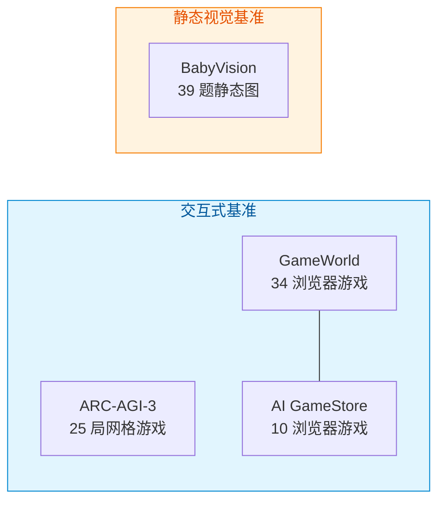

# 04 · 跨基准验证

## 主张与检验

博文的主张是：**同一套 VISTA 框架只需少量适配，就能用于不同的游戏与谜题** [F-040]，并在浏览器游戏、迷宫和连线题中做了验证 [F-009]。

论文用三个附加基准兑现这个主张，全部**使用相同的 GPT-5.6 Sol 模型**，与官方基础框架（minimal harness）对比 [F-056]：

| 基准 | 覆盖内容 | 官方实现 | VISTA | 人类 | 此前最好 | F |
|------|---------|---------|-------|------|---------|---|
| **GameWorld** | 34 个浏览器游戏、5 类题材、170 项任务 | 40.0% | **63.3%** | 55.3% | 20.0% | [F-036][F-056] |
| **AI GameStore** | 10 个公开浏览器游戏 | 47.3 | **140.3** | 100（归一化） | 9.0 | [F-037][F-057] |
| **BabyVision** | 39 题（20 迷宫 + 19 连线） | 41.0% | **63.2%** | 92.3% | 25.7% | [F-038][F-058] |

## 各基准的口径必须分别读

三个基准的分数**不可直接横向比较**——量纲与计分规则完全不同。

### GameWorld：成功率与进度双指标

- **成功率（SR）**定义为 170 项任务中完成的比例 [F-056]。
- 除成功率外论文还报"进度（Progress）"指标：VISTA 79.3%，官方实现 62.9%，新玩家 64.1% [F-056]。
- 人类新玩家成功率 **55.3%**——**低于** VISTA 的 63.3%，但这不等于"VISTA 比人强"：人类基线是首次游玩，且 RHAE 类效率指标并未在此适用。

### AI GameStore：几何平均，不是总分

- 每个游戏的原始分先**按该游戏对应的公开人类中位数归一化为 100**，再对 10 个游戏取**几何平均** [F-057]。
- 因此 140.3 意味着"平均比人类中位数高 40.3%"，而 47.3 意味着"约为人类中位数的一半"。
- 附录 B.1 另给出三次运行的原始聚合值：119.99 / 148.58 / 140.06——**波动很大**（约 ±14），所以"140.3"这个数字本身应理解为特定聚合协议下的代表值，而非稳定量。

### BabyVision：静态图片，不是交互式

- BabyVision 全集为 **388 项任务、22 个子类**；VISTA 评估的是其中 **39 题**（20 道迷宫 + 19 道连线）[F-058]。博文的"选取的 39 道题"表述方向正确，但读者容易误读为全集规模（勘误 E-6）。
- 人类 **92.3%**，VISTA 63.2%，官方实现 41.0% [F-058]。
- **关键点**：这组任务只有**静态图片**，模型也能通过放大局部、检查像素改善判断 [F-039][F-052]。也就是说 BabyVision 验证的是"**视觉检查**"这个组件在无交互场景下同样有效，**而不是**交互式 Harness 的能力。

## 证据强度分析：可迁移性是混合的

> **解读（假设 M5）**：这是本篇最需要读者自己判断的一节。四个基准看起来跨度很大，但按**交互性**与**媒介**两个轴排开，重复度很高。

| 轴 | 分布情况 |
|----|---------|
| **交互性** | ARC-AGI-3 / GameWorld / AI GameStore 均为交互式；**BabyVision 是静态图片**，与"交互式 Harness"这一核心卖点不同源 |
| **媒介** | GameWorld 与 AI GameStore **都是浏览器游戏**，共享大量引擎、渲染管线与视觉分布假设 |
| **视觉分布** | ARC-AGI-3 是离散网格、颜色索引明确；GameWorld / AI GameStore 是连续自然风格渲染；BabyVision 是静态几何图案 |

**结论**：四个基准证明了 **① 方法稳健**（在四个基准上都相对各自基线大幅提升）**与 ② 部分可迁移**（从网格游戏迁移到浏览器游戏、从交互迁移到静态视觉），但**不能**支撑"已证明对任意视觉环境通用"——因为没有覆盖具身/物理世界环境，而这恰是论文自己列出的下一步方向 [F-010][F-069]。

## 与 3D 变体合看：方法有适用边界

ARC-AGI-3 的 3D 重渲染变体得分从 100.00 降到 **84.12**，动作数从 7,302 增至 **20,640** [F-066]。

结合 BabyVision 的静态特性，可以归纳出 VISTA 最适用的画面条件：

| 条件 | 说明 |
|------|------|
| ✅ 网格化 / 离散、颜色边界清晰 | 放大后像素值一一对应，局部检视有效 |
| ✅ 细节在少量关卡中关键 | 原始档案的"期权"价值得以兑现 |
| ⚠️ 连续自然风格渲染 | GameWorld / AI GameStore 仍有效，但提升幅度（+23.3pp）低于 ARC-AGI-3（+59.3pp） |
| ❌ 3D 重渲染 | 明显退化（84.12），动作数激增 |

## 未来方向

论文 §7 明确把"更接近物理世界的具身任务"列为下一步 [F-069]，对应博文的表述 [F-010]。这恰好也是当前证据最薄弱的方向——**尚未验证**。

## 下一步

- 完整局限清单、全部勘误、给读者的行动建议 → [05 局限与实践](05-limitations-and-practice.md)

## 相关

- [事实登记](../references/article-source.md) · [核验与勘误](../references/verification.md) · [知识地图](../references/knowledge-map.md)
