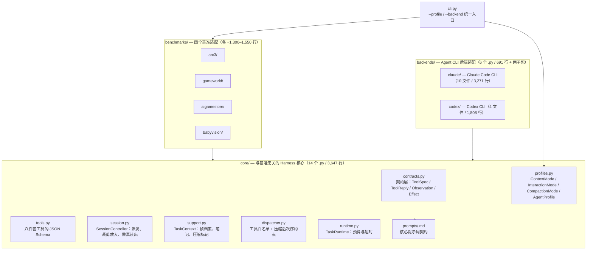

# 06 · 源码架构总览

> 源码固定在 commit `c97c354f0a8948256545a3e8850a1848f8e5b8c1`（2026-10-04），MIT License，**仓库无任何 release tag**，故按 commit 固定 [F-086]。本篇所有源码引用均可回溯到 [源码快照登记](/references/source-code-map.md) 中的固定坐标。

## 一、仓库有多大

先看规模，因为它决定"这是一篇论文的配套实现"还是"一个可独立使用的框架"：

| 指标 | 数量 | F |
|------|------|---|
| 工作树文件（排除 .git） | 104 | [F-087] |
| Python 文件 / 总行数 | 82 / 18,754 行 | [F-087] |
| `def`/`async def` 定义 / 去重函数名 | 705 / 465 | [F-089] |
| `class` 定义 / 去重类名 | 90 / 84 | [F-089] |
| 控制台入口 | 4 个 | [F-090] |

> **读法**：18,754 行、705 个函数——这不是"论文附带的小脚本"，而是一个**有独立工程结构的实现**。但它也不是通用框架：四个基准适配包共占约 5,500 行，其余约 13,000 行是与基准无关的 core 与后端层 [F-088]。这个比例说明 VISTA 的**可复用部分在 core**。

## 二、四层结构



### 契约层（`core/contracts.py`）

所有跨层通信都走**冻结的 dataclass**：`ToolSpec`、`ToolReply`、`ToolBinding`、`ToolExecution`、`Observation`、`ObservationBundle`、`Visual`、`PublicTask`、`SubmissionSpec`，以及三个 StrEnum：`Effect`（工具效果类型）、`Capability`（能力）、`EvidenceKind`（证据种类）[F-131]。

**为什么契约层是这套代码的关键**：VISTA 要同时对接两个**互不相容**的 Agent CLI（Claude Code 与 Codex）、四个**互不相同**的基准环境。冻结 dataclass 让"基准差异"和"后端差异"都退化成实现细节，core 层不需要知道任何具体基准。

### 工具层（`core/tools.py`）

八件套工具的 **JSON Schema 全部集中在这一个文件**里，每个是一个 `build_*_tool()` 函数返回的 dict [F-095][F-096][F-098]。ARC-AGI-3 的 `play` 动作工具另在 `arc3/{claude,codex}/tools.py` 中定义 [F-100]。

注意 `core/tools.py` **不含任何实现逻辑**——它只声明"这个工具长什么样、参数边界在哪"。实现分布在 `core/session.py`（裁剪、放大、采样）与 `core/support.py`（通用任务上下文）[F-096][F-099]。

### 契约与实现的分离带来的一个实际后果

`core/tools.py` 里的 `DEFAULT_DISPLAY_SIZE = 1024` 是**默认值**，而实际使用的 `display_size` 是**从供给的画面尺寸推导**的：`TaskContext` 取所有 visuals 的最大边长，缺省才回落到 1024 [F-104]。ARC-AGI-3 控制器则显式设为 `GRID_SIZE * render_scale` = 64 × 8 = **512** [F-104]——与论文的 512×512 完全一致。

> **这解释了一个初读容易困惑的点**：论文说 512×512，源码里却有一个 1024 的常量。两者不矛盾——1024 是"没有画面时"的兜底，512 是 ARC-AGI-3 的真实渲染尺寸。

## 三、后端层：同一个 Harness，两种压缩策略

两个后端包大小悬殊（Claude 10 文件 / 3,271 行 vs Codex 4 文件 / 1,808 行），差异主要来自 Claude 侧多出的 MCP 桥、凭证池与限流处理 [F-088]。

### 压缩策略按后端分叉（这是最值得注意的一处工程事实）

| 后端 | 压缩机制 | 入口函数 | F |
|------|---------|---------|---|
| Claude Code | **原生压缩**（native） | `run_task_with_native_context` | [F-108] |
| Codex | **检查点交接**（checkpoint-handoff） | `run_task_with_compact_checkpoints` | [F-108] |

`core/profiles.py` 的 `CompactionMode` 枚举把两者显式建模为 `native` 与 `checkpoint-handoff` [F-108]。

- **Claude 侧**：自动压缩窗口 1,000,000、90% 触发 [F-108]。
- **Codex 侧**：由模型上下文窗口推导预算——`DEFAULT_MODEL_CONTEXT_WINDOW = 272000`（适用 `gpt-5.4/5.5/5.6-` 前缀）、回落 128,000、硬预留 32,000、回合余量 40,000 [F-109]。

Codex 侧的交接是**注入式**的：压缩边界上注入一条内部指令，要求模型"Call save_compact_checkpoint now as your first and only action, then end this turn"，且 `core/dispatcher.py` 在压缩边界后**拒绝**先调用其他工具 [F-122]。

> **解读（假设）**：把 `save_compact_checkpoint` 做成**跨后端通用的工具**、而把"何时触发"做成后端特定，是这套设计里最见功力的一处。工具语义统一在 core，触发时机贴着各 CLI 的实际压缩行为——这让论文里"上下文交接"这一句话在两个完全不同的运行时上都能落地 [F-128]。

### 模型与推理强度

| 后端 | 默认模型 | 默认强度 | 可选强度 |
|------|---------|---------|---------|
| Codex | `gpt-5.6-sol` | `max` | minimal / low / medium / high / xhigh / max / ultra |
| Claude | `opus` | `xhigh` | low / medium / high / xhigh / max |

竞争模式（`--operation-mode competition`）默认 Claude effort 为 `xhigh` [F-110]。

> 这直接印证了论文表 1 的 effort 列：Opus 5.0 用 **xhigh**、GPT-5.6 Sol 用 **max** [F-077]。源码里的默认值与论文表格**逐格吻合**。

## 四、基准层：同一套工具，四种环境

四个基准包结构**大体同构但并非一致**：gameworld / aigamestore / babyvision 三者都有 `profiles.py`（工具装配 + 提示词）、`run.py`（回合循环）、`session.py`（会话）与各自的 `cli.py`；**arc3 例外**——它没有 `profiles.py`（对应文件是单数 `profile.py`），也没有 `session.py`（会话逻辑落在 `arc3/{claude,codex}/controller.py`），且 `cli.py` 也不存在（入口是 `arc3/{claude,codex}/harness.py`）[F-088]。

`gameworld` 与 `aigamestore` 的 `profiles.py` 各定义一份**内容完全一致**的 `VISTA_TOOLS` 八元组 [F-095]：

```python
VISTA_TOOLS = ('inspect', 'read_pixels', 'history', 'read_guide',
               'write_guide', 'read_working', 'write_working',
               'save_compact_checkpoint')
```

> **这是一条重要的实现事实**：论文把工具分成"视觉三件套"与"笔记两件套"，源码则把**八个工具平铺成同一层**——`read_guide`/`write_guide`/`read_working`/`write_working` 是与 `inspect`/`read_pixels` 同级的工具，而不是文件系统旁路 [F-095]。换句话说，模型访问 `GUIDE.md` 是**通过工具调用**，不是自己去读文件。

### 各基准的差异点

| 基准 | 协议常量 | 规模常量 | F |
|------|---------|---------|---|
| ARC-AGI-3 | 8 个动作 + 逐回合渲染 | `DEFAULT_MAX_STEPS = 2000`、`DEFAULT_MAX_INVALID_RETRIES = 15`、25 个游戏 ID | [F-101][F-111][F-112] |
| GameWorld | `gameworld-computer-use` | `PRIMARY_STEPS = 100`（每任务 100 步） | [F-116] |
| AI GameStore | `aigamestore-segmented-input` | `PUBLIC_GAMES = range(1,11)`、每次决策 5 段 × 0.2 秒、`MAX_DECISIONS = 120` | [F-115] |
| BabyVision | `babyvision-mllm-one-question-final-answer` | 默认任务集 `tracking48`（48 题、三子类） | [F-114] |

BabyVision 的协议常量本身就说明了它的定位：**一问一答、末次 boxed 答案**，没有游戏、没有环境动作——源码的共享指令原文是 "there is no game, no environment action, and nothing to explore beyond it" [F-114]。这与论文"BabyVision 验证的是视觉检查组件在无交互场景同样有效"的判断一致。

### 动作语义的精确口径

ARC-AGI-3 的 `play` 工具描述给出了全部 8 个动作的语义与键位绑定 [F-101]：

| 动作 | 语义 | 键位 |
|------|------|------|
| `RESET` | 初始化或重启游戏/关卡 | — |
| `ACTION1`–`ACTION4` | 通常为上/下/左/右 | W/↑ · S/↓ · A/← · D/→ |
| `ACTION5` | 交互类动作（选择、旋转、附加、分离、执行等） | Space / F |
| `ACTION6` | **坐标动作**（鼠标点击） | 鼠标点击 |
| `ACTION7` | **Undo**（回到上一状态） | Ctrl / Cmd+Z |

`ACTION6` 使用与 `inspect` 的 region **同一套 `display_size × display_size` 坐标系**（x 向右、y 向下）[F-097][F-101]。

> **一处必须更正的旧口径**：ARC-AGI-3 技术报告 §2.3.2 原文是 "a subset of: Five key actions, plus an Undo action…; **One action to select (e.g. click on) a cell from the 64x64 grid by specifying its coordinates**"——即除五个关键动作与 Undo 外**还有一类坐标选择动作**，本束先前事实 F-084 遗漏了它，已按 [F-126] 更正（勘误 E-10）。

## 五、跨基准共享的安全与稳定性设计

| 机制 | 内容 | F |
|------|------|---|
| 凭证隔离 | `FORBIDDEN_SUBPROCESS_CREDENTIALS = ('CLAUDE_CODE_OAUTH_TOKEN','ANTHROPIC_API_KEY','ARC_API_KEY')`——MCP 子进程不得携带凭证 | [F-117] |
| 动作不重放 | `ArcHTTPAdapter` 的 docstring：\"Use fresh connections and never replay a submitted game action.\" | [F-120] |
| 环境超时 | 连接 10 秒 / 读取 120 秒 / 重连 3 次；任务总上限 2,000,000 秒 | [F-120] |
| 基础设施终止原因 | 5 类：`compact_recovery_failed`、`controller_error`、`environment_response_missing`、`retry_boundary_interrupt_failed`、`visual_transport_failed` | [F-119] |
| 恢复上限 | 压缩无动作循环上限 3、运行期恢复上限 8/步、决策租约恢复上限 5/步；5xx 退避 10/30/60/120 秒 | [F-119] |

> **解读（假设）**："never replay a submitted game action" 这条约束值得单独看——在交互式基准里，**重发一个动作**比崩溃危险得多，因为它会污染动作计数从而直接污染 RHAE 分母。把它写成传输层（HTTP Adapter）的不变量而不是业务层的判断，说明作者清楚指标对动作计数的敏感性。

## 六、源码覆盖不到的部分

| 论文/基准要素 | 源码状态 | F |
|--------------|---------|---|
| ARC-AGI-3 私有/半私有集（55+55） | **无适配逻辑**——`STANDARD_GAME_ORDER` 与 HTTP 层只覆盖 25 个公开局 | [F-130] |
| BabyVision 论文评估的 39 题 | 默认任务集是 `tracking48`（48 题、三子类），需用 `--subtypes 'Maze\|Connect the lines'` 收窄 | [F-114][F-130] |
| 论文的多次运行方差 | 源码提供批量编排，但方差由使用者汇总 | [F-130] |

## 七、下一步

- 八个工具的实现细节（裁剪、量化、符号表）→ [07 工具与记忆实现](07-tooling-and-memory-implementation.md)
- 怎么把它跑起来 → [08 复现与运维](08-reproduction-and-operations.md)
- 论文每一节对应源码哪一行 → [09 论文与源码映射](09-paper-source-mapping.md)

## 相关

- [源码快照登记](/references/source-code-map.md) · [论文谱系与阅读地图](/references/paper-reading-map.md) · [事实登记](/references/article-source.md)
- [01 三组件机制](01-visual-harness-components.md)：本文的源码层与该篇的论文层一一对应
